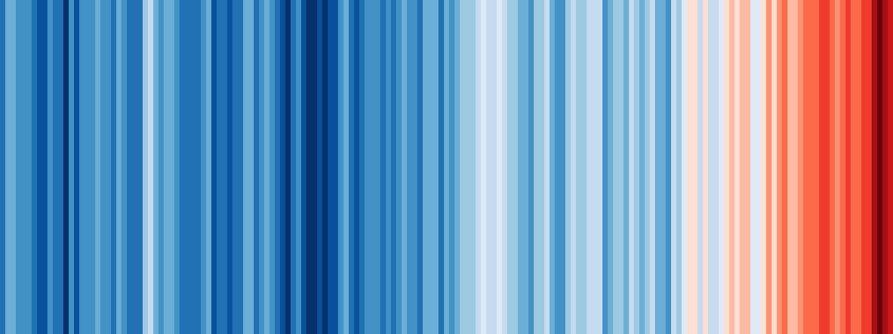

<!--
author:   Juliana Hilf; Hannes Tegelbeckers
email:    juliana.hilf@ovgu.de
version:  1.0.0
language: en
mode:     Textbook
narrator: UK English Female
comment:  GIZ Sustainability Onboarding – Session 1: Introduction to Sustainability. Self-paced, unmoderated. Licence: CC BY-SA 4.0 [CHECK: confirm with GIZ]
-->

# GIZ Sustainability Onboarding 1 – Introduction to Sustainability

**Estimated time:** 10–15 minutes · **Format:** main-topic overview, self-paced, 6 short pages

After this session you can:

- describe the historical emergence of the term "sustainability" and recognise key milestones in its development.

> **How this works:** There is no tutor in this course. Every quiz explains its answer, and every reflection question has an expert view you can compare with. Your notes go into your personal **learning journal** in Moodle – nobody grades them.

## Why this topic matters

Sustainability is not a new word, but it is not a scientific term either. As the sustainability researcher Juliana Hilf puts it: "The concept of sustainable development is not the result of scientific research; instead, it is an ethically grounded concept." In plain words: it is about what we *owe* to the environment, to people today, and to people who will come after us.

You may have heard the word in EU project texts or in Ministry documents. This session gives you a stable starting point: why the topic matters, where the word comes from, and what the key milestones are. You do not need any prior knowledge.

Unsustainable development is not an abstract idea. It shows up in concrete problems:

- **Deforestation** leads to loss of biodiversity, disrupts water cycles and contributes to climate change.
- **Plastic pollution:** 400 million tons of plastic are produced every year. Each day, over 2,000 garbage trucks' worth of plastic waste ends up in oceans, rivers and lakes.
- **Biodiversity loss:** coral reefs are dying off because of ocean acidification and rising temperatures; this affects the livelihoods of people who depend on reef ecosystems.
- **Gender inequality:** women are more affected by extreme weather events, because they often have limited access to resources, decision-making power and mobility.
- **Climate change:** more extreme weather events such as heatwaves, extreme rain, hurricanes, dry periods and floods.

The scientific evidence behind these problems comes, among others, from the **IPCC** (Intergovernmental Panel on Climate Change) – the UN body for the scientific assessment of climate change. It provides the basis for science-based policy decisions without recommending political action. Its 2023 Synthesis Report concludes that global warming today is already about 1.1 °C, that a liveable future is still possible – but that emissions must fall faster than they have so far. (Here "pre-industrial level" means the average temperature between 1850 and 1900, before industrial heating of the climate.)

The video below introduces the topic in three minutes.

Watch for: how the video connects environment, society and economy, and which everyday examples it uses to explain sustainability.

!?[What is Sustainability](https://www.youtube.com/watch?v=zx04Kl8y4dE "UCLA – What is Sustainability (3:06)")

**Check:** Which statement about the temperature record is correct?

- [(X)] 2024 was the first calendar year with a global average temperature of about 1.60 °C above the pre-industrial level.
- [( )] The Paris goal has already been missed, because one year was above 1.5 °C.
- [( )] The IPCC recommends political action to governments.
[[?]] Think about how the Paris goal counts temperature: one single year, or an average over many years?
****************************************
**2024 was the first calendar year** with a global average temperature of about 1.60 °C above the pre-industrial level. The Paris goal refers to an average over at least 20 years, so one year above 1.5 °C does not yet mean the goal has been missed. And the IPCC deliberately does not recommend political action – it only provides the scientific basis for decisions.
****************************************

## The big picture

This image shows the global average temperature from 1850 to 2018. Each stripe is one year; blue means a cooler year, red means a warmer year. Look at the direction of travel: the stripes shift from blue to red.

*Image: Warming stripes (global, WMO, 1850–2018) – Ed Hawkins (University of Reading) – CC BY-SA 4.0 – via Wikimedia Commons – unchanged*

This session is the entry point to the topic. It is short by design: it orients you and shows you where to go next. The two subtopics below carry the learning content.

| # | Title | What you will learn | Time |
|---|---|---|---|
| 1_1 | Origin of the term "sustainability" | Where the term comes from and how it was used early on in environmental and resource management debates | 25 min |
| 1_2 | Historical milestones of sustainability debates | The central milestones in the history of sustainability – major reports, conferences and policy agreements | 25 min |

And the story starts much earlier than any report. In 1713, the German forester Hans Carl von Carlowitz published *Sylvicultura oeconomica* – the title page is shown below. In it he uses the German term for sustainable forestry ("nachhaltende Nutzung"). Session 1_1 tells you the full story.

 – public domain")

*Image: Sylvicultura oeconomica, title page – Hans Carl von Carlowitz (1713) – public domain – via Wikimedia Commons – unchanged*

In Serbia, this work is already underway: the GIZ project "Teaching skills for green transformation" (Serbia, Jan 2024 – Dec 2026, partner: Ministry of Education) revises VET programmes to include green skills. This course is part of that project.

## Where do you start?

Before you dive in, take a quick look at what you already know. This is a self-assessment – there is no right or wrong answer.

**Self-assessment:** How familiar are you with these terms?

[(I know it well)(I have heard of it)(It is new to me)]
[                                                    ] Brundtland definition
[                                                    ] Carlowitz
[                                                    ] Agenda 2030
[                                                    ] IPCC

Which subtopic should you start with?

- If **Brundtland definition** and **Carlowitz** are new to you: start with **1_1 – Origin of the term "sustainability"**. It explains where the word comes from, and that is the foundation for everything else.
- If you already know the origin, but **Agenda 2030** or **IPCC** feel vague: start with **1_2 – Historical milestones of sustainability debates**. It walks you through the reports, conferences and agreements step by step.
- If you know all four terms well: you can read 1_1 quickly and spend most of your time in 1_2, where the milestones are discussed in depth.

## Warm-up check

These four questions are a warm-up, not an exam. Every question explains its answer.

**Check:** Who wrote the Brundtland definition of sustainable development?

- [( )] The IPCC, in its 2023 Synthesis Report
- [(X)] The World Commission on Environment and Development (WCED), in 1987
- [( )] The Club of Rome, in *The Limits to Growth*
[[?]] The report is called *Our Common Future*.
****************************************
The Brundtland definition comes from the report *Our Common Future*, written in 1987 by the World Commission on Environment and Development (WCED). The Club of Rome report *The Limits to Growth* is an earlier milestone from 1972, not the source of the definition. The IPCC provides the scientific assessment of climate change – it does not define development.
****************************************

**Check:** Which of the following are named as problems of unsustainable development in this session? (Select all that apply.)

- [[X]] Deforestation, with loss of biodiversity and disrupted water cycles
- [[X]] Plastic pollution in oceans, rivers and lakes
- [[ ]] A shortage of teachers in VET schools
- [[X]] Dying coral reefs that affect people's livelihoods
[[?]] The session names five problem areas – environment, plastic, biodiversity, gender, climate.
****************************************
Deforestation, plastic pollution and biodiversity loss (dying coral reefs) are all named as problems of unsustainable development. A teacher shortage is a real challenge in education, but it is not one of the problems listed in this session – keep the two types of challenge separate.
****************************************

**Check:** Match each milestone to its year.

- [ [1713] [1987] [2015] ]
- [ (X)    ( )    ( )    ]  First use of the term in forestry
- [ ( )    (X)    ( )    ]  Brundtland Report *Our Common Future*
- [ ( )    ( )    (X)    ]  *Agenda 2030* with the 17 Sustainable Development Goals; Paris Agreement
[[?]] Think in three steps: a forestry rule in the 1700s, a global report in the 1980s, and a set of global goals in 2015.
****************************************
**1713:** Hans Carl von Carlowitz uses the German term for sustainable forestry ("nachhaltende Nutzung"). **1987:** the Brundtland Report *Our Common Future* brings the term into global development policy. **2015:** *Agenda 2030* with the 17 Sustainable Development Goals and the Paris Agreement turn sustainability into a set of concrete, global goals. Session 1_2 shows you the full timeline.
****************************************

## Learning journal

Take a moment to think about the short African paraphrase of the Brundtland definition, used in Juliana Hilf's trainings: **"Enough, for everyone, forever."**

> **Learning journal:** Which of the three words – *enough*, *for everyone*, *forever* – is the biggest challenge for VET in Serbia? Write 3–5 sentences about your choice.

Compare with an expert view

All three words are defensible, and a good answer names the trade-off. A **ministry officer** might choose *forever*: VET programmes shape the workforce of coming decades, and the green and sustainable transition is one of the central challenges of TVET – together with economic transformation, technological transition, digitalisation and demographic transition. A **school developer** might choose *for everyone*: green skills must reach all schools, including in regions where the economy is changing fastest, not only well-resourced ones. A **principal** might choose *enough*: a school must deliver green competences with the budget, staff and equipment it actually has. UNESCO's 2022 strategy frames the task of TVET as helping develop skills for all people to work, live and learn – for inclusive and sustainable economies and for inclusive and peaceful societies. Whichever word you chose, your answer should connect it to a concrete decision you can influence.

## Sources and licences

- Hilf, J. (2024): *Introduction to the Sustainability Approach*. Capacity building for GIZ, Day 1 – OVGU/GIZ – text and structure adapted
- World Commission on Environment and Development (1987): *Our Common Future*. Oxford University Press – quoted
- IPCC (2023): *Climate Change 2023: Synthesis Report. Summary for Policymakers* – https://www.ipcc.ch/report/ar6/syr/ – summarised
- Copernicus Climate Change Service (2025): *Copernicus: 2024 is the first year to exceed 1.5 °C above pre-industrial level* – https://climate.copernicus.eu/copernicus-2024-first-year-exceed-15degc-above-pre-industrial-level – summarised
- OVGU/GIZ (2026): *Introduction to Sustainability – an interactive micro-course* (internal German draft, Session_1) – adapted
- GIZ: *Teaching skills for green transformation* – https://www.giz.de/en/worldwide/123790.html – linked
- UNESCO (2022): *Transforming TVET for successful and just transitions. UNESCO strategy 2022–2029* – summarised
- Video: UCLA – *What is Sustainability* – https://www.youtube.com/watch?v=zx04Kl8y4dE – embedded (YouTube licence)
- Image: Ed Hawkins – *Warming stripes (global, WMO, 1850–2018)* – CC BY-SA 4.0 – https://commons.wikimedia.org/wiki/File:20181204_Warming_stripes_(global,_WMO,_1850-2018)_-_Climate_Lab_Book_(Ed_Hawkins).png – unchanged
- Image: Carlowitz (1713) – *Sylvicultura oeconomica*, title page – public domain – https://commons.wikimedia.org/wiki/File:Carlowitz_Sylvicultura.jpg – unchanged
