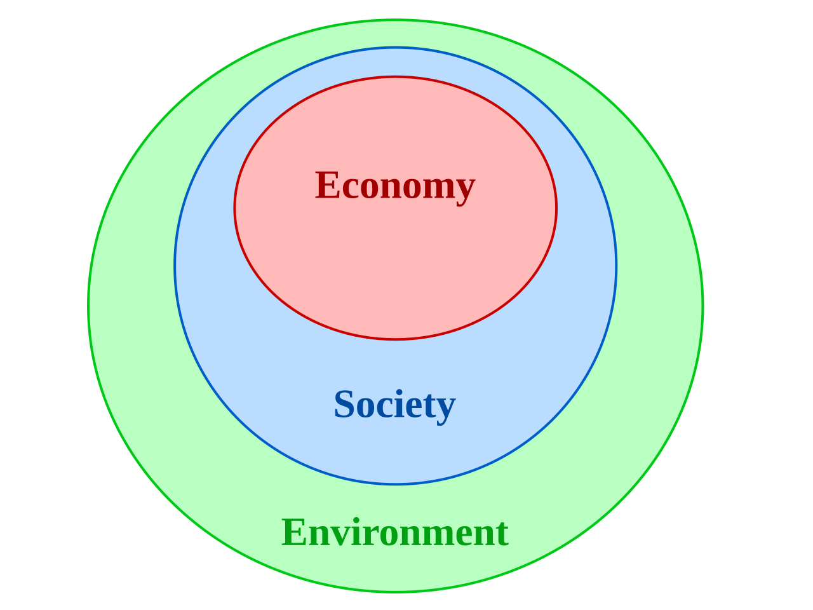
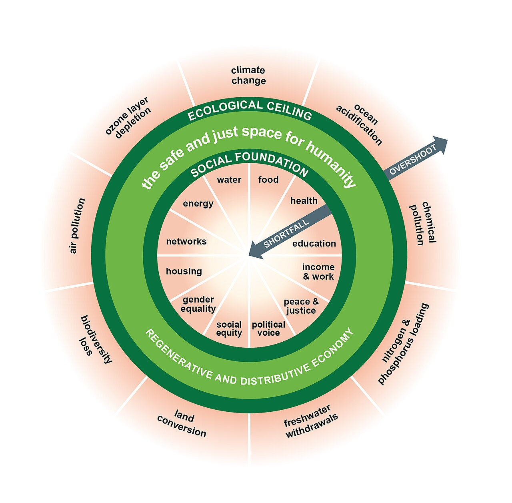

<!--
author:   Juliana Hilf; Hannes Tegelbeckers
email:    juliana.hilf@ovgu.de
version:  1.0.0
language: en
mode:     Textbook
narrator: UK English Female
comment:  GIZ Sustainability Onboarding – Session 2_2: Models of sustainability. Self-paced, unmoderated. Licence: CC BY-SA 4.0 [CHECK: confirm with GIZ]
-->

# GIZ Sustainability Onboarding 2_2 – Models of sustainability

**Estimated time:** 25 minutes · **Format:** self-paced, 5 content pages + a Serbia page + final self-check

After this session you can:

- distinguish between selected models of sustainability, for example the three-pillar model or the doughnut model,
- explain what each model allows and what it forbids – trade-offs versus hard limits,
- discuss their implications for practice, for example for a decision about a VET school programme.

> **How this works:** There is no tutor in this course. Every quiz explains its answer, and every reflection question has an expert view you can compare with. Your notes go into your personal **learning journal** in Moodle – nobody grades them.

Part of: Session 2 – Basic Concepts and Policies.

## 1 Model 1: The three pillars

The best-known model describes sustainability as three dimensions that must be balanced: **ecological**, **social** and **economic**. Researchers Purvis, Mao and Robinson (2019) searched for the conceptual origins of this model.

 – CC BY-SA 3.0")

*Image: Sustainable development.svg – Johann Dréo (nojhan) – CC BY-SA 3.0 – via Wikimedia Commons – unchanged*

**Strengths:** the model is easy to communicate. It shows that sustainability is more than environmental protection.

**Critique:** the picture suggests that the three dimensions are equal and can be **traded against each other** – for example, economic gains "compensating" for ecological damage. Some authors therefore add a **fourth dimension**, such as culture or governance (Michelsen et al. 2016; Mulligan 2018).

**Check:** Which statement best captures the main critique of the three-pillar model?

- [( )] It is too complicated to communicate to a school board.
- [(X)] It suggests the three dimensions are equal and can be traded against each other.
- [( )] It ignores the economic dimension completely.
[[?]] Think about what a picture of three *equal* pillars implies for a decision that has winners and losers.
****************************************
The pillar picture invites "balancing" – for instance, economic gains "compensating" for ecological damage. Its strengths are real: it is easy to communicate and it shows that sustainability is more than environmental protection. Ignoring the economy is the opposite of its message.
****************************************

> **Learning journal:** Which pillar gets the most attention in your institution today – and which the least? What does that tell you about how sustainability is understood there?

Compare with an expert view

In many VET schools the **economic pillar** gets the most attention: placement rates, company partnerships and labour-market relevance are the daily language. The **ecological pillar** often gets the least, appearing as energy-saving measures rather than a design principle. A ministry officer might read the same imbalance in funding rules: money follows programmes, not environmental impact. A school developer might see it in curricula that mention "green" only in one elective. None of these readings is wrong – the point is to notice which pillar your institution defaults to, because that reveals which trade-offs are invisible there.

## 2 Model 2: The nested model

The **nested model** (sometimes called the "Russian-doll" model) draws the same three dimensions differently: the **economy sits inside society**, and **society sits inside the environment**. The economy depends on society, and both depend on the environment.

*Image: Nested sustainability-v2.svg – KTucker – CC BY-SA 3.0 – via Wikimedia Commons – unchanged*

This visual is the counter-image to equal pillars: nothing can happen outside the environment, so the environment sets the frame. It links to the idea of **strong sustainability** from Session 2_1: the ecological dimension is not exchangeable.

**Check:** Choose the right word: In the nested model, the economy is drawn [[(inside society, and society inside the environment)|on top of the environment|as one of three equal pillars].

****************************************
The nested model is a picture of **dependence**: the economy needs society to function, and both need the environment to exist at all. That is why trade-offs are limited – the environment sets the frame, it does not sit next to the other two dimensions as an equal partner.
****************************************

## 3 Model 3: The doughnut

Kate Raworth's **doughnut model** draws two boundaries:

- an inner ring, the **social foundation** – the minimum every person needs (for example food, health, education, work),
- an outer ring, the **ecological ceiling** – the planetary limits humanity should not overshoot.

The **safe and just space for humanity** lies **between** the two rings. Falling short of the social foundation is a **shortfall**; overshooting the ecological ceiling is an **overshoot**. Both are failures. Unlike the pillar model, the doughnut does **not** allow trade-offs. The economy is a means, not a pillar of equal weight. The Doughnut Economics Action Lab describes 12 dimensions of the social foundation and 9 planetary boundaries of the ecological ceiling [CHECK: Juliana – confirm we want these numbers on the page].

*Image: Doughnut (economic model) – Kate Raworth / Doughnut Economics Action Lab – CC BY-SA 4.0 – via Wikimedia Commons – unchanged*

First, a short introduction to the model. It takes about 90 seconds. Watch for the two rings and where the "safe and just space" is.

!?[What is Doughnut Economics? – with Kate Raworth](https://www.youtube.com/watch?v=kxQeb2PDz9M "What is Doughnut Economics? – with Kate Raworth (1:36)")

**Question:** In one sentence: what do the two rings of the doughnut stand for? (No right answer here – check your understanding with the next quiz.)

Now the longer talk, in Kate Raworth's own words. It is about 16 minutes, so it is fine to watch it in parts. Watch for the two rings and what "overshoot" and "shortfall" mean in her picture.

!?[A healthy economy should be designed to thrive, not grow](https://www.youtube.com/watch?v=Rhcrbcg8HBw "TED – Kate Raworth: A healthy economy should be designed to thrive, not grow (about 16 min)")

**Check:** Which statements describe the doughnut model? (Select all that apply.)

- [[X]] It defines a lower social limit and an upper ecological limit.
- [[ ]] It treats ecology, society and economy as equal and exchangeable.
- [[X]] Economic activity is a means to stay inside the safe and just space.
- [[ ]] Falling short of the social foundation is acceptable if the economy grows.
[[?]] Remember: in the doughnut, both going below the inner ring and going above the outer ring count as failure.
****************************************
The doughnut defines a **floor** (the social foundation) and a **ceiling** (the ecological limits). The economy is a means, not a pillar of equal weight – so treating the dimensions as exchangeable is exactly what the model rejects. And shortfall and overshoot are both failures: growth does not "buy" a pass for missing social needs.
****************************************

## 4 Model 4: The SDG "wedding cake"

The Stockholm Resilience Centre (2016) arranged the Sustainable Development Goals as a **wedding cake**: biosphere-related goals form the **base layer**, society goals the **middle layer**, economy goals the **top**. Economies and societies are embedded in the biosphere. (The original graphic is linked in the sources – it is not copied here.)

**Watch for:** the order of the layers. The video is under two minutes. It shows why the biosphere sits at the bottom of the cake.

!?[Wedding Cake model of the Sustainable Development Goals](https://www.youtube.com/watch?v=Wu8xvzIPRhM "Lyndsay Walsh – Wedding Cake model of the Sustainable Development Goals (1:42)")

**Question:** In one sentence: why does the biosphere sit at the bottom of the cake? (No right answer here – check your understanding with the sorting quiz below.)

The grouping used in this course is (Hilf 2026):

| Layer | SDGs |
| ----- | ---- |
| **Environment** – the foundation | 6, 13, 14, 15 |
| **Society** – the core | 1, 2, 3, 4, 5, 11, 16 |
| **Economy** – the challenge | 8, 9, 10, 12 |

**Check:** Sort each SDG into the layer it belongs to (in this course's grouping).

- [ [Environment] [Society] [Economy] ]
- [ (X)    ( )    ( )    ]  SDG 6
- [ ( )    (X)    ( )    ]  SDG 4
- [ ( )    ( )    (X)    ]  SDG 8
- [ (X)    ( )    ( )    ]  SDG 13
- [ ( )    (X)    ( )    ]  SDG 1
- [ ( )    ( )    (X)    ]  SDG 12
[[?]] The foundation layer holds 6, 13, 14, 15; the core holds 1, 2, 3, 4, 5, 11, 16; the challenge holds 8, 9, 10, 12.
****************************************
SDGs **6** (water) and **13** (climate) belong to the **environment** foundation; SDGs **4** (education) and **1** (no poverty) belong to the **society** core; SDGs **8** (decent work) and **12** (responsible consumption and production) belong to the **economy** challenge. The order of the layers is the point: the economy rests on society, and both rest on the biosphere.
****************************************

## 5 Compare the models

| | Three pillars | Nested | Doughnut |
|---|---|---|---|
| Picture | three equal pillars / overlapping circles | circles inside each other | ring between floor and ceiling |
| Trade-offs | possible ("balance") | limited – environment sets the frame | not allowed – two hard limits |
| Fits | weak sustainability | strong sustainability | strong sustainability + social justice |
| Good for | starting a conversation | showing dependence on nature | decisions involving limits |

**Check:** Match each feature to the model it belongs to.

- [ [Three pillars] [Nested] [Doughnut] [Wedding cake] ]
- [ (X)    ( )    ( )    ( )    ]  Allows trade-offs ("balance")
- [ ( )    (X)    ( )    ( )    ]  Economy inside society, society inside the environment
- [ ( )    ( )    (X)    ( )    ]  Two hard limits – no trade-offs
- [ ( )    ( )    ( )    (X)    ]  SDGs as layers, biosphere at the base
[[?]] Ask for each model: what does its picture *forbid*? The pillars allow balancing; the doughnut allows nothing outside the rings.
****************************************
The **three-pillar** picture is the one that allows trade-offs – that is also its main critique. The **nested** model shows dependence: economy inside society inside the environment. The **doughnut** sets two hard limits and forbids trade-offs. The **wedding cake** arranges the SDGs in layers with the biosphere at the base.
****************************************

**Your view:** Which model would you use to explain green transformation to each group? (No right answer – there is no grading here.)

[(Three pillars)(Nested)(Doughnut)(Wedding cake)]
[                                  ] With ministry colleagues
[                                  ] With teachers
[                                  ] With company partners

Many practitioners use the **pillars to start a conversation** and the **doughnut to guide decisions**. Notice where your own answers differ from that pattern – that is useful information for the Serbia page below.

## 6 What this means in Serbia

In 2024, electricity in Serbia relied on **lignite** (low-quality coal) for about **60 %**, with hydro supplying most of the rest; gas about 5 %, wind about 3 %. The **Kolubara** mining basin supplies about 75 % of the lignite used by the state power company EPS.

Now apply the models to this situation:

- In the **three-pillar model**, jobs in coal regions (social, economic) can be "balanced" against emissions (ecological).
- In the **doughnut**, both the social floor (decent jobs for coal workers) and the ecological ceiling (climate) are **hard limits** – the question becomes *how* to move into the safe space: a just transition, new green skills.

**Check (scenario):** You are a principal. A company partner asks your school to expand a programme that trains workers for a resource-intensive industry in a coal region. Which model helps you discuss this most productively with the school board?

- [( )] The three-pillar model – because it lets the board balance jobs and emissions freely.
- [(X)] The doughnut model – because it keeps decent work and climate both as hard limits, and focuses the discussion on *how* to move into the safe space.
- [( )] The nested model – because it shows that the economy is the most important part.
[[?]] Think about which model stops the board from "paying" for jobs with the climate.
****************************************
The doughnut frames **both** sides as hard limits: decent work for coal-region workers (social foundation) and the climate (ecological ceiling). The discussion then shifts from "jobs *or* climate" to "how do we get into the safe space – for example through a just transition and new green skills". The pillar framing invites exactly the trade-off the critique warns about. The nested model shows dependence on nature – the opposite of "the economy is most important".
****************************************

> **Learning journal:** Explain one model from this session in three sentences, and apply it to one VET programme in Serbia. (This is the template assessment for this session – write it into your learning journal.)

Compare with an expert view

A strong answer names the model, states its core rule, and then makes a concrete programme-level claim. For example, with the **doughnut**: "The doughnut sets a social floor and an ecological ceiling, and allows no trade-offs between them. For a VET school in a coal region, that means a programme for battery maintenance and renewable-installation work is not a 'green alternative' to the old programme – it is the way to keep the social floor (decent local work) while respecting the ceiling (climate)." A ministry officer might apply the same model to funding rules: funds for new green occupations do not "compensate" for closing coal-linked programmes, because both floors and ceilings are hard limits. A school developer might apply the **nested** model instead: every programme decision sits inside the local labour market, and that sits inside the regional energy system. All three readings are valid – what matters is that the model's rule (trade-offs allowed or forbidden) drives the claim.

## Final self-check

Pass mark: 70 %. You can repeat the check as often as you like.

**1.** What is the main critique of the three-pillar model?

- [( )] It is too complicated to communicate.
- [(X)] It suggests that damage in one dimension can be compensated by gains in another.
- [( )] It ignores the social dimension.
****************************************
Treating the pillars as equal implies they can be traded against each other – for example, economic gains "compensating" for ecological damage. Models like the doughnut set limits instead.
****************************************

**2.** Complete the sentence: In the doughnut model, the safe and just space lies between the social foundation and the ecological ______.

[[ceiling]]
****************************************
The doughnut has a **floor** (social foundation) and a **ceiling** (ecological limits). The safe and just space is the ring between them.
****************************************

**3.** Which statements apply to the nested model? (Select all that apply.)

- [[X]] The economy is drawn inside society.
- [[X]] Society is drawn inside the environment.
- [[ ]] The economy is one of three equal dimensions.
- [[ ]] It allows trade-offs in the same way as the three-pillar model.
****************************************
The nested model is a picture of **dependence**: the economy depends on society, and both depend on the environment. That is why the environment sets the frame and trade-offs are limited – the opposite of the equal-pillar picture.
****************************************

**4.** Sort each SDG into the layer it belongs to (in this course's grouping).

- [ [Environment] [Society] [Economy] ]
- [ (X)    ( )    ( )    ]  SDG 14
- [ ( )    ( )    (X)    ]  SDG 10
- [ ( )    (X)    ( )    ]  SDG 3
- [ (X)    ( )    ( )    ]  SDG 15
[[?]] Foundation: 6, 13, 14, 15 · Core: 1, 2, 3, 4, 5, 11, 16 · Challenge: 8, 9, 10, 12.
****************************************
**14** and **15** belong to the **environment** foundation; **3** belongs to the **society** core; **10** belongs to the **economy** challenge.
****************************************

**Check:** In the SDG "wedding cake", where do biosphere-related goals sit?

- [( )] At the top
- [(X)] At the base
- [( )] In the middle

****************************************
The wedding cake places the **biosphere at the base**, society in the middle and the economy on top: economies and societies are embedded in the biosphere.
****************************************

**6.** In 2024, about what share of electricity in Serbia came from lignite?

- [( )] About 20 %
- [(X)] About 60 %
- [( )] About 90 %
****************************************
Lignite supplied about **60 %** of Serbia's electricity in 2024; hydro supplied most of the rest, gas about 5 % and wind about 3 %.
****************************************

## Sources and licences

- Hilf, J. (2024): *Introduction to the Sustainability Approach* – GIZ training, Day 1 – adapted
- Hilf, J. (2025): *Models of Sustainability …* – GIZ workshop – adapted
- Hilf, J. (2026): *Green TVET – Concepts and practical approaches* – expert input – adapted (SDG grouping)
- Hilf, J. (2026): *C1 Sustainability: origins and concepts* (course sample) – adapted
- Purvis, B., Mao, Y. & Robinson, D. (2019): *Three pillars of sustainability: in search of conceptual origins*. Sustainability Science 14, 681–695 – https://doi.org/10.1007/s11625-018-0627-5 – via Hilf – linked
- Michelsen, G. et al. (2016); Mulligan, M. (2018): *An Introduction to Sustainability*. Routledge – via Hilf – linked
- Doughnut Economics Action Lab: *What is the Doughnut?* – https://doughnuteconomics.org/tools/what-is-the-doughnut – CC BY-SA 4.0 – summarised
- Stockholm Resilience Centre (2016): *The SDGs wedding cake* – https://www.stockholmresilience.org/research/research-news/2016-06-14-the-sdgs-wedding-cake.html – linked (graphic not copied)
- CEE Bankwatch Network: *The energy sector in Serbia* – https://bankwatch.org/beyond-coal/the-energy-sector-in-serbia – summarised
- TED – Kate Raworth: *A healthy economy should be designed to thrive, not grow* – https://www.youtube.com/watch?v=Rhcrbcg8HBw – embedded
- *What is Doughnut Economics? – with Kate Raworth* – https://www.youtube.com/watch?v=kxQeb2PDz9M – embedded
- Lyndsay Walsh: *Wedding Cake model of the Sustainable Development Goals* – https://www.youtube.com/watch?v=Wu8xvzIPRhM – embedded
- Kate Raworth / Doughnut Economics Action Lab: *Doughnut (economic model)* – CC BY-SA 4.0 – https://commons.wikimedia.org/wiki/File:Doughnut_(economic_model).jpg – unchanged
- Johann Dréo (nojhan): *Sustainable development.svg* – CC BY-SA 3.0 – https://commons.wikimedia.org/wiki/File:Sustainable_development.svg – unchanged
- KTucker: *Nested sustainability-v2.svg* – CC BY-SA 3.0 – https://commons.wikimedia.org/wiki/File:Nested_sustainability-v2.svg – unchanged
