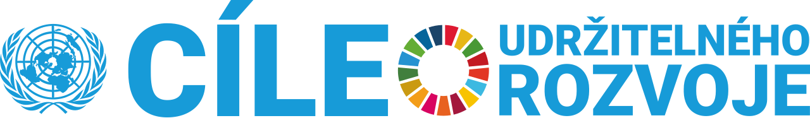

<!--
author:   Juliana Hilf; Hannes Tegelbeckers
email:    juliana.hilf@ovgu.de
version:  1.0.0
language: en
mode:     Textbook
narrator: UK English Female
comment:  GIZ Sustainability Onboarding – Session 2_3: Sustainable Development Goals (SDGs). Self-paced, unmoderated. Licence: CC BY-SA 4.0 [CHECK: confirm with GIZ]
-->

# GIZ Sustainability Onboarding 2_3 – Sustainable Development Goals (SDGs)

**Estimated time:** 25 minutes · **Format:** self-paced, 5 short content pages + Serbia page + final self-check

After this session you can:

- describe the purpose and structure of the Sustainable Development Goals (SDGs),
- name the goals that matter most for VET policy, school development and the occupations Serbian VET schools train for,
- give examples of how the SDGs relate to the VET sector – for example by mapping a curriculum or a greening strategy against the goals.

> **How this works:** There is no tutor in this course. Every quiz explains its answer, and every reflection question has an expert view you can compare with. Your notes go into your personal **learning journal** in Moodle – nobody grades them.

Part of: Session 2 – Basic Concepts and Policies

## 1 What are the SDGs, and why do they matter?

First, a quick look at where you stand – nothing is graded here:

**Self-assessment:** How familiar are you with these terms?

[(I know it well)(I have heard of it)(It is new to me)]
[                                                    ] Agenda 2030
[                                                    ] SDG 4.4 (skills for employment)
[                                                    ] SDG 4.7 (skills for sustainable development)

In 2015, the UN adopted **Agenda 2030** in New York. It concerns **all UN member states**, and it is officially valid from **2016 to 2030**. Its core is a set of **17 Sustainable Development Goals (SDGs)** with **169 targets** – the sub-goals that make each goal concrete.

Two political aspirations sit behind the goals: "the conservation of natural resources" and "economic development for all". In other words: the SDGs are not only about protecting nature. They are also about jobs, education and growth.

Here is a short overview video. Watch for: how many goals there are, and how the goals are grouped.

!?[UN Sustainable Development Goals – Overview](https://www.youtube.com/watch?v=M-iJM02m_Hg "UNICEF Georgia – UN Sustainable Development Goals – Overview (2:12)")

**Check:** In which year did Agenda 2030 officially start to be valid?

- [( )] 2015
- [(X)] 2016
- [( )] 2020
[[?]] The adoption happened in 2015 – the validity started one year later.
****************************************
Agenda 2030 was **adopted in 2015**, but it is officially valid from **2016 to 2030**. 2015 is the year of the decision in New York, not the start of the implementation period.
****************************************

*Image: SDG logo and text – United Nations – used unchanged for information*

## 2 The goals that matter most for this course

The 17 goals cover almost everything – from poverty to peace. For this course, three goals are the key goals for you, as a ministry officer, a school developer or a principal:

- **SDG 4 – Quality education:** "Ensure inclusive and equitable quality education and promote lifelong learning opportunities for all." Two targets are especially close to VET:
  - **Target 4.4:** substantially increase the number of youth and adults who have relevant skills, including technical and vocational skills, for employment, decent jobs and entrepreneurship.
  - **Target 4.7:** ensure that all learners acquire the knowledge and skills needed to promote sustainable development.
- **SDG 8 – Decent work and economic growth.**
- **SDG 13 – Climate action.**

This is where VET sits: your work is a direct contribution to SDG 4, and the occupations your schools train for feed into SDG 8 and SDG 13.

*Image: SDG targets and indicators – Rakhyun E. Kim – CC BY 4.0 – via Wikimedia Commons – unchanged*

The image shows the structure: goals on top, then targets, then indicators that measure progress.

**Check:** Which statements apply to SDG 4.4? (Select all that apply.)

- [[X]] It is about increasing the number of youth and adults with relevant skills.
- [[X]] It explicitly mentions technical and vocational skills.
- [[ ]] It only applies to primary education.
- [[X]] It links skills to employment, decent jobs and entrepreneurship.
[[?]] Read the target text above carefully – it names both the people it concerns and the skills it lists.
****************************************
Target 4.4 is about **youth and adults** (not only children) and about **relevant skills, including technical and vocational skills**, for **employment, decent jobs and entrepreneurship**. It is one of the most direct policy hooks for VET in any country.
****************************************

## 3 The goals are interconnected

The goals cannot be viewed stand-alone. Many goals cannot be achieved without others – and progress in one goal often propels progress in others. This is sometimes called a **virtuous cycle**.

Two examples make this clear:

- Good health and well-being (**SDG 3**) are essential for quality education (**SDG 4**) and for reducing inequalities (**SDG 10**). Healthy people are more productive, can attend school and are less likely to fall into poverty – which leads to decent work (**SDG 8**).
- Clean water and sanitation (**SDG 6**) is crucial for health (**SDG 3**), poverty reduction (**SDG 1**) and reducing inequalities (**SDG 10**). It also supports sustainable cities (**SDG 11**) and life on land (**SDG 15**).

One practical way to keep the 17 goals in your head is to group them into three families:

| Family | Goals |
| --- | --- |
| **ENVIRONMENT – the foundation** | 6, 13, 14, 15 |
| **SOCIETY – the core** | 1, 2, 3, 4, 5, 11, 16 |
| **ECONOMY – the challenge** | 8, 9, 10, 12 |

**Check:** Put each goal into its family.

- [ [ENVIRONMENT] [SOCIETY] [ECONOMY] ]
- [ ( )    (X)    ( )    ]  SDG 4 – Quality education
- [ (X)    ( )    ( )    ]  SDG 13 – Climate action
- [ ( )    ( )    (X)    ]  SDG 8 – Decent work and economic growth
- [ ( )    ( )    (X)    ]  SDG 10 – Reduced inequalities
[[?]] Education is about people. Climate action is about the natural world. Decent work is about the economy.
****************************************
In this grouping, **education (4)** sits in **SOCIETY – the core**, **climate action (13)** in **ENVIRONMENT – the foundation**, and **decent work (8)** in **ECONOMY – the challenge**. The grouping is a memory aid, not an official classification – the goals themselves remain interconnected.
****************************************

## 4 A critical look at the SDGs

The SDGs are a strong framework – but they are not perfect. In my trainings, I always present the critique alongside the goals, so you can use them with open eyes:

- **Conflicts between goals** – for example SDG 8 (economic growth) vs. SDG 13 (climate action).
- **Too broad and vague** – progress is hard to measure; there are data gaps and inconsistent monitoring.
- **Overly ambitious** for countries that lack infrastructure and funding.
- They **do not sufficiently address the structural causes of inequality** and reflect Western development models.
- The **growth paradigm remains unchallenged**.
- There is **corporate influence, greenwashing** (when companies look greener than they are) **and symbolic politics** – which is why strong political will and good governance matter.

The situation is not comfortable: a report from 2026 found that **none of the 17 SDGs is on track to be achieved by 2030**. That is not a reason to give up – it is a reason to work with the framework where you can, and to be honest about what it cannot deliver.

**Check:** Which are points of critique of the SDGs? (Select all that apply.)

- [[X]] Conflicts between goals, for example SDG 8 vs. SDG 13.
- [[ ]] The goals are too few to cover modern problems.
- [[X]] Progress is hard to measure; data gaps and inconsistent monitoring exist.
- [[X]] Corporate influence, greenwashing and symbolic politics are a risk.
- [[ ]] The goals were adopted only by a few UN member states.
[[?]] Think about what is difficult in practice: measuring progress, balancing goals, and who benefits.
****************************************
The standard critique includes **conflicts between goals**, **broad and vague wording with data gaps**, **ambition that outstrips available infrastructure and funding**, a **Western bias that leaves structural causes of inequality unaddressed**, and the risk of **greenwashing and symbolic politics**. The SDGs were adopted by **all** UN member states – that is a strength, not a critique.
****************************************

> **Learning journal:** Which SDG conflict do you see in your region – for example SDG 8 (economic growth) vs. SDG 13 (climate action)? Write 2–4 sentences: who is affected, and what a realistic compromise could look like.

Compare with an expert view

A **ministry officer** would usually name the tension between growth targets (jobs, tax revenue) and climate targets (emissions, efficiency standards) – for example, when a region depends on energy-intensive industry. A **school developer** might see it in curricula: training for current jobs (SDG 8) versus adding green competences (SDG 13). A **principal** experiences it in the budget: energy-saving investments cost money the school may not have. A realistic compromise is rarely "choose one goal" – it is sequencing: which targets come first, which skills prepare learners for both, and where funding can follow.

## 5 Using the SDGs: mapping your work

The most practical use of the SDGs is as a **framework to link any greening strategy** with the global agenda. They are easy to understand and easy to evaluate. You can **map** policies, business plans, **teaching syllabi**, greening strategies and projects against the SDGs.

Here are six occupation examples – the same kinds of occupations your VET schools train for:

| Occupation | Main SDGs |
| --- | --- |
| Electrician installing solar systems | 7 (affordable and clean energy), 13 |
| Plumber / water technician | 6 |
| Cook / food technician | 2, 3, 12 |
| Construction worker (energy-efficient buildings) | 11, 13 |
| Teacher / trainer | 4 |
| Recycling / waste management technician | 12 |

**Check:** Match each occupation to its main SDGs.

- [ [SDG 7 and 13] [SDG 6] [SDG 2, 3, 12] ]
- [ ( )    ( )    (X)    ]  Cook / food technician
- [ (X)    ( )    ( )    ]  Electrician installing solar systems
- [ ( )    (X)    ( )    ]  Plumber / water technician
[[?]] Follow the material each occupation works with: energy, water, food.
****************************************
Each occupation maps to the goals its work serves: **electricians** to clean energy and climate (**7, 13**), **plumbers** to water (**6**), and **cooks** to food, health and responsible consumption (**2, 3, 12**). The point is not the exact list – it is the method: pick the occupation, ask which goals its work advances, and write that down.
****************************************

**Scenario (school developer):** You are reviewing the curriculum for the occupation "electrician". Which SDG targets would you map it against, and how would you do it?

> **Learning journal:** Choose one VET programme in Serbia and link two SDGs (or targets) to it. Write 3–5 sentences: which goals, which targets, and why the link is convincing.

Compare with an expert view

A school developer would most naturally start with **SDG 4.4** (skills for employment, decent jobs and entrepreneurship) and **SDG 4.7** (skills for sustainable development): for example, an electrician curriculum that includes solar systems and energy efficiency directly serves both. A **ministry officer** would add the system level: does the national VET strategy name these targets, and are they funded? A **principal** would look at the school level: do the teachers have the green competences, and do company partnerships offer training places in green technologies? All three views are valid – the SDGs work at every level at once.

## 6 What this means in Serbia

Two concrete facts connect the SDGs to your daily work:

- The **Statistical Office of the Republic of Serbia** publishes a *Progress report on the implementation of Sustainable Development Goals by 2030 in the Republic of Serbia*. [CHECK: Juliana – add one figure for SDG 4 or SDG 13 from the latest report]
- In Serbia, **VET programmes are being revised to include green skills** (GIZ project 2024–2026). This is a direct link to **SDG 4.4 / 4.7 and SDG 8**.

In other words: the work you are doing right now – revising programmes, supporting schools, steering the system – is a documented contribution to the national SDG agenda. You do not need a new project to "start with the SDGs". You need to **name the goals your work already serves** and to **show them** in strategy documents, curricula and quality reports.

**Your view:** Which SDG is most visible in your institution today?

[(a)] SDG 4 – Quality education
[(b)] SDG 8 – Decent work and economic growth
[(c)] SDG 13 – Climate action
[(d)] None of them yet – it is new to us

## Final self-check

Pass mark: 70 %. You can repeat the check as often as you like.

**1.** In which year did Agenda 2030 officially start to be valid?

- [( )] 2015
- [(X)] 2016
- [( )] 2030
****************************************
Agenda 2030 was adopted in 2015 and is officially valid **2016–2030**.
****************************************

**2.** How many targets do the 17 SDGs have?

[[169]]
****************************************
The 17 goals are broken down into **169 targets** – the sub-goals that make each goal concrete.
****************************************

**3.** Which goals does the course concept name as the key goals for this audience? (Select all that apply.)

- [[X]] SDG 4 – Quality education
- [[ ]] SDG 1 – No poverty
- [[X]] SDG 8 – Decent work and economic growth
- [[ ]] SDG 12 – Responsible consumption and production
- [[X]] SDG 13 – Climate action
[[?]] Think about which goals connect education, work and climate.
****************************************
The course concept names **SDG 4, SDG 8 and SDG 13** as the key goals for ministry officers, school developers and principals.
****************************************

**4.** Choose the right words: __________ adopted Agenda 2030.

[[  the UN  | (all GIZ projects) | the EU  ]]

[[ 2015 | (2016) | 2030 ]]
****************************************
**The UN** adopted Agenda 2030 in **2015** (in New York); it is then valid from 2016 to 2030.
****************************************

**5.** Match each goal to its number.

- [ [4] [8] [13] ]
- [ ( )    ( )    (X)    ]  Climate action
- [ (X)    ( )    ( )    ]  Quality education
- [ ( )    (X)    ( )    ]  Decent work and economic growth
[[?]] Education is the "4", climate is the "13".
****************************************
**SDG 4** is Quality education, **SDG 8** is Decent work and economic growth, **SDG 13** is Climate action.
****************************************

**6.** A report from 2026 found that …

- [( )] half of the 17 SDGs are on track to be achieved by 2030
- [(X)] none of the 17 SDGs is on track to be achieved by 2030
- [( )] all 17 SDGs will be achieved by 2030
[[?]] The finding is not optimistic – that is exactly why the critique matters.
****************************************
A 2026 report found that **none of the 17 SDGs is on track** to be achieved by 2030. The practical answer is not to stop using the framework – it is to map your work against it and to be honest about the gaps.
****************************************

## Sources and licences

- Hilf, J. (2024): *SDGs and Sustainable Economies*. GIZ training, Day 2 – adapted
- Hilf, J. (2025): *Models of Sustainability …*. GIZ workshop – adapted
- Hilf, J. (2026): *Green TVET – Concepts and practical approaches*. Expert input – adapted
- Hilf, J. (2026): *Onboarding to Green Transformation – Course Concept* – adapted
- United Nations (2015): *Transforming our world. The 2030 Agenda for Sustainable Development* – https://sdgs.un.org/goals ; Goal 4: https://sdgs.un.org/goals/goal4 – quoted
- Filho, W. L. et al. (2020): Heading towards an unsustainable world. *Discover Sustainability*. Springer – via Hilf (2025)
- Earth.org (2026, 24 June): *None of 17 UN SDGs on track to be achieved by 2030, report finds* – via Hilf (2026)
- Statistical Office of the Republic of Serbia: *Progress report on the implementation of SDGs by 2030 in the Republic of Serbia* – https://www.stat.gov.rs/media/353537/progress-report-on-the-implementation-of-sustainable-development-goals-by-2030-in-the-republic-of-serbia.pdf – linked
- GIZ: *Teaching skills for green transformation* – https://www.giz.de/en/worldwide/123790.html – linked
- Video: UNICEF Georgia – *UN Sustainable Development Goals – Overview* – https://www.youtube.com/watch?v=M-iJM02m_Hg – embedded
- Video: United Nations – *Stocktaking: What it will take to achieve the SDGs* – https://www.youtube.com/watch?v=enGJyhu6Xr0 – linked
- Image: United Nations – SDG logo – https://commons.wikimedia.org/wiki/File:Sustainable_Development_Goals_-_logo_and_text.svg – unchanged
- Image: Rakhyun E. Kim – *SDG targets and indicators* – CC BY 4.0 – https://commons.wikimedia.org/wiki/File:SDG_targets_and_indicators.jpg – unchanged
