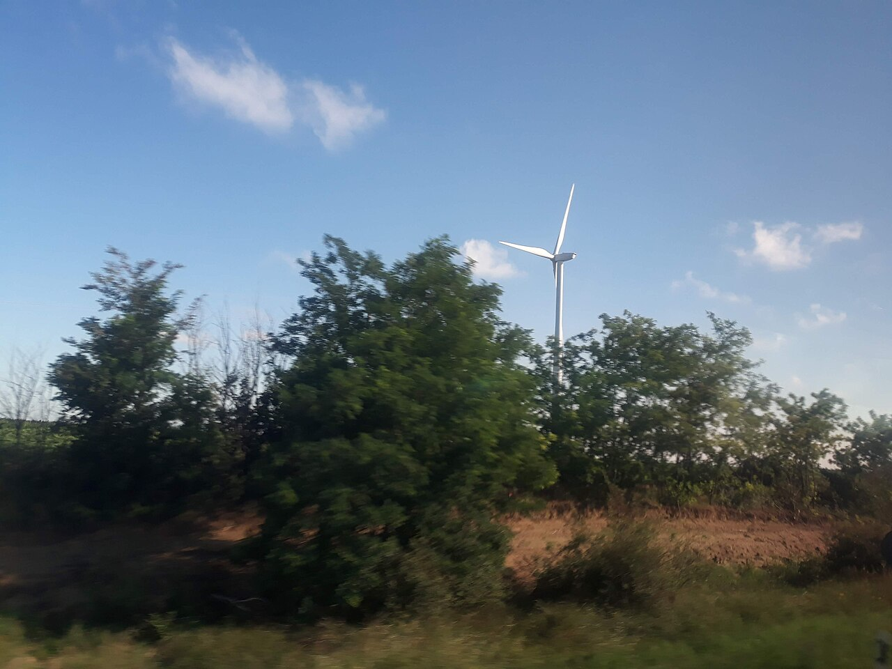

<!--
author:   Juliana Hilf; Hannes Tegelbeckers
email:    juliana.hilf@ovgu.de
version:  1.0.0
language: en
mode:     Textbook
narrator: UK English Female
comment:  GIZ Sustainability Onboarding – Session 2_4: International and national climate policies. Self-paced, unmoderated. Licence: CC BY-SA 4.0 [CHECK: confirm with GIZ]
-->

# GIZ Sustainability Onboarding 2_4 – International and national climate policies

**Estimated time:** 25 minutes · **Format:** self-paced, 6 short pages + a Serbia page + final self-check

After this session you can:

- outline the central elements of international and national climate policies, from the Paris Agreement to Serbian law,
- compare the three policy levels: global (Paris Agreement, SDGs), EU and region (European Green Deal, Green Agenda for the Western Balkans), and Serbia (climate law, strategy, NDC),
- explain what "net zero" means and how it differs from "carbon neutral",
- reflect on what these policies mean for companies, VET schools and VET policy in Serbia.

> **How this works:** There is no tutor in this course. Every quiz explains its answer, and every reflection question has an expert view you can compare with. Your notes go into your personal **learning journal** in Moodle – nobody grades them.

Part of: Session 2 – Basic Concepts and Policies

## 1 Climate policies on three levels

Climate policy is not one big document. It works on **three levels**, one above the other. The global level sets the direction. The EU and regional level translate it into programmes and money. The national level turns it into law, strategies and targets.

| Level | Examples you will meet in this session |
| --- | --- |
| Global | Paris Agreement (2015), Sustainable Development Goals (SDGs) |
| EU and region | European Green Deal (2019), Green Agenda for the Western Balkans (2020) |
| Serbia | Law on Climate Change (2021), Low Carbon Development Strategy, NDC |

Before you start, take a quick look at where you stand. There is no right answer here – it only helps you read the next pages.

**Self-assessment:** How familiar are you with these terms?

[(I know it well)(I have heard of it)(It is new to me)]
[                                                    ] Paris Agreement
[                                                    ] Nationally Determined Contribution (NDC)
[                                                    ] Net zero
[                                                    ] European Green Deal
[                                                    ] Green Agenda for the Western Balkans
[                                                    ] Serbian Law on Climate Change

Let us start at the top: the Paris Agreement. The short video below explains how it works. Watch for one thing: who decides the actual climate plans, and what those plans are called.

!?[What is the "Paris Agreement", and how does it work?](https://www.youtube.com/watch?v=5THr3bFj8Z4 "United Nations – What is the 'Paris Agreement', and how does it work? (1:40)")

**Check:** In the video, each country submits its own climate action plan. What are these plans called?

- [( )] Global Stocktake
- [(X)] Nationally Determined Contributions (NDCs)
- [( )] Just Transition Mechanism
[[?]] The name contains the idea that each nation decides its own contribution.
****************************************
Explanation: An **NDC** is a country's own climate action plan with emission targets; the plans must be updated and strengthened over time. The **global stocktake** is the review of progress every 5 years, and the **Just Transition Mechanism** is part of the European Green Deal, not of the Paris Agreement.
****************************************

## 2 The Paris Agreement in five points

The Paris Agreement was adopted in **2015** at the UN Climate Change Conference (COP21) in Paris and signed by nearly 200 countries. Its main goal: limit global warming to **well below 2 °C**, preferably **1.5 °C**, above pre-industrial levels.

Here is the plenary hall where it happened:

*Image: COP21 plenary hall, Paris 2015 – U.S. Department of State – public domain – via Wikimedia Commons – unchanged*

Five elements hold the Agreement together:

1. **Nationally Determined Contributions (NDCs)** – each country sets its own climate action plan with emission targets; plans must be updated and strengthened.
2. **Transparency and accountability** – regular reporting on emissions and progress.
3. **Climate finance** – developed countries pledged to mobilise USD 100 billion per year for developing countries.
4. **Adaptation and resilience** – preparing for floods, droughts and other climate impacts.
5. **Global stocktake** – a review of progress every 5 years.

**Check:** Which are key elements of the Paris Agreement? (Select all that apply.)

- [[X]] Each country sets its own climate action plan (NDC)
- [[X]] Regular reporting on emissions and progress
- [[X]] Developed countries pledged to mobilise USD 100 billion per year for developing countries
- [[X]] A global stocktake every 5 years
- [[ ]] The same binding emission target for all countries
****************************************
Explanation: The Paris Agreement is built on **national** plans, not one common target: each country decides its own contribution, reports on it, and the whole system is reviewed every 5 years. Climate finance and adaptation are part of the deal. A single binding target for all countries does not exist.
****************************************

## 3 Net zero: what it means, and what it does not

You will hear the term **net zero** in every policy text from now on – so let us be precise.

**Net zero** means balancing the amount of greenhouse gases emitted with the amount **removed** from the atmosphere – so that no additional greenhouse gases are added. In practice: reduce emissions as much as possible, and offset the rest through nature-based solutions (trees, wetlands), technology (carbon capture and storage), or carbon credits (which are controversial).

Two points to keep in mind:

- "Net zero" does **not** mean zero emissions.
- It is different from "carbon neutral", which often applies only to CO₂ and relies more on offsets.

**Check:** Choose the right word: The Paris Agreement aims to limit warming to well below [[1 °C | (2 °C) | 3 °C]] above pre-industrial levels.
[[?]] The 1.5 °C figure is the preferred target, but the hard limit is higher.
****************************************
Explanation: The hard limit in the Paris Agreement is **well below 2 °C**; 1.5 °C is the preferred target within that limit.
****************************************

**Check:** Complete the definition: Net zero means balancing the amount of greenhouse gases emitted with the amount ______.

[[removed]]
****************************************
Explanation: Net zero is not "zero emissions" – it is a **balance**: as much removed as emitted, with the priority on reducing emissions first.
****************************************

## 4 The European Green Deal and the Green Agenda for the Western Balkans

The **European Green Deal** was launched in **December 2019**. Its goal: Europe as the **first climate-neutral continent by 2050**, with a legally binding net zero target. A key step on the way: at least **55 % emission reduction by 2030** compared with 1990.

It works on several areas at once: clean energy (renewables, efficiency, phase out fossil fuel subsidies), circular economy (textiles, electronics, packaging), sustainable mobility, biodiversity and agriculture ("Farm to Fork"), and zero pollution. Two instruments matter for people and regions: the **Just Transition Mechanism** for the regions and workers most affected, and the goal to mobilise at least **EUR 1 trillion** in sustainable investments.

The Green Deal also reaches beyond the EU: it influences global climate diplomacy, trade and development partnerships – including EU candidate countries such as Serbia.

The video below explains the Green Deal in its own words. Watch for the 2050 goal and the areas it covers.

!?[What is the European Green Deal and why is it important?](https://www.youtube.com/watch?v=H37grur6HaU "European Commission – What is the European Green Deal and why is it important? (1:59)")

For the Western Balkans, the **Sofia Declaration** is the regional answer. It was endorsed on **10 November 2020** at the Sofia Summit by Western Balkan leaders, and it aligns the region with the European Green Deal. Its five areas: climate, energy and mobility (decarbonisation – reducing carbon emissions); circular economy; depollution (air, water, soil); sustainable food systems and rural areas; biodiversity. [CHECK: Juliana – confirm the five pillars against the RCC text]

The short video below shows how the region frames this agenda. Watch for the link to the European Green Deal.

!?[Green Agenda for the Western Balkans](https://www.youtube.com/watch?v=OivEuG7hGOg "Regional Cooperation Council – Green Agenda for the Western Balkans (1:09)")

Three frameworks, three levels – here is how they compare:

| Framework | Year | Who | Goal | Binding? |
| --- | --- | --- | --- | --- |
| European Green Deal | 2019 | European Commission | Climate-neutral EU by 2050 | Binding within the EU (EU laws) |
| SDGs | 2015 | UN | Global sustainable development by 2030 | Voluntary (national plans, Voluntary National Reviews) |
| Paris Agreement | 2015 | UNFCCC | 1.5–2 °C limit | Legally binding on reporting (NDCs, 5-year reviews) |

**Check:** The European Green Deal aims to reduce EU emissions by at least ______ by 2030 compared with 1990.

- [( )] 40 %
- [(X)] 55 %
- [( )] 100 %
[[?]] It is a step on the way to the 2050 goal – not the 2050 goal itself.
****************************************
Explanation: The 2030 step is at least **55 %** below 1990 levels. "100 %" would be the 2050 goal: climate neutrality (net zero) by 2050.
****************************************

## 5 Serbia: from international targets to national law

Now the national level. Serbia has turned the international and regional direction into national instruments:

- **Law on Climate Change**, adopted **18 March 2021**: it requires a low-carbon development strategy with an action plan, and monitoring, reporting and verification (MRV – checking that the reported numbers are real) of greenhouse gas emissions.
- **Strategy for Low Carbon Development 2023–2030 with projections until 2050** (Official Gazette No. 46/2023): it covers energy, industry, transport, agriculture, forestry and waste. Its 2050 vision includes **green jobs**.
- **NDC (update 2022):** reduce greenhouse gas emissions by **33.3 % by 2030 compared with 1990** (without the land-use sector) – equal to 13.2 % below 2010.
- **NDC 3.0 (September 2025):** a **40.1 %** reduction by **2035** compared with 1990 (conditional, excluding land use and forestry). Civil society (CAN Europe) called it a raise in ambition, but criticised that the 2030 target was not updated.

One number shows why this matters: about **60 %** of Serbia's electricity came from lignite in 2024.

**Check:** Match each policy to its level.

- [ [Global] [EU] [Region] [Serbia] ]
- [ (X)    ( )    ( )    ( )    ]  Paris Agreement (2015)
- [ ( )    (X)    ( )    ( )    ]  European Green Deal (2019)
- [ ( )    ( )    (X)    ( )    ]  Green Agenda for the Western Balkans (2020)
- [ ( )    ( )    ( )    (X)    ]  Law on Climate Change (2021)
[[?]] Follow the "who decides" rule: the UN, the EU, the Western Balkan leaders, or Serbia itself.
****************************************
Explanation: The **Paris Agreement** is a global treaty (UN). The **European Green Deal** is EU policy. The **Green Agenda** was endorsed by Western Balkan leaders, so it is regional. The **Law on Climate Change** is Serbian national law.
****************************************

## 6 What policies mean for companies and VET

Policies do not stay on paper. They create a chain:

1. New targets in policies (emission reduction, climate neutrality).
2. New tasks in companies: energy audits, efficient buildings, renewable installations, emissions reporting.
3. New or changed **occupational standards, qualifications and curricula**.
4. Teacher training and school equipment.

Each of you works on a different link of this chain: the **ministry** steers standards, **school developers** support the curriculum review, and **principals** organise implementation and company partnerships.

> **Learning journal:** Which policy level – global, EU/region, or Serbia – influences your daily work the most? Give one concrete example.

Compare with an expert view

A **ministry officer** usually feels the national level most directly: the Law on Climate Change and the Low Carbon Development Strategy decide which standards and qualifications must be developed next. A **school developer** often works at the EU/regional level: Green Deal requirements appear in EU-funded projects, and the Green Agenda frames what "green" means for the region. A **principal** usually sees the national level in concrete form – school equipment, company partnerships, and which new occupations the local labour market actually needs. All three levels show up in one school day; the question is which one you can act on this week.

**Scenario:** You work at the Ministry of Education. The new Low Carbon Development Strategy names **green jobs in construction** as part of its 2050 vision. Which is the logical next step for your ministry?

- [( )] Add a climate unit to every subject in every school
- [(X)] Start the process to develop or update the occupational standards and qualifications for these green jobs
- [( )] Wait until 2050 and see what happens
[[?]] Think about the chain: targets → tasks in companies → standards → curricula → training.
****************************************
Explanation: The strategy signals new tasks in companies, so the ministry's move is to develop or update the **occupational standards and qualifications** first. Only then can curricula, teacher training and equipment follow. Adding a climate unit everywhere is not targeted, and waiting ignores that the chain must start now.
****************************************

## What this means in Serbia

All three levels meet in one country. Serbia aligns with the European Green Deal through the **Green Agenda for the Western Balkans** (Sofia Declaration, 10 November 2020). The **Law on Climate Change** (18 March 2021) makes the work concrete: a low-carbon development strategy with an action plan, and monitoring, reporting and verification (MRV – checking that the reported numbers are real) of emissions.

The **Strategy for Low Carbon Development 2023–2030 with projections until 2050** covers energy, industry, transport, agriculture, forestry and waste – and its 2050 vision names **green jobs**. The **NDC** sets the numbers: 33.3 % emission reduction by 2030 compared with 1990, and in the NDC 3.0 (September 2025) a 40.1 % reduction by 2035.

The starting point is clear: about 60 % of electricity came from lignite in 2024. But the transition is already visible – wind farms like Čibuk 1 are part of the Serbian energy mix today:

*Image: Wind farm Čibuk 1 (2018) – Ivan25 – CC BY-SA 4.0 – via Wikimedia Commons – unchanged*

> **Learning journal:** Pick one sector your schools train for (for example construction, energy, transport or agriculture). What does the NDC target mean for that sector's future tasks?

Compare with an expert view

A good answer follows the chain from page 6. For **energy**, the NDC targets mean more tasks around renewable installations, grid operation and energy efficiency – and fewer around lignite-only skills. For **construction**, efficient buildings and retrofits become core tasks. For **transport and agriculture**, emissions reporting and low-carbon methods enter daily work. As a **school developer**, you would check which of these tasks already appear in the occupational standards and which are missing. As a **principal**, you would ask your company partners which of these tasks they will hire for in the next few years. The target number itself (33.3 % by 2030, 40.1 % by 2035) is the signal; the sector tasks are the consequence.

## Final self-check

Pass mark: 70 %. You can repeat the check as often as you like.

**1.** What is a Nationally Determined Contribution (NDC)?

- [( )] A review of all countries' progress every 5 years
- [(X)] A country's own climate action plan with emission targets
- [( )] A fund that pays for all climate projects worldwide
[[?]] "Nationally" tells you who decides; "contribution" tells you what it is.
****************************************
Explanation: Each country sets its **own** plan with emission targets, and the plans must be updated and strengthened. The 5-year review is the global stocktake, and climate finance is a separate element of the Paris Agreement.
****************************************

**2.** Which statements apply to the European Green Deal? (Select all that apply.)

- [[X]] It aims for a climate-neutral EU by 2050.
- [[X]] It targets at least a 55 % emission reduction by 2030 compared with 1990.
- [[X]] It includes a Just Transition Mechanism for the regions and workers most affected.
- [[ ]] It sets the same NDC for all EU member states.
****************************************
Explanation: The Green Deal sets the 2050 climate-neutrality goal, the 55 % 2030 step, and support for the most affected regions and workers. NDCs belong to the **Paris Agreement**, where each country decides its own plan – the Green Deal does not set them.
****************************************

**3.** Match each policy to its level.

- [ [Global] [EU] [Region] [Serbia] ]
- [ (X)    ( )    ( )    ( )    ]  Paris Agreement
- [ ( )    ( )    (X)    ( )    ]  Green Agenda for the Western Balkans
- [ ( )    ( )    ( )    (X)    ]  Low Carbon Development Strategy 2023–2030
- [ ( )    (X)    ( )    ( )    ]  European Green Deal
[[?]] Ask: who adopted it – the UN, the EU, the Western Balkan leaders, or Serbia?
****************************************
Explanation: The **Paris Agreement** is global (UN). The **Green Agenda** is regional (Western Balkan leaders, 2020). The **Low Carbon Development Strategy** is Serbian national policy. The **Green Deal** is EU policy.
****************************************

**4.** Serbia's Law on Climate Change was adopted on 18 March ______.

[[2021]]
****************************************
Explanation: The Law on Climate Change was adopted on **18 March 2021**; it requires a low-carbon development strategy with an action plan and MRV of greenhouse gas emissions.
****************************************

**5.** Choose the right year: Serbia's NDC 3.0 (September 2025) aims to reduce greenhouse gas emissions by 40.1 % by [[2030 | (2035) | 2040]] compared with 1990.
[[?]] The 2030 target (33.3 %) comes from the earlier NDC update.
****************************************
Explanation: NDC 3.0 sets **40.1 % by 2035** (conditional, excluding land use and forestry). The 33.3 % target for 2030 comes from the 2022 NDC update – CAN Europe criticised that it was not updated alongside the new target.
****************************************

**6.** You support VET schools with curriculum review. A company partner reports new tasks: energy audits and emissions reporting. What is your first move?

- [( )] Report the company to the ministry
- [(X)] Check whether the current occupational standards and curricula already cover these tasks
- [( )] Wait until the next strategy review
[[?]] New tasks in companies are the signal for the next step in the chain.
****************************************
Explanation: New tasks in companies (energy audits, emissions reporting) mean you should check the **occupational standards and curricula** first – that is the school developer's role. Reporting the company is not needed; waiting delays the update the chain requires.
****************************************

## Sources and licences

- Hilf, J. (2025): *Models of Sustainability: Frameworks, Policies …* – GIZ workshop – no licence stated – adapted (incl. comparison table)
- UN Climate Change: *The Paris Agreement* – UNFCCC – https://unfccc.int/process-and-meetings/the-paris-agreement – summarised
- Climatepartner (2024): *What does net zero mean?* – https://www.climatepartner.com/en/knowledge/insights/what-does-net-zero-mean – via Hilf (2025) – summarised
- European Commission: *The European Green Deal* – https://commission.europa.eu/strategy-and-policy/priorities-2019-2024/european-green-deal_en – summarised
- Regional Cooperation Council (2020): *Sofia Declaration on the Green Agenda for the Western Balkans* – https://www.rcc.int/docs/546/sofia-declaration-on-the-green-agenda-for-the-western-balkans – summarised
- CEE Legal Matters: *Serbia – The new Law on Climate Change* – https://ceelegalmatters.com/serbia/16624-serbia-the-new-law-on-climate-change-for-the-survival-of-the-living-world – summarised; official text [CHECK: link to Official Gazette]
- *Low Carbon Development Strategy Serbia 2023–2030 with 2050 projections* – https://unfccc.int/sites/default/files/resource/Low_Carbon_Development_Strategy_Serbia_2023-2030_with_2050_Projections.pdf – summarised
- NDC Partnership: *Serbia* – https://ndcpartnership.org/country/srb – summarised; CAN Europe: *Western Balkans NDCs 3.0* – https://caneurope.org/western-balkans-ndcs-3-0-serbia-joins-montenegro-in-updating-climate-commitments – summarised
- CEE Bankwatch Network: *The energy sector in Serbia* – https://bankwatch.org/beyond-coal/the-energy-sector-in-serbia – summarised
- Video: United Nations – *What is the "Paris Agreement", and how does it work?* – https://www.youtube.com/watch?v=5THr3bFj8Z4 – embedded
- Video: Regional Cooperation Council – *Green Agenda for the Western Balkans* – https://www.youtube.com/watch?v=OivEuG7hGOg – embedded
- Video: European Commission – *What is the European Green Deal and why is it important?* – https://www.youtube.com/watch?v=H37grur6HaU – embedded
- Image: U.S. Department of State – *COP21 plenary hall, Paris 2015* – public domain – https://commons.wikimedia.org/wiki/File:Kerry_Mxakato-Diseko_Zhenhua_in_the_Plenary_Hall_at_the_COP21.jpg – unchanged
- Image: Ivan25 – *Wind farm Čibuk 1 (2018)* – CC BY-SA 4.0 – https://commons.wikimedia.org/wiki/File:Wind_farm_%C4%8Cibuk_1_(2018)_1.jpg – unchanged
- This session: GIZ Sustainability Onboarding – GIZ / OVGU – CC BY-SA 4.0 [CHECK: confirm with GIZ]
