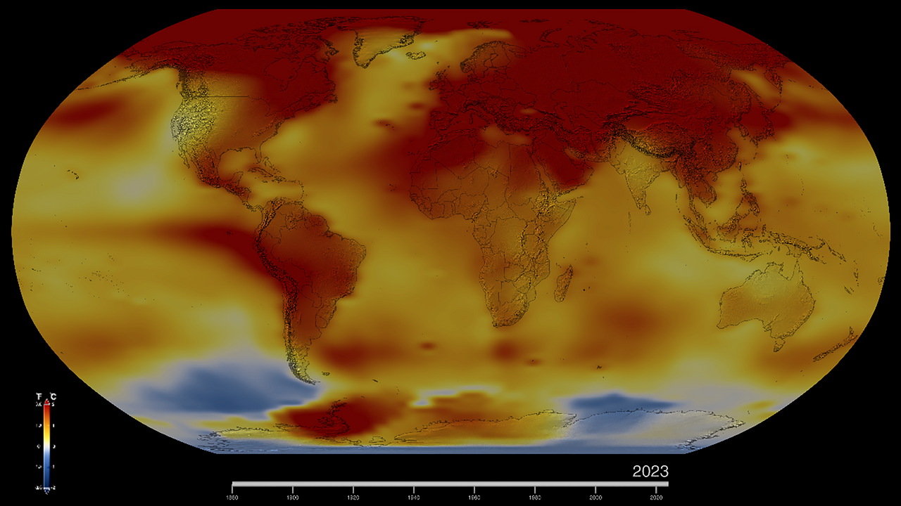

<!--
author:   Juliana Hilf; Hannes Tegelbeckers
email:    juliana.hilf@ovgu.de
version:  1.0.0
language: en
mode:     Textbook
narrator: UK English Female
comment:  GIZ Sustainability Onboarding – Session 3: Ecological Issues. Self-paced, unmoderated. Licence: CC BY-SA 4.0 [CHECK: confirm with GIZ]
-->

# GIZ Sustainability Onboarding 3 – Ecological Issues

**Estimated time:** 10–15 minutes · **Format:** self-paced overview, 6 short pages

After this session you can:

- name the central ecological challenges (deforestation, plastic pollution, biodiversity loss, climate change),
- distinguish the terms **climate change** and **climate crisis**,
- describe the concept of **planetary boundaries** and say how many of the nine boundaries are currently crossed,
- relate these concepts to your work in the VET system, in school development, or in leading a school.

> **How this works:** There is no tutor in this course. Every quiz explains its answer, and every reflection question has an expert view you can compare with. Your notes go into your personal **learning journal** in Moodle – nobody grades them.

## Why this topic matters

Sustainability is not only about ideas and policies. It starts with the state of the planet. This topic introduces the ecological challenges that shape all the others:

- **Deforestation** – loss of forests, with biodiversity loss, disrupted water cycles and climate change as consequences.
- **Plastic pollution** – about 400 million tons of plastic are produced every year.
- **Biodiversity loss** – affecting insects, mammals, fish and coral reefs.
- **Climate change** – more extreme weather: heatwaves, extreme rain, hurricanes, dry periods and floods.

These challenges reach far beyond the environment. They affect the regions where your schools work. In May 2014, floods in Serbia affected about 1.6 million people – roughly a fifth of the population.

One term is central to this topic, and it is often used incorrectly. Watch this short video with a NASA expert. Pay attention to how *climate change* and *global warming* differ – and notice which of the two terms is used in everyday debates.

!?[Is Climate Change the Same as Global Warming? – We Asked a NASA Expert](https://www.youtube.com/watch?v=TUinL0C_zgE "NASA – Is Climate Change the Same as Global Warming? – We Asked a NASA Expert (1:17)")

**Check:** According to this topic, which statement is correct?

- [( )] Climate change is the same thing as global warming.
- [(X)] Climate change means more extreme weather – heatwaves, extreme rain, dry periods, floods.
- [( )] Biodiversity loss is an economic problem, not an ecological one.
[[?]] Look at the list of ecological challenges above the video.
****************************************
The course treats **climate change** as the broader phenomenon with visible effects like extreme weather. The NASA video shows that "global warming" and "climate change" are related but not identical terms. Biodiversity loss is listed as an ecological challenge – it affects living systems such as insects, mammals, fish and coral reefs.
****************************************

## The big picture

The image below shows global temperature anomalies – the difference between measured temperatures and a long-term average – from 1880 to 2023. Notice the upward trend in the last decades.

*Image: Global Temperature Anomalies from 1880 to 2023 – NASA Scientific Visualization Studio – public domain – via Wikimedia Commons – unchanged*

This topic has two subtopics. They build on each other:

| Subtopic | Title | What you will learn | Time |
| -------- | ----- | ------------------- | ---- |
| 3_1 | Climate change and climate crisis | The difference between "climate change" and "climate crisis", and why the choice of wording matters in public debates. | 20–30 min |
| 3_2 | Planetary boundaries | The idea of nine Earth-system boundaries that define a safe operating space for humanity – and how many are already crossed. | 20–30 min |

The concept was first introduced by the Stockholm Resilience Centre in 2009. A 2023 assessment (Richardson et al., *Science Advances*) found **six of nine** boundaries crossed. The Planetary Health Check 2025 (PIK) now reports **seven of nine** crossed – ocean acidification was newly crossed; only ozone depletion and aerosol loading remain in the safe zone.

Climate change is **one** of the nine planetary boundaries. So 3_1 looks closely at climate and the words we use for it, and 3_2 widens the view to all nine boundaries.

## Where do you start?

**Self-assessment:** How familiar are you with these concepts?

[(I know it well)(I have heard of it)(It is new to me)]
[                                                    ] Climate change
[                                                    ] Climate crisis
[                                                    ] Planetary boundaries
[                                                    ] Ecological footprint

Which subtopic should you start with?

**If "climate change" is new to you:** start with **3_1 – Climate change and climate crisis**. It explains the basic terms before anything else builds on them.

**If you know the climate terms well but "planetary boundaries" is new to you:** go straight to **3_2 – Planetary boundaries**. It will also give you a short refresher on climate as one boundary.

**If both are new to you:** work in the order 3_1, then 3_2. The concepts build on each other, and 3_2 is easier to understand once you are comfortable with the climate terms.

## Warm-up check

**Check:** How many Earth-system processes with boundaries define the "safe operating space" for humanity?

- [( )] Six
- [( )] Seven
- [(X)] Nine
[[?]] The 2025 health check says how many are *crossed* – but the question asks how many there are in total.
****************************************
The concept of planetary boundaries, first introduced by the Stockholm Resilience Centre in 2009, names **nine** Earth-system processes. The number seven is the number of boundaries that were crossed according to the 2025 Planetary Health Check – not the total.
****************************************

**Check:** Which of the following are ecological challenges named in this course? (Select all that apply.)

- [[X]] Deforestation
- [[X]] Plastic pollution
- [[X]] Biodiversity loss
- [[ ]] Overpopulation
- [[X]] Climate change
****************************************
This course names four ecological challenges: **deforestation, plastic pollution, biodiversity loss and climate change**. Overpopulation is not among them in this source material.
****************************************

**Check:** Match each concept to its description.

- [ [Climate change] [Climate crisis] [Planetary boundaries] ]
- [ (X)    ( )    ( )    ]  One of the nine Earth-system processes
- [ ( )    ( )    (X)    ]  Nine boundaries that define a safe operating space for humanity
- [ ( )    (X)    ( )    ]  The term subtopic 3_1 distinguishes from "climate change"
****************************************
**Climate change** is one of the nine planetary boundaries. **Planetary boundaries** is the concept of nine Earth-system processes with limits. **Climate crisis** is the term explored in 3_1 – the course is careful about the difference between the two climate terms and why wording matters in public debates.
****************************************

**Check:** Complete the sentence: Humanity uses as many ecological resources as if we lived on ______.

[[1.71 Earths]]
****************************************
According to the ecological footprint data in this course, humanity uses as much as **1.71 Earths** – and people in the Global North use far more than people in developing countries.
****************************************

## Learning journal

> **Learning journal:** Name one ecological challenge you can observe in your region – in the schools you support, in your city, or in the VET sector. Which concept from this topic (climate change, climate crisis, planetary boundaries) would help you explain it to colleagues, and why?

Compare with an expert view

A good answer names a concrete observation and then picks a concept that fits. A **principal** might point to more heat days in the workshop halls or to floods that closed the school for weeks – the 2014 floods in Serbia affected about 1.6 million people. The concept of **climate change** helps here, because it explains the pattern behind single events: more extreme weather, not just one bad year. A **school developer** might notice that curricula in the schools they support rarely connect training programmes to ecological limits – the concept of **planetary boundaries** helps there, because it shows that limits are not a matter of opinion but of Earth-system science. A **ministry officer** might look at the whole system: which qualifications prepare young people for a green economy. All three perspectives are valid – what matters is that the concept is used to *explain*, not to warn.

## Sources and licences

- Hilf, J. (2024): *Introduction to the Sustainability Approach*. GIZ training, Day 1 – adapted
- Hilf, J. (2026): *Green TVET – Concepts and practical approaches*. Expert input – adapted
- IPCC (2023): *Climate Change 2023: Synthesis Report* – https://www.ipcc.ch/report/ar6/syr/ – summarised
- Copernicus (2025): *2024 first year to exceed 1.5 °C above pre-industrial level* – https://climate.copernicus.eu/copernicus-2024-first-year-exceed-15degc-above-pre-industrial-level – summarised
- Stockholm Resilience Centre: *Planetary boundaries* – https://www.stockholmresilience.org/research/planetary-boundaries.html – linked
- Stockholm Resilience Centre / PIK (2025): *Seven of nine planetary boundaries now breached* – https://www.stockholmresilience.org/news--events/general-news/2025-09-24-seven-of-nine-planetary-boundaries-now-breached – summarised
- Global Footprint Network – https://www.footprintnetwork.org/ – via Hilf (2024)
- ReliefWeb: *Serbia floods 2014* – https://reliefweb.int/report/serbia/serbia-floods-2014 – summarised
- NASA: *Is Climate Change the Same as Global Warming? – We Asked a NASA Expert* – https://www.youtube.com/watch?v=TUinL0C_zgE – embedded
- TED: Johan Rockström – *Let the environment guide our development* – https://www.youtube.com/watch?v=RgqtrlixYR4 – linked
- NASA Scientific Visualization Studio: *Global Temperature Anomalies from 1880 to 2023* – public domain – https://commons.wikimedia.org/wiki/File:Global_Temperature_Anomalies_from_1880_to_2023_(SVS5207_-_2023AverageTemp_4K).png – unchanged
- This session: Onboarding to Green Transformation, GIZ / OVGU, 2026 – CC BY-SA 4.0 [CHECK: confirm with GIZ]
