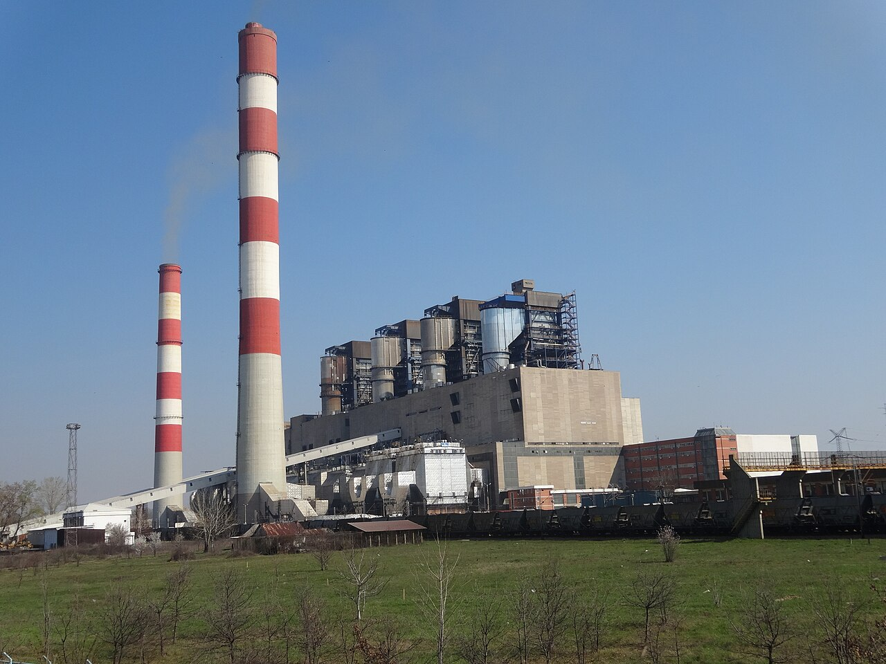

<!--
author:   Juliana Hilf; Hannes Tegelbeckers
email:    juliana.hilf@ovgu.de
version:  1.0.0
language: en
mode:     Textbook
narrator: UK English Female
comment:  GIZ Sustainability Onboarding – Session 3_2: Planetary boundaries. Self-paced, unmoderated. Licence: CC BY-SA 4.0 [CHECK: confirm with GIZ]
-->

# GIZ Sustainability Onboarding 3_2 – Planetary boundaries

**Estimated time:** 25 minutes · **Format:** self-paced, 5 short pages + Serbia example + final self-check

After this session you can:

- describe the idea of planetary boundaries and explain what a "safe operating space" means,
- name the nine planetary boundaries and say which of them are currently crossed,
- discuss selected boundaries that are particularly relevant for the sectors Serbian VET schools train for (energy, construction, agriculture, metalworking, food).

> **How this works:** There is no tutor in this course. Every quiz explains its answer, and every reflection question has an expert view you can compare with. Your notes go into your personal **learning journal** in Moodle – nobody grades them.

Part of: Session 3 – Ecological Issues

## 1 What is a planetary boundary?

In 2009, Johan Rockström and colleagues at the **Stockholm Resilience Centre** introduced a new idea. Instead of asking "is the environment okay?", they asked: **which Earth-system processes must we keep within safe limits?**

For each of **nine** Earth-system processes, the scientists define a **boundary**. A boundary marks the edge of a **"safe operating space"** for humanity. As long as we stay inside it, the Earth system is expected to remain stable.

One important nuance: **crossing a boundary does not mean collapse overnight.** It means the **risk of large, possibly irreversible changes rises**. Think of it like a speed limit: driving 10 km/h over it does not crash your car, but the risk of an accident grows with every extra kilometre.

!?[Planetary Boundaries and Human Opportunities](https://www.youtube.com/watch?v=N3XxAwzDvj4 "Stockholm Resilience Centre – Planetary Boundaries and Human Opportunities (2:24)")

**Watch for:** how the video explains the idea of a "safe operating space", and why scientists speak in terms of *risk* instead of *certainty*.

**Check:** What does it mean when humanity crosses a planetary boundary?

- [( )] The Earth system collapses immediately
- [(X)] The risk of large, possibly irreversible changes rises
- [( )] Nothing – the boundary is only a suggestion
- [( )] Only one country is affected
[[?]] The scientists compare it to a speed limit, not a cliff edge.
****************************************
Crossing a boundary means the **risk of large, possibly irreversible changes rises** – it is a warning, not a guarantee of collapse. It is not an immediate event (option 1), not optional (option 3), and the boundaries are global, not national (option 4).
****************************************

## 2 The nine boundaries

The nine boundaries are:

| # | Boundary | In plain words |
|---|---|---|
| 1 | Climate change | Warming of the climate system |
| 2 | Biosphere integrity | Loss of biodiversity and species |
| 3 | Land-system change | For example deforestation |
| 4 | Freshwater change / use | How much water we take and alter |
| 5 | Biogeochemical flows | Nitrogen and phosphorus, for example from fertilisers |
| 6 | Novel entities | Plastics, chemicals and other new substances |
| 7 | Ocean acidification | The ocean becoming more acidic |
| 8 | Atmospheric aerosol loading | Particles in the air |
| 9 | Stratospheric ozone depletion | Thinning of the ozone layer |

 – CC BY 4.0")

*Image: Diagram of the nine Planetary Boundaries – Potsdam Institute for Climate Impact Research (PIK) – CC BY 4.0 – via Wikimedia Commons – unchanged*

**Check:** How many planetary boundaries are there?

[[nine]]
****************************************
The framework defines **nine** Earth-system processes, each with its own boundary. (Answer "9" also accepted.)
****************************************

## 3 Where do we stand today?

Scientists have checked all nine boundaries twice:

- **2023** (Richardson et al., *Science Advances*): the first assessment of **all nine** boundaries found that **six of nine** were already crossed.
- **2025** (Planetary Health Check): **seven of nine** are now crossed. **Ocean acidification** was newly crossed – the surface pH fell by about 0.1 units since industrialisation, a 30–40 % rise in acidity. All seven crossed boundaries show **worsening** trends. Only **ozone depletion** and **aerosol loading** remain in the safe zone.

If you have more time, this longer talk by Johan Rockström explains the thinking behind the whole framework:

!?[Johan Rockström: Let the environment guide our development](https://www.youtube.com/watch?v=RgqtrlixYR4 "TED – Johan Rockström: Let the environment guide our development (about 18 min)")

**Go deeper:** [Planetary boundaries – a science update by professor Johan Rockström (2026), 24:56](https://www.youtube.com/watch?v=dhWXmq1XQa4 "Stockholm Resilience Centre – Planetary boundaries – a science update by professor Johan Rockström (2026) (24:56)")

**Check:** Which two boundaries were still in the safe zone in the 2025 assessment? (Select all that apply.)

- [[ ]] Climate change
- [[X]] Stratospheric ozone depletion
- [[X]] Atmospheric aerosol loading
- [[ ]] Ocean acidification
[[?]] Seven of nine are crossed. The two "safe" ones are both about the atmosphere – but not warming.
****************************************
In 2025, only **ozone depletion** and **aerosol loading** remain in the safe zone. Ocean acidification was the *newly* crossed boundary, and climate change has been crossed for a long time.
****************************************

## 4 Related ideas: doughnut, footprint, handprint

The planetary boundaries are not a stand-alone idea. They connect to the models you may have met earlier:

- The **doughnut model** (Session 2_2) uses the planetary boundaries as its **ecological ceiling** – the outer ring that must not be crossed.
- The **ecological footprint** measures how much nature we use. Right now, humanity uses resources **as if we lived on 1.71 Earths** – and people in the Global North use far more than people in developing countries.
- A common **critique** of the footprint: it can shift responsibility to individuals instead of companies and governments.
- The **handprint** is the positive side: what you actively *do* to help. A footprint says how much you take; a handprint says how much you give back.

> **Learning journal:** Describe one planetary boundary in your own words and connect it to one VET programme your schools offer (for example energy, construction, agriculture, metalworking or food).

Compare with an expert view

A good answer names one boundary, explains it in simple language, and links it to concrete school work. For example: **biogeochemical flows** means how much nitrogen and phosphorus we add to the land, mainly through fertilisers – and a school that trains farmers or food technologists can teach how fertiliser use works and how to reduce it. Or: **novel entities** means new substances like plastics and chemicals – and a metalworking programme can discuss lubricants, coolants and waste oils. A ministry officer might connect the boundary to curriculum standards, a principal to which equipment and processes students actually work with. Any of these readings is valid – the point is the link between the global limit and a concrete programme.

## 5 Which boundary matters for which VET sector?

The same nine boundaries are not equally relevant everywhere. For the sectors Serbian VET schools train for, the links look like this:

| Sector (VET) | Most relevant boundaries | Why |
|---|---|---|
| Energy / electrical | Climate change, aerosol loading | Fossil power plants emit CO₂ and particles |
| Construction | Climate change, land-system change, novel entities | Cement and steel, land use, building chemicals |
| Agriculture / food | Biogeochemical flows, freshwater, biosphere integrity, land-system change | Fertiliser, irrigation, habitat loss |
| Metalworking / mechanical | Climate change, novel entities | Energy-intensive processes, lubricants, coolants |
| Car mechanics / mobility | Climate change, aerosol loading, novel entities | Exhaust, fuels, waste oil, batteries |

**Your view:** Which boundary is most relevant for the schools you work with?

[(a)] Climate change
[(b)] Biogeochemical flows (fertilisers)
[(c)] Novel entities (plastics, chemicals)
[(d)] Another one – I will note it in my journal

**Check:** Match each VET sector to the boundary that is most relevant for it.

- [ [Climate change] [Biogeochemical flows] [Land-system change] [Novel entities] ]
- [ (X)    ( )    ( )    ( )    ]  Energy / electrical
- [ ( )    (X)    ( )    ( )    ]  Agriculture / food
- [ ( )    ( )    (X)    ( )    ]  Construction
- [ ( )    ( )    ( )    (X)    ]  Metalworking / mechanical
[[?]] Follow the "why" column: what does each sector emit or use most?
****************************************
Energy and electrical work is dominated by **climate change** (CO₂ from fossil power). Agriculture is most tied to **biogeochemical flows** (fertilisers). Construction strongly affects **land-system change** (plus cement, steel and building chemicals). Metalworking is most linked to **novel entities** (lubricants, coolants) on top of energy use. Note that most sectors touch *several* boundaries – the match shows the strongest link.
****************************************

## 6 What this means in Serbia

The planetary boundaries are global – but their effects are very local. Two examples from Serbia and the Western Balkans:

**Electricity and the climate boundary.** In 2024, about **60 % of Serbia's electricity came from lignite** (Bankwatch). The Kolubara basin supplies about **75 % of EPS lignite**. Lignite power plants are a direct link to the **climate** boundary (CO₂) and the **aerosol** boundary (particles).

*Image: Urovci, Termoelektrana Nikola Tesla, 12 – Mickey Mystique – CC BY-SA 3.0 – via Wikimedia Commons – unchanged*

**Air pollution and the aerosol boundary.** The EEA's 2025 report counts more than **22,000 premature deaths** in the **Western Balkans** in 2023 linked to air pollution. For Serbia, premature mortality attributable to fine particulate matter (PM2.5) was **188.3 per 100,000** inhabitants over 30 (EEA data cited by RERI). This shows an important point: **locally, aerosols (particles) already harm health, even though the *global* aerosol boundary is not yet crossed.** Global limits and local effects are two different things – and both matter for your work.

Agriculture is an important sector in Serbia [CHECK: Juliana / GIZ – add one source on fertiliser use or water use in Serbian agriculture].

**Scenario (school developer):** A school wants to add **one** "planetary boundaries" lesson to its agriculture programme. Which boundary would you choose, and why?

- [(X)] Biogeochemical flows – because fertiliser use is part of everyday agricultural practice
- [( )] Stratospheric ozone depletion – because it is a global problem
- [( )] Ocean acidification – because it was the newest finding
[[?]] Pick the boundary whose "why" column fits the sector the students actually work in.
****************************************
**Biogeochemical flows** fits best: the source links agriculture to fertiliser (nitrogen and phosphorus), irrigation, habitat loss and land use – things students in an agriculture programme meet in practice. Ozone depletion and ocean acidification are real global issues, but they have no direct connection to the daily work of an agriculture programme.
****************************************

> **Learning journal:** Think about the difference between footprint and handprint. What is **one handprint idea** for your institution – a ministry, a school development office or a school?

Compare with an expert view

A good handprint answer is concrete and realistic for the institution. A **ministry officer** might propose that new occupational profiles include a sustainability module, so every graduate leaves with at least one boundary in mind. A **school developer** could design a one-day teacher workshop where each teacher links one boundary to their own subject. A **principal** might start with the school itself: waste sorting, energy-saving routines in workshops, or involving students in measuring the school's footprint. All three are valid – a handprint is "what you actively do", so the best answer is something the institution can actually start, not a slogan.

## Final self-check

Pass mark: 70 %. You can repeat the check as often as you like.

**1.** Who introduced the planetary boundaries framework, and when?

- [( )] The UN, in 1992
- [(X)] Johan Rockström and colleagues at the Stockholm Resilience Centre, in 2009
- [( )] The Brundtland Commission, in 1987
[[?]] It is newer than the Brundtland Report and comes from a Swedish research centre.
****************************************
The framework was first introduced in **2009** by **Johan Rockström and colleagues at the Stockholm Resilience Centre**.
****************************************

**2.** How many planetary boundaries are there?

[[nine]]
****************************************
There are **nine** Earth-system processes, each with its own boundary. (Answer "9" also accepted.)
****************************************

**3.** Which two boundaries were still in the safe zone in the 2025 assessment? (Select all that apply.)

- [[ ]] Freshwater change / use
- [[X]] Stratospheric ozone depletion
- [[X]] Atmospheric aerosol loading
- [[ ]] Biosphere integrity
****************************************
Only **ozone depletion** and **aerosol loading** remain in the safe zone; all seven crossed boundaries show worsening trends.
****************************************

**4.** In the 2025 Planetary Health Check, which boundary was *newly* crossed?

- [( )] Climate change
- [(X)] Ocean acidification
- [( )] Land-system change
- [( )] Stratospheric ozone depletion
[[?]] The surface pH fell by about 0.1 units since industrialisation.
****************************************
**Ocean acidification** was the newly crossed boundary in 2025 – surface pH fell by about 0.1 units since industrialisation, a 30–40 % rise in acidity.
****************************************

**5.** Choose the right number: humanity uses resources as if we lived on [[ 1 Earth | (1.71 Earths) | 3 Earths ]].

****************************************
The ecological footprint of humanity is about **1.71 Earths** – and people in the Global North use far more than people in developing countries.
****************************************

**6.** What is the "handprint"?

- [( )] The amount of nature a person uses
- [(X)] The positive impact – what a person or institution actively does to help
- [( )] A measure of ocean acidification
- [( )] The same as the ecological footprint
****************************************
The **handprint** stands for positive impact – what you actively do. The **footprint** measures how much you use; the handprint is the giving-back side.
****************************************

**7.** Why is the aerosol (particle) issue important in Serbia even though the *global* aerosol boundary is not yet crossed?

- [( )] It is not important – only the global boundary matters
- [(X)] Because locally, particles already harm health – global limits and local effects are two different things
- [( )] Because Serbia has crossed the global boundary
- [( )] Because aerosols do not exist in Serbia
[[?]] The EEA report counts more than 22,000 premature deaths in the Western Balkans in 2023.
****************************************
Globally, aerosol loading is still in the safe zone – but **locally**, particles already cause harm: the EEA's 2025 report counts more than 22,000 premature deaths in the Western Balkans in 2023 linked to air pollution. That is exactly why both levels matter.
****************************************

## Sources and licences

- Stockholm Resilience Centre: *Planetary boundaries* – https://www.stockholmresilience.org/research/planetary-boundaries.html – linked
- Stockholm Resilience Centre: *All planetary boundaries mapped out for the first time, six of nine crossed* (2023) – https://www.stockholmresilience.org/research/research-news/2023-09-13-all-planetary-boundaries-mapped-out-for-the-first-time-six-of-nine-crossed.html – summarised
- Richardson, K. et al. (2023): *Earth beyond six of nine planetary boundaries*. *Science Advances* 9(37) – summarised
- Stockholm Resilience Centre / PIK (2025): *Seven of nine planetary boundaries now breached* – https://www.stockholmresilience.org/news--events/general-news/2025-09-24-seven-of-nine-planetary-boundaries-now-breached – summarised
- Hilf, J. (2024): *Introduction to the Sustainability Approach*. GIZ training, Day 1 – adapted (footprint, handprint)
- Doughnut Economics Action Lab: *What is the Doughnut?* – https://doughnuteconomics.org/tools/what-is-the-doughnut – linked
- CEE Bankwatch Network: *The energy sector in Serbia* – https://bankwatch.org/beyond-coal/the-energy-sector-in-serbia – summarised
- Balkan Green Energy News: *RERI publishes analysis of Serbia's air quality in 2025* – https://balkangreenenergynews.com/reri-serbia-facing-at-least-7373-early-deaths-in-2030-from-air-pollution/ ; EEA (2025) air quality health risk assessment – summarised [CHECK: Juliana – confirm the figures in the EEA country annex]
- Video: Stockholm Resilience Centre – *Planetary Boundaries and Human Opportunities* (2:24) – https://www.youtube.com/watch?v=N3XxAwzDvj4 – embedded
- Video: TED – Johan Rockström: *Let the environment guide our development* (about 18 min) – https://www.youtube.com/watch?v=RgqtrlixYR4 – embedded
- Video: Stockholm Resilience Centre – *Planetary boundaries – a science update by professor Johan Rockström (2026)* (24:56) – https://www.youtube.com/watch?v=dhWXmq1XQa4 – linked
- Image: Potsdam Institute for Climate Impact Research (PIK) – *Diagram of the nine Planetary Boundaries* – CC BY 4.0 – https://commons.wikimedia.org/wiki/File:Diagram_of_the_nine_Planetary_Boundaries.png – unchanged
- Image: Mickey Mystique – *Urovci, Termoelektrana Nikola Tesla, 12* – CC BY-SA 3.0 – https://commons.wikimedia.org/wiki/File:Urovci,_Termoelektrana_Nikola_Tesla,_12.JPG – unchanged
- This session: GIZ Sustainability Onboarding, GIZ / OVGU – CC BY-SA 4.0 [CHECK: confirm with GIZ]
