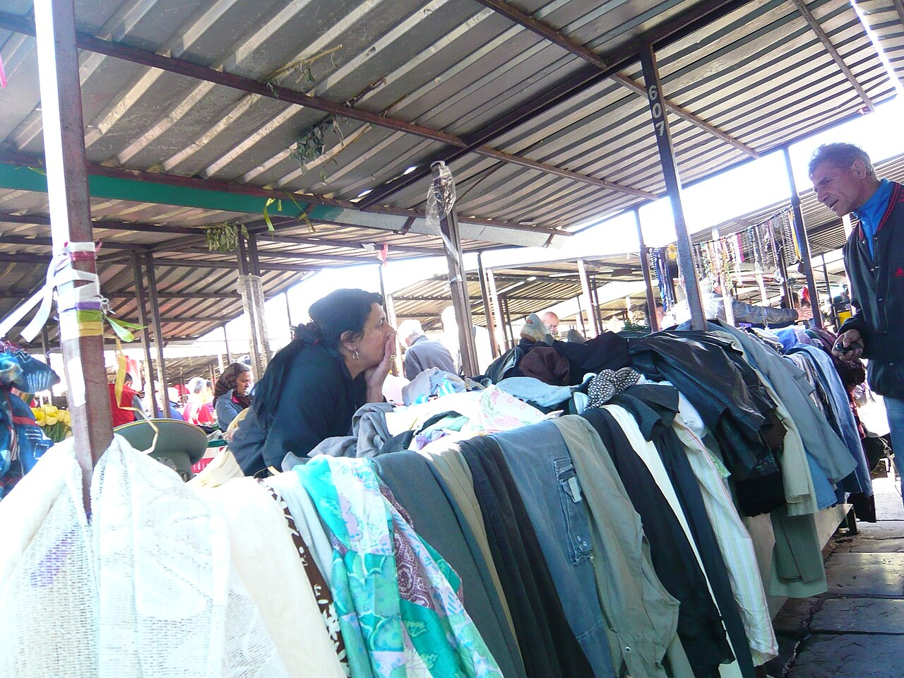

<!--
author:   Juliana Hilf; Hannes Tegelbeckers
email:    juliana.hilf@ovgu.de
version:  1.0.0
language: en
mode:     Textbook
narrator: UK English Female
comment:  GIZ Sustainability Onboarding – Session 4_2: Food, health, and well-being. Self-paced, unmoderated. Licence: CC BY-SA 4.0 [CHECK: confirm with GIZ]
-->

# GIZ Sustainability Onboarding 4_2 – Food, health, and well-being

**Estimated time:** 25 minutes · **Format:** self-paced, 5 short pages + a Serbia page + final self-check

After this session you can:

- describe the stages of a food system and the main impact of each stage,
- explain how food systems connect to the SDGs, planetary boundaries and health,
- reflect on options for more sustainable and healthy consumption patterns in your role (ministry, school developer or principal).

> **How this works:** There is no tutor in this course. Every quiz explains its answer, and every reflection question has an expert view you can compare with. Your notes go into your personal **learning journal** in Moodle – nobody grades them.

Part of: Session 4 – Social Issues

## 1 What is a food system?

Think about your last meal. Where did the food come from? Who grew it, processed it, transported it, sold it – and where did the leftovers go? All of these steps belong together in one system.

A **food system** covers everything from **production** (farming) to **consumption** and **waste**:

```ascii
production (farming) → processing → transport and trade → retail and markets → consumption → waste
```

Each stage has a different main impact. Production uses fertilisers and water. Processing uses energy. Transport creates emissions. Consumption affects our health. And waste ends up in landfills.

**Check:** Match each stage of the food system to its main impact.

- [ [fertiliser & water] [energy] [emissions] [health] [landfill] ]
- [ (X)    ( )    ( )    ( )    ( )    ]  Production (farming)
- [ ( )    (X)    ( )    ( )    ( )    ]  Processing
- [ ( )    ( )    (X)    ( )    ( )    ]  Transport and trade
- [ ( )    ( )    ( )    (X)    ( )    ]  Consumption
- [ ( )    ( )    ( )    ( )    (X)    ]  Waste
[[?]] Think about what each stage mainly uses or produces.
****************************************
Production mainly uses **fertilisers and water** (nitrogen and phosphorus from fertilisers, plus freshwater use). **Processing** needs **energy**. **Transport and trade** create **emissions**. **Consumption** is where food meets our **health**. **Waste** ends up in **landfill**. This is why one decision – for example in a school canteen – touches several stages at once.
****************************************

## 2 Food and the SDGs

Food is not only an ecological topic. It is also a social one. Several Sustainable Development Goals (SDGs) are directly linked to food systems:

- **SDG 2** – zero hunger,
- **SDG 3** – good health and well-being,
- **SDG 12** – responsible consumption and production,
- plus the ecological SDGs **6, 13, 14 and 15**.

Health (SDG 3) is also essential for **education (SDG 4)** and for **reducing inequalities (SDG 10)**. In other words: if people are hungry or sick, learning and fairness become much harder.

The Stockholm Resilience Centre summarises this in a short video. Watch for how one topic – food – touches many different goals at the same time.

!?[How food connects all the SDGs](https://www.youtube.com/watch?v=kvmoue_EsPo "Stockholm Resilience Centre – How food connects all the SDGs (0:31)")

**Check:** What does the short video from the Stockholm Resilience Centre show?

- [(X)] Food connects all the SDGs.
- [( )] Food only affects SDG 2 (zero hunger).
- [( )] Food is separate from the SDGs.
****************************************
The video's message is that **food connects all the SDGs**: it touches hunger, health, consumption, water, climate, oceans and land. That is exactly why this session treats food as a social issue, not only an ecological one.
****************************************

## 3 Healthy and sustainable diets

Can a diet be healthy for people **and** gentle on the planet at the same time? The **EAT-Lancet Commission** (2019) says yes. It proposed a "**planetary health diet**": a diet that is healthy for people and stays within planetary boundaries. [CHECK: Juliana – decide whether to name food groups/amounts; not in the source]

On the production side, the source gives a strong-sustainability example: **agroecology and local food systems**. In agroecology, farming works with natural systems and preserves soil and biodiversity. The EU Green Deal takes a policy path with its **"Farm to Fork"** strategy for sustainable farming.

The EAT organisation explains the link between our plates and the planet in two minutes. Watch for the central idea: what we eat and how it is produced affects both people and the planet.

!?[Can healthy food save the planet?](https://www.youtube.com/watch?v=PIc42oIU0Ik "EAT – Can healthy food save the planet? (2:11)")

**Check:** The EAT-Lancet Commission (2019) proposed a "planetary health diet". What is the idea behind it?

- [(X)] A diet that is healthy for people and stays within planetary boundaries.
- [( )] A diet that maximises food production at any cost.
- [( )] A diet that only wealthy countries can afford.
****************************************
The core idea is the **double benefit**: the diet must be **healthy for people** and it must **stay within planetary boundaries**. It is not about producing as much as possible, and it is not about cost – it is about fitting both human health and ecological limits together.
****************************************

**Check:** Choose the right name: The EU Green Deal strategy for sustainable food is called "[[ (Farm to Fork) | Field to Table | Plate to Farm ]]".

****************************************
The strategy is called **"Farm to Fork"** – it covers the whole chain, from the farm (production) to the fork (consumption). It is part of the EU Green Deal for sustainable farming.
****************************************

**Check:** Agroecology and local food systems are presented in the source as an example of what?

- [( )] A type of farming that replaces natural systems with machines
- [(X)] Strong sustainability – farming works with natural systems, preserving soil and biodiversity
- [( )] A rule about food packaging
[[?]] Strong sustainability means nature sets hard limits that cannot be compensated by money or technology.
****************************************
Agroecology is an example of **strong sustainability**: farming works **with** natural systems and preserves soil and biodiversity, instead of treating nature as a resource to be replaced. That is the difference from a purely economic view of farming.
****************************************

## 4 Well-being beyond the plate

Food is only one part of well-being. The World Health Organization (WHO) points out a broader truth: what we eat **and** how it is produced affects our health and the environment. The video below states this in under a minute. Watch for the link between food systems, health and the environment.

!?[Food systems: our food, our health, our future](https://www.youtube.com/watch?v=6Y499vq7tDg "World Health Organization – Food Systems: Our food, our health, our future (1:05)")

**Check:** Which statements fit the WHO message? (Select all that apply.)

- [[X]] What we eat affects our health.
- [[X]] How food is produced affects the environment.
- [[ ]] Food choice is only a private matter with no wider effect.
****************************************
The WHO message is that food systems connect **health and environment**: what we eat matters for our health, and how food is produced matters for the environment. Because production, trade and consumption affect everyone, food is **not only a private matter**.
****************************************

Well-being also depends on the air we breathe. Two numbers from the source show the scale of the problem:

- More than **22,000 premature deaths** in the Western Balkans in 2023 were caused by air pollution (EEA 2025).
- In Serbia, premature mortality due to PM2.5 (very fine particles in the air) was **188.3 per 100,000 inhabitants over 30** (EEA data via RERI).

Climate change adds another risk: more **heatwaves**, which are a health risk for workers and learners (IPCC 2023).

> **Learning journal:** Name two sustainable choices you could make in your daily or professional life – for example around food, waste or health.

<details>
<summary>Compare with an expert view</summary>

A **principal** might choose seasonal and local food for the canteen and add a school garden, because both cut waste and teach learners directly. A **school developer** could weave food, waste and health topics into the curricula of cooks, food technicians, farmers or retail occupations, so that sustainability becomes part of professional practice. A **ministry officer** might act through public procurement criteria for school meals or occupational standards for food and agriculture occupations. All three choices are valid – what matters is that the choice is concrete, fits your real responsibilities, and connects health with sustainability instead of treating them as separate topics.

</details>

## 5 What this means in Serbia

Belgrade's **Kalenić market** shows one familiar form of local food supply: a traditional urban market selling local produce.



*Image: Kalenić market in Belgrade 1 – Bebauautu – CC BY-SA 3.0 – via Wikimedia Commons – unchanged*

[CHECK: Juliana / GIZ – one source on local food / green markets or school meals in Serbia]

The air pollution numbers from the previous page are also Serbia numbers: the 22,000 premature deaths in the Western Balkans in 2023 and the Serbian PM2.5 figure of 188.3 per 100,000 inhabitants over 30 show that well-being here is not only about food, but about air and heat as well.

One helpful way to hold all of this together is the **doughnut model** (from Session 2_2). Its social foundation includes **food and health**: everyone should have enough to eat and be able to stay healthy. At the same time, the ecological ceiling must not be overshot.


*Image: Doughnut (economic model) – Kate Raworth / Doughnut Economics Action Lab – CC BY-SA 4.0 – via Wikimedia Commons – unchanged*

**Scenario (principal):** The school canteen contract is up for renewal. Which three criteria do you add? (Select all that apply.)

- [[X]] Seasonal and local food
- [[X]] Less food waste in preparation and serving
- [[X]] Drinking water available to all learners
- [[ ]] The cheapest price, whatever the source
- [[ ]] Only imported products
[[?]] Think about what the source lists as options for a principal: canteen and buffet, school garden, drinking water, healthy workshop climate.
****************************************
The source names **seasonal and local food, less waste and drinking water** as options for a school canteen and buffet. "Cheapest price, whatever the source" ignores the sustainability and health goals, and "only imported products" goes against the local-food option. A good contract combines price with these quality criteria.
****************************************

**Self-assessment:** How often does food appear in the curricula you know (for example cooks, food technicians, farmers, retail)?

[(a)] Often
[(b)] Sometimes
[(c)] Rarely
[(d)] Never

## 6 Options for action

You do not have to solve the food system alone. The source connects concrete options to the three roles in this course:

- **Principal:** school canteen and buffet (seasonal, local, less waste), a school garden, drinking water, and a healthy workshop climate (heat, air).
- **School developer:** integrate food, waste and health topics into the curricula of cooks, food technicians, farmers and retail.
- **Ministry:** occupational standards for food and agriculture occupations, and public procurement criteria for school meals [CHECK: Serbian rules on school meals].

Notice the pattern: the same goal – more sustainable and healthy food – is steered at three different levels. One school, one curriculum, one system.

> **Learning journal:** Which one health topic – heat, air or food – could your institution address first? Why this one?

<details>
<summary>Compare with an expert view</summary>

A **principal** often starts with **food and heat**, because the canteen and the workshop climate are under the school's direct control: seasonal and local food, less waste, drinking water, and a healthy workshop climate. A **school developer** often starts with **food**, because integrating food, waste and health topics into the curricula of cooks, food technicians, farmers or retail can change many schools at once. A **ministry officer** may start with **air**, because public procurement criteria for school meals and occupational standards for food and agriculture occupations set the frame for everyone. There is no single right answer – the best first step is the one that fits your real decision power and your institution's current conditions.

</details>

## Final self-check

Pass mark: 70 %. You can repeat the check as often as you like.

**1.** Which of these SDGs is **not** listed in the source as directly linked to food systems?

- [( )] SDG 2 – zero hunger
- [( )] SDG 3 – good health and well-being
- [( )] SDG 12 – responsible consumption and production
- [(X)] SDG 7
****************************************
The source lists **SDGs 2, 3 and 12** as directly linked to food, plus the ecological SDGs 6, 13, 14 and 15. SDG 7 is not part of that list.
****************************************

**2.** Which planetary boundaries are linked to agriculture in the source? (Select all that apply.)

- [[X]] Biogeochemical flows (nitrogen and phosphorus from fertilisers)
- [[X]] Freshwater use
- [[X]] Land-system change
- [[X]] Biosphere integrity
- [[ ]] Ozone layer
****************************************
The source names **biogeochemical flows, freshwater use, land-system change and biosphere integrity** as boundaries linked to agriculture. The ozone layer is not mentioned.
****************************************

**3.** Choose the right name: The EU Green Deal strategy for sustainable farming is called "[[ (Farm to Fork) | Field to Table | Plate to Farm ]]".

****************************************
The strategy is called **"Farm to Fork"** – it covers the whole chain from production to consumption, and it is part of the EU Green Deal.
****************************************

**4.** Complete the definition: A "planetary health diet" is a diet that is healthy for people and stays within ______ boundaries.

[[planetary]]
****************************************
The EAT-Lancet Commission (2019) proposed a diet that is healthy for people and stays within **planetary** boundaries – the ecological limits from Session 3_2.
****************************************

**5.** According to the source (EEA data via RERI), what was the premature mortality due to PM2.5 in Serbia?

- [(X)] 188.3 per 100,000 inhabitants over 30
- [( )] 22,000 per 100,000 inhabitants over 30
- [( )] 1,025 per 100,000 inhabitants over 30
[[?]] The 22,000 figure is a total for the whole Western Balkans in 2023 – not a Serbian rate per 100,000.
****************************************
The Serbian figure is **188.3 per 100,000 inhabitants over 30**. The 22,000 number is the total count of premature deaths in the **Western Balkans** in 2023 – a different measure.
****************************************

**6.** Which options does the source name for a school principal? (Select all that apply.)

- [[X]] A canteen with seasonal and local food and less waste
- [[X]] A school garden
- [[X]] Drinking water
- [[ ]] Public procurement rules for the whole VET system
- [[ ]] Occupational standards for food occupations
****************************************
For a **principal**, the source names the canteen and buffet (seasonal, local, less waste), a school garden, drinking water and a healthy workshop climate. **Procurement rules and occupational standards** are options at the **ministry** level, not at the school level.
****************************************

## Sources and licences

- Hilf, J. (2024): *Introduction to the Sustainability Approach*. GIZ training, Day 1 – adapted
- Hilf, J. (2024): *SDGs and Sustainable Economies*. GIZ training, Day 2 – adapted
- Hilf, J. (2025): *Models of Sustainability …*. GIZ workshop – adapted
- Hilf, J. (2026): *Green TVET – Concepts and practical approaches*. Expert input – adapted
- Stockholm Resilience Centre – https://www.stockholmresilience.org/research/planetary-boundaries.html – linked
- Stockholm Resilience Centre / PIK (2025): *Seven of nine planetary boundaries now breached* – https://www.stockholmresilience.org/news--events/general-news/2025-09-24-seven-of-nine-planetary-boundaries-now-breached – summarised
- EAT-Lancet Commission (2019): *Food in the Anthropocene* – https://eatforum.org/eat-lancet-commission/ – linked
- World Health Organization – video "Food Systems: Our food, our health, our future" – https://www.youtube.com/watch?v=6Y499vq7tDg – embedded
- Balkan Green Energy News (2026): RERI analysis of Serbia's air quality – https://balkangreenenergynews.com/reri-serbia-facing-at-least-7373-early-deaths-in-2030-from-air-pollution/ – summarised
- IPCC (2023): *Climate Change 2023: Synthesis Report* – summarised
- EAT – video "Can healthy food save the planet?" – https://www.youtube.com/watch?v=PIc42oIU0Ik – embedded
- Stockholm Resilience Centre – video "How food connects all the SDGs" – https://www.youtube.com/watch?v=kvmoue_EsPo – embedded
- Bebauautu – *Kalenić market in Belgrade 1* – CC BY-SA 3.0 – https://commons.wikimedia.org/wiki/File:Kaleni%C4%87_market_in_Belgrade_1.JPG – unchanged
- Kate Raworth / Doughnut Economics Action Lab – *Doughnut (economic model)* – CC BY-SA 4.0 – https://commons.wikimedia.org/wiki/File:Doughnut_(economic_model).jpg – unchanged
