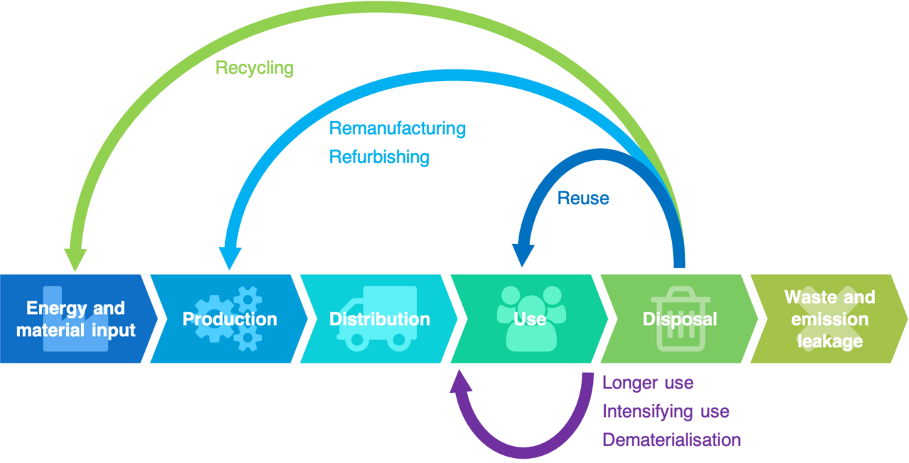

<!--
author:   Juliana Hilf; Hannes Tegelbeckers
email:    juliana.hilf@ovgu.de
version:  1.0.0
language: en
mode:     Textbook
narrator: UK English Female
comment:  GIZ Sustainability Onboarding – Session 5_2: Alternative approaches to green economies. Self-paced, unmoderated. Licence: CC BY-SA 4.0 [CHECK: confirm with GIZ]
-->

# GIZ Sustainability Onboarding 5_2 – Alternative approaches to green economies

**Estimated time:** 25 minutes · **Format:** self-paced, 5 short pages + Serbia page + final self-check

After this session you can:

- identify and briefly describe alternative approaches to green or sustainable economies,
- compare the **green economy** and the **circular economy** and name their differences,
- consider the relevance of these approaches for companies and for the professions your schools train for.

> **How this works:** There is no tutor in this course. Every quiz explains its answer, and every reflection question has an expert view you can compare with. Your notes go into your personal **learning journal** in Moodle – nobody grades them.

Part of: Session 5 – Economic Issues

## 1 What is a green economy?

In 2008, the UN Environment Programme launched the **Green Economy Initiative** to motivate policymakers to support environmental investments. In 2015, at the UN General Assembly, UN Environment published *Uncovering pathways towards an inclusive green economy*. It describes an inclusive green economy with seven concepts: sharing, circularity, collaboration, solidarity, resilience, opportunity and interdependence.

The working definition used in this session is:

> "An inclusive green economy is one that improves human well-being and builds social equity while reducing environmental risks and scarcities."
> — UN Environment (2015)

This approach is seen as an alternative to today's dominant economic model. The argument is that the dominant model exacerbates inequalities, encourages waste, triggers resource scarcities and threatens environment and health. The video below explains the idea in plain language.

Watch for: what the video says a green economy is, and how it differs from the way we produce and consume today.

!?[What is a green economy?](https://www.youtube.com/watch?v=VkOtfvhtawA "Greenpeace UK – What is a green economy? (4:08)")

**Check:** Which statement best describes the green economy as defined by UN Environment?

- [( )] An economy that reduces environmental risks, but only if growth slows down
- [(X)] An economy that improves human well-being and builds social equity while reducing environmental risks and scarcities
- [( )] An economy that replaces all fossil fuels with renewable energy
[[?]] The definition combines three goals at once – well-being, equity and environment.
****************************************
The definition has three parts: better well-being, more social equity, and fewer environmental risks and scarcities. Reducing risks alone, or replacing fossil fuels alone, is only one part. Slowing growth is not part of this definition – that is the point of another approach you will meet later.
****************************************

## 2 Criticism of the green economy

The green economy is not without critics. Several authors (Unmüßig, Sachs & Fatheuer 2012; Brand 2012) raise the same core objections:

- it **ignores the need to reduce consumption** – it assumes we can keep consuming more, just "greener",
- it **sticks to economic growth** as the central goal,
- it offers "**more of the same**" instead of a fundamental transformation of the economy,
- it focuses on **decarbonisation** instead of all planetary boundaries,
- it **relies heavily on technological innovation** to solve environmental problems.

This is an honest position: the green economy is a strong starting point, but some researchers argue it is not enough. You do not need to decide today which side you agree with – but you should know that the debate exists.

**Check:** Which are points of criticism of the green economy? (Select all that apply.)

- [[X]] It ignores the need to reduce consumption.
- [[ ]] It requires a complete stop of economic growth.
- [[X]] It focuses on decarbonisation instead of all planetary boundaries.
- [[X]] It relies heavily on technological innovation.
- [[ ]] It was rejected by the UN Environment Programme in 2015.
[[?]] Remember the five objections listed above – two of the options are not among them.
****************************************
The critics say the green economy keeps growth, keeps consumption high, focuses mainly on carbon, and hopes for technological fixes. "Stopping growth" is not a criticism of the green economy – it is closer to the degrowth position. And UN Environment did not reject the concept; it published the 2015 report on inclusive green economies.
****************************************

> **Learning journal:** Do you think the criticism that the green economy is "more of the same" also applies to how green transformation is discussed in the VET sector you work in? Give one concrete example.

Compare with an expert view

Many ministry officers notice that "green" training is often added as a new module to existing programmes, without changing how schools are funded or organised. School developers often point to curricula that mention sustainability, while teaching methods and assessment stay the same. Principals sometimes describe new "green" equipment that is bought, but not maintained – so the underlying pattern of "buy more" continues. All three examples show the same pattern: the label changes, the system does not.

## 3 The circular economy

The **circular economy** is a model of production and consumption that involves **sharing, leasing, reusing, repairing, refurbishing and recycling** existing materials and products as long as possible. Product life cycles are extended and waste is reduced to a minimum.

In practice: markets give incentives to **reuse** products rather than scrapping them and extracting new resources. Waste such as clothes, scrap metal and obsolete electronics is returned to the economy or used more efficiently. A circular economy can protect the environment, use resources more wisely, develop new sectors, **create jobs** and new capabilities.

The image below shows the basic idea: instead of a line that ends in waste, a loop that keeps materials in use.

*Image: The Circular Economy concept – Geissdoerfer, M., Pieroni, M. P., Pigosso, D. C. A., Soufani, K. – CC BY 4.0 – via Wikimedia Commons – unchanged*

Watch for: how the video explains the difference between a **linear** economy (take, make, dispose) and a **circular** economy (make, use, return). Note which verbs the circular model uses, and how the end of the product's life is different in both models. The video is short – you can watch it once and then answer the check below.

!?[Explaining the Circular Economy and How Society Can Re-think Progress](https://www.youtube.com/watch?v=zCRKvDyyHmI "Ellen MacArthur Foundation – Explaining the Circular Economy and How Society Can Re-think Progress (about 4 min)")

**Check:** Choose the right words: The circular economy moves from the linear "take-make-[[ (dispose) | return ]]" to "make-use-[[ return | (dispose) ]]".

[[?]] The linear model ends in waste. The circular model closes the loop.
****************************************
The linear model ends in waste: take resources, make products, **dispose** of them. The circular model closes the loop: make, use, **return** materials and products to the economy. The two models are mirror images of each other at the end of the product's life.
****************************************

## 4 Green vs. circular economy

Both approaches are often mentioned together, but they are not the same. The table below compares them across six aspects.

| Aspect | Green economy | Circular economy |
|---|---|---|
| Goal | Sustainable development without degrading the environment | Keep products, materials and resources in use as long as possible |
| Focus | Renewable energy, energy efficiency, sustainable agriculture, pollution reduction | Design, reuse, refurbishing, remanufacturing, recycling |
| Model | Integrates environmental sustainability into economic policies | From linear "take-make-dispose" to circular "make-use-return" |
| Economic benefits | Green jobs, sustainable business, green technologies | New business models: leasing, sharing, servitization |
| Examples | Solar and wind projects, green buildings, sustainable farming | Product life extension, industrial symbiosis, recycling systems |
| Policy | Regulation, incentives for clean technology, penalties for polluters | Extended producer responsibility, product-as-a-service, design for longevity |

**Check:** Match each aspect to the approach it belongs to.

- [ [Green economy] [Circular economy] ]
- [ (X)    ( )    ]  Focus on renewable energy, energy efficiency and sustainable agriculture
- [ ( )    (X)    ]  Design, reuse, refurbishing, remanufacturing, recycling
- [ (X)    ( )    ]  Incentives for clean technology and penalties for polluters
- [ ( )    (X)    ]  New business models such as leasing and sharing
[[?]] Look at the "Focus" and "Economic benefits" rows of the table above.
****************************************
The green economy focuses on **clean energy and clean production** (renewables, efficiency, agriculture, pollution) and steers it with regulation and incentives. The circular economy focuses on **keeping products and materials in use** (design, reuse, refurbishing, recycling) and builds new business models like leasing and sharing. Both aim at sustainability – they just work on different parts of the system.
****************************************

## 5 Further approaches and their relevance for professions

Beyond green and circular economies, four more approaches are often discussed:

- **Corporate Social Responsibility (CSR):** a self-regulating business model that helps a company be socially accountable to itself, its stakeholders and the public – operating in ways that enhance society and the environment.
- **Doughnut economics:** the economy is a means to meet everyone's needs within planetary boundaries.
- **Degrowth:** reduced material consumption to stay within ecological limits (strong sustainability).
- **Net zero:** a balance between emissions and removals. Note: net zero is **not** the same as zero emissions, and it differs from "carbon neutral".

These approaches are not only policy terms. They create and shape professions. For example:

- **Circular economy:** repair technicians, refurbishment of electronics and machines, recycling and waste management, design for disassembly.
- **Green economy:** solar and wind installers, energy advisors, efficient-building trades, sustainable agriculture.

**Scenario (school developer):** A company partner offers to set up a **repair workshop** at a VET school: students would repair and refurbish electronics and machines, and the school would collect broken equipment from local businesses instead of scrapping it.

- [(X)] This is an example of the **circular economy** – products are repaired, reused and kept in use, and waste is returned to the economy.
- [( )] This is an example of the **green economy** – it is about renewable energy and clean production.
- [( )] This is an example of **degrowth** – it requires the school to reduce its overall consumption.
[[?]] Which of the six circular verbs (share, lease, reuse, repair, refurbish, recycle) is at the heart of a repair workshop?
****************************************
A repair workshop is a textbook circular-economy example: **repair** and **refurbish** are two of the six core verbs, and broken equipment is returned to the economy instead of being scrapped. It is not primarily about renewable energy (green economy), and it does not require the school to consume less overall (degrowth). Teachers for such a workshop need competences in repair, refurbishment of electronics and machines, and design for disassembly – all listed professions in the source.
****************************************

**Your view:** Which approach is most visible in the companies and sectors you work with today?

[(Circular economy)] [(Green economy)] [(CSR)] [(None of them so far)]

**Self-assessment:** How familiar are you with these terms?

[(I know it well)(I have heard of it)(It is new to me)]
[                                                    ] Circular economy
[                                                    ] Doughnut economics
[                                                    ] Degrowth
[                                                    ] Net zero

> **Learning journal:** Think of one piece of equipment, furniture or IT at your institution that is usually replaced when it breaks. What would a circular approach look like for it – who would repair it, and what would change?

Compare with an expert view

Principals often start with the simplest case: a broken copier, a chair, or a laptop. A circular approach means: first ask "can this be repaired?" and only then decide to buy new. School developers point out that this needs a small change in the school's purchasing rules – a repair-first rule before any new purchase. Ministry officers add that procurement rules at system level can make this easier: for example, requiring that new equipment be designed for repair or disassembly. None of these steps needs new money – they change the order of decisions.

## What this means in Serbia

Serbia has already taken a concrete step in this direction. The **Roadmap for Circular Economy in Serbia** was published by the Ministry of Environmental Protection in **2020**, developed within the UNDP project *Circular Economy Platform for Sustainable Development in Serbia*. Its aims are to encourage circular business models and job creation, and it is meant as a starting document for dialogue between decision-makers, industry, academia and civil society. Serbia was the **first country in the Western Balkans** to produce such a roadmap.

Two more links show that the topic is on the regional agenda: the European Environment Agency (EEA) tracks Serbia's **circular material use rate**, and the **Green Agenda for the Western Balkans** includes circular economy as one of its areas.

**Check:** Which statements about Serbia and the circular economy are correct? (Select all that apply.)

- [[X]] Serbia published a Roadmap for Circular Economy in 2020.
- [[X]] The roadmap was developed within a UNDP project.
- [[X]] Serbia was the first country in the Western Balkans to produce such a roadmap.
- [[ ]] The roadmap was published by the Ministry of Education.
- [[X]] The EEA tracks Serbia's circular material use rate.
[[?]] Check who published the roadmap and which ministry is named in the source.
****************************************
The roadmap was published by the **Ministry of Environmental Protection** in 2020, within the UNDP project, and Serbia was the first country in the Western Balkans to do so. The Ministry of Education is not the publisher – but the roadmap's aim to create jobs and encourage circular business models is directly relevant for the VET system you work in.
****************************************

## Final self-check

Pass mark: 70 %. You can repeat the check as often as you like.

**1.** In which year did the UN Environment Programme launch the Green Economy Initiative?

- [( )] 2012
- [(X)] 2008
- [( )] 2015
****************************************
The Green Economy Initiative was launched in **2008**. The year 2015 is when UN Environment published *Uncovering pathways towards an inclusive green economy* at the UN General Assembly.
****************************************

**2.** Which are benefits of a circular economy? (Select all that apply.)

- [[X]] It can create jobs and new capabilities.
- [[X]] It reduces waste to a minimum.
- [[ ]] It requires stopping all economic growth.
- [[X]] It can develop new sectors.
[[?]] The source lists four benefits – one of the options is a criticism of a different approach.
****************************************
The source names four benefits: protecting the environment, using resources more wisely, developing new sectors, and creating jobs and new capabilities. Stopping growth is not a benefit of the circular economy – it is a position of the degrowth approach.
****************************************

**3.** Match each profession to the approach it belongs to.

- [ [Green economy] [Circular economy] ]
- [ ( )    (X)    ]  Repair technician for electronics and machines
- [ (X)    ( )    ]  Solar and wind installer
- [ ( )    (X)    ]  Recycling and waste management technician
- [ (X)    ( )    ]  Energy advisor
[[?]] Think about which approach each profession serves: clean energy or keeping products in use.
****************************************
Repair technicians and recycling technicians keep products and materials in use – that is the **circular economy**. Solar and wind installers and energy advisors work in the **green economy**, which focuses on renewable energy and efficiency.
****************************************

**4.** Complete the sentence: The circular economy moves from the linear "take-make-dispose" to "make-use-________".

[[return]]
****************************************
The circular model closes the loop: **make, use, return**. Materials and products are returned to the economy instead of ending in waste.
****************************************

**5.** Which statement about "net zero" is correct?

- [( )] Net zero means zero emissions, full stop
- [(X)] Net zero means a balance between emissions and removals
- [( )] Net zero is the same as "carbon neutral"
[[?]] The source makes two distinctions about net zero – remember both.
****************************************
Net zero is a **balance** between emissions and removals – not zero emissions. And it is explicitly **different** from "carbon neutral". Both distinctions come straight from the source.
****************************************

**6.** Which ministry published the Roadmap for Circular Economy in Serbia?

- [( )] The Ministry of Education
- [(X)] The Ministry of Environmental Protection
- [( )] The Ministry of Economy
****************************************
The roadmap was published by the **Ministry of Environmental Protection** in 2020, within the UNDP project. It is relevant for the VET system because it aims to encourage circular business models and job creation.
****************************************

## Sources and licences

- Hilf, J. (2024): *SDGs and Sustainable Economies*. GIZ training, Day 2 – adapted (incl. comparison table)
- Hilf, J. (2025): *Models of Sustainability …*. GIZ workshop – adapted
- Hilf, J. (2026): *Green TVET – Concepts and practical approaches*. Expert input – adapted
- UN Environment (2015): *Uncovering pathways towards an inclusive green economy*; UNEP: *About Green Economy* – https://www.unep.org/explore-topics/green-economy/about-green-economy – quoted/summarised
- Unmüßig, B., Sachs, W. & Fatheuer, T. (2012): *Critique of the green economy*. Heinrich Böll Foundation; Brand, U. (2012): Green Economy – the Next Oxymoron? *GAIA* 21(1) – via Hilf
- UNCTAD: *Circular economy* – https://unctad.org/topic/trade-and-environment/circular-economy – summarised
- Doughnut Economics Action Lab – https://doughnuteconomics.org/tools/what-is-the-doughnut – linked
- Climatepartner (2024): *What does net zero mean?* – via Hilf (2025)
- Ministry of Environmental Protection of Serbia (2020): *Roadmap for Circular Economy in Serbia* – https://circulareconomy.europa.eu/platform/sites/default/files/roadmap-for-circular-economy-in-serbia.pdf; UNDP Serbia – https://www.undp.org/serbia/publications/roadmap-circular-economy-serbia – summarised
- EEA: *Circular material use rate – Serbia* – https://www.eea.europa.eu/en/europe-environment-2025/countries/serbia/circular-material-use-rate – linked
- Regional Cooperation Council: *Sofia Declaration on the Green Agenda for the Western Balkans* – linked
- Videos: Ellen MacArthur Foundation – https://www.youtube.com/watch?v=zCRKvDyyHmI; Greenpeace UK – https://www.youtube.com/watch?v=VkOtfvhtawA – embedded
- Image: Geissdoerfer et al. – *The Circular Economy concept* – CC BY 4.0 – https://commons.wikimedia.org/wiki/File:The_Circular_Economy_concept.png – unchanged
- This session: GIZ Sustainability Onboarding, GIZ / OVGU, 2026 – CC BY-SA 4.0 [CHECK: confirm with GIZ]
