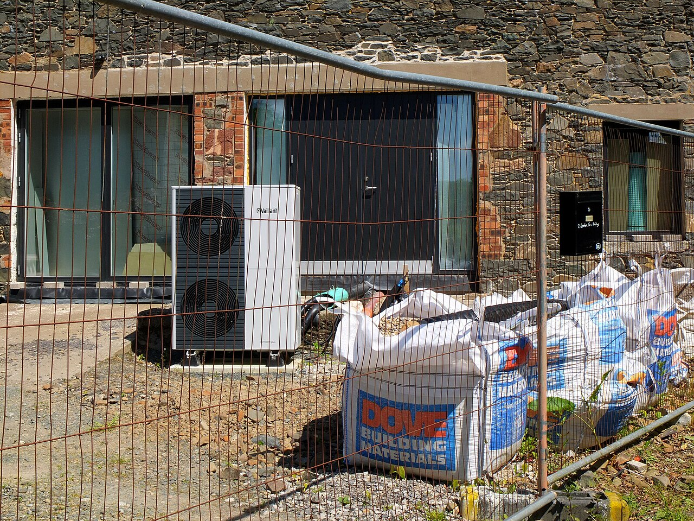
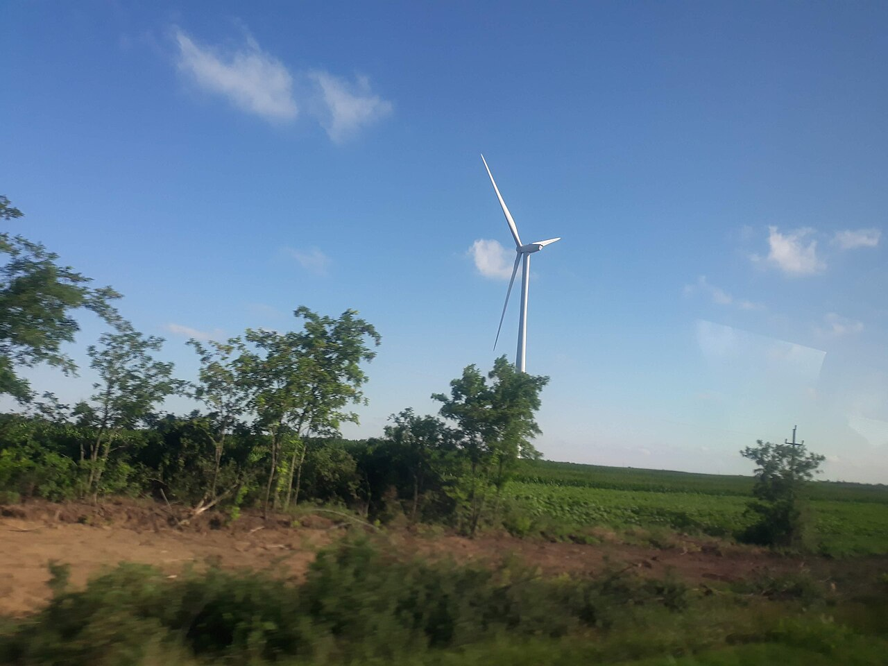

<!--
author:   Juliana Hilf; Hannes Tegelbeckers
email:    juliana.hilf@ovgu.de
version:  1.0.0
language: en
mode:     Textbook
narrator: UK English Female
comment:  GIZ Sustainability Onboarding – Session 6_1: Pathways towards a great transformation. Self-paced, unmoderated. Licence: CC BY-SA 4.0 [CHECK: confirm with GIZ]
-->

# GIZ Sustainability Onboarding 6_1 – Pathways towards a great transformation

**Estimated time:** 25 minutes · **Format:** self-paced, 5 content pages + Serbia page + final self-check

After this session you can:

- outline possible **pathways and strategies** for societal transformation towards sustainability,
- name the main **actors** at each level of a pathway (society, science, policy makers, industries),
- relate these pathways to current debates and examples (European Green Deal, Serbia, TVET).

> **How this works:** There is no tutor in this course. Every quiz explains its answer, and every reflection question has an expert view you can compare with. Your notes go into your personal **learning journal** in Moodle – nobody grades them.

Part of: Session 6 – Responding to Sustainability Challenges

## 1 What is a "great transformation"?

So far you have looked at problems: ecological limits, social and economic challenges. This session turns to the other side: **how do societies actually change?**

The German Advisory Council on Global Change (WBGU) used the expression "great transformation" in 2011. Its report *World in Transition – A Social Contract for Sustainability* argues that the transformation towards sustainability is as deep as the great transformations of earlier centuries. It cannot be achieved by technology alone. It needs a new **"social contract"** between citizens, science, business and the state. [CHECK: Juliana – confirm wording against the WBGU summary for policy-makers]

Two important consequences follow from this:

- The transformation is **normative**: it is a goal society chooses, not a technical problem with one solution.
- It is **contested**: different actors weigh goals differently. That is why it relies on **constant negotiation and societal learning** (UNESCO 2022).

In other words: a pathway is not a straight line. It is a route that is negotiated again and again – by governments, companies, schools, and citizens.

**Check:** According to the WBGU (2011), what does the transformation towards sustainability mainly need?

- [( )] A single international law that all countries must follow
- [(X)] A new "social contract" between citizens, science, business and the state
- [( )] Only technical innovation – society can stay the same
[[?]] Think about who has to agree to change, not just what has to be built.
****************************************
The WBGU (2011) argues that the transformation is as deep as earlier great transformations and therefore needs a new **social contract** between citizens, science, business and the state. A single law cannot do it, because the goal is normative and contested. And technology alone is not enough, because the change also concerns how we consume, organise work and make decisions.
****************************************

## 2 Five strategies for transformation

Debates about transformation usually revolve around five strategies. You will recognise them again in policy documents from the EU and from Serbia:

| Strategy | In plain words |
|---|---|
| **Efficiency** | Doing more with fewer resources (weak sustainability). |
| **Sufficiency** | Using less, consuming differently (strong sustainability, degrowth – growing the economy less). |
| **Consistency / circularity** | Closing loops so materials stay in use (circular economy). [CHECK: Juliana – "consistency" is a common third strategy in German debates; keep or drop] |
| **Decarbonisation / net zero** | Reduce emissions, balance the rest (Paris Agreement, European Green Deal). |
| **Just transition** | Make the change fair for workers and regions (EU Just Transition Mechanism; ILO). |

These strategies are not alternatives that exclude each other. A real pathway usually combines several – for example, a school that installs heat pumps (efficiency), buys them as a shared service (sufficiency) and keeps them repairable (circularity).



*Image: Heat pump installation – Jim Barton – CC BY-SA 2.0 – via Wikimedia Commons / geograph.org.uk – unchanged*

**Check:** Match each example to the strategy it best illustrates.

- [ [Efficiency] [Sufficiency] [Circularity] [Decarbonisation] [Just transition] ]
- [ (X)    ( )    ( )    ( )    ( )    ]  LED lighting in a school building
- [ ( )    (X)    ( )    ( )    ( )    ]  Car-sharing instead of private cars
- [ ( )    ( )    (X)    ( )    ( )    ]  A repair workshop for machines and tools
- [ ( )    ( )    ( )    (X)    ( )    ]  A new solar park
- [ ( )    ( )    ( )    ( )    (X)    ]  Retraining coal miners for green jobs
[[?]] Ask: does the example use less of a resource (efficiency), less consumption (sufficiency), keep materials in use (circularity), reduce emissions (decarbonisation), or protect workers (just transition)?
****************************************
LED lighting uses **less energy for the same light → efficiency**. Car-sharing means **fewer cars in total → sufficiency**. A repair workshop **keeps materials in use → circularity**. A solar park **replaces fossil electricity → decarbonisation**. Retraining coal miners makes the change **fair for workers → just transition**. Note that real projects often combine several strategies at once.
****************************************

## 3 A pathway from policy to jobs

How do these strategies become reality? One simple pathway connects the levels from today's situation to the 2050 vision:

```
ascii
Today (fossil-based, linear)
  → Targets & policies (Paris Agreement, European Green Deal,
     Green Agenda for the Western Balkans, Serbian climate law)
  → New tasks in companies (renewables, efficiency, circularity)
  → New skills & qualifications (VET standards, curricula, teacher training)
  → Green jobs & just transition (2050 vision)
```

Every arrow is a job for a different group of actors. Responsibility for the transformation lies with **society, science, policy makers and industries** (Leal Filho et al. 2021). Change can be initiated in several ways: through **democracy and politics**, through **participation and social engagement**, through **work decisions** (changing how organisations operate) and through **everyday decisions**.

Your role in this pathway is the fourth arrow: policy creates new tasks, and VET must turn them into skills and qualifications. The following video shows how the GIZ project *TVET4GreenJobs* makes that link.

Watch for: how the video connects climate goals with jobs, and which groups it names as partners in the transition.

!?[TVET4GreenJobs: Skills for a Just Transition to a Green Future](https://www.youtube.com/watch?v=P-L2YULZHVI "GIZ – TVET4GreenJobs: Skills for a Just Transition to a Green Future (3:45)")

**Check:** In the source material, what does the GIZ project *TVET4GreenJobs* connect?

- [( )] Only school curricula and examination formats
- [(X)] Climate goals and jobs – skills for a just transition to a green future
- [( )] Household energy use and private consumption
[[?]] Look at the project's title.
****************************************
The project title says it: *Skills for a Just Transition to a Green Future*. The link is between **climate goals and jobs** – VET prepares people for the new tasks that a greener economy creates. This is exactly the fourth arrow of the pathway diagram: new skills and qualifications.
****************************************

> **Learning journal:** Pick one sector (for example energy, transport, waste or agriculture). Describe one pathway from a policy target to a VET offering in that sector – in three or four sentences.

<details>
<summary>Compare with an expert view</summary>

A good answer follows the four arrows of the diagram. Example (energy): a policy sets a target for renewable energy → companies and municipalities build solar parks and heat-pump systems and need installers → VET updates standards, curricula and teacher training for these occupations → graduates fill green jobs, including in regions affected by the shift away from coal. A ministry officer might emphasise the first two arrows (targets and standards), a school developer the middle ones (curricula, teacher training), and a principal the last one (training places, company partnerships). All three views describe the same pathway from different positions.

</details>

## 4 Example from policy: the European Green Deal

The clearest recent example of a societal pathway is the **European Green Deal** (European Commission). Its central commitments:

- **Net zero** greenhouse gas emissions by **2050**,
- at least **−55 %** emissions by **2030** (compared with 1990),
- a package of policies: **clean energy**, **circular economy**, **sustainable mobility**, **Farm to Fork** (a policy for more sustainable food production), **zero pollution**,
- a **Just Transition Mechanism** to support regions and workers affected by the change,
- at least **EUR 1 trillion** in investments.

Notice what is missing from this list: a ban on all fossil fuels by a fixed date. The Green Deal is a **steering framework** – it sets targets, funds investment and protects the most vulnerable. That is what a "pathway" means in practice: a direction, a budget, and rules for fairness.

The European Commission has a short introductory video (optional, 3:13):

!?[European Green Deal: Achieving Climate Neutrality and Economic Growth](https://www.youtube.com/watch?v=e-OiG6p2dHQ "European Commission – European Green Deal: Achieving Climate Neutrality and Economic Growth (3:13)")

**Check:** Which statements describe the European Green Deal? (Select all that apply.)

- [[X]] It aims at net zero greenhouse gas emissions by 2050.
- [[ ]] It plans to phase out all fossil fuels completely by 2025.
- [[X]] It includes the Farm to Fork policy and a zero pollution goal.
- [[X]] It sets up a Just Transition Mechanism for affected regions and workers.
- [[ ]] It is financed only by voluntary donations from companies.
[[?]] Check each option against the list above – the source names the elements explicitly.
****************************************
The Green Deal aims at **net zero by 2050**, includes **Farm to Fork** and **zero pollution**, and sets up the **Just Transition Mechanism**. It does **not** promise a complete fossil-fuel phase-out by 2025 – it is a framework of targets, policies and investments (at least EUR 1 trillion), not a single ban.
****************************************

## 5 TVET as part of the pathway

The pathway diagram shows why education is not a side track but a **load-bearing step**: without new skills and qualifications, new tasks in companies cannot be filled.

Two international documents frame this role of TVET:

- **UNESCO TVET strategy 2022–2029** – *Transforming TVET for successful and just transitions*: TVET should build skills for work and life, for inclusive and sustainable economies, and for inclusive and peaceful societies.
- **Cedefop & UNESCO-UNEVOC (2025)** – *Meeting skill needs for the green transition – Skills anticipation and VET for a greener future* (Practical guide 4): a guide on how to anticipate green skill needs and turn them into VET. (Linked only – read it directly at the source.)

The last strategy of page 2 becomes especially important here: a **just transition** means the change is fair for workers and regions. The ILO explains this idea in a short video.

Watch for: who is affected by the transition, and what "fair" means in practice.

!?[A just transition to a new, greener life](https://www.youtube.com/watch?v=xu-PyeicH64 "ILO – A just transition to a new, greener life (2:40)")

**Check:** In this course, what does the term "just transition" mean?

- [( )] A transition that is finished as quickly as possible
- [(X)] A transition that is fair for workers and regions affected by the change
- [( )] A transition that is financed only by the EU
[[?]] The word "just" means "fair" – ask who must be protected.
****************************************
"Just" here means **fairness**: workers and regions that lose jobs or industries during the change must not be left behind. That is why the EU has a Just Transition Mechanism and why UNESCO names "successful **and just** transitions" in its TVET strategy. Speed and financing are relevant, but they are not what the term defines.
****************************************

> **Learning journal:** Look again at the pathway diagram. Which obstacle do you see on this pathway in your role – as a ministry officer, a school developer or a principal?

<details>
<summary>Compare with an expert view</summary>

Typical obstacles appear at different arrows. A **ministry officer** may see slow updates of occupational standards or a gap between climate targets and education policy. A **school developer** may see that curricula and teacher training lag behind new company tasks, or that few companies offer training places in green occupations. A **principal** may see budget limits, a shortage of qualified teachers, or the difficulty of keeping partnerships with companies that are themselves in transition. None of these obstacles stops the pathway – but each one needs a concrete answer at its level, which is exactly what "constant negotiation and societal learning" means.

</details>

## 6 What this means in Serbia

Serbia has its own set of targets that feed into the pathway diagram:

- **Low Carbon Development Strategy 2023–2030 with projections until 2050** (Official Gazette 46/2023): covers energy, industry, transport, agriculture, forestry and waste; the 2050 vision explicitly includes **green jobs**.
- **NDC 2022:** −33.3 % greenhouse gas emissions by 2030 compared with 1990 (without land use).
- **NDC 3.0 (September 2025):** −40.1 % by 2035 compared with 1990 (conditional). CAN Europe notes that Serbia raised its ambition, but the 2030 target was not updated.
- The starting point is still fossil-based: about **60 %** of electricity comes from lignite (2024), while wind provides about **3 %**.
- At the regional level, the **Green Agenda for the Western Balkans** (Sofia Declaration, 10 November 2020) sets a common direction.

New renewable capacity is already visible in Serbia:



*Image: Wind farm Čibuk 1 (2018) – Ivan25 – CC BY-SA 4.0 – via Wikimedia Commons – unchanged* [CHECK: Juliana – add capacity/year from an official source if wanted]

**Check (scenario):** You are a ministry officer. Looking at the pathway diagram of page 3, which step is your ministry's most direct lever?

- [( )] New tasks in companies – the ministry should run the companies
- [(X)] Targets & policies – the ministry sets the framework the whole pathway follows
- [( )] Everyday decisions of citizens – the ministry decides them directly
[[?]] Which arrow of the diagram sits closest to the work of a ministry?
****************************************
A ministry works mainly at the **"Targets & policies"** step: it sets the framework (strategy, standards, funding rules) that companies, schools and citizens then follow. It does not run companies, and it cannot decide everyday behaviour directly – it can only steer the conditions. That is why the quality of the policy step decides how fast the later steps move.
****************************************

**Your view:** Which of the five strategies do you think is the most realistic for Serbia by 2030? (No right answer – this is your opinion, nothing is graded.)

[(a)] Efficiency – doing more with fewer resources
[(b)] Sufficiency – using less, consuming differently
[(c)] Consistency / circularity – keeping materials in use
[(d)] Decarbonisation / net zero – reducing emissions
[(e)] Just transition – making the change fair for workers and regions

## Final self-check

Pass mark: 70 %. You can repeat the check as often as you like.

**1.** According to the WBGU (2011), the transformation towards sustainability needs …

- [( )] a faster rollout of existing technologies
- [(X)] a new "social contract" between citizens, science, business and the state
- [( )] a single European law for all countries
****************************************
The WBGU (2011) sees the transformation as a societal change as deep as earlier great transformations – it needs a new social contract, not only new technology or one law.
****************************************

**2.** Complete the sentence: "The transformation towards sustainability relies on constant ______ and societal learning."

[[negotiation]]
****************************************
Because the transformation is normative and contested, it relies on **constant negotiation** between the different actors (UNESCO 2022).
****************************************

**3.** Which statements apply to the European Green Deal? (Select all that apply.)

- [[X]] Net zero greenhouse gas emissions by 2050
- [[X]] At least −55 % emissions by 2030 compared with 1990
- [[ ]] A complete phase-out of fossil fuels by 2025
- [[X]] A Just Transition Mechanism for affected regions and workers
****************************************
The Green Deal combines the **2050 net zero** target, the **−55 % by 2030** target and the **Just Transition Mechanism**. It does **not** promise a full fossil-fuel phase-out by 2025.
****************************************

**4.** Match each example to the actor level it best represents.

- [ [Policy] [Business] [Civil society] ]
- [ (X)    ( )    ( )    ]  The European Green Deal
- [ ( )    (X)    ( )    ]  A company energy audit
- [ ( )    ( )    (X)    ]  A school strike for the climate
[[?]] Ask: who decides, who operates, who mobilises?
****************************************
The **European Green Deal** is a policy framework. A **company energy audit** is a work decision inside an organisation – business. A **school strike for the climate** is social engagement – civil society. All three levels can initiate change, as the source list of ways to initiate change shows.
****************************************

**5.** Choose the right word: The WBGU (2011) report *World in Transition – A Social Contract for Sustainability* argues that the transformation needs a new social [[ (contract) | law | budget ]] between citizens, science, business and the state.

****************************************
The WBGU's central idea is a new **social contract** – an agreed, negotiated framework between the four groups of actors, not a single law or a budget line.
****************************************

**6.** What does Serbia's NDC 3.0 (September 2025) commit to?

- [( )] −33.3 % greenhouse gas emissions by 2030
- [(X)] −40.1 % greenhouse gas emissions by 2035 compared with 1990 (conditional)
- [( )] Net zero greenhouse gas emissions by 2045
[[?]] NDC 3.0 is the newer, 2025 document – check both the percentage and the year.
****************************************
NDC 3.0 (September 2025) commits to **−40.1 % by 2035** compared with 1990 (conditional). The **−33.3 % by 2030** figure belongs to the earlier NDC 2022, and CAN Europe notes that the 2030 target was not updated.
****************************************

## Sources and licences

- *World in Transition – A Social Contract for Sustainability* – WBGU, 2011 – https://www.wbgu.de/en/publications/publication/world-in-transition-a-social-contract-for-sustainability – summarised
- *Introduction to the Sustainability Approach* – Hilf, J., 2024, GIZ training, Day 1 – adapted
- *SDGs and Sustainable Economies* – Hilf, J., 2024, GIZ training, Day 2 – adapted
- *Models of Sustainability …* – Hilf, J., 2025, GIZ workshop – adapted
- *Green TVET – Concepts and practical approaches* – Hilf, J., 2026, expert input – adapted
- *Transforming TVET for successful and just transitions. UNESCO strategy 2022–2029* – UNESCO, 2022 – summarised
- *Meeting skill needs for the green transition – Skills anticipation and VET for a greener future* (Practical guide 4) – Cedefop & UNESCO-UNEVOC, 2025 – https://www.cedefop.europa.eu/en/publications/4220 – linked only
- *Sofia Declaration on the Green Agenda for the Western Balkans* – Regional Cooperation Council, 2020 – https://www.rcc.int/docs/546/sofia-declaration-on-the-green-agenda-for-the-western-balkans – linked
- *Low Carbon Development Strategy Serbia 2023–2030 with 2050 Projections* – Republic of Serbia, 2023 – https://unfccc.int/sites/default/files/resource/Low_Carbon_Development_Strategy_Serbia_2023-2030_with_2050_Projections.pdf – summarised
- Serbia NDCs – NDC Partnership – https://ndcpartnership.org/country/srb ; CAN Europe – https://caneurope.org/western-balkans-ndcs-3-0-serbia-joins-montenegro-in-updating-climate-commitments – summarised
- *The energy sector in Serbia* – CEE Bankwatch Network – https://bankwatch.org/beyond-coal/the-energy-sector-in-serbia – summarised
- Video: *TVET4GreenJobs: Skills for a Just Transition to a Green Future* – GIZ – https://www.youtube.com/watch?v=P-L2YULZHVI – embedded
- Video: *A just transition to a new, greener life* – ILO – https://www.youtube.com/watch?v=xu-PyeicH64 – embedded
- Video: *European Green Deal: Achieving Climate Neutrality and Economic Growth* – European Commission – https://www.youtube.com/watch?v=e-OiG6p2dHQ – embedded
- Image: *Wind farm Čibuk 1 (2018) 2* – Ivan25, CC BY-SA 4.0 – https://commons.wikimedia.org/wiki/File:Wind_farm_%C4%8Cibuk_1_(2018)_2.jpg – unchanged
- Image: *Heat pump installation* – Jim Barton, CC BY-SA 2.0 – https://commons.wikimedia.org/wiki/File:Heat_pump_installation_-_geograph.org.uk_-_7495844.jpg – unchanged
