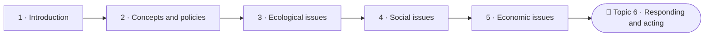

<!--
author:   Juliana Hilf; Hannes Tegelbeckers
email:    juliana.hilf@ovgu.de
version:  2.0.0
language: en
narrator: UK English Female
mode:     Presentation
comment:  GIZ Sustainability Onboarding, session 1, Introduction to Sustainability. Self-paced and unmoderated. Licence CC BY-SA 4.0 [CHECK confirm with GIZ]

import:   https://raw.githubusercontent.com/LiaTemplates/mermaid_template/0.1.4/README.md
-->

# GIZ Sustainability Onboarding 1 – Introduction to Sustainability

    --{{0}}--
Welcome to the Onboarding to Green Transformation. This is the first session. If you can, turn the sound on. If not, that is fine, because everything important is also written on the pages.

**Main topic · about 20 minutes · self-paced · no tutor**

> [!TIP] How this works
> Turn the sound on if you can; everything important is also on the page. Every quiz explains its answer, hints appear after a wrong try, and you can try again as often as you like. Your written notes are your personal learning journal – nobody grades them.

> [!IMPORTANT] Completing this session in Moodle
> You pass with at least 70 % of the quizzes correct **and** every survey and text box submitted. A few words are enough. Finish in one sitting if you can, because answers may be lost when you reload the page.

> [!NOTE] The case in this course
> You will follow Milica Stojanović, principal of Ravnica Technical School, and her colleagues Stefan Ilić (school developer) and Jelena Marković (ministry officer). The people, the school and the ministry's letter are fictional. The facts around them are real, and the sources are on the last page.

## The Water Came in May

    --{{0}}--
May 2014. After days of extreme rain, floods hit Serbia. Obrenovac, near Belgrade, was one of the worst-affected towns.

<!-- style="max-width:100%;width:60%;display:block;margin:0 auto;" -->

**May 2014:** after days of extreme rain, floods hit Serbia, and Obrenovac near Belgrade was one of the worst-affected towns. Milica Stojanović still remembers that May. She is the principal of Ravnica Technical School, a VET school in the Kolubara region (school and person are fictional). This year a letter from the Ministry of Education is on her desk: every school should prepare a short *green plan*. The word "sustainable" appears nine times in the letter.

    --{{1}}--
Milica has one question before she can write anything.

      {{1}}
> [!IMPORTANT] Guiding question
> What does "sustainable" actually mean – and why should a technical school care?

    --{{2}}--
Before we start, a quick estimate. There is no penalty for a wrong guess.

      {{2}}
****************************************

**Predict:** How many people in Serbia were affected by the floods of May 2014?

<!-- data-hint-button="1" data-solution-button="2" -->
- [(X)] About 1.6 million people
- [( )] About 16,000 people
- [( )] About 160,000 people
[[?]] It was roughly one fifth of the population of Serbia.
***
About 1.6 million people were affected – roughly a fifth of the population.
***

****************************************

    --{{3}}--
So this is not an abstract topic. It reaches the regions where schools work. This is where our course begins.

      {{3}}
> [!NOTE] What really happened
> More than 1.6 million people were affected. Sustainability is not only a word in project texts: it is about risks that reach the regions where your schools work. This course helps you, like Milica, to work with the term confidently. You do not need any prior knowledge.

## The Road Ahead

    --{{0}}--
Here is the whole course as a road: six main topics, and you are at the start of the first. Milica's green plan grows along this road.

    --{{1}}--
This session is short by design. It orients you and shows you where to go next. Here is what you take away from it.

      {{1}}

<!-- data-type="none" -->
| Know | Can do | Value |
|------|--------|-------|
| How the term emerged historically | Describe the historical emergence of the term | Fairness towards people today and in future |
| Key milestones in its development | Recognise the milestones and choose your next subtopic | Responsibility for decisions you can influence |

    --{{2}}--
A quick question on the map.

      {{2}}
****************************************

**Decide:** In which topic do you plan your own initiative?

<!-- data-hint-button="1" data-solution-button="2" -->
- [(X)] Topic 6 · Responding and acting
- [( )] Topic 1 · Introduction
- [( )] Topic 3 · Ecological issues
[[?]] Follow the road to its end.
***
Right. The course is part of the GIZ project "Teaching skills for green transformation" (Serbia, January 2024 to December 2026, partner: Ministry of Education), which revises VET programmes to include green skills.
***

****************************************

## Stripes from Blue to Red

    --{{0}}--
Back to Milica. She opens the staff meeting with this image. Each stripe is one year, from 1850 to 2018. Blue means a cooler year, red a warmer one. Look at the direction of travel.

<!-- style="max-width:100%;width:60%;display:block;margin:0 auto;" -->
 – Ed Hawkins (University of Reading) – CC BY-SA 4.0 – via Wikimedia Commons")

Each stripe is one year from 1850 to 2018: blue means a cooler year, red a warmer one. Look at the direction of travel.

The evidence behind the image comes, among others, from the **IPCC** (Intergovernmental Panel on Climate Change), the UN body for the scientific assessment of climate change. Its 2023 Synthesis Report concludes that global warming today is already about 1.1 °C, that a liveable future is still possible, and that emissions must fall faster than they have so far.

"Pre-industrial level" means the average temperature between 1850 and 1900, before industrial heating of the climate.

    --{{1}}--
One teacher asks: so sustainability is simply a scientific term? Milica has an answer from the sustainability researcher Juliana Hilf.

      {{1}}
> The concept of sustainable development is not the result of scientific research; instead, it is an ethically grounded concept.
>
> -- Juliana Hilf (2024), Introduction to the Sustainability Approach

    --{{2}}--
In plain words, it is about what we owe to the environment, to people today and to people who will come after us. So what is fact, and what is a goal?

      {{2}}
> [!IMPORTANT] Problem
> Science describes what is happening. The ethical question is what we owe to the environment, to people today and to people who will come after us. To work with the term, you need to keep the two apart.

## One Hot Year, One Long-Term Goal

    --{{0}}--
Here is a test. Stefan, the school developer, reads three statements in the news. Which one is correct?

**Predict:** Which statement about the temperature record is correct?

<!-- data-hint-button="1" data-solution-button="2" -->
- [(X)] 2024 was the first calendar year with a global average temperature of about 1.60 °C above the pre-industrial level.
- [( )] The Paris goal has already been missed, because one year was above 1.5 °C.
- [( )] The IPCC recommends political action to governments.
[[?]] Think about how the Paris goal counts temperature: one single year, or an average over many years?

    --{{1}}--
The Paris goal refers to an average over at least twenty years. And the IPCC deliberately does not recommend political action.

      {{1}}
> [!NOTE] Observe
> The Paris goal refers to an average over at least 20 years, so one year above 1.5 °C does not yet mean the goal has been missed. The IPCC provides the scientific basis for decisions; it deliberately does not recommend political action.

    --{{2}}--
Now try to explain this in your own words, as if a colleague had asked you.

      {{2}}
****************************************

**Explain:** A colleague says: "2024 was above 1.5 °C, so Paris has failed." What do you answer?

[[___ ___ ___]]

****************************************

## What Unsustainable Looks Like

    --{{0}}--
Unsustainable development is not an abstract idea. It shows up in concrete problems. Here are four areas Milica collects for her staff.

**Where does unsustainable development show up?**

    --{{1}}--
First, forests and reefs. Deforestation disrupts water cycles and contributes to climate change. Coral reefs are dying off, and this affects the people who depend on them.

      {{1}}
- **Forests and reefs:** deforestation causes biodiversity loss and disrupts water cycles; coral reefs die off through ocean acidification and rising temperatures, which affects livelihoods

    --{{2}}--
Second, plastic. Four hundred million tons are produced every year, and each day more than two thousand garbage trucks' worth ends up in oceans, rivers and lakes.

      {{2}}
- **Plastic pollution:** 400 million tons of plastic are produced every year; each day over 2,000 garbage trucks' worth of plastic waste ends up in oceans, rivers and lakes

    --{{3}}--
Third, inequality. Women are often more affected by extreme weather, because they have less access to resources, decision-making power and mobility.

      {{3}}
- **Gender inequality:** women are more affected by extreme weather events, because they often have limited access to resources, decision-making power and mobility

    --{{4}}--
And fourth, climate change, with more heatwaves, extreme rain, hurricanes, dry periods and floods.

      {{4}}
- **Climate change:** more extreme weather events such as heatwaves, extreme rain, hurricanes, dry periods and floods

    --{{5}}--
Why does this matter for a school? Because schools train the people who will deal with these problems.

      {{5}}
> [!TIP] Why this matters
> These areas reach far beyond the environment. They affect people, livelihoods and the regions where schools work, and they shape the occupations VET prepares for.

    --{{6}}--
Which of these areas did you already know about? Mark them. Nobody grades this.

      {{6}}
****************************************

**Mark:** Which of these do you already know? (several possible)

[[a1]] **Forests and reefs:** deforestation causes biodiversity loss and disrupts water cycles; coral reefs die off through ocean acidification and rising temperatures, which affects livelihoods
[[a2]] **Plastic pollution:** 400 million tons of plastic are produced every year; each day over 2,000 garbage trucks' worth of plastic waste ends up in oceans, rivers and lakes
[[a3]] **Gender inequality:** women are more affected by extreme weather events, because they often have limited access to resources, decision-making power and mobility
[[a4]] **Climate change:** more extreme weather events such as heatwaves, extreme rain, hurricanes, dry periods and floods

****************************************

## Sustainability in Three Minutes

    --{{0}}--
Milica shows this short video at the end of the staff meeting. Before you press play, read the two things to watch for.

> [!TIP] Watch for
> 1. how the video connects environment, society and economy
> 2. which everyday examples it uses to explain sustainability

!?[What is Sustainability](https://www.youtube.com/watch?v=zx04Kl8y4dE "UCLA – What is Sustainability (3:06)")

Text summary of the video

The video (UCLA, 3:06) introduces the topic by connecting environment, society and economy, and it explains sustainability with everyday examples. If you cannot watch it, you can continue: the questions below only use what this course has already explained.

    --{{1}}--
One question on what Juliana Hilf said earlier.

      {{1}}
****************************************

**Decide:** "Ethically grounded" means that sustainability is about …

<!-- data-hint-button="1" data-solution-button="2" -->
- [( )] measuring temperatures as exactly as possible
- [(X)] what we owe to the environment, to people today and to people who will come after us
- [( )] following the recommendations of the IPCC
[[?]] Think about the word "owe".
***
Exactly. Measuring is the work of science, and the IPCC deliberately makes no recommendations. Sustainability asks what we owe to others.
***

****************************************

    --{{2}}--
And one word to type.

      {{2}}
****************************************

**Type:** The video connects environment, economy and which third area? (one word)

<!-- data-hint-button="1" data-solution-button="2" -->
[[society]]
[[?]] It is about people living together.

****************************************

## A Word Older Than You Think

    --{{0}}--
Now to Milica's first question: where does the word come from? The story starts much earlier than any report. This is the title page of a book from 1713.

 – public domain – via Wikimedia Commons")

In 1713, the German forester Hans Carl von Carlowitz published *Sylvicultura oeconomica*. In it he uses the German term for sustainable forestry ("nachhaltende Nutzung").

Later milestones built on this idea: the Brundtland Report *Our Common Future* (1987), *Agenda 2030* with its 17 Sustainable Development Goals, and the Paris Agreement (both 2015).

Session 1_1 tells the full story of the word, and Session 1_2 follows the milestones.

    --{{1}}--
Remember this one idea.

      {{1}}
> [!NOTE] Key message
> Sustainability started as a practical rule for forests and became a set of global goals.

    --{{2}}--
Let us check that the name has stuck.

      {{2}}
****************************************

**Type:** Who used the German term for sustainable forestry in 1713? (surname)

<!-- data-hint-button="1" data-solution-button="2" -->
[[Carlowitz]]
[[?]] It is on the title page above: Hans Carl von …

***
Hans Carl von Carlowitz. You will meet him again in Session 1_1.
***

****************************************

## Where Do You Start?

    --{{0}}--
Topic one has two subtopics. Which one should come first depends on what you already know. Look at four terms.

**How familiar are these four terms?**

    --{{1}}--
The Brundtland definition, from the report of 1987.

      {{1}}
- **Brundtland definition** (1987)

    --{{2}}--
Carlowitz, whom you have just met.

      {{2}}
- **Carlowitz** (1713)

    --{{3}}--
Agenda 2030, with its seventeen goals.

      {{3}}
- **Agenda 2030** (2015)

    --{{4}}--
And the IPCC, the UN body for the scientific assessment of climate change.

      {{4}}
- **IPCC**

    --{{5}}--
Here is the recommendation. If Brundtland and Carlowitz are new, start with 1_1. If you know the origin but Agenda 2030 or the IPCC feel vague, start with 1_2. If you know all four, read 1_1 quickly and spend your time in 1_2.

      {{5}}
> [!TIP] Why this matters
> **Start with 1_1** if Brundtland and Carlowitz are new. **Start with 1_2** if you know the origin, but Agenda 2030 or the IPCC feel vague. **Know all four?** Read 1_1 quickly and spend most of your time in 1_2.

    --{{6}}--
Now mark the terms you already know, and use your answer to choose your next session.

      {{6}}
****************************************

**Mark:** Which of these do you already know? (several possible)

[[a1]] **Brundtland definition** (1987)
[[a2]] **Carlowitz** (1713)
[[a3]] **Agenda 2030** (2015)
[[a4]] **IPCC**

****************************************

## Warm-up Check

    --{{0}}--
Three questions, as a warm-up and not an exam. Every question explains its answer.

**1 · Choose one:** Who wrote the Brundtland definition of sustainable development?

<!-- data-hint-button="1" data-solution-button="2" -->
- [( )] The IPCC, in its 2023 Synthesis Report
- [(X)] The World Commission on Environment and Development (WCED), in 1987
- [( )] The Club of Rome, in *The Limits to Growth*
[[?]] The report is called *Our Common Future*.
***
The Brundtland definition comes from the report *Our Common Future*, written in 1987 by the World Commission on Environment and Development. *The Limits to Growth* is an earlier milestone from 1972. The IPCC provides the scientific assessment of climate change and does not define development.
***

    --{{1}}--
Next, which of these did Milica put on her list of problems of unsustainable development?

      {{1}}
****************************************

**2 · Choose all that apply:** Which of these are named as problems of unsustainable development in this session?

<!-- data-hint-button="1" data-solution-button="2" -->
- [[X]] Plastic pollution in oceans, rivers and lakes
- [[ ]] A shortage of teachers in VET schools
- [[X]] Dying coral reefs that affect people's livelihoods
- [[ ]] Too many school holidays
[[?]] The session named forests and reefs, plastic, gender inequality and climate change.
***
Plastic pollution and dying coral reefs are named as problems of unsustainable development. A teacher shortage is a real challenge in education, but it is not one of the problems listed here. Keep the two types of challenge separate.
***

****************************************

    --{{2}}--
And one number to type.

      {{2}}
****************************************

**3 · Type:** In which year was the Brundtland Report *Our Common Future* published? (4 digits)

<!-- data-hint-button="1" data-solution-button="2" -->
[[1987]]
[[?]] It lies between Carlowitz in 1713 and Agenda 2030 in 2015, and two years before the fall of the Berlin Wall.

***
1987. The Brundtland Report brought the term into global development policy.
***

****************************************

## Enough, for Everyone, Forever

    --{{0}}--
Now it is your turn. A short African paraphrase of the Brundtland definition, used in Juliana Hilf's trainings, says: Enough, for everyone, forever. Milica writes the three words on the board in the staff room.

 – CC BY-SA 4.0")

**"Enough, for everyone, forever."** This short African paraphrase of the Brundtland definition is used in Juliana Hilf's trainings. Milica writes these three words on the board. Then she looks at what her school has to work with. (All figures are fictional.)

<!-- data-type="none" -->
| Figure | Value |
|--------|-------|
| Students at Ravnica Technical School | about 480 |
| Teachers | 42 |
| Programmes | 5, including electrician, mining and agriculture |

## Your Learning Journal

    --{{0}}--
Write three to five sentences on the first question, then open the expert view and compare.

**1 · Answer:** Which of the three words – *enough*, *for everyone*, *forever* – is the biggest challenge for VET in Serbia?

[[___ ___]]

✅ Model answer

All three are defensible, and a good answer names the trade-off. A **ministry officer** might choose *forever*: VET programmes shape the workforce of coming decades, and the green transition is a central TVET challenge, together with economic transformation, technology, digitalisation and demographic change. A **school developer** might choose *for everyone*: green skills must reach all schools, not only well-resourced ones. A **principal** might choose *enough*: a school must deliver green competences with the budget, staff and equipment it actually has.

    --{{1}}--
Now connect your word to something you can actually change.

      {{1}}
****************************************

**2 · Answer:** Which concrete decision in your work could you influence with this word in mind?

[[___ ___]]

✅ Model answer

Milica's answer: her word is *enough*, so she looks at how the workshop budget is planned. Your decision can be small. It only has to be yours. UNESCO's 2022 strategy frames the task of TVET as helping develop skills for all people to work, live and learn, for inclusive and sustainable economies and for inclusive and peaceful societies. Whichever word you chose, your answer should connect it to a decision you can influence.

****************************************

    --{{2}}--
Last question. Imagine a colleague asks you what sustainable means.

      {{2}}
****************************************

**3 · Answer:** How would you explain "sustainable" to a colleague in one or two sentences?

[[___ ___]]

✅ Model answer

For example: "Sustainable means that we meet our needs today without taking away the ability of future generations to meet theirs. It is not only a scientific term: it is about what we owe to others." The first sentence follows the Brundtland definition (1987), and the second follows Juliana Hilf.

****************************************

## What Milica Takes Back to Her Desk

    --{{0}}--
Milica returns to the ministry's letter. What has she got so far?

    --{{1}}--
First, the word is older than the debate.

      {{1}}
- The term began in forestry: Carlowitz, 1713.

    --{{2}}--
Second, it has concrete milestones.

      {{2}}
- Key milestones: Brundtland 1987, Agenda 2030 and the Paris Agreement 2015.

    --{{3}}--
Third, it shows up in concrete problems.

      {{3}}
- Unsustainable development shows up in problems such as deforestation, plastic pollution and climate change.

    --{{4}}--
Fourth, it is not only science.

      {{4}}
****************************************

- Sustainability is an ethically grounded concept, based on scientific evidence.

> [!NOTE] Remember
> Enough, for everyone, forever.

****************************************

    --{{5}}--
One last question, on the milestones.

      {{5}}
****************************************

**Recap:** Which order of milestones is correct?

<!-- data-hint-button="1" data-solution-button="2" -->
- [( )] Brundtland Report → Carlowitz → Agenda 2030
- [( )] Agenda 2030 → Carlowitz → Brundtland Report
- [(X)] Carlowitz → Brundtland Report → Agenda 2030
[[?]] Think in three steps: a forestry rule in the 1700s, a global report in the 1980s, a set of global goals in 2015.
***
1713: Carlowitz uses the German term for sustainable forestry. 1987: the Brundtland Report brings the term into global development policy. 2015: Agenda 2030 with the 17 goals and the Paris Agreement turn it into concrete global goals. Session 1_2 shows the full timeline.
***

****************************************

    --{{6}}--
Milica now knows why the word matters, but not yet exactly where it comes from. That is next. Choose your subtopic, as recommended on the page Where Do You Start.

      {{6}}
**➡️ Next:** Session 1_1, *Origin of the term "sustainability"*, or Session 1_2, *Historical milestones*, depending on your self-check. In 1_1, Milica faces a budget decision that a forester from 1713 can help with.

## Sources and licences

    --{{0}}--
Here you find all sources and licences of this session. The case of Milica and Ravnica Technical School is fictional.

- Hilf, J. (2024): *Introduction to the Sustainability Approach*. Capacity building for GIZ, Day 1 – OVGU/GIZ – text and structure adapted
- World Commission on Environment and Development (1987): *Our Common Future*. Oxford University Press – quoted
- IPCC (2023): *Climate Change 2023: Synthesis Report. Summary for Policymakers* – https://www.ipcc.ch/report/ar6/syr/ – summarised
- Copernicus Climate Change Service (2025): *Copernicus: 2024 is the first year to exceed 1.5 °C above pre-industrial level* – https://climate.copernicus.eu/copernicus-2024-first-year-exceed-15degc-above-pre-industrial-level – summarised
- ReliefWeb: *Serbia floods 2014* – https://reliefweb.int/report/serbia/serbia-floods-2014 – summarised
- OVGU/GIZ (2026): *Introduction to Sustainability – an interactive micro-course* (internal German draft, Session_1) – adapted
- GIZ: *Teaching skills for green transformation* – https://www.giz.de/en/worldwide/123790.html – linked
- UNESCO (2022): *Transforming TVET for successful and just transitions. UNESCO strategy 2022–2029* – summarised
- Video: UCLA – *What is Sustainability* – https://www.youtube.com/watch?v=zx04Kl8y4dE – embedded (YouTube licence)
- Image: Ed Hawkins – *Warming stripes (global, WMO, 1850–2018)* – CC BY-SA 4.0 – https://commons.wikimedia.org/wiki/File:20181204_Warming_stripes_(global,_WMO,_1850-2018)_-_Climate_Lab_Book_(Ed_Hawkins).png – unchanged
- Image: Carlowitz (1713) – *Sylvicultura oeconomica*, title page – public domain – https://commons.wikimedia.org/wiki/File:Carlowitz_Sylvicultura.jpg – unchanged
- Image: Gmihail at Serbian Wikipedia – *Flood in Obrenovac, 2014* – CC BY-SA 3.0 RS – via Wikimedia Commons – unchanged
- Case: Milica Stojanović, Stefan Ilić, Jelena Marković, Ravnica Technical School and the ministry's letter are fictional – created for this course
- This session: GIZ Sustainability Onboarding, GIZ / OVGU, 2026 – CC BY-SA 4.0 [CHECK: confirm with GIZ]
