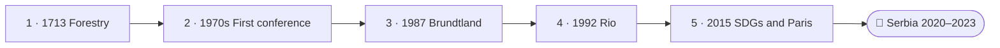

<!--
author:   Juliana Hilf; Hannes Tegelbeckers
email:    juliana.hilf@ovgu.de
version:  2.0.0
language: en
narrator: UK English Female
mode:     Presentation
comment:  GIZ Sustainability Onboarding, session 1_2, Historical milestones of sustainability debates. Self-paced and unmoderated. Licence CC BY-SA 4.0 [CHECK confirm with GIZ]

import:   https://raw.githubusercontent.com/LiaTemplates/mermaid_template/0.1.4/README.md
-->

# GIZ Sustainability Onboarding 1_2 – Historical milestones of sustainability debates

    --{{0}}--
Welcome to session one two. Jelena Marković has to write three sentences that justify green skills in a new occupational standard. For that, she needs the right milestones. If you can, turn the sound on.

**Subtopic of Session 1 · about 35 minutes · self-paced · no tutor**

> [!TIP] How this works
> Turn the sound on if you can; everything important is also on the page. Every quiz explains its answer, hints appear after a wrong try, and you can try again as often as you like. Your written notes are your personal learning journal – nobody grades them.

> [!IMPORTANT] Completing this session in Moodle
> You pass with at least 70 % of the quizzes correct **and** every survey and text box submitted. A few words are enough. Finish in one sitting if you can, because answers may be lost when you reload the page.

> [!NOTE] The case in this course
> Jelena Marković, Milica Stojanović and Ravnica Technical School are fictional. The facts around them are real, and the sources are on the last page.

## Three Sentences for a Standard

    --{{0}}--
Jelena Marković works at the Ministry of Education. She has to write a short text that justifies green skills in new occupational standards. Which milestone should she quote? Sustainability is often treated as a modern idea. It is not.

<!-- style="max-width:100%;width:60%;display:block;margin:0 auto;" -->

Jelena Marković (fictional) has to write a short text that justifies green skills in new occupational standards. Which milestones should she quote? Sustainability is often treated as a modern idea. It is not. It starts as a practical rule for one trade, forestry, and ends up as the guiding goal of the whole global community.

    --{{1}}--
So Jelena follows the whole story.

      {{1}}
> [!IMPORTANT] Guiding question
> What did each milestone bring: a new idea, a new institution, or a new set of goals?

    --{{2}}--
Let us see what you know about the order of events.

      {{2}}
****************************************

**Predict:** Which of these milestones came first?

<!-- data-hint-button="1" data-solution-button="2" -->
- [(X)] *Silent Spring* (1962)
- [( )] Stockholm Conference (1972)
- [( )] Brundtland Report (1987)
[[?]] One of these happened before the first global UN environment conference.
***
*Silent Spring* came first. It raised environmental awareness, and it prepared the ground for the Stockholm Conference and the Brundtland Report.
***

****************************************

    --{{3}}--
And the story starts even earlier. We will walk through it, one milestone at a time.

      {{3}}
> [!NOTE] What really happened
> This session walks you through the story, one milestone at a time, from 1713 to Serbia's own law. By the end, you can write Jelena's sentences.

## The Timeline

    --{{0}}--
Here is the timeline of this session. And the road continues with Serbia's own entries.

    --{{1}}--
After this session, you can do three things.

      {{1}}

<!-- data-type="none" -->
| Know | Can do | Value |
|------|--------|-------|
| Central milestones: major reports, conferences, policy agreements | Identify them, and characterise what each one brought | Seeing your work as part of a long story |
| Recent steps in Serbia and the Western Balkans | Place these steps on the same timeline | Nothing here is "imported": it is the same timeline |

    --{{2}}--
A quick look at the timeline.

      {{2}}
****************************************

**Decide:** Which milestone comes directly after Brundtland on the timeline?

<!-- data-hint-button="1" data-solution-button="2" -->
- [(X)] Rio, 1992
- [( )] Forestry, 1713
- [( )] The 1970s conference
[[?]] Follow the arrows from left to right.
***
Rio followed five years after Brundtland, and it turned the idea into a global programme.
***

****************************************

## Where the Idea Starts: 1713

    --{{0}}--
The story begins in 1713. This was not a global vision. It was a rule to keep one valuable resource, the forest, productive for the next generation of foresters.

 – Hans Carl von Carlowitz – public domain – via Wikimedia Commons")

In **1713**, Hans Carl von Carlowitz published *Sylvicultura oeconomica*, a book on the management of forests. He used the German term for a simple rule of **sustained-yield forestry**: cut only as much wood as can grow back.

This was not a global vision. It was a rule to keep one valuable resource productive for the next generation of foresters.

    --{{1}}--
Here is what this milestone brought.

      {{1}}
> [!NOTE] Key message
> 1713 brought an **idea**: in that year, the term was a practical rule for one trade, not a global goal.

    --{{2}}--
Check the name.

      {{2}}
****************************************

**Type:** Carlowitz used the term for sustained-yield … (one word)

<!-- data-hint-button="1" data-solution-button="2" -->
[[forestry]]
[[?]] It is the trade the book is about.

***
Forestry: manage the forest so that it keeps producing. The global goal only appears in 1987, and state-level policy emerges with the UN conferences from 1972 onwards.
***

****************************************

## Awareness and a First Conference

    --{{0}}--
Now the debate changes. Jelena notes what happened between 1962 and 1972.

**What changed the debate in the early 1970s?**

    --{{1}}--
In 1962, Rachel Carson published Silent Spring.

      {{1}}
- **1962, *Silent Spring*:** Rachel Carson warned about pesticides and pollution, and showed that local pollution can have global consequences

    --{{2}}--
In 1972, the UN held its first global environment conference.

      {{2}}
- **1972, Stockholm:** the first global UN environment conference: 114 states [CHECK: number of states at Stockholm – sources say 113 or 114], about 1,200 delegates including many NGOs; a declaration of principles and an action plan

    --{{3}}--
From this came a new institution.

      {{3}}
- **UNEP:** the UN Environment Programme, the UN body for the environment, was founded in Nairobi

    --{{4}}--
And also in 1972, the Club of Rome published The Limits to Growth.

      {{4}}
- **1972, *The Limits to Growth*:** the Club of Rome presented a computer model from MIT that showed "overshoot and collapse" (more in Session 5_1)

    --{{5}}--
So in a single decade, a global conversation began.

      {{5}}
> [!TIP] Why this matters
> These milestones brought **awareness** (*Silent Spring*), a new **institution** (UNEP) and a first global **declaration** (Stockholm).

    --{{6}}--
Which of these milestones did you already know?

      {{6}}
****************************************

**Mark:** Which of these do you already know? (several possible)

[[a1]] **1962, *Silent Spring*:** Rachel Carson warned about pesticides and pollution, and showed that local pollution can have global consequences
[[a2]] **1972, Stockholm:** the first global UN environment conference: 114 states [CHECK: number of states at Stockholm – sources say 113 or 114], about 1,200 delegates including many NGOs; a declaration of principles and an action plan
[[a3]] **UNEP:** the UN Environment Programme, the UN body for the environment, was founded in Nairobi
[[a4]] **1972, *The Limits to Growth*:** the Club of Rome presented a computer model from MIT that showed "overshoot and collapse" (more in Session 5_1)

****************************************

## 1987: The Brundtland Definition

    --{{0}}--
In 1987, the World Commission on Environment and Development, chaired by Norway's Prime Minister Gro Harlem Brundtland, published the report Our Common Future. It gave the definition that is still the reference point today. Watch the video.

> [!TIP] Watch for
> 1. why the report linked environment and development
> 2. what it put at the centre of the debate

!?[The ground-breaking Brundtland report](https://www.youtube.com/watch?v=KIaguVNjZAU "UVED – The ground-breaking Brundtland report (5:53)")

Text summary of the video

For the first time, the report *Our Common Future* (WCED, 1987) explicitly linked economic development and environmental protection, and put **sustainable development** at the centre. Its definition:

"development that meets the needs of the present without compromising the ability of future generations to meet their own needs"

The definition combines three elements: the **needs of the present**, **justice towards future generations**, and the **limits of natural systems**.

    --{{1}}--
What did the report do for the first time?

      {{1}}
****************************************

**Decide:** What did the Brundtland Report do for the first time?

<!-- data-hint-button="1" data-solution-button="2" -->
- [( )] It founded the UN Environment Programme.
- [(X)] It explicitly linked economic development and environmental protection.
- [( )] It set the 1.5 °C limit for global warming.
[[?]] Think about the two words it put together.
***
The report put sustainable development at the centre. Its definition carries a political claim: today's development must not use up what future generations need.
***

****************************************

    --{{2}}--
Complete the definition.

      {{2}}
****************************************

**Type:** Development that meets the needs of the present without compromising the ability of future ______ to meet their own needs. (one word)

<!-- data-hint-button="1" data-solution-button="2" -->
[[generations]]
[[?]] It is about the people who come after us.

****************************************

## 1992: Rio Turns the Idea into a Programme

    --{{0}}--
In 1992, the UN Conference on Environment and Development, the Earth Summit, met in Rio de Janeiro. It produced four key results.

**What did the Earth Summit produce?**

    --{{1}}--
First, Agenda 21.

      {{1}}
- **Agenda 21:** an action programme with 40 chapters, for governments, business, NGOs and citizens at local, national and global level

    --{{2}}--
Second, the Rio Declaration, with two important principles.

      {{2}}
- **Rio Declaration:** 27 principles, including the **polluter-pays principle** (the one who causes pollution pays for it) and the **precautionary principle** (act before harm is fully proven)

    --{{3}}--
Third, the climate convention.

      {{3}}
- **UN Framework Convention on Climate Change (UNFCCC):** the treaty that later led to the Kyoto Protocol (1997)

    --{{4}}--
And fourth, biological diversity.

      {{4}}
- **Convention on Biological Diversity:** protection of the variety of life on Earth

    --{{5}}--
This changed the status of the idea.

      {{5}}
> [!TIP] Why this matters
> Rio turned sustainable development from a scientific and political concept into a **global guiding principle**. Agenda 21 became the template for many local, regional and national sustainability processes.

    --{{6}}--
Which of these results did you already know?

      {{6}}
****************************************

**Mark:** Which of these do you already know? (several possible)

[[a1]] **Agenda 21:** an action programme with 40 chapters, for governments, business, NGOs and citizens at local, national and global level
[[a2]] **Rio Declaration:** 27 principles, including the **polluter-pays principle** (the one who causes pollution pays for it) and the **precautionary principle** (act before harm is fully proven)
[[a3]] **UN Framework Convention on Climate Change (UNFCCC):** the treaty that later led to the Kyoto Protocol (1997)
[[a4]] **Convention on Biological Diversity:** protection of the variety of life on Earth

****************************************

## Check: Rio

    --{{0}}--
Jelena checks her notes. Three short questions, and every question explains its answer.

**1 · Choose one:** Which conference produced Agenda 21?

<!-- data-hint-button="1" data-solution-button="2" -->
- [( )] Stockholm 1972
- [(X)] Rio 1992
- [( )] Paris 2015
[[?]] It was the Earth Summit.
***
Agenda 21 was adopted at the UN Conference on Environment and Development in Rio in 1992. Stockholm produced the first global declaration and led to UNEP. Paris produced the Paris Agreement.
***

    --{{1}}--
Next, the Declaration.

      {{1}}
****************************************

**2 · Choose all that apply:** Which statements apply to the Rio Declaration?

<!-- data-hint-button="1" data-solution-button="2" -->
- [[X]] It contains the polluter-pays principle.
- [[ ]] It was adopted at the Stockholm Conference in 1972.
- [[X]] It contains the precautionary principle.
- [[ ]] It has 40 chapters.
[[?]] The Declaration is the list of 27 principles. The 40-chapter document is a different Rio outcome.
***
The Rio Declaration (27 principles) includes the polluter-pays and the precautionary principle. The 40-chapter document is Agenda 21, a separate outcome of the same conference.
***

****************************************

    --{{2}}--
And one number.

      {{2}}
****************************************

**3 · Type:** How many chapters does Agenda 21 have? (number)

<!-- data-hint-button="1" data-solution-button="2" -->
[[40]]
[[?]] It is on the previous page.

***
40 chapters. It became the template for many local, regional and national sustainability processes.
***

****************************************

## 2015: Goals and a Temperature Limit

    --{{0}}--
First, in the year 2000, the UN adopted the Millennium Development Goals. Then in 2015, two things happened. Agenda 2030 was adopted, with the Sustainable Development Goals. And at COP21 in Paris, the Paris Agreement was adopted. Watch this video for the whole story.

> [!TIP] Watch for
> 1. the steps from Stockholm to Rio and beyond
> 2. how the debate moved from one sector to a global goal

!?[A Historical View on Sustainable Development](https://www.youtube.com/watch?v=D5mzI9Kw4JM "sustainable-globalization – A Historical View on Sustainable Development (6:14)")

Text summary of the video

**2000, Millennium Development Goals (MDGs):** 8 goals for 2000–2015 on poverty, education, gender equality, health and environmental sustainability; the first attempt to make development measurable with time-bound goals.

**2015, Agenda 2030:** 17 Sustainable Development Goals, 169 targets, for all UN member states, valid 2016–2030.

**2015, Paris Agreement (COP21):** limit warming to well below 2 °C above pre-industrial levels, preferably 1.5 °C.

    --{{1}}--
What does the Paris Agreement aim for?

      {{1}}
****************************************

**Decide:** What does the Paris Agreement aim to limit warming to?

<!-- data-hint-button="1" data-solution-button="2" -->
- [( )] Well below 3 °C, preferably 2 °C
- [(X)] Well below 2 °C, preferably 1.5 °C
- [( )] 1.5 °C at the latest
[[?]] The agreement sets a limit "well below" one value and "preferably" a lower one.
***
Well below 2 °C, preferably 1.5 °C (COP21, 2015). The other options swap or drop the two levels.
***

****************************************

    --{{2}}--
And the number of goals.

      {{2}}
****************************************

**Type:** How many Sustainable Development Goals does Agenda 2030 contain? (number)

<!-- data-hint-button="1" data-solution-button="2" -->
[[17]]
[[?]] The earlier Millennium Goals were 8. These are more than twice as many.

****************************************

## Serbia on the Timeline

    --{{0}}--
The timeline does not stop in 2015. The Western Balkans and Serbia added their own entries. Jelena fills them in.

**Complete:**

<!-- data-hint-button="1" data-solution-button="2" data-show-partial-solution -->
The Sofia Declaration on the Green Agenda for the Western Balkans was endorsed on 10 November [[ (2020) | 2015 | 2023 ]] , at the Sofia Summit. Serbia's Law on Climate Change was adopted on 18 March of the year [[2021]]. The EU roadmap for the first climate-neutral continent, the European Green Deal, came first, in [->[ (2019) | 2022 ]].
[[?]] Serbia's law came one year after the Sofia Declaration.

    --{{1}}--
And a few statements.

      {{1}}
****************************************

**Decide:** True or false?

<!-- data-hint-button="1" data-solution-button="2" data-show-partial-solution -->
[(true) (false)]
[  (X)    ( )  ] Serbia's Law on Climate Change requires a low-carbon development strategy with an action plan, and monitoring, reporting and verification (MRV) of emissions.
[  ( )    (X)  ] The Strategy for Low Carbon Development 2023–2030 does not mention green jobs.
[  (X)    ( )  ] The GIZ project "Teaching skills for green transformation" runs from January 2024 to December 2026, with the Serbian Ministry of Education.
[  ( )    (X)  ] The Sofia Declaration has nothing to do with the EU Green Deal.
[[?]] The strategy's 2050 vision includes green jobs. In Sofia, leaders committed to the green agenda in line with the EU Green Deal.
***
The law requires a strategy and MRV. The strategy (Official Gazette 46/2023) includes green jobs in its 2050 vision. In Sofia, Western Balkan leaders committed to the green agenda in line with the EU Green Deal. These are the latest chapter of the same global timeline.
***

****************************************

## Jelena's Three Sentences

    --{{0}}--
Now you help Jelena. She has to justify green skills in new occupational standards. Which milestones would you quote?

Jelena has to justify green skills in new occupational standards (fictional). Her notes on the most recent chapter of the timeline:

<!-- data-type="none" -->
| Figure | Value |
|--------|-------|
| Sofia Declaration (2020) | Western Balkan leaders commit to the green agenda in line with the EU Green Deal |
| Law on Climate Change (2021) | requires a low-carbon development strategy, action plan and MRV of emissions |
| Strategy for Low Carbon Development 2023–2030 | its 2050 vision includes **green jobs** |

## Your Learning Journal

    --{{0}}--
First, Jelena's text. Write the two or three sentences you would use.

**1 · Answer:** Which milestones would you quote to justify green skills in a new occupational standard, and why? Write two or three sentences.

[[___ ___]]

✅ Model answer

A strong answer quotes the **Brundtland definition (1987)** to show that development and environment belong together, then the **Paris Agreement (2015)** and **Agenda 2030** to show that the goals are concrete and time-bound, and finally Serbia's **Law on Climate Change (2021)** to show that the commitment is national and legal. The logic: the global definition gives the "why", the 2015 agreements give the "what", and the Serbian law gives the "here and now". A principal reading the same text would check whether the standard names the occupations where green skills are needed.

    --{{1}}--
Next, the definition and your work.

      {{1}}
****************************************

**2 · Answer:** Which of the three elements of the Brundtland definition – present needs, future generations, or the limits of natural systems – matters most for your work in education, and why?

[[___ ___]]

✅ Model answer

A **ministry officer** often points to **present needs**: education is a basic need, and the system must work for the people living today. A **school developer** often points to **future generations**: the programmes we design now shape the workforce of the next 30–40 years. A **principal** often points to the **limits of natural systems**: a school is a physical building that consumes energy and space. All three readings are valid: the definition is deliberately open, and that is why it still works.

****************************************

    --{{2}}--
And finally, Serbia.

      {{2}}
****************************************

**3 · Answer:** What changed for VET in Serbia because of the Sofia Declaration (2020) and the Law on Climate Change (2021)?

[[___ ___]]

✅ Model answer

A **ministry officer** would note that green transformation is now **legally anchored**, so schools and training systems are part of that framework. A **school developer** would point to the **strategy**: its 2050 vision includes green jobs, so the occupations your schools train for are changing. A **principal** would add that the GIZ project with the Ministry of Education is one concrete response. None of this is "imported": it sits on the same timeline as Brundtland and Paris.

****************************************

## Exit Ticket

    --{{0}}--
Three short questions, one per objective. You can repeat them as often as you like.

**🎟️ 1 · The report** – What was the 1987 report called?

<!-- data-hint-button="1" data-solution-button="2" -->
- [(X)] *Our Common Future*
- [( )] *The Limits to Growth*
- [( )] *Silent Spring*
[[?]] It contains the Brundtland definition.

    --{{1}}--
Next, the principles.

      {{1}}
****************************************

**🎟️ 2 · Rio** – Which principles are part of the Rio Declaration?

<!-- data-hint-button="1" data-solution-button="2" -->
- [[X]] Polluter-pays principle
- [[ ]] Free-trade principle
- [[X]] Precautionary principle
[[?]] One says who pays. The other says to act before harm is fully proven.

****************************************

    --{{2}}--
And a number.

      {{2}}
****************************************

**🎟️ 3 · Global goals** – The Millennium Development Goals of the year 2000 were how many goals? (number)

<!-- data-hint-button="1" data-solution-button="2" -->
[[8]]
[[?]] It is in the text summary of the last video.

****************************************

## What Jelena Sends Off

    --{{0}}--
Jelena sends off her text. Here is the timeline it rests on.

    --{{1}}--
First, the idea.

      {{1}}
- **Idea:** Carlowitz 1713, and *Silent Spring* 1962.

    --{{2}}--
Second, the institutions.

      {{2}}
- **Institutions:** Stockholm 1972 and UNEP; Rio 1992 with its conventions.

    --{{3}}--
Third, the definition and goals.

      {{3}}
- **Definition and goals:** Brundtland 1987, MDGs 2000, SDGs and Paris 2015.

    --{{4}}--
Fourth, here and now.

      {{4}}
****************************************

- **Here and now:** Sofia 2020, Serbia's law 2021, the Low Carbon Development Strategy 2023.

> [!NOTE] Remember
> The global definition gives the "why", the 2015 agreements give the "what", and the Serbian law gives the "here and now".

****************************************

    --{{5}}--
One last question.

      {{5}}
****************************************

**Recap:** The Paris Agreement and Agenda 2030 were both adopted in which year?

<!-- data-hint-button="1" data-solution-button="2" -->
- [( )] 2020
- [( )] 2021
- [(X)] 2015
[[?]] The two later years belong to the Sofia Declaration and Serbia's law.
***
2015: Paris Agreement and Agenda 2030. 2020: Sofia Declaration. 2021: Serbia's Law on Climate Change.
***

****************************************

    --{{6}}--
Topic one is complete. But if nobody has the correct definition, how do you work with the concept? That is topic two.

      {{6}}
**➡️ Next:** Session 2, *Basic Concepts and Policies*. Milica has written the first page of her green plan, and Stefan circles four frameworks. Which of them actually binds us?

## Sources and licences

    --{{0}}--
Here you find all sources and licences of this session. The case of Jelena and Milica is fictional.

- Hilf, J. (2024): *Introduction to the Sustainability Approach*. GIZ training, Day 1 – adapted
- Hilf, J. (2024): *Greening Somalia and Somaliland – SDGs and Sustainable Economies*. GIZ training, Day 2 – adapted
- Hilf, J. (2025): *Models of Sustainability: Frameworks, Policies and Greening Strategies*. GIZ workshop – adapted
- OVGU/GIZ (2026): *Introduction to Sustainability – an interactive micro-course* (internal German draft, Session_1) – adapted
- World Commission on Environment and Development (1987): *Our Common Future* – quoted
- The Club of Rome: *The Limits to Growth+50* – https://www.clubofrome.org/ltg50/ – linked
- Regional Cooperation Council (2020): *Sofia Declaration on the Green Agenda for the Western Balkans* – https://www.rcc.int/docs/546/sofia-declaration-on-the-green-agenda-for-the-western-balkans – linked, summarised
- CEE Legal Matters: *Serbia – The new Law on Climate Change* – https://ceelegalmatters.com/serbia/16624-serbia-the-new-law-on-climate-change-for-the-survival-of-the-living-world – summarised
- *Strategy for Low Carbon Development of Serbia 2023–2030* – https://leap.unep.org/en/countries/rs/national-legislation/strategy-low-carbon-development-republic-serbia-period-2023-2030 – linked
- GIZ: *Teaching skills for green transformation* – https://www.giz.de/en/worldwide/123790.html – linked
- UVED: *The ground-breaking Brundtland report* – https://www.youtube.com/watch?v=KIaguVNjZAU – embedded
- sustainable-globalization: *A Historical View on Sustainable Development* – https://www.youtube.com/watch?v=D5mzI9Kw4JM – embedded
- U.S. Department of State: *Plenary Hall at the COP21* – public domain – https://commons.wikimedia.org/wiki/File:Kerry_Mxakato-Diseko_Zhenhua_in_the_Plenary_Hall_at_the_COP21.jpg – unchanged
- Carlowitz: *Sylvicultura oeconomica* – public domain – https://commons.wikimedia.org/wiki/File:Carlowitz_Sylvicultura.jpg – unchanged
- Case: Jelena Marković, Milica Stojanović, Ravnica Technical School and the text for the standard are fictional – created for this course
