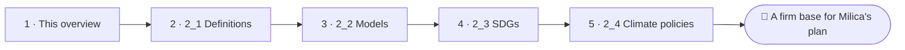

<!--
author:   Juliana Hilf; Hannes Tegelbeckers
email:    juliana.hilf@ovgu.de
version:  2.0.0
language: en
narrator: UK English Female
mode:     Presentation
comment:  GIZ Sustainability Onboarding, session 2, Basic Concepts and Policies. Self-paced and unmoderated. Licence CC BY-SA 4.0 [CHECK confirm with GIZ]

import:   https://raw.githubusercontent.com/LiaTemplates/mermaid_template/0.1.4/README.md
-->

# GIZ Sustainability Onboarding 2 – Basic Concepts and Policies

    --{{0}}--
Welcome to topic two. Milica Stojanović has started her green plan, and now she needs firm ground: concepts, models and policies. If you can, turn the sound on.

**Main topic · about 20 minutes · self-paced · no tutor**

> [!TIP] How this works
> Turn the sound on if you can; everything important is also on the page. Every quiz explains its answer, hints appear after a wrong try, and you can try again as often as you like. Your written notes are your personal learning journal – nobody grades them.

> [!IMPORTANT] Completing this session in Moodle
> You pass with at least 70 % of the quizzes correct **and** every survey and text box submitted. A few words are enough. Finish in one sitting if you can, because answers may be lost when you reload the page.

> [!NOTE] The case in this course
> Milica Stojanović, principal of Ravnica Technical School, and her colleagues Stefan Ilić and Jelena Marković are fictional. The facts around them are real, and the sources are on the last page.

## Four Frameworks on One Page

    --{{0}}--
Milica has written the first page of her green plan. Stefan, the school developer, reads it and circles four names. Which of them actually binds us, he asks.

<!-- style="max-width:100%;width:60%;display:block;margin:0 auto;" -->

Milica's first page names the **SDGs**, the **Paris Agreement**, the **European Green Deal** and **Serbia's Law on Climate Change**. These are real commitments. The Western Balkan leaders endorsed the **Green Agenda for the Western Balkans** in the Sofia Declaration (10 November 2020), and Serbia adopted its Law on Climate Change on 18 March 2021. Stefan asks: "Which of these actually binds us?" (Milica, Stefan and the plan are fictional.)

    --{{1}}--
That question leads to a bigger one.

      {{1}}
> [!IMPORTANT] Guiding question
> What is sustainability as a concept, how do we picture it, and which policies put it into practice?

    --{{2}}--
Before you read on, make a prediction.

      {{2}}
****************************************

**Predict:** Which of these frameworks is described as "legally binding on reporting"?

<!-- data-hint-button="1" data-solution-button="2" -->
- [(X)] The Paris Agreement
- [( )] The Sustainable Development Goals (Agenda 2030)
- [( )] The Green Agenda for the Western Balkans
[[?]] Under this framework, countries submit national climate plans, called NDCs, and take part in a global stocktake.
***
The Paris Agreement is legally binding on reporting: countries submit national climate plans (NDCs) and take part in a global stocktake. The SDGs are voluntary and aspirational, and the European Green Deal is binding within the EU.
***

****************************************

    --{{3}}--
These frameworks are not far away. They decide what happens in the VET sector.

      {{3}}
> [!NOTE] What really happened
> These frameworks decide what happens in VET: which skills are taught, which schools receive support, and which occupations your schools train for. All of this builds on the concepts and policies in this topic.

## Your Way Through Topic 2

    --{{0}}--
This topic has four subtopics. They move from the idea, to the pictures we use to describe it, and then to the policies that put it into practice.

    --{{1}}--
After this session, you can do three things.

      {{1}}

<!-- data-type="none" -->
| Know | Can do | Value |
|------|--------|-------|
| Sustainability as a normative concept | Define it and say why it is contested | Openness to different values and goals |
| Key models and policy frameworks | Distinguish the models and relate them to the SDGs, Paris, the Green Deal and Serbia's climate law | Taking commitments seriously in VET work |

    --{{2}}--
Can you read the map?

      {{2}}
****************************************

**Decide:** Each subtopic takes 20 to 30 minutes. Where do the policies meet practice, including Serbia's own commitments?

<!-- data-hint-button="1" data-solution-button="2" -->
- [(X)] 2_3 and 2_4
- [( )] 2_1 only
- [( )] 2_2 only
[[?]] Look at the end of the road.
***
Right. 2_1 explains the normative idea, 2_2 gives you the models, and 2_3 and 2_4 show the goals and policies, including Serbia's own commitments.
***

****************************************

## Where the World Stands

    --{{0}}--
Milica wants to know whether the goals are working. This three-minute video by the United Nations is a stocktaking. Read the two things to watch for first.

> [!TIP] Watch for
> 1. where the world currently stands on the Sustainable Development Goals
> 2. what would have to change to achieve them

!?[Stocktaking – what it will take to achieve the Sustainable Development Goals](https://www.youtube.com/watch?v=enGJyhu6Xr0 "United Nations – Stocktaking: What it will take to achieve the Sustainable Development Goals? (3:10)")

Text summary of the video

The video (United Nations, 3:10) is a stocktaking: it shows where the world stands on the SDGs and what still has to change. Its honest message is that the goals are not yet on track.

    --{{1}}--
What did you take from the video?

      {{1}}
****************************************

**Decide:** What does the video suggest about achieving the Sustainable Development Goals?

<!-- data-hint-button="1" data-solution-button="2" -->
- [( )] The goals are already on track and will be reached by 2030 without further action.
- [(X)] The world is not yet where it needs to be: achieving the goals requires further change and action.
- [( )] The goals are only a suggestion for rich countries.
[[?]] The word "stocktaking" means looking honestly at what has been achieved so far.
***
The honest message is that the goals are not yet on track, which is why this course looks at the concepts, models and policies behind them.
***

****************************************

    --{{2}}--
And one number to type.

      {{2}}
****************************************

**Type:** How many Sustainable Development Goals are there? (number)

<!-- data-hint-button="1" data-solution-button="2" -->
[[17]]
[[?]] Count the coloured goals in the logo on the first page of this session.

****************************************

## Is and Should

    --{{0}}--
At the staff meeting, a teacher asks Milica: so who has the correct definition? Her answer: nobody. Sustainability is a normative concept. This table shows what that means.

<!-- data-type="none" -->
| Criterion | Descriptive statement | Normative concept |
|-----------|---------------|---------------|
| Says | what is | how society *should* develop |
| Basis | measurement and evidence | ethics, social and political guidelines |
| Disagreement | can be settled with better data | contested: scientific and political controversies, no single "correct" definition |
| Reference point | indicators and measuring methods | the Brundtland definition (1987), applied through models and policies |

    --{{1}}--
Here are two examples.

      {{1}}
- **Descriptive statement:** "Global warming today is about 1.1 °C."
- **Normative concept:** "Future generations must be able to meet their own needs."

    --{{2}}--
One misunderstanding comes up again and again. Sustainability is not only about the environment.

      {{2}}
> [!WARNING] Common misconception
> "Sustainability only concerns environmental protection." It also covers the economy, population development and social justice.

    --{{3}}--
Now you decide. Which concept does each statement fit?

      {{3}}
****************************************

**Decide:** Which concept does each statement describe?

<!-- data-hint-button="1" data-solution-button="2" data-show-partial-solution -->
[(Descriptive statement) (Normative concept)]
[       (X)             ( )      ] 2024 was the first calendar year about 1.60 °C above the pre-industrial level.
[       ( )             (X)      ] Sustainability is a guideline about how society should develop.
[       (X)             ( )      ] The IPCC assesses the scientific evidence on climate change.
[       ( )             (X)      ] Sustainability is contested because people weigh values differently.
[[?]] Ask yourself: does the statement report what is, or say what should be?
***
Statements 1 and 3 describe evidence and how it is assessed. Statements 2 and 4 are about the normative character of sustainability.
***

****************************************

## Where Do You Start?

    --{{0}}--
Take two minutes to place yourself. There are no wrong answers. This only helps you choose your path through the four subtopics.

**How familiar are these four topics?**

    --{{1}}--
First, sustainability as a normative concept. This is subtopic two one.

      {{1}}
- **2_1** Sustainability as a normative concept

    --{{2}}--
Second, the models of sustainability: pillars, doughnut and wedding cake.

      {{2}}
- **2_2** Models of sustainability: pillars, doughnut, wedding cake

    --{{3}}--
Third, the Sustainable Development Goals.

      {{3}}
- **2_3** The Sustainable Development Goals

    --{{4}}--
And fourth, international and national climate policies.

      {{4}}
- **2_4** International and national climate policies

    --{{5}}--
Here is the recommendation. If two one is new, start there, because it is the foundation. If it is familiar but two two is not, go to two two. If you are confident with both, take two three or two four, whichever is newer to you.

      {{5}}
> [!TIP] Why this matters
> **2_1 is new?** Start there: it is the foundation for everything that follows. **2_1 is familiar, 2_2 is not?** Go to 2_2 for the vocabulary. **Confident with both?** Start with 2_3 or 2_4, whichever is newer. **All four known?** Do the check on the next page and revisit where your answers were weakest.

    --{{6}}--
Now mark what you already know, and use your answer to choose your next session.

      {{6}}
****************************************

**Mark:** Which of these do you already know? (several possible)

[[a1]] **2_1** Sustainability as a normative concept
[[a2]] **2_2** Models of sustainability: pillars, doughnut, wedding cake
[[a3]] **2_3** The Sustainable Development Goals
[[a4]] **2_4** International and national climate policies

****************************************

## Warm-up Check

    --{{0}}--
Time for a warm-up. Stefan has left gaps in his notes for Milica. Can you fill them?

**Complete:**

<!-- data-hint-button="1" data-solution-button="2" data-show-partial-solution -->
The Paris Agreement is [[ (legally binding on reporting) | voluntary for all countries | binding only within the EU ]] . Agenda 2030 contains this many Sustainable Development Goals: [[17]]. Serbia adopted its Law on Climate Change in [->[ (2021) | 2015 ]].
[[?]] Serbia's law came one year after the Sofia Declaration of 2020.

    --{{1}}--
Now the scope of each framework. Ask yourself who launched it: the EU, the United Nations or Serbia.

      {{1}}
****************************************

**Decide:** True or false?

<!-- data-hint-button="1" data-solution-button="2" data-show-partial-solution -->
[(true) (false)]
[  (X)    ( )  ] The European Green Deal is EU-wide.
[  ( )    (X)  ] The SDGs (Agenda 2030) apply only at national level.
[  (X)    ( )  ] The Paris Agreement is a global framework under the United Nations.
[  ( )    (X)  ] Serbia's Law on Climate Change is an EU-wide framework.
[[?]] Ask yourself who launched each framework: the EU, the United Nations, or Serbia.
***
The European Green Deal is EU-wide. The SDGs and the Paris Agreement are global frameworks under the United Nations. Serbia's Law on Climate Change (18 March 2021) is the national level: it is how global commitments meet one country.
***

****************************************

## Which One First?

    --{{0}}--
Back to Stefan's question. Jelena, a ministry officer, joins the discussion: which framework matters most for a VET ministry in Serbia?

Stefan's question reaches Jelena Marković at the ministry (fictional): **which framework matters most for a VET ministry in Serbia?** She notes the legal status of each.

<!-- data-type="none" -->
| Figure | Value |
|--------|-------|
| SDGs (Agenda 2030) | voluntary, aspirational, global |
| Paris Agreement | legally binding on reporting, global |
| European Green Deal | binding within the EU |

## Your Learning Journal

    --{{0}}--
Write down your own answer first. Then open the expert view and compare.

**1 · Answer:** Which of the three frameworks matters most for a VET ministry in Serbia, and why?

[[___ ___]]

✅ Model answer

There is no wrong answer, but here are three valid readings. A **ministry officer** may point to the **Paris Agreement**: it is legally binding on reporting, so Serbia has concrete obligations (NDCs, reviews) that the education system must support. A **school developer** may choose the **SDGs**: they are voluntary and broad, which makes them a useful common language in curriculum work. A **principal** may pick the **European Green Deal**: its EU-wide reach and tools directly shape funding and standards for schools.

    --{{1}}--
Now take your own position in the case.

      {{1}}
****************************************

**2 · Answer:** If you were Milica, which framework would you name first in the green plan?

[[___ ___]]

✅ Model answer

In practice, all three matter. The difference is which one you need to act on first. Milica names Serbia's Law on Climate Change first, because it is the national level that applies directly, and she then links it to the Paris Agreement and the SDGs as the larger frame.

****************************************

    --{{2}}--
And finally, one question for your own work.

      {{2}}
****************************************

**3 · Answer:** Where in your own work do you meet one of these frameworks?

[[___ ___]]

✅ Model answer

For example, a **ministry officer** may meet them in reporting duties and strategy papers, a **school developer** in curriculum work, and a **principal** in funding and project applications. If you can name one concrete document or decision, you have made the link to your own work.

****************************************

## What Milica Adds to Her Plan

    --{{0}}--
Milica rewrites her first page. Here is what she has now.

    --{{1}}--
First, sustainability says how society should develop.

      {{1}}
- Sustainability is a **normative concept**: a social and political guideline about how society should develop.

    --{{2}}--
Second, that makes it contested.

      {{2}}
- It is **contested**: there is no single scientifically "correct" definition. Brundtland (1987) is the common reference point.

    --{{3}}--
Third, how we apply it depends on models.

      {{3}}
- How we apply the idea depends on the **models** we use: three pillars, doughnut, SDG "wedding cake".

    --{{4}}--
Fourth, policies put it into practice, up to the national level.

      {{4}}
****************************************

- **Policies** range from global (SDGs, Paris) through EU-wide (Green Deal) to national (Serbia's Law on Climate Change).

> [!NOTE] Remember
> These frameworks decide which skills are taught, which schools receive support and which occupations your schools train for.

****************************************

    --{{5}}--
One last question.

      {{5}}
****************************************

**Recap:** Which statements describe sustainability as a normative concept?

<!-- data-hint-button="1" data-solution-button="2" -->
- [( )] It is a purely scientific term with one exact definition.
- [( )] It only concerns environmental protection.
- [(X)] It is a guideline about how society should develop, and it is contested.
[[?]] Think about the word "normative": it is about what should be, not only what is.
***
A normative concept says how society should develop, and it is contested. It covers more than the environment: also the economy, population development and social justice.
***

****************************************

    --{{6}}--
Next, choose your subtopic. If you follow the road, Milica has a difficult visitor in session two one, with a generous offer and a label that needs checking.

      {{6}}
**➡️ Next:** Choose your subtopic as recommended. In Session 2_1, a company offers Milica's school a free workshop on one condition: it must be called "carbon neutral".

## Sources and licences

    --{{0}}--
Here you find all sources and licences of this session. The case of Milica and Ravnica Technical School is fictional.

- Hilf, J. (2024): *Introduction to the Sustainability Approach*. GIZ training, Day 1 – adapted
- Hilf, J. (2025): *Models of Sustainability: Frameworks, Policies and Greening Strategies for Transformation*. GIZ workshop – adapted (incl. comparison table)
- Hilf, J. (2026): *Green TVET – Concepts and practical approaches*. Expert input – adapted
- WBGU (2011): *World in Transition – A Social Contract for Sustainability*. Summary for policy-makers – summarised
- Doughnut Economics Action Lab: *What is the Doughnut?* – https://doughnuteconomics.org/tools/what-is-the-doughnut – CC BY-SA 4.0 – summarised
- Stockholm Resilience Centre (2016): *The SDGs wedding cake* – https://www.stockholmresilience.org/research/research-news/2016-06-14-the-sdgs-wedding-cake.html – linked
- Regional Cooperation Council: *Sofia Declaration on the Green Agenda for the Western Balkans* – https://www.rcc.int/docs/546/sofia-declaration-on-the-green-agenda-for-the-western-balkans – linked
- CEE Legal Matters: *Serbia – The new Law on Climate Change* – https://ceelegalmatters.com/serbia/16624-serbia-the-new-law-on-climate-change-for-the-survival-of-the-living-world – summarised
- Video: United Nations – *Stocktaking* – https://www.youtube.com/watch?v=enGJyhu6Xr0 – embedded
- Image: United Nations – *Sustainable Development Goals – logo and text* – https://commons.wikimedia.org/wiki/File:Sustainable_Development_Goals_-_logo_and_text.svg – unchanged
- Case: Milica Stojanović, Stefan Ilić, Jelena Marković, Ravnica Technical School and the green plan are fictional – created for this course
- This session: GIZ Sustainability Onboarding – Onboarding to Green Transformation, GIZ / OVGU – CC BY-SA 4.0 [CHECK: confirm with GIZ]
