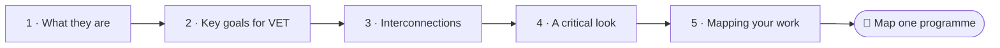
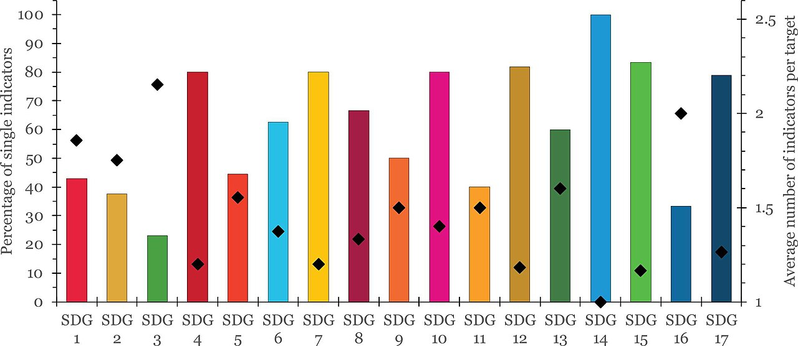
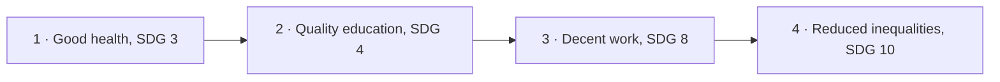

<!--
author:   Juliana Hilf; Hannes Tegelbeckers
email:    juliana.hilf@ovgu.de
version:  2.0.0
language: en
narrator: UK English Female
mode:     Presentation
comment:  GIZ Sustainability Onboarding, session 2_3, Sustainable Development Goals. Self-paced and unmoderated. Licence CC BY-SA 4.0 [CHECK confirm with GIZ]

import:   https://raw.githubusercontent.com/LiaTemplates/mermaid_template/0.1.4/README.md
-->

# GIZ Sustainability Onboarding 2_3 – Sustainable Development Goals (SDGs)

    --{{0}}--
Welcome to session two three. Milica and Stefan open the electrician curriculum and hold it up against seventeen global goals. If you can, turn the sound on.

**Subtopic of Session 2 · about 30 minutes · self-paced · no tutor**

> [!TIP] How this works
> Turn the sound on if you can; everything important is also on the page. Every quiz explains its answer, hints appear after a wrong try, and you can try again as often as you like. Your written notes are your personal learning journal – nobody grades them.

> [!IMPORTANT] Completing this session in Moodle
> You pass with at least 70 % of the quizzes correct **and** every survey and text box submitted. A few words are enough. Finish in one sitting if you can, because answers may be lost when you reload the page.

> [!NOTE] The case in this course
> Milica Stojanović, principal of Ravnica Technical School, and her colleagues Stefan Ilić and Jelena Marković are fictional. The facts around them are real, and the sources are on the last page.

## Seventeen Goals, One Curriculum

    --{{0}}--
The school board has asked Milica to map her programmes against the Sustainable Development Goals. Stefan opens the electrician curriculum. But then a teacher reads out a news headline from 2026.

<!-- style="max-width:100%;width:60%;display:block;margin:0 auto;" -->

Ravnica Technical School should map its programmes against the **Sustainable Development Goals** (the school and its plan are fictional). Stefan Ilić, the school developer, opens the curriculum for electricians. A teacher is sceptical and reads out a headline from a report published in 2026 about how the goals are doing.

    --{{1}}--
So Milica asks a question that many people ask.

      {{1}}
> [!IMPORTANT] Guiding question
> What are the SDGs for – and are they still worth using in a VET school?

    --{{2}}--
What do you think the report found?

      {{2}}
****************************************

**Predict:** How many of the 17 SDGs are on track to be achieved by 2030, according to the 2026 report?

<!-- data-hint-button="1" data-solution-button="2" -->
- [(X)] None of them
- [( )] About half of them
- [( )] All 17
[[?]] The finding is not optimistic.
***
A report from 2026 found that none of the 17 SDGs is on track to be achieved by 2030. That is not a reason to give up.
***

****************************************

    --{{3}}--
Milica's answer to the teacher is this one: it is a reason to work with the framework where we can, and to be honest about what it cannot deliver.

      {{3}}
> [!NOTE] What really happened
> None of the 17 is on track (Earth.org, 2026). The practical answer is not to stop using the framework, but to map your work against it and to be honest about the gaps. This session shows you how.

## From Goals to Your Curriculum

    --{{0}}--
Here is today's path, from what the goals are to how you can use them.

    --{{1}}--
After this session, you can do three things.

      {{1}}

<!-- data-type="none" -->
| Know | Can do | Value |
|------|--------|-------|
| The purpose and structure of the SDGs | Describe them and name the goals that matter most for VET | Using the framework with open eyes |
| How the SDGs relate to the VET sector | Give examples by mapping a curriculum or greening strategy against the goals | Showing what your work already contributes |

    --{{2}}--
A quick look at the path.

      {{2}}
****************************************

**Decide:** What do you do with the goals at the end of today's path?

<!-- data-hint-button="1" data-solution-button="2" -->
- [(X)] Map one programme against them
- [( )] Memorise all 169 targets
- [( )] Rewrite the goals for Serbia
[[?]] Look at the last step of the road.
***
The most practical use of the SDGs is as a framework you can map your own work against.
***

****************************************

## What the SDGs Are

    --{{0}}--
Stefan starts with the basics. In 2015, the UN adopted Agenda 2030 in New York. Its core is seventeen goals with one hundred and sixty-nine targets. Look at the image: goals on top, then targets, then indicators that measure progress.

In 2015, the UN adopted **Agenda 2030** in New York. It concerns **all UN member states** and is officially valid from **2016 to 2030**. Its core is a set of **17 Sustainable Development Goals** with **169 targets**, the sub-goals that make each goal concrete.

The image shows the structure: goals on top, then targets, then indicators that measure progress.

    --{{1}}--
There are two political aspirations behind the goals.

      {{1}}
> [!NOTE] Key message
> Two aspirations sit behind the goals: "the conservation of natural resources" and "economic development for all". So the SDGs are also about jobs, education and growth.

    --{{2}}--
Check the number of sub-goals.

      {{2}}
****************************************

**Type:** How many targets do the 17 SDGs have? (number)

<!-- data-hint-button="1" data-solution-button="2" -->
[[169]]
[[?]] It is written in the text on this page.

***
169 targets, the sub-goals that make each goal concrete.
***

****************************************

## The Goals in Two Minutes

    --{{0}}--
Here is a short overview video. Read the two things to watch for, then press play.

> [!TIP] Watch for
> 1. how many goals there are
> 2. how the goals are grouped

!?[UN Sustainable Development Goals: overview](https://www.youtube.com/watch?v=M-iJM02m_Hg "UNICEF Georgia – UN Sustainable Development Goals – Overview (2:12)")

Text summary of the video

The video (UNICEF Georgia, 2:12) gives an overview of the 17 goals. If you cannot watch it, you can continue: the questions below use the facts on the previous page. A related video is the United Nations' [Stocktaking: What it will take to achieve the SDGs](https://www.youtube.com/watch?v=enGJyhu6Xr0).

    --{{1}}--
Here is a detail that many people mix up.

      {{1}}
****************************************

**Decide:** In which year did Agenda 2030 officially start to be valid?

<!-- data-hint-button="1" data-solution-button="2" -->
- [( )] 2015
- [(X)] 2016
- [( )] 2020
[[?]] The adoption happened in 2015. Validity started one year later.
***
Agenda 2030 was adopted in 2015 but is officially valid from 2016 to 2030. 2015 is the year of the decision in New York, not the start of implementation.
***

****************************************

    --{{2}}--
And one more number.

      {{2}}
****************************************

**Type:** In which year does Agenda 2030 end? (4 digits)

<!-- data-hint-button="1" data-solution-button="2" -->
[[2030]]
[[?]] It is in the name.

****************************************

## The Goals That Matter Most for VET

    --{{0}}--
The seventeen goals cover almost everything, from poverty to peace. Stefan circles three key goals for ministry officers, school developers and principals. And two targets are especially close to VET.

**Where does VET sit in the seventeen goals?**

    --{{1}}--
SDG four is quality education.

      {{1}}
- **SDG 4, Quality education:** "Ensure inclusive and equitable quality education and promote lifelong learning opportunities for all."

    --{{2}}--
Target four point four is one of the most direct policy hooks for VET in any country.

      {{2}}
- **Target 4.4:** substantially increase the number of youth and adults who have relevant skills, including technical and vocational skills, for employment, decent jobs and entrepreneurship

    --{{3}}--
Target four point seven is about sustainable development itself.

      {{3}}
- **Target 4.7:** ensure that all learners acquire the knowledge and skills needed to promote sustainable development

    --{{4}}--
And the occupations your schools train for feed into two more goals.

      {{4}}
- **SDG 8, Decent work and economic growth; SDG 13, Climate action**

    --{{5}}--
This is where VET sits.

      {{5}}
> [!TIP] Why this matters
> Your work is a direct contribution to SDG 4, and the occupations your schools train for feed into SDG 8 and SDG 13.

    --{{6}}--
Which of these did you already know?

      {{6}}
****************************************

**Mark:** Which of these do you already know? (several possible)

[[a1]] **SDG 4, Quality education:** "Ensure inclusive and equitable quality education and promote lifelong learning opportunities for all."
[[a2]] **Target 4.4:** substantially increase the number of youth and adults who have relevant skills, including technical and vocational skills, for employment, decent jobs and entrepreneurship
[[a3]] **Target 4.7:** ensure that all learners acquire the knowledge and skills needed to promote sustainable development
[[a4]] **SDG 8, Decent work and economic growth; SDG 13, Climate action**

****************************************

## The Goals Pull Each Other Along

    --{{0}}--
The goals cannot be viewed stand-alone. Progress in one often propels progress in others. This is sometimes called a virtuous cycle. Here is one chain.

    --{{1}}--
It begins with health.

      {{1}}
1. **Good health, SDG 3:** Healthy people are more productive, can attend school and are less likely to fall into poverty.

    --{{2}}--
That makes education possible.

      {{2}}
2. **Quality education, SDG 4:** Good health and well-being are essential for quality education.

    --{{3}}--
Education leads on to work.

      {{3}}
3. **Decent work, SDG 8:** Healthy, educated people find their way to decent work.

    --{{4}}--
And this reduces inequality. Clean water works in a similar way.

      {{4}}
4. **Reduced inequalities, SDG 10:** Health also helps reduce inequalities. In a similar way, clean water and sanitation (SDG 6) are crucial for health (SDG 3), poverty reduction (SDG 1) and reducing inequalities (SDG 10), and support sustainable cities (SDG 11) and life on land (SDG 15).

## Put the Chain in Order

    --{{0}}--
Now you put the chain in order. Drag each card into the right gap.

**Order:** Drag each card into the right gap.

<!-- data-randomize data-show-partial-solution data-solution-button="2" -->
Step 1: [->[ Good health, SDG 3 ]] → Step 2: [->[ Quality education, SDG 4 ]] → Step 3: [->[ Decent work, SDG 8 ]] → Step 4: [->[ Reduced inequalities, SDG 10 ]]

## Check: Targets and Families

    --{{0}}--
One practical way to keep the goals in your head is to group them into three families. Environment, the foundation, holds six, thirteen, fourteen and fifteen. Society, the core, holds one, two, three, four, five, eleven and sixteen. Economy, the challenge, holds eight, nine, ten and twelve.

**1 · Choose one:** One way to remember the goals is three families: **Environment** (6, 13, 14, 15), **Society** (1, 2, 3, 4, 5, 11, 16) and **Economy** (8, 9, 10, 12). This is a memory aid, not an official classification. Where does SDG 13, Climate action, belong?

<!-- data-hint-button="1" data-solution-button="2" -->
- [( )] Society, the core
- [(X)] Environment, the foundation
- [( )] Economy, the challenge
[[?]] Climate action is about the natural world.
***
Climate action sits in Environment, the foundation. Education (4) sits in Society, and decent work (8) in Economy. The goals themselves remain interconnected.
***

    --{{1}}--
Next, a target you have just met.

      {{1}}
****************************************

**2 · Choose all that apply:** Which statements apply to SDG target 4.4?

<!-- data-hint-button="1" data-solution-button="2" -->
- [[X]] It explicitly mentions technical and vocational skills.
- [[ ]] It only applies to primary education.
- [[X]] It links skills to employment, decent jobs and entrepreneurship.
- [[ ]] It only applies to countries with low incomes.
[[?]] Read the target once more. It names both the people it concerns and the skills it lists.
***
Target 4.4 is about youth and adults, and about relevant skills, including technical and vocational skills, for employment, decent jobs and entrepreneurship.
***

****************************************

    --{{2}}--
And one number.

      {{2}}
****************************************

**3 · Type:** Which goal number stands for "Quality education"? (number)

<!-- data-hint-button="1" data-solution-button="2" -->
[[4]]
[[?]] Target 4.4 belongs to this goal.

***
SDG 4 is Quality education, SDG 8 is Decent work and economic growth, and SDG 13 is Climate action.
***

****************************************

## A Critical Look

    --{{0}}--
The sceptical teacher has a point. The SDGs are a strong framework, but they are not perfect. Juliana Hilf always presents the critique alongside the goals, so that you can use them with open eyes.

**What should you keep in mind when you work with the SDGs?**

    --{{1}}--
First, goals can conflict.

      {{1}}
- **Conflicts between goals:** for example SDG 8 (economic growth) versus SDG 13 (climate action)

    --{{2}}--
Second, they are hard to measure.

      {{2}}
- **Too broad and vague:** progress is hard to measure, with data gaps and inconsistent monitoring

    --{{3}}--
Third, they may ask too much and look at too little.

      {{3}}
- **Ambition and blind spots:** overly ambitious for countries that lack infrastructure and funding; structural causes of inequality not sufficiently addressed; Western development models

    --{{4}}--
And fourth, growth and greenwashing. Greenwashing is when companies look greener than they are.

      {{4}}
- **Growth and greenwashing:** the growth paradigm remains unchallenged; corporate influence, greenwashing (companies looking greener than they are) and symbolic politics

    --{{5}}--
Here is what follows.

      {{5}}
> [!TIP] Why this matters
> Strong political will and good governance matter. None of the 17 goals is on track (2026), so work with the framework where you can, and be honest about what it cannot deliver.

    --{{6}}--
Which of these points had you heard before?

      {{6}}
****************************************

**Mark:** Which of these do you already know? (several possible)

[[a1]] **Conflicts between goals:** for example SDG 8 (economic growth) versus SDG 13 (climate action)
[[a2]] **Too broad and vague:** progress is hard to measure, with data gaps and inconsistent monitoring
[[a3]] **Ambition and blind spots:** overly ambitious for countries that lack infrastructure and funding; structural causes of inequality not sufficiently addressed; Western development models
[[a4]] **Growth and greenwashing:** the growth paradigm remains unchallenged; corporate influence, greenwashing (companies looking greener than they are) and symbolic politics

****************************************

## Mapping the Electrician Curriculum

    --{{0}}--
Now to Stefan's task. The most practical use of the SDGs is as a framework to link any greening strategy with the global agenda. You can map policies, business plans, teaching syllabi and projects against the goals.

You can **map** policies, business plans, **teaching syllabi**, greening strategies and projects against the SDGs. Here are six examples:

<!-- data-type="none" -->
| Occupation | Main SDGs |
|---|---|
| Electrician installing solar systems | 7, 13 |
| Plumber / water technician | 6 |
| Cook / food technician | 2, 3, 12 |
| Construction worker (energy-efficient buildings) | 11, 13 |
| Teacher / trainer | 4 |
| Recycling / waste management technician | 12 |

The real link in Serbia:

<!-- data-type="none" -->
| Figure | Value |
|--------|-------|
| VET programmes in Serbia | being revised to include green skills (GIZ project 2024–2026) |
| Link to the goals | SDG 4.4, 4.7 and SDG 8 |
| Official reporting | Statistical Office of the Republic of Serbia, progress report on the SDGs |

## Your Learning Journal

    --{{0}}--
First, help Stefan. Write your answer, then compare.

**1 · Answer:** You review the curriculum for "electrician". Which SDG targets would you map it against, and how?

[[___ ___]]

✅ Model answer

Start with **SDG 4.4** (skills for employment, decent jobs and entrepreneurship) and **SDG 4.7** (skills for sustainable development): an electrician curriculum that includes solar systems and energy efficiency directly serves both. A **ministry officer** would add the system level: does the national VET strategy name these targets, and are they funded? A **principal** would ask: do the teachers have the green competences, and do partners offer training places in green technologies? The method is the point: pick the occupation, ask which goals its work advances, and write that down.

    --{{1}}--
Now for a conflict, the kind the sceptical teacher was talking about.

      {{1}}
****************************************

**2 · Answer:** Which SDG conflict do you see in your region, for example SDG 8 versus SDG 13? Who is affected, and what could a realistic compromise look like?

[[___ ___]]

✅ Model answer

A **ministry officer** would usually name the tension between growth targets and climate targets, for example when a region depends on energy-intensive industry. A **school developer** might see it in curricula: training for current jobs versus adding green competences. A **principal** experiences it in the budget: energy-saving investments cost money the school may not have. A realistic compromise is rarely "choose one goal". It is sequencing: which targets come first, which skills prepare learners for both, and where funding can follow.

****************************************

    --{{2}}--
Finally, your own programme.

      {{2}}
****************************************

**3 · Answer:** Choose one VET programme in Serbia and link two SDGs or targets to it. Why is the link convincing?

[[___ ___]]

✅ Model answer

The work of revising programmes, supporting schools and steering the system is already a documented contribution to the national SDG agenda. You do not need a new project to "start with the SDGs". You need to **name the goals your work already serves** and to **show them** in strategy documents, curricula and quality reports. A convincing link names the goal, the target and one concrete element of the programme.

****************************************

## Exit Ticket

    --{{0}}--
Three short questions, one per objective. You can repeat them as often as you like.

**🎟️ 1 · Structure** – In which year did Agenda 2030 officially start to be valid?

<!-- data-hint-button="1" data-solution-button="2" -->
- [(X)] 2016
- [( )] 2015
- [( )] 2030
[[?]] The adoption happened one year earlier.

    --{{1}}--
Next, the key goals.

      {{1}}
****************************************

**🎟️ 2 · Key goals** – Which goals does this course name as key goals for its audience?

<!-- data-hint-button="1" data-solution-button="2" -->
- [[X]] SDG 4, Quality education
- [[ ]] SDG 1, No poverty
- [[X]] SDG 13, Climate action
[[?]] Think about which goals connect education, work and climate. SDG 8 is the third.

****************************************

    --{{2}}--
And one number, from the mapping table.

      {{2}}
****************************************

**🎟️ 3 · Mapping** – An electrician installing solar systems serves SDG 13 and which other goal, Affordable and clean energy? (number)

<!-- data-hint-button="1" data-solution-button="2" -->
[[7]]
[[?]] Look at the first row of the occupation table.

****************************************

## What Milica Writes Down

    --{{0}}--
Milica closes the curriculum folder and adds a page to her plan.

    --{{1}}--
First, the structure.

      {{1}}
- Agenda 2030: 17 goals, 169 targets, valid 2016–2030, for all UN member states.

    --{{2}}--
Second, where VET sits.

      {{2}}
- VET contributes directly to **SDG 4** (targets 4.4 and 4.7) and feeds into **SDG 8** and **SDG 13**.

    --{{3}}--
Third, the goals are connected, and they can conflict.

      {{3}}
- The goals are interconnected, and they can conflict, for example SDG 8 and SDG 13.

    --{{4}}--
Fourth, mapping is the practical tool.

      {{4}}
****************************************

- **Mapping** links your curriculum, strategy or project to the goals.

> [!NOTE] Remember
> Name the goals your work already serves, and show them in strategy documents, curricula and quality reports.

****************************************

    --{{5}}--
One last question.

      {{5}}
****************************************

**Recap:** The 2026 report says none of the 17 goals is on track. What follows?

<!-- data-hint-button="1" data-solution-button="2" -->
- [( )] Stop using the SDGs at schools.
- [( )] Report only the goals that look good.
- [(X)] Map your work against them and be honest about the gaps.
[[?]] Think of Milica's answer to the sceptical teacher.
***
The practical answer is not to stop using the framework. Map your work against it and be honest about the gaps.
***

****************************************

    --{{6}}--
Then Jelena calls. A new national strategy names green jobs in construction. What does that mean for the ministry and for schools? That is session two four.

      {{6}}
**➡️ Next:** Session 2_4, *International and national climate policies*. A new strategy names green jobs in construction, and Jelena has to work out the next step.

## Sources and licences

    --{{0}}--
Here you find all sources and licences of this session. The case of Milica and Ravnica Technical School is fictional.

- Hilf, J. (2024): *SDGs and Sustainable Economies*. GIZ training, Day 2 – adapted
- Hilf, J. (2025): *Models of Sustainability …*. GIZ workshop – adapted
- Hilf, J. (2026): *Green TVET – Concepts and practical approaches*. Expert input – adapted
- Hilf, J. (2026): *Onboarding to Green Transformation – Course Concept* – adapted
- United Nations (2015): *Transforming our world. The 2030 Agenda for Sustainable Development* – https://sdgs.un.org/goals ; Goal 4: https://sdgs.un.org/goals/goal4 – quoted
- Filho, W. L. et al. (2020): Heading towards an unsustainable world. *Discover Sustainability*. Springer – via Hilf (2025)
- Earth.org (2026, 24 June): *None of 17 UN SDGs on track to be achieved by 2030, report finds* – via Hilf (2026)
- Statistical Office of the Republic of Serbia: *Progress report on the implementation of SDGs by 2030 in the Republic of Serbia* – https://www.stat.gov.rs/media/353537/progress-report-on-the-implementation-of-sustainable-development-goals-by-2030-in-the-republic-of-serbia.pdf – linked
- GIZ: *Teaching skills for green transformation* – https://www.giz.de/en/worldwide/123790.html – linked
- Video: UNICEF Georgia – *UN Sustainable Development Goals – Overview* – https://www.youtube.com/watch?v=M-iJM02m_Hg – embedded
- Video: United Nations – *Stocktaking: What it will take to achieve the SDGs* – https://www.youtube.com/watch?v=enGJyhu6Xr0 – linked
- Image: United Nations – SDG logo – https://commons.wikimedia.org/wiki/File:Sustainable_Development_Goals_-_logo_and_text.svg – unchanged
- Image: Rakhyun E. Kim – *SDG targets and indicators* – CC BY 4.0 – https://commons.wikimedia.org/wiki/File:SDG_targets_and_indicators.jpg – unchanged
- Case: Milica Stojanović, Stefan Ilić, Ravnica Technical School and the mapping task are fictional – created for this course
- [CHECK: Juliana – add one figure for SDG 4 or SDG 13 from the latest Serbian progress report]
