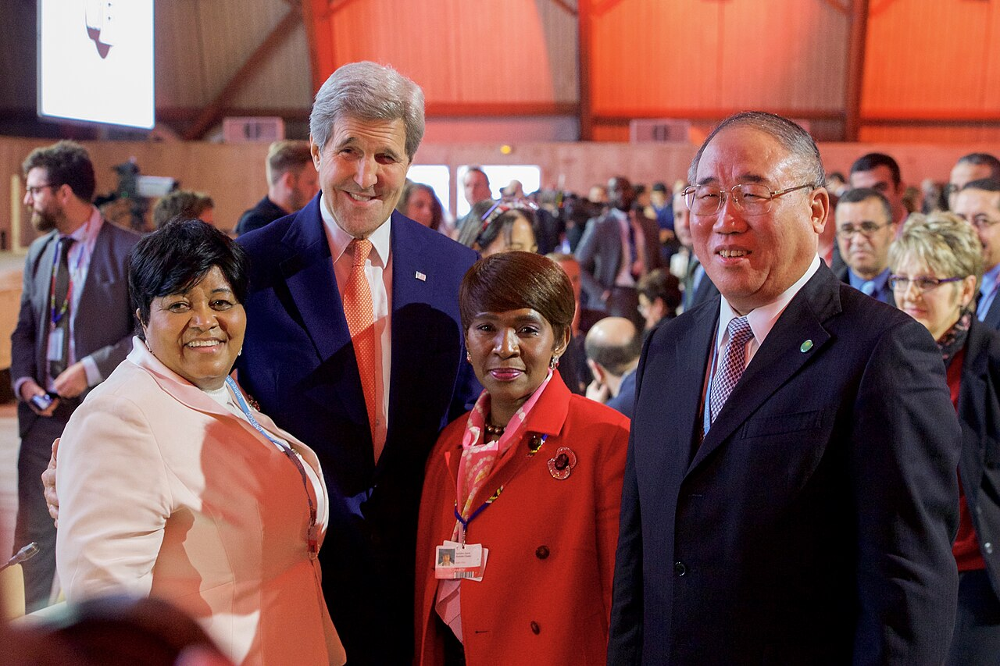
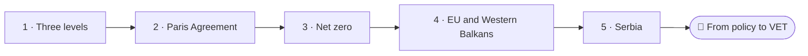
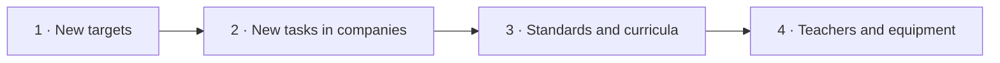

<!--
author:   Juliana Hilf; Hannes Tegelbeckers
email:    juliana.hilf@ovgu.de
version:  2.0.0
language: en
narrator: UK English Female
mode:     Presentation
comment:  GIZ Sustainability Onboarding, session 2_4, International and national climate policies. Self-paced and unmoderated. Licence CC BY-SA 4.0 [CHECK confirm with GIZ]

import:   https://raw.githubusercontent.com/LiaTemplates/mermaid_template/0.1.4/README.md
-->

# GIZ Sustainability Onboarding 2_4 – International and national climate policies

    --{{0}}--
Welcome to session two four. Today we are at the ministry, with Jelena Marković. A new strategy is on her desk, and she has to work out what comes next. If you can, turn the sound on.

**Subtopic of Session 2 · about 30 minutes · self-paced · no tutor**

> [!TIP] How this works
> Turn the sound on if you can; everything important is also on the page. Every quiz explains its answer, hints appear after a wrong try, and you can try again as often as you like. Your written notes are your personal learning journal – nobody grades them.

> [!IMPORTANT] Completing this session in Moodle
> You pass with at least 70 % of the quizzes correct **and** every survey and text box submitted. A few words are enough. Finish in one sitting if you can, because answers may be lost when you reload the page.

> [!NOTE] The case in this course
> Jelena Marković, Milica Stojanović, Stefan Ilić and Ravnica Technical School are fictional. The strategy, the laws and the figures are real, and the sources are on the last page.

## Green Jobs in Construction

    --{{0}}--
Jelena Marković works at the Ministry of Education. On her desk is Serbia's Strategy for Low Carbon Development. Its vision for 2050 names green jobs in construction. But what does a global climate conference have to do with a bricklayer's training?

<!-- style="max-width:100%;width:60%;display:block;margin:0 auto;" -->

Jelena Marković (fictional) works at the Ministry of Education. On her desk is Serbia's *Strategy for Low Carbon Development 2023–2030 with projections until 2050*. Its 2050 vision names **green jobs**, including in **construction**. The road to that document began in a hall like this one: Paris, 2015.

    --{{1}}--
Jelena's question is the one every ministry officer asks.

      {{1}}
> [!IMPORTANT] Guiding question
> How does a global agreement reach a Serbian classroom – and what do you have to do next?

    --{{2}}--
Put yourself in Jelena's place.

      {{2}}
****************************************

**Predict:** The strategy names green jobs in construction. Which is the logical next step for the ministry?

<!-- data-hint-button="1" data-solution-button="2" -->
- [(X)] Start the process to develop or update the occupational standards and qualifications for these jobs
- [( )] Add a climate unit to every subject in every school
- [( )] Wait until 2050 and see what happens
[[?]] Think about the chain: targets, tasks in companies, standards, curricula, training.
***
The strategy signals new tasks in companies, so the ministry develops or updates standards and qualifications first. Only then can curricula, teacher training and equipment follow.
***

****************************************

    --{{3}}--
To see why, let us follow the road from Paris to the classroom.

      {{3}}
> [!NOTE] What really happened
> Standards come first. Climate policy works on three levels, one above the other, and it creates a chain from targets to training. This session follows that chain.

## From Paris to the Classroom

    --{{0}}--
Here is the path of this session.

    --{{1}}--
After this session, you can do these things.

      {{1}}

<!-- data-type="none" -->
| Know | Can do | Value |
|------|--------|-------|
| Central elements of international and national climate policies | Outline them, and compare the three policy levels | Precision about what commitments really mean |
| What net zero means | Explain net zero, and reflect on what policies mean for companies, schools and VET in Serbia | Seeing your own link in the chain |

    --{{2}}--
A quick look at the path.

      {{2}}
****************************************

**Decide:** Which step comes directly before Serbia on the path?

<!-- data-hint-button="1" data-solution-button="2" -->
- [(X)] EU and Western Balkans
- [( )] Paris Agreement
- [( )] Net zero
[[?]] Serbia aligns with what comes just before it.
***
Serbia aligns with the European Green Deal through the Green Agenda for the Western Balkans.
***

****************************************

## Three Levels, One Above the Other

    --{{0}}--
Climate policy is not one big document. It works on three levels, one above the other. The global level sets the direction. The EU and regional level translates it into programmes and money. The national level turns it into law, strategies and targets.

**Who decides what, at which level?**

    --{{1}}--
At the global level, we have the Paris Agreement and the Sustainable Development Goals.

      {{1}}
- **Global:** Paris Agreement (2015), Sustainable Development Goals

    --{{2}}--
At EU level, there is the European Green Deal.

      {{2}}
- **EU:** European Green Deal (2019)

    --{{3}}--
The Western Balkan region has its own green agenda.

      {{3}}
- **Region:** Green Agenda for the Western Balkans (2020)

    --{{4}}--
And Serbia has its own law, strategy and targets.

      {{4}}
- **Serbia:** Law on Climate Change (2021), Low Carbon Development Strategy, NDC

    --{{5}}--
A simple rule helps.

      {{5}}
> [!TIP] Why this matters
> Follow the "who decides" rule: the UN, the EU, the Western Balkan leaders, or Serbia itself.

    --{{6}}--
Which of these do you already know?

      {{6}}
****************************************

**Mark:** Which of these do you already know? (several possible)

[[a1]] **Global:** Paris Agreement (2015), Sustainable Development Goals
[[a2]] **EU:** European Green Deal (2019)
[[a3]] **Region:** Green Agenda for the Western Balkans (2020)
[[a4]] **Serbia:** Law on Climate Change (2021), Low Carbon Development Strategy, NDC

****************************************

## How the Paris Agreement Works

    --{{0}}--
Let us start at the top. Watch this short video and look out for two things.

> [!TIP] Watch for
> 1. who decides the actual climate plans
> 2. what those plans are called

!?[What is the Paris Agreement, and how does it work?](https://www.youtube.com/watch?v=5THr3bFj8Z4 "United Nations – What is the 'Paris Agreement', and how does it work? (1:40)")

Text summary of the video

The Paris Agreement was adopted in 2015 at COP21 and signed by nearly 200 countries. Each country submits its own climate action plan with emission targets, called a Nationally Determined Contribution (NDC). The plans must be updated and strengthened over time, and progress is reviewed.

    --{{1}}--
What are these plans called?

      {{1}}
****************************************

**Decide:** Each country submits its own climate action plan. What are these plans called?

<!-- data-hint-button="1" data-solution-button="2" -->
- [( )] Global Stocktake
- [(X)] Nationally Determined Contributions (NDCs)
- [( )] Just Transition Mechanism
[[?]] The name contains the idea that each nation decides its own contribution.
***
An NDC is a country's own climate action plan with emission targets. The global stocktake is the review of progress every 5 years, and the Just Transition Mechanism is part of the European Green Deal.
***

****************************************

    --{{2}}--
And one number.

      {{2}}
****************************************

**Type:** In which year was the Paris Agreement adopted? (4 digits)

<!-- data-hint-button="1" data-solution-button="2" -->
[[2015]]
[[?]] It was the same year as Agenda 2030.

****************************************

## The Paris Agreement in Five Points

    --{{0}}--
Jelena writes down the five elements that hold the Paris Agreement together. Its main goal is to limit global warming to well below two degrees, preferably one point five degrees, above pre-industrial levels.

**Main goal:** limit warming to **well below 2 °C**, preferably **1.5 °C**, above pre-industrial levels.

1. **NDCs:** each country sets its own climate action plan; plans must be updated and strengthened.
2. **Transparency and accountability:** regular reporting on emissions and progress.
3. **Climate finance:** developed countries pledged to mobilise USD 100 billion per year for developing countries.
4. **Adaptation and resilience:** preparing for floods, droughts and other climate impacts.
5. **Global stocktake:** a review of progress every 5 years.

    --{{1}}--
Note what is not in the Agreement.

      {{1}}
> [!NOTE] Key message
> There is no single binding emission target for all countries. The Agreement is built on national plans, and it is legally binding on reporting.

    --{{2}}--
Check one number.

      {{2}}
****************************************

**Type:** The global stocktake reviews progress every how many years? (number)

<!-- data-hint-button="1" data-solution-button="2" -->
[[5]]
[[?]] It is element five in the list.

***
Every 5 years. Each country decides its own contribution and reports on it, and the whole system is reviewed.
***

****************************************

## Net Zero Is Not Zero

    --{{0}}--
You will hear the term net zero in every policy text from now on, so let us be precise. Remember the company in session two one, with its carbon neutral workshop? Jelena compares the two terms.

<!-- data-type="none" -->
| Criterion | Net zero | Carbon neutral |
|-----------|---------------|---------------|
| Means | balancing greenhouse gases emitted with the amount **removed** from the atmosphere | a claim that often applies only to CO₂ |
| Covers | greenhouse gases | often only CO₂ |
| Priority | reduce as much as possible, then offset the rest | relies more on offsets |
| Ways of offsetting | nature-based solutions, technology (carbon capture and storage), carbon credits (controversial) | often credits and tree planting |

    --{{1}}--
Here are two examples.

      {{1}}
- **Net zero:** The EU's legally binding target for 2050
- **Carbon neutral:** The company's workshop in Session 2_1: credits and trees, with emissions continuing

    --{{2}}--
And one common error.

      {{2}}
> [!WARNING] Common misconception
> "Net zero means zero emissions." It does not. It is a balance: as much removed as emitted, with the priority on reducing emissions first.

    --{{3}}--
Now you sort them.

      {{3}}
****************************************

**Decide:** Which concept does each statement describe?

<!-- data-hint-button="1" data-solution-button="2" data-show-partial-solution -->
[(Net zero) (Carbon neutral)]
[       (X)             ( )      ] Balances greenhouse gases emitted with those removed
[       ( )             (X)      ] Often applies only to CO₂
[       (X)             ( )      ] Reduce as much as possible first, then offset the rest
[       ( )             (X)      ] Relies more on offsets
[[?]] Which term covers all greenhouse gases, and which relies more on offsets?
***
Net zero is a balance across greenhouse gases, with reduction first. "Carbon neutral" often applies only to CO₂ and relies more on offsets.
***

****************************************

## The European Green Deal

    --{{0}}--
Next level: the EU. The European Green Deal was launched in December 2019. It also reaches beyond the EU, including to candidate countries such as Serbia. Watch out for two things.

> [!TIP] Watch for
> 1. the 2050 goal
> 2. the areas the Green Deal covers

!?[What is the European Green Deal and why is it important?](https://www.youtube.com/watch?v=H37grur6HaU "European Commission – What is the European Green Deal and why is it important? (1:59)")

Text summary of the video

**Launched December 2019.** Goal: Europe as the first climate-neutral continent by 2050, with a legally binding net zero target. Key step: at least 55 % emission reduction by 2030 compared with 1990.

**Areas:** clean energy, circular economy (textiles, electronics, packaging), sustainable mobility, biodiversity and agriculture ("Farm to Fork"), zero pollution.

**For people and regions:** the Just Transition Mechanism for the regions and workers most affected, and the goal to mobilise at least EUR 1 trillion in sustainable investments.

**Beyond the EU:** it influences climate diplomacy, trade and development partnerships, including with EU candidate countries such as Serbia.

    --{{1}}--
Here is the interim target.

      {{1}}
****************************************

**Decide:** The European Green Deal aims to reduce EU emissions by at least how much by 2030, compared with 1990?

<!-- data-hint-button="1" data-solution-button="2" -->
- [( )] 40 %
- [(X)] 55 %
- [( )] 100 %
[[?]] It is a step on the way to the 2050 goal, not the 2050 goal itself.
***
The 2030 step is at least 55 % below 1990 levels. Climate neutrality (net zero) is the goal for 2050.
***

****************************************

    --{{2}}--
And one year.

      {{2}}
****************************************

**Type:** By which year should the EU be climate-neutral? (4 digits)

<!-- data-hint-button="1" data-solution-button="2" -->
[[2050]]
[[?]] It is the same year as the vision of Serbia's strategy.

****************************************

## The Green Agenda for the Western Balkans

    --{{0}}--
For the Western Balkans, the Sofia Declaration is the regional answer. It was endorsed on the tenth of November 2020 at the Sofia Summit, and it aligns the region with the European Green Deal. This short video shows how the region frames the agenda.

> [!TIP] Watch for
> 1. the link to the European Green Deal
> 2. the areas the agenda covers

!?[Green Agenda for the Western Balkans](https://www.youtube.com/watch?v=OivEuG7hGOg "Regional Cooperation Council – Green Agenda for the Western Balkans (1:09)")

Text summary of the video

The **Sofia Declaration** was endorsed on 10 November 2020 by Western Balkan leaders and aligns the region with the European Green Deal. Its five areas: climate, energy and mobility (decarbonisation, meaning reducing carbon emissions); circular economy; depollution (air, water, soil); sustainable food systems and rural areas; biodiversity. [CHECK: Juliana – confirm the five pillars against the RCC text]

    --{{1}}--
Who endorsed it?

      {{1}}
****************************************

**Decide:** Who endorsed the Sofia Declaration on the Green Agenda?

<!-- data-hint-button="1" data-solution-button="2" -->
- [( )] The United Nations
- [(X)] Western Balkan leaders
- [( )] The Government of Serbia alone
[[?]] This is the regional level.
***
It was endorsed by Western Balkan leaders at the Sofia Summit, on 10 November 2020. That makes it regional.
***

****************************************

    --{{2}}--
And its year.

      {{2}}
****************************************

**Type:** In which year was the Sofia Declaration endorsed? (4 digits)

<!-- data-hint-button="1" data-solution-button="2" -->
[[2020]]
[[?]] One year after the European Green Deal.

****************************************

## Serbia: From Targets to Law

    --{{0}}--
Now the national level. Serbia has turned the international and regional direction into national instruments. One number shows why this matters: about sixty percent of Serbia's electricity came from lignite in 2024. But the transition is visible already, in wind farms like this one.

 – Ivan25 – CC BY-SA 4.0 – via Wikimedia Commons")

- **Law on Climate Change** (18 March 2021): requires a low-carbon development strategy with an action plan, and monitoring, reporting and verification (MRV: checking that the reported numbers are real) of emissions.
- **Strategy for Low Carbon Development 2023–2030 with projections until 2050** (Official Gazette 46/2023): energy, industry, transport, agriculture, forestry and waste; its 2050 vision includes **green jobs**.
- **NDC (update 2022):** −33.3 % greenhouse gases by 2030 compared with 1990, without the land-use sector (equal to 13.2 % below 2010).
- **NDC 3.0 (September 2025):** −40.1 % by 2035 compared with 1990 (conditional, excluding land use and forestry). CAN Europe called it a raise in ambition, but criticised that the 2030 target was not updated.

    --{{1}}--
One number shows why this matters.

      {{1}}
> [!NOTE] Key message
> About 60 % of Serbia's electricity came from lignite in 2024. But the transition is already visible, in wind farms like Čibuk 1.

    --{{2}}--
Check the date of the law.

      {{2}}
****************************************

**Type:** In which year was Serbia's Law on Climate Change adopted? (4 digits)

<!-- data-hint-button="1" data-solution-button="2" -->
[[2021]]
[[?]] It was one year after the Sofia Declaration.

***
18 March 2021. It requires a low-carbon development strategy with an action plan, and MRV of greenhouse gas emissions.
***

****************************************

## The Chain from Policy to VET

    --{{0}}--
Now Jelena's question can be answered. Policies do not stay on paper. They create a chain.

    --{{1}}--
It starts with new targets.

      {{1}}
1. **New targets:** New targets in policies, such as emission reduction and climate neutrality.

    --{{2}}--
These create new tasks.

      {{2}}
2. **New tasks in companies:** Energy audits, efficient buildings, renewable installations, emissions reporting.

    --{{3}}--
Then, standards and curricula must change. This is the ministry's step.

      {{3}}
3. **Standards and curricula:** New or changed occupational standards, qualifications and curricula.

    --{{4}}--
Finally, teachers and schools must be able to deliver.

      {{4}}
4. **Teachers and equipment:** Teacher training and school equipment. The **ministry** steers standards, **school developers** support the curriculum review, and **principals** organise implementation and company partnerships.

## Put the Chain in Order

    --{{0}}--
Now you put the chain in order. Drag each card into the right gap.

**Order:** Drag each card into the right gap.

<!-- data-randomize data-show-partial-solution data-solution-button="2" -->
Step 1: [->[ New targets ]] → Step 2: [->[ New tasks in companies ]] → Step 3: [->[ Standards and curricula ]] → Step 4: [->[ Teachers and equipment ]]

## Your Link in the Chain

    --{{0}}--
Jelena sends the chain to Milica and Stefan. Each of them works on a different link. Which link is yours?

 – Ivan25 – CC BY-SA 4.0")

Jelena sends the chain to Milica and Stefan (all fictional). All three levels meet in one country: Serbia aligns with the European Green Deal through the **Green Agenda**, and national law makes the work concrete. Here are the three comparisons Jelena adds:

<!-- data-type="none" -->
| Figure | Value |
|--------|-------|
| European Green Deal (2019) | binding within the EU (EU laws); climate-neutral EU by 2050 |
| SDGs (2015) | voluntary (national plans, Voluntary National Reviews); global development by 2030 |
| Paris Agreement (2015) | legally binding on reporting (NDCs, 5-year reviews); limit of 1.5–2 °C |

## Your Learning Journal

    --{{0}}--
First, your own daily work.

**1 · Answer:** Which policy level – global, EU and region, or Serbia – influences your daily work the most? Give one concrete example.

[[___ ___]]

✅ Model answer

A **ministry officer** usually feels the national level most directly: the Law on Climate Change and the Low Carbon Development Strategy decide which standards and qualifications must be developed next. A **school developer** often works at the EU and regional level: Green Deal requirements appear in EU-funded projects, and the Green Agenda frames what "green" means for the region. A **principal** usually sees the national level in concrete form: equipment, partnerships, and which occupations the local labour market needs. All three levels show up in one school day. The question is which one you can act on this week.

    --{{1}}--
Next, one sector.

      {{1}}
****************************************

**2 · Answer:** Pick one sector your schools train for. What does the NDC target mean for that sector's future tasks?

[[___ ___]]

✅ Model answer

Follow the chain. For **energy**: more tasks around renewable installations, grid operation and energy efficiency, and fewer around lignite-only skills. For **construction**: efficient buildings and retrofits become core tasks. For **transport and agriculture**: emissions reporting and low-carbon methods enter daily work. As a **school developer**, check which tasks already appear in the standards. As a **principal**, ask your company partners which tasks they will hire for. The target number is the signal; the sector tasks are the consequence.

****************************************

    --{{2}}--
And one more practical case.

      {{2}}
****************************************

**3 · Answer:** You support VET schools with curriculum review. A company partner reports new tasks: energy audits and emissions reporting. What is your first move?

[[___ ___]]

✅ Model answer

**Check whether the current occupational standards and curricula already cover these tasks.** That is the school developer's role. New tasks in companies are the signal for the next step in the chain. Waiting until the next strategy review only delays the update the chain requires.

****************************************

## Exit Ticket

    --{{0}}--
Three short questions, one per objective. You can repeat them as often as you like.

**🎟️ 1 · Paris Agreement** – What is a Nationally Determined Contribution (NDC)?

<!-- data-hint-button="1" data-solution-button="2" -->
- [(X)] A country's own climate action plan with emission targets
- [( )] A review of all countries' progress every 5 years
- [( )] A fund that pays for all climate projects worldwide
[[?]] "Nationally" tells you who decides; "contribution" tells you what it is.

    --{{1}}--
Next, the Green Deal.

      {{1}}
****************************************

**🎟️ 2 · European Green Deal** – Which statements apply to the European Green Deal?

<!-- data-hint-button="1" data-solution-button="2" -->
- [[X]] It aims for a climate-neutral EU by 2050.
- [[ ]] It sets the same NDC for all EU member states.
- [[X]] It includes a Just Transition Mechanism for the regions and workers most affected.
[[?]] NDCs belong to the Paris Agreement.

****************************************

    --{{2}}--
And one number, from Serbia.

      {{2}}
****************************************

**🎟️ 3 · Serbia** – Serbia's NDC 3.0 (September 2025) aims to cut greenhouse gas emissions by how many percent by 2035, compared with 1990? (number)

<!-- data-hint-button="1" data-solution-button="2" -->
[[40.1]]
[[?]] The 33.3 % target for 2030 comes from the earlier update. This one is higher, around 40.

****************************************

## What Jelena Sends Out

    --{{0}}--
Jelena writes her note. Here is what it says.

    --{{1}}--
First, three levels.

      {{1}}
- Climate policy works on three levels: global, EU and region, and Serbia.

    --{{2}}--
Second, Paris runs on national plans.

      {{2}}
- The Paris Agreement is built on national plans (**NDCs**) and is legally binding on reporting.

    --{{3}}--
Third, net zero is a balance.

      {{3}}
- **Net zero** is a balance, not zero emissions.

    --{{4}}--
Fourth, national law makes it concrete.

      {{4}}
****************************************

- Serbia's law, strategy and NDC make it concrete, and policy reaches VET through a **chain**.

> [!NOTE] Remember
> Targets → tasks in companies → standards and curricula → teachers and equipment.

****************************************

    --{{5}}--
One last question.

      {{5}}
****************************************

**Recap:** The strategy names green jobs in construction. What does the ministry do first?

<!-- data-hint-button="1" data-solution-button="2" -->
- [( )] Buy new equipment for all schools.
- [( )] Wait for the next strategy review.
- [(X)] Develop or update the occupational standards and qualifications.
[[?]] Remember the chain.
***
Standards and qualifications come first. Only then can curricula, teacher training and equipment follow.
***

****************************************

    --{{6}}--
Milica now has her firm ground, with concepts, models, goals and policies. Then she looks out of the window of the school. It is thirty-eight degrees outside, and the workshop is hotter still. Topic three is about the ecological issues.

      {{6}}
**➡️ Next:** Session 3, *Ecological Issues*. Milica's firm ground is ready. Now the summer heat in her workshop halls brings the topic right into her school.

## Sources and licences

    --{{0}}--
Here you find all sources and licences of this session. The case of Jelena, Milica and Ravnica Technical School is fictional.

- Hilf, J. (2025): *Models of Sustainability: Frameworks, Policies …* – GIZ workshop – no licence stated – adapted (incl. comparison table)
- UN Climate Change: *The Paris Agreement* – UNFCCC – https://unfccc.int/process-and-meetings/the-paris-agreement – summarised
- Climatepartner (2024): *What does net zero mean?* – https://www.climatepartner.com/en/knowledge/insights/what-does-net-zero-mean – via Hilf (2025) – summarised
- European Commission: *The European Green Deal* – https://commission.europa.eu/strategy-and-policy/priorities-2019-2024/european-green-deal_en – summarised
- Regional Cooperation Council (2020): *Sofia Declaration on the Green Agenda for the Western Balkans* – https://www.rcc.int/docs/546/sofia-declaration-on-the-green-agenda-for-the-western-balkans – summarised
- CEE Legal Matters: *Serbia – The new Law on Climate Change* – https://ceelegalmatters.com/serbia/16624-serbia-the-new-law-on-climate-change-for-the-survival-of-the-living-world – summarised; official text [CHECK: link to Official Gazette]
- *Low Carbon Development Strategy Serbia 2023–2030 with 2050 projections* – https://unfccc.int/sites/default/files/resource/Low_Carbon_Development_Strategy_Serbia_2023-2030_with_2050_Projections.pdf – summarised
- NDC Partnership: *Serbia* – https://ndcpartnership.org/country/srb – summarised; CAN Europe: *Western Balkans NDCs 3.0* – https://caneurope.org/western-balkans-ndcs-3-0-serbia-joins-montenegro-in-updating-climate-commitments – summarised
- CEE Bankwatch Network: *The energy sector in Serbia* – https://bankwatch.org/beyond-coal/the-energy-sector-in-serbia – summarised
- Video: United Nations – *What is the "Paris Agreement", and how does it work?* – https://www.youtube.com/watch?v=5THr3bFj8Z4 – embedded
- Video: Regional Cooperation Council – *Green Agenda for the Western Balkans* – https://www.youtube.com/watch?v=OivEuG7hGOg – embedded
- Video: European Commission – *What is the European Green Deal and why is it important?* – https://www.youtube.com/watch?v=H37grur6HaU – embedded
- Image: U.S. Department of State – *COP21 plenary hall, Paris 2015* – public domain – https://commons.wikimedia.org/wiki/File:Kerry_Mxakato-Diseko_Zhenhua_in_the_Plenary_Hall_at_the_COP21.jpg – unchanged
- Image: Ivan25 – *Wind farm Čibuk 1 (2018)* – CC BY-SA 4.0 – https://commons.wikimedia.org/wiki/File:Wind_farm_%C4%8Cibuk_1_(2018)_1.jpg – unchanged
- Case: Jelena Marković, Milica Stojanović, Stefan Ilić and Ravnica Technical School are fictional – created for this course
- This session: GIZ Sustainability Onboarding – GIZ / OVGU – CC BY-SA 4.0 [CHECK: confirm with GIZ]
