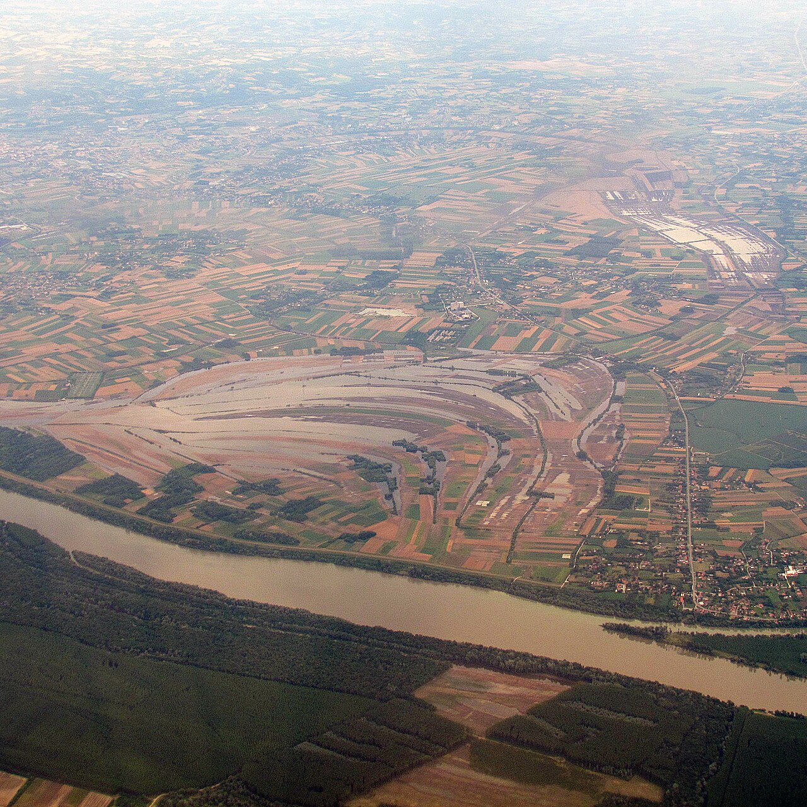

<!--
author:   Juliana Hilf; Hannes Tegelbeckers
email:    juliana.hilf@ovgu.de
version:  2.0.0
language: en
narrator: UK English Female
mode:     Presentation
comment:  GIZ Sustainability Onboarding, session 3, Ecological Issues. Self-paced and unmoderated. Licence CC BY-SA 4.0 [CHECK confirm with GIZ]

import:   https://raw.githubusercontent.com/LiaTemplates/mermaid_template/0.1.4/README.md
-->

# GIZ Sustainability Onboarding 3 – Ecological Issues

    --{{0}}--
Welcome to topic three. The summer has reached Milica's workshops, and the ecological questions in her green plan are no longer abstract. If you can, turn the sound on.

**Main topic · about 20 minutes · self-paced · no tutor**

> [!TIP] How this works
> Turn the sound on if you can; everything important is also on the page. Every quiz explains its answer, hints appear after a wrong try, and you can try again as often as you like. Your written notes are your personal learning journal – nobody grades them.

> [!IMPORTANT] Completing this session in Moodle
> You pass with at least 70 % of the quizzes correct **and** every survey and text box submitted. A few words are enough. Finish in one sitting if you can, because answers may be lost when you reload the page.

> [!NOTE] The case in this course
> Milica Stojanović, principal of Ravnica Technical School, and her colleagues are fictional. The facts around them are real, and the sources are on the last page.

## Heat in the Workshop

    --{{0}}--
It is the last week of the school year. The metalwork teacher tells Milica that the workshop is too hot for practical lessons. Is this just one bad summer, he asks, or something more?

<!-- style="max-width:100%;width:60%;display:block;margin:0 auto;" -->

A hot June at Ravnica Technical School (fictional): the metalwork teacher tells Milica that the workshop is too hot for practical lessons. "Is this just one bad summer?" Milica looks up this image. It shows global temperature anomalies, the difference between measured temperatures and a long-term average, from 1880 to 2023. Notice the upward trend in the last decades.

    --{{1}}--
Milica has a broader question for her green plan.

      {{1}}
> [!IMPORTANT] Guiding question
> What is the state of the planet – and what does it mean for the regions where schools work?

    --{{2}}--
Here is a first estimate. How much of the Earth's resources do we use?

      {{2}}
****************************************

**Predict:** According to ecological footprint data, humanity uses as many ecological resources as if we lived on …

<!-- data-hint-button="1" data-solution-button="2" -->
- [(X)] 1.71 Earths
- [( )] 0.71 Earths
- [( )] 5 Earths
[[?]] It is more than one Earth, but less than two.
***
About 1.71 Earths, and people in the Global North use far more than people in developing countries.
***

****************************************

    --{{3}}--
So we are already overdrawing. In this topic you will see the challenges, and how to name them.

      {{3}}
> [!NOTE] What really happened
> We use about 1.71 Earths. Sustainability starts with the state of the planet, and this topic introduces the ecological challenges that shape all the others.

## Your Way Through Topic 3

    --{{0}}--
Topic three has two subtopics, and they build on each other. Climate change is one of the nine planetary boundaries. So three one looks closely at climate and the words we use for it, and three two widens the view to all nine.

    --{{1}}--
After this session, you can do these things.

      {{1}}

<!-- data-type="none" -->
| Know | Can do | Value |
|------|--------|-------|
| Central ecological challenges | Name them, and distinguish climate change from climate crisis | Explaining rather than warning |
| The concept of planetary boundaries | Describe it, say how many of the nine are crossed, and relate it to your work in VET | Seeing limits as part of your own work |

    --{{2}}--
Which subtopic is which?

      {{2}}
****************************************

**Decide:** Each subtopic takes 20 to 30 minutes. Which one explains the words "climate change" and "climate crisis"?

<!-- data-hint-button="1" data-solution-button="2" -->
- [(X)] 3_1
- [( )] 3_2
- [( )] Neither
[[?]] The first looks closely at climate.
***
3_1 covers the difference between the two terms, and why wording matters in public debates. 3_2 covers nine Earth-system boundaries that define a safe operating space for humanity.
***

****************************************

## Four Challenges

    --{{0}}--
Milica collects four ecological challenges for her staff. They are not far away. In May 2014, floods in Serbia affected about one point six million people, roughly a fifth of the population.

- **Deforestation:** loss of forests, with biodiversity loss, disrupted water cycles and climate change as consequences.
- **Plastic pollution:** about 400 million tons of plastic are produced every year.
- **Biodiversity loss:** affecting insects, mammals, fish and coral reefs.
- **Climate change:** more extreme weather, with heatwaves, extreme rain, hurricanes, dry periods and floods.

In May 2014, floods in Serbia affected about 1.6 million people, roughly a fifth of the population.

    --{{1}}--
Here is the key point.

      {{1}}
> [!NOTE] Key message
> These challenges reach far beyond the environment. They affect the regions where your schools work.

    --{{2}}--
Check the number from the opening.

      {{2}}
****************************************

**Type:** Humanity uses as many ecological resources as if we lived on how many Earths? (number with decimal point)

<!-- data-hint-button="1" data-solution-button="2" -->
[[1.71]]
[[?]] It was the estimate on the first page.

***
About 1.71 Earths, according to the ecological footprint data in this course.
***

****************************************

## One Term, Often Used Incorrectly

    --{{0}}--
The metalwork teacher says: isn't it all just global warming? One term is central to this topic, and it is often used incorrectly. Here is a short video with a NASA expert. Read what to watch for.

> [!TIP] Watch for
> 1. how "climate change" and "global warming" differ
> 2. which of the two terms is used in everyday debates

!?[Is Climate Change the Same as Global Warming? We Asked a NASA Expert](https://www.youtube.com/watch?v=TUinL0C_zgE "NASA – Is Climate Change the Same as Global Warming? – We Asked a NASA Expert (1:17)")

Text summary of the video

The video (NASA, 1:17) shows that "global warming" and "climate change" are related but not identical terms. Climate change is the broader phenomenon, with visible effects such as extreme weather.

    --{{1}}--
What fits this topic?

      {{1}}
****************************************

**Decide:** According to this topic, which statement is correct?

<!-- data-hint-button="1" data-solution-button="2" -->
- [( )] Climate change is the same thing as global warming.
- [(X)] Climate change means more extreme weather: heatwaves, extreme rain, dry periods, floods.
- [( )] Biodiversity loss is an economic problem, not an ecological one.
[[?]] Look at the list of challenges on the previous page.
***
The course treats climate change as the broader phenomenon with visible effects such as extreme weather. Biodiversity loss is an ecological challenge: it affects living systems such as insects, mammals, fish and coral reefs.
***

****************************************

    --{{2}}--
And one number.

      {{2}}
****************************************

**Type:** How many ecological challenges does this course name? (number)

<!-- data-hint-button="1" data-solution-button="2" -->
[[4]]
[[?]] Count the items on the previous page.

****************************************

## Where Do You Start?

    --{{0}}--
Now it is time to place yourself. Look at these four concepts.

**How familiar are these four concepts?**

    --{{1}}--
Climate change.

      {{1}}
- **Climate change**

    --{{2}}--
Climate crisis.

      {{2}}
- **Climate crisis**

    --{{3}}--
Planetary boundaries. The concept was introduced by the Stockholm Resilience Centre in 2009. A 2023 assessment found six of nine crossed, and the Planetary Health Check 2025 reports seven of nine.

      {{3}}
- **Planetary boundaries:** introduced by the Stockholm Resilience Centre in 2009. A 2023 assessment (Richardson et al.) found six of nine crossed. The Planetary Health Check 2025 (PIK) reports **seven of nine** crossed: ocean acidification was newly crossed, and only ozone depletion and aerosol loading remain in the safe zone.

    --{{4}}--
Ecological footprint.

      {{4}}
- **Ecological footprint**

    --{{5}}--
Here is the recommendation. If climate change is new, start with three one. If you know the climate terms but not planetary boundaries, go straight to three two. If both are new, go in order.

      {{5}}
> [!TIP] Why this matters
> **"Climate change" is new?** Start with 3_1: it explains the basic terms. **Know the climate terms, but not "planetary boundaries"?** Go straight to 3_2. **Both new?** Work in order, 3_1 then 3_2: 3_2 is easier once you are comfortable with the climate terms.

    --{{6}}--
Now mark what you already know, and use your answer to choose your next session.

      {{6}}
****************************************

**Mark:** Which of these do you already know? (several possible)

[[a1]] **Climate change**
[[a2]] **Climate crisis**
[[a3]] **Planetary boundaries:** introduced by the Stockholm Resilience Centre in 2009. A 2023 assessment (Richardson et al.) found six of nine crossed. The Planetary Health Check 2025 (PIK) reports **seven of nine** crossed: ocean acidification was newly crossed, and only ozone depletion and aerosol loading remain in the safe zone.
[[a4]] **Ecological footprint**

****************************************

## Warm-up Check

    --{{0}}--
Three short questions. Every question explains its answer.

**1 · Choose one:** How many Earth-system processes with boundaries define the "safe operating space" for humanity?

<!-- data-hint-button="1" data-solution-button="2" -->
- [( )] Six
- [(X)] Nine
- [( )] Seven
[[?]] The 2025 health check says how many are *crossed*, but the question asks how many there are in total.
***
The concept names nine Earth-system processes. Seven is the number crossed according to the 2025 Planetary Health Check, not the total.
***

    --{{1}}--
Next, the challenges.

      {{1}}
****************************************

**2 · Choose all that apply:** Which of the following are ecological challenges named in this course?

<!-- data-hint-button="1" data-solution-button="2" -->
- [[X]] Plastic pollution
- [[ ]] Overpopulation
- [[X]] Biodiversity loss
- [[ ]] Teacher shortage
[[?]] The course names deforestation, plastic pollution, biodiversity loss and climate change.
***
This course names four ecological challenges: deforestation, plastic pollution, biodiversity loss and climate change. Overpopulation is not among them in this source material.
***

****************************************

    --{{2}}--
And how many are crossed?

      {{2}}
****************************************

**3 · Type:** How many of the nine planetary boundaries are crossed, according to the Planetary Health Check 2025? (number)

<!-- data-hint-button="1" data-solution-button="2" -->
[[7]]
[[?]] Only ozone depletion and aerosol loading remain in the safe zone.

***
Seven of nine. Climate change is one of them. So 3_1 looks closely at climate, and 3_2 widens the view to all nine.
***

****************************************

## Back to the Metalwork Teacher

    --{{0}}--
Milica writes a note for the next staff meeting. She wants to explain, not to warn. What would you write?

Milica prepares a short note for the next staff meeting. She wants to **explain, not to warn**. She has three figures at hand:

<!-- data-type="none" -->
| Figure | Value |
|--------|-------|
| Floods in Serbia, May 2014 | about 1.6 million people affected |
| Planetary boundaries crossed (2025) | seven of nine |
| Ecological footprint of humanity | about 1.71 Earths |

## Your Learning Journal

    --{{0}}--
Think of your own region. Write down your answer, then compare.

**1 · Answer:** Name one ecological challenge you can observe in your region: in the schools you support, in your city or in the VET sector.

[[___ ___]]

✅ Model answer

A **principal** might point to more heat days in the workshop halls or to floods that closed the school for weeks. A **school developer** might notice that curricula rarely connect training programmes to ecological limits. A **ministry officer** might look at the whole system: which qualifications prepare young people for a green economy?

    --{{1}}--
Now choose a concept that helps.

      {{1}}
****************************************

**2 · Answer:** Which concept from this topic (climate change, climate crisis, planetary boundaries) would help you explain it to colleagues, and why?

[[___ ___]]

✅ Model answer

**Climate change** explains the pattern behind single events: more extreme weather, not just one bad year. **Planetary boundaries** shows that limits are not a matter of opinion but of Earth-system science. What matters is that the concept is used to *explain*, not to warn.

****************************************

    --{{2}}--
Finally, write Milica's sentence.

      {{2}}
****************************************

**3 · Answer:** What would you say to the teacher who asks: "Is this just one bad summer?"

[[___ ___]]

✅ Model answer

For example: "One hot summer alone proves nothing. But the long-term trend is clear, and it means more extreme weather in the regions where we work. That is why we should plan for it in our school." Note the careful wording: a single event cannot simply be attributed to climate change, but the pattern is real.

****************************************

## What Milica Puts in Her Note

    --{{0}}--
Milica finishes her note. Here is what she has.

    --{{1}}--
First, four challenges.

      {{1}}
- Four ecological challenges: deforestation, plastic pollution, biodiversity loss, climate change.

    --{{2}}--
Second, one term is broader.

      {{2}}
- Climate change is broader than global warming. Subtopic 3_1 also looks at the term "climate crisis".

    --{{3}}--
Third, nine boundaries.

      {{3}}
- Nine planetary boundaries define a safe operating space; seven are crossed (2025).

    --{{4}}--
Fourth, this reaches your region.

      {{4}}
****************************************

- The challenges reach the regions where your schools work.

> [!NOTE] Remember
> Use a concept to explain, not to warn.

****************************************

    --{{5}}--
One last question, matching the terms.

      {{5}}
****************************************

**Recap:** Which description fits "planetary boundaries"?

<!-- data-hint-button="1" data-solution-button="2" -->
- [( )] One of the nine Earth-system processes
- [( )] The term subtopic 3_1 distinguishes from "climate change"
- [(X)] Nine boundaries that define a safe operating space for humanity
[[?]] The other two options describe climate change and climate crisis.
***
Planetary boundaries is the concept of nine Earth-system processes with limits. Climate change is one of the nine, and climate crisis is the term explored in 3_1.
***

****************************************

    --{{6}}--
Choose your subtopic. If you follow the road, Jelena has a problem with a single word in session three one.

      {{6}}
**➡️ Next:** Choose your subtopic as recommended. In Session 3_1, Jelena has to decide on one word for a new curriculum framework: "change" or "crisis"?

## Sources and licences

    --{{0}}--
Here you find all sources and licences of this session. The case of Milica and Ravnica Technical School is fictional.

- Hilf, J. (2024): *Introduction to the Sustainability Approach*. GIZ training, Day 1 – adapted
- Hilf, J. (2026): *Green TVET – Concepts and practical approaches*. Expert input – adapted
- IPCC (2023): *Climate Change 2023: Synthesis Report* – https://www.ipcc.ch/report/ar6/syr/ – summarised
- Copernicus (2025): *2024 first year to exceed 1.5 °C above pre-industrial level* – https://climate.copernicus.eu/copernicus-2024-first-year-exceed-15degc-above-pre-industrial-level – summarised
- Stockholm Resilience Centre: *Planetary boundaries* – https://www.stockholmresilience.org/research/planetary-boundaries.html – linked
- Stockholm Resilience Centre / PIK (2025): *Seven of nine planetary boundaries now breached* – https://www.stockholmresilience.org/news--events/general-news/2025-09-24-seven-of-nine-planetary-boundaries-now-breached – summarised
- Global Footprint Network – https://www.footprintnetwork.org/ – via Hilf (2024)
- ReliefWeb: *Serbia floods 2014* – https://reliefweb.int/report/serbia/serbia-floods-2014 – summarised
- NASA: *Is Climate Change the Same as Global Warming? – We Asked a NASA Expert* – https://www.youtube.com/watch?v=TUinL0C_zgE – embedded
- TED: Johan Rockström – *Let the environment guide our development* – https://www.youtube.com/watch?v=RgqtrlixYR4 – linked
- NASA Scientific Visualization Studio: *Global Temperature Anomalies from 1880 to 2023* – public domain – https://commons.wikimedia.org/wiki/File:Global_Temperature_Anomalies_from_1880_to_2023_(SVS5207_-_2023AverageTemp_4K).png – unchanged
- Gmihail at Serbian Wikipedia: *Flood in Obrenovac, 2014* – CC BY-SA 3.0 RS – https://commons.wikimedia.org/wiki/File:Flood_in_Obrenovac,_2014.jpg – unchanged
- Case: Milica Stojanović, Ravnica Technical School and the metalwork teacher are fictional – created for this course
- This session: Onboarding to Green Transformation, GIZ / OVGU, 2026 – CC BY-SA 4.0 [CHECK: confirm with GIZ]
