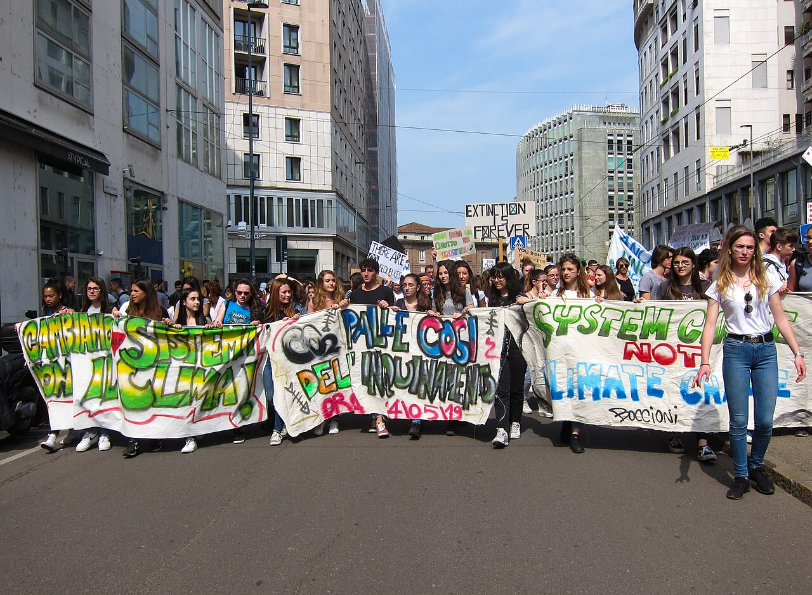
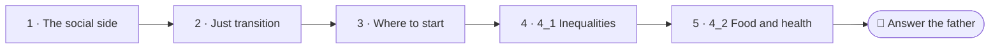

<!--
author:   Juliana Hilf; Hannes Tegelbeckers
email:    juliana.hilf@ovgu.de
version:  2.0.0
language: en
narrator: UK English Female
mode:     Presentation
comment:  GIZ Sustainability Onboarding, session 4, Social Issues. Self-paced and unmoderated. Licence CC BY-SA 4.0 [CHECK confirm with GIZ]

import:   https://raw.githubusercontent.com/LiaTemplates/mermaid_template/0.1.4/README.md
-->

# GIZ Sustainability Onboarding 4 – Social Issues

    --{{0}}--
Welcome to topic four. So far, sustainability may have felt like an environmental topic. Then a father stands up at Milica's parents' evening and asks a very different question. If you can, turn the sound on.

**Main topic · about 20 minutes · self-paced · no tutor**

> [!TIP] How this works
> Turn the sound on if you can; everything important is also on the page. Every quiz explains its answer, hints appear after a wrong try, and you can try again as often as you like. Your written notes are your personal learning journal – nobody grades them.

> [!IMPORTANT] Completing this session in Moodle
> You pass with at least 70 % of the quizzes correct **and** every survey and text box submitted. A few words are enough. Finish in one sitting if you can, because answers may be lost when you reload the page.

> [!NOTE] The case in this course
> Milica Stojanović, principal of Ravnica Technical School, and the people around her are fictional. The facts around them are real, and the sources are on the last page.

## A Question at the Parents' Evening

    --{{0}}--
It is the parents' evening at Milica's school. She presents her green plan. A father who works in the mine stands up and asks: green for whom? And who pays for it?

<!-- style="max-width:100%;width:60%;display:block;margin:0 auto;" -->

At a parents' evening at Ravnica Technical School (fictional), Milica presents her green plan. A father who works in the mine stands up: *"Green for whom? And who pays for it?"* Milica thinks of pictures like this one, from Milan in 2019: young people demanding a say in how their society develops. Social sustainability is about who is included, who is affected and who has a voice.

    --{{1}}--
The father's question leads to this one.

      {{1}}
> [!IMPORTANT] Guiding question
> What are the social dimensions of sustainability – and how can a green transition be fair?

    --{{2}}--
First, an estimate for Serbia.

      {{2}}
****************************************

**Predict:** In 2023, about what share of people in Serbia were at risk of poverty?

<!-- data-hint-button="1" data-solution-button="2" -->
- [(X)] About 19.9 %
- [( )] About 2 %
- [( )] About 50 %
[[?]] It is about one person in five.
***
About 19.9 %, according to the Statistical Office of Serbia (SILC 2023). You will look at this in detail in Session 4_1.
***

****************************************

    --{{3}}--
Sustainability has a strong social side. And the father's question has a name.

      {{3}}
> [!NOTE] What really happened
> One person in five. The shift to a green economy must be **fair** for workers and regions: this is called a **just transition**.

## Your Way Through Topic 4

    --{{0}}--
Topic four has two subtopics. Four one is about inequalities and democracy. Four two is about food, health and well-being. Here is the path.

    --{{1}}--
After this session, you can do three things.

      {{1}}

<!-- data-type="none" -->
| Know | Can do | Value |
|------|--------|-------|
| The social dimensions of sustainability | Recognise them, and connect issues such as inequality, democracy, food and health to your life and work | Asking who is included and who has a voice |
| What a just transition means | Choose your starting point in the two subtopics | Fairness for workers and regions |

    --{{2}}--
Which subtopic is which?

      {{2}}
****************************************

**Decide:** Each subtopic takes 20 to 30 minutes. Which one covers social inequalities and democratic participation, with examples?

<!-- data-hint-button="1" data-solution-button="2" -->
- [(X)] 4_1
- [( )] 4_2
- [( )] Neither
[[?]] The other one is about food systems, health and well-being.
***
4_1 covers how inequalities and democratic participation are linked to sustainable development. 4_2 covers connections between food systems, health and well-being, and options for more sustainable choices.
***

****************************************

## People and Planet First

    --{{0}}--
The EU's Just Transition Mechanism supports the regions and workers most affected by the shift. And UNESCO says that TVET should help develop skills for inclusive and sustainable economies, and for inclusive and peaceful societies. Milica shows the parents this short video.

> [!TIP] Watch for
> 1. why workers and communities must be part of the transition
> 2. what "people and planet first" means in practice

!?[To solve the climate emergency, we need a just transition that puts people and planet first](https://www.youtube.com/watch?v=kGUKwm04L2k "International Labour Organization – To solve the climate emergency, we need a just transition that puts people and planet first (1:36)")

Text summary of the video

The ILO calls for a just transition: the shift to a green economy must be fair for workers and regions, not only fast. The EU's Just Transition Mechanism supports the regions and workers most affected. UNESCO (2022) says that TVET should help develop skills for inclusive and sustainable economies and for inclusive and peaceful societies.

    --{{1}}--
What is needed, according to the ILO?

      {{1}}
****************************************

**Decide:** According to the ILO, what is needed to solve the climate emergency?

<!-- data-hint-button="1" data-solution-button="2" -->
- [( )] Faster economic growth
- [(X)] A just transition that puts people and planet first
- [( )] A complete stop of economic activity
[[?]] Think about the phrase "people and planet first" in the title.
***
The shift must be fair for workers and regions, not only fast. Growth alone does not address fairness, and stopping the economy would harm the very people the transition is meant to protect.
***

****************************************

    --{{2}}--
And one word.

      {{2}}
****************************************

**Type:** The fair shift to a green economy is called a … transition. (one word)

<!-- data-hint-button="1" data-solution-button="2" -->
[[just]]
[[?]] It is also in the name of the EU mechanism.

****************************************

## Two Forms of Fairness

    --{{0}}--
Milica answers the father with two ideas. In the three-pillar model, sustainability rests on ecological, social and economic pillars. In the doughnut, the inner ring is a social foundation. At the heart of the social dimension is justice, and researchers distinguish two forms.

<!-- data-type="none" -->
| Criterion | Intragenerational justice | Intergenerational justice |
|-----------|---------------|---------------|
| Word | *intra* = within | *inter* = between |
| Fairness towards | people living today | future generations |
| Claim | everyone should be able to lead a decent life that at least satisfies fundamental needs | people who come later must also be able to satisfy their needs |
| Question for the school | Who is affected by our plan today? | What do we leave for later cohorts? |

    --{{1}}--
Here is what this looks like in Milica's plan.

      {{1}}
- **Intragenerational justice:** Training places that reach the students who need them most
- **Intergenerational justice:** Programmes that still lead to jobs in thirty years

    --{{2}}--
Be careful with one assumption.

      {{2}}
> [!WARNING] Common misconception
> "Fairness between countries is all that counts." Intragenerational justice covers everyone living today, including within one country or one town.

    --{{3}}--
Now you decide.

      {{3}}
****************************************

**Decide:** Which concept does each statement describe?

<!-- data-hint-button="1" data-solution-button="2" data-show-partial-solution -->
[(Intragenerational justice) (Intergenerational justice)]
[       (X)             ( )      ] Everyone today should be able to lead a decent life.
[       ( )             (X)      ] Decisions today must not take away the chances of people yet to come.
[       (X)             ( )      ] A miner's family should not carry the cost of change alone.
[       ( )             (X)      ] Keeping the forest for the next generation of foresters.
[[?]] "Intra" means "within": which group of people is meant here?
***
Statements 1 and 3 are about people living today. Statements 2 and 4 are about future generations. (Michelsen et al. 2016)
***

****************************************

## Where Do You Start?

    --{{0}}--
Now a short self-assessment. Nothing is graded. This helps you choose a starting point.

**How familiar are these topics?**

    --{{1}}--
Inequalities and democracy.

      {{1}}
- **Inequalities and democracy** (4_1)

    --{{2}}--
Food, health and well-being.

      {{2}}
- **Food, health and well-being** (4_2)

    --{{3}}--
The just transition.

      {{3}}
- **The just transition** (4_1)

    --{{4}}--
And the social foundation of the doughnut.

      {{4}}
- **The social foundation:** the minimum every person needs, for example food, health, education and work

    --{{5}}--
Here is the recommendation. Start where you are weakest. If both areas are new, start with four one, because four two builds on its ideas of justice and fairness.

      {{5}}
> [!TIP] Why this matters
> **Inequalities and democracy weakest?** Start with 4_1: it gives you the ideas of justice that 4_2 builds on. **Food and health weakest?** Start with 4_2. **Both new?** Start with 4_1, then 4_2. **Know both well?** Still read 4_1 first: the facts on inequalities in Serbia are a useful reference.

    --{{6}}--
Now mark what you already know, and use your answer to choose your next session.

      {{6}}
****************************************

**Mark:** Which of these do you already know? (several possible)

[[a1]] **Inequalities and democracy** (4_1)
[[a2]] **Food, health and well-being** (4_2)
[[a3]] **The just transition** (4_1)
[[a4]] **The social foundation:** the minimum every person needs, for example food, health, education and work

****************************************

## Warm-up Check

    --{{0}}--
Three quick checks to activate what you already know. Every check explains its answer.

**1 · Choose one:** In the doughnut model, the social foundation is the minimum every person needs. Which item belongs to it?

<!-- data-hint-button="1" data-solution-button="2" -->
- [( )] Power
- [(X)] Food, health, education and work
- [( )] Money and shares
[[?]] Remember the inner ring of the doughnut.
***
Food, health, education and work are examples of the social foundation: the minimum every person needs for a decent life.
***

    --{{1}}--
Next, which are social dimensions?

      {{1}}
****************************************

**2 · Choose all that apply:** Which of the following are social dimensions of sustainability?

<!-- data-hint-button="1" data-solution-button="2" -->
- [[X]] Gender inequality
- [[ ]] Reducing CO₂ emissions
- [[X]] Democratic participation and strong institutions
- [[ ]] Protecting the ozone layer
[[?]] Ecological measures are important, but they are not social dimensions themselves.
***
Gender inequality, food, health, well-being and democratic participation (SDG 16: peace, justice, strong institutions) are social dimensions. Reducing CO₂ emissions is an ecological measure.
***

****************************************

    --{{2}}--
And a goal number. S D G one is no poverty, five is gender equality, ten is reduced inequalities and sixteen is peace, justice and strong institutions.

      {{2}}
****************************************

**3 · Type:** SDG 1 is "no poverty", SDG 5 "gender equality" and SDG 16 "peace, justice and strong institutions". Which goal number stands for "reduced inequalities"? (number)

<!-- data-hint-button="1" data-solution-button="2" -->
[[10]]
[[?]] It lies between 5 and 16: it is a round number.

***
SDG 10. Together with SDG 1, 2 (zero hunger), 3 (health), 4 (education), 5 and 16, it forms the social core of the SDGs.
***

****************************************

## Green for Whom?

    --{{0}}--
Milica writes to the father after the parents' evening. To do that, she needs to name a concrete issue and a concrete group. What would you write?

After the parents' evening, Milica writes a short answer to the father. A good answer names a **concrete group** and a **concrete link** to the transition. She notes:

<!-- data-type="none" -->
| Figure | Value |
|--------|-------|
| At risk of poverty, Serbia (2023) | about 19.9 % |
| The school's region (fictional) | many families depend on the mine |
| Support for affected regions in the EU | Just Transition Mechanism |

## Your Learning Journal

    --{{0}}--
Think of your own region. Name a concrete issue.

**1 · Answer:** Name one social issue in your region that has a link to the green transition: a change in jobs, a health or food concern, or a group that is affected more than others.

[[___ ___]]

✅ Model answer

There is no single correct answer, but a good reflection names a **concrete group** and a **concrete link**. A **ministry officer** might point to regions whose industry is shrinking, and ask how qualifications and funding follow the people. A **school developer** might look at which occupations students will actually have in ten years. A **principal** might notice who is most affected when the campus changes, for example staff with low incomes or students without easy access to transport.

    --{{1}}--
Next, who is involved?

      {{1}}
****************************************

**2 · Answer:** Who in your system – ministry, school or company – is involved in this issue?

[[___ ___]]

✅ Model answer

All three views share the same core question of a just transition: **who benefits, who is affected, and who has a say?** A good answer names at least one actor who decides, and one group that is affected but not yet heard.

****************************************

    --{{2}}--
Finally, what would you write to the father?

      {{2}}
****************************************

**3 · Answer:** If you were Milica, what would you answer the father in two sentences?

[[___ ___]]

✅ Model answer

For example: "You are right to ask. A green plan is only fair if families who depend on the mine have a say and if new training reaches them first, and that is what we want to work on with you." The answer takes the question seriously, and it names who is involved.

****************************************

## What Milica Learned That Evening

    --{{0}}--
Milica drives home after the parents' evening. Here is what stayed with her.

    --{{1}}--
First, sustainability has a strong social side.

      {{1}}
- Sustainability has a strong social side: the social pillar, and the doughnut's social foundation.

    --{{2}}--
Second, at its heart is justice.

      {{2}}
- At its heart is **justice**: for people living today, and for future generations.

    --{{3}}--
Third, the transition must be fair.

      {{3}}
- The shift to a green economy must be fair for workers and regions: a **just transition**.

    --{{4}}--
Fourth, VET has a role.

      {{4}}
****************************************

- TVET should help develop skills for inclusive and sustainable economies, and for inclusive and peaceful societies (UNESCO 2022).

> [!NOTE] Remember
> Who benefits, who is affected, and who has a say?

****************************************

    --{{5}}--
One last question.

      {{5}}
****************************************

**Recap:** What is *intragenerational* justice?

<!-- data-hint-button="1" data-solution-button="2" -->
- [( )] Fairness towards future generations
- [( )] Fairness between different countries only
- [(X)] Fairness towards people living today
[[?]] "Intra" means "within".
***
Intragenerational justice is about people living today. Fairness towards future generations is intergenerational justice.
***

****************************************

    --{{6}}--
Choose your subtopic. If you follow the road, the municipality announces a solar park in session four one. Who should have a say?

      {{6}}
**➡️ Next:** Choose your subtopic as recommended. In Session 4_1, the municipality announces a solar park, and Milica has to decide who sits at the table.

## Sources and licences

    --{{0}}--
Here you find all sources and licences of this session. The case of Milica and Ravnica Technical School is fictional.

- Hilf, J. (2024): *Introduction to the Sustainability Approach*. GIZ training, Day 1 – adapted
- Hilf, J. (2024): *SDGs and Sustainable Economies*. GIZ training, Day 2 – adapted
- Hilf, J. (2025): *Models of Sustainability …*. GIZ workshop – adapted
- Hilf, J. (2026): *Green TVET – Concepts and practical approaches*. Expert input – adapted
- Hilf, J. (2026): *C1 Sustainability: origins and concepts* (course sample) – adapted
- Michelsen, G. et al. (2016) – via Hilf (2024)
- Wichterich, C. (2002) – via Hilf (2024)
- UNESCO (2022): *Transforming TVET for successful and just transitions* – summarised
- Beta Briefing (2024): *At-risk-of-poverty rate in Serbia slightly down from 2022* – https://betabriefing.com/news/politics/28905-at-risk-of-poverty-rate-in-serbia-slightly-down-from-2022 – summarised
- Video: International Labour Organization – *To solve the climate emergency, we need a just transition that puts people and planet first* – https://www.youtube.com/watch?v=kGUKwm04L2k – embedded
- Image: Mænsard vokser – *Students holding banners, School strikes for climate, Milan 2019* – CC BY-SA 4.0 – https://commons.wikimedia.org/wiki/File:Students_holding_banners,_School_strikes_for_climate_-_Fridays_For_Future_in_Milan,_Italy_-_24_May,_2019-05-24.jpg – unchanged
- Case: Milica Stojanović, Ravnica Technical School, the parents' evening and the father are fictional – created for this course
- This session: GIZ Sustainability Onboarding, GIZ / OVGU – CC BY-SA 4.0 [CHECK: confirm with GIZ]
