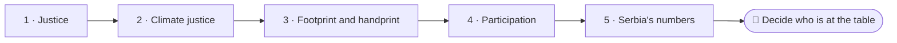
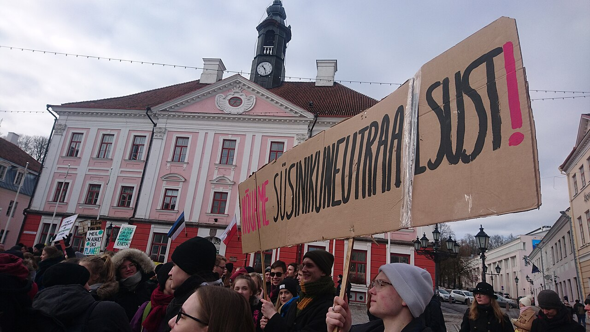

<!--
author:   Juliana Hilf; Hannes Tegelbeckers
email:    juliana.hilf@ovgu.de
version:  2.0.0
language: en
narrator: UK English Female
mode:     Presentation
comment:  GIZ Sustainability Onboarding, session 4_1, Inequalities and democracy. Self-paced and unmoderated. Licence CC BY-SA 4.0 [CHECK confirm with GIZ]

import:   https://raw.githubusercontent.com/LiaTemplates/mermaid_template/0.1.4/README.md
-->

# GIZ Sustainability Onboarding 4_1 – Inequalities and democracy

    --{{0}}--
Welcome to session four one. In Milica's municipality, a solar park is planned, and many of her students' parents work in the mine. Who should have a say? If you can, turn the sound on.

**Subtopic of Session 4 · about 30 minutes · self-paced · no tutor**

> [!TIP] How this works
> Turn the sound on if you can; everything important is also on the page. Every quiz explains its answer, hints appear after a wrong try, and you can try again as often as you like. Your written notes are your personal learning journal – nobody grades them.

> [!IMPORTANT] Completing this session in Moodle
> You pass with at least 70 % of the quizzes correct **and** every survey and text box submitted. A few words are enough. Finish in one sitting if you can, because answers may be lost when you reload the page.

> [!NOTE] The case in this course
> Milica Stojanović, Ravnica Technical School and the municipality's solar park are a constructed example, not a real case. The facts around them are real, and the sources are on the last page.

## A Solar Park Next to the Mine

    --{{0}}--
Milica's school is in a coal-mining municipality. Many parents of her students work in the mine. Now the municipality plans a solar park. Which new programmes should the school offer, and who should decide?

<!-- style="max-width:100%;width:60%;display:block;margin:0 auto;" -->

**Constructed example:** Milica's school is in a coal-mining municipality. Many parents of her students work in the mine. The municipality plans a solar park, and the school has to decide which new programmes to offer. In the real world, the **Kolubara basin** supplies about 75 % of the lignite used by the state power company EPS.

    --{{1}}--
This raises a question about fairness and about who gets to speak.

      {{1}}
> [!IMPORTANT] Guiding question
> How are inequality and democratic participation linked to sustainable development?

    --{{2}}--
First, an estimate. What is happening to lignite output in the Kolubara basin?

      {{2}}
****************************************

**Predict:** The Kolubara basin's output in 2023 and 2024, compared with its earlier 28–30 million tonnes per year, was …

<!-- data-hint-button="1" data-solution-button="2" -->
- [(X)] down, at 22 million tonnes
- [( )] stable, at 30 million tonnes
- [( )] up, at 40 million tonnes
[[?]] Think about enrolment in mining programmes. The direction is not up.
***
Output fell from 28–30 million tonnes per year to 22 million tonnes in 2023 and 2024.
***

****************************************

    --{{3}}--
For workers, families and VET schools in the region, this is a just-transition question.

      {{3}}
> [!NOTE] What really happened
> Output is falling. For workers, families and VET schools in the region, this is a **just-transition question**: who is involved in deciding what comes next?

## Today's Path

    --{{0}}--
Here is today's path.

    --{{1}}--
After this session, you can do three things.

      {{1}}

<!-- data-type="none" -->
| Know | Can do | Value |
|------|--------|-------|
| How inequality and participation are linked to sustainable development | Explain this link and illustrate it with simple examples | Giving those affected a voice |
| What a just transition requires | Name concrete ways that people, schools and regions can take part | Acting, and not only observing |

    --{{2}}--
A quick look at the path.

      {{2}}
****************************************

**Decide:** Which step comes directly before Participation?

<!-- data-hint-button="1" data-solution-button="2" -->
- [(X)] Footprint and handprint
- [( )] Justice
- [( )] Serbia's numbers
[[?]] Follow the arrows from left to right.
***
Thinking in handprints turns people from passive observers into people who can act. Participation follows from that.
***

****************************************

## Enough, for Everyone, Forever

    --{{0}}--
Sustainability is not only about nature. It is also about fairness. A short phrase captures both ideas of justice: Enough, for everyone, forever. Everyone is about the people of today. Forever is about the people who come after us.

**"Enough, for everyone, forever."**

- **Intragenerational justice:** responsibility for the people alive today. All humans should be able to enjoy a decent life that at least satisfies their fundamental needs. This is the "everyone".
- **Intergenerational justice:** responsibility for future generations. This is the "forever".

**Resource use is unequal:** people in the Global North and in industrialised countries use far more resources than people in developing countries. In terms of ecological footprint, humanity lives as if it had 1.71 Earths.

**The SDGs address these gaps:** SDG 10 (reduced inequalities), SDG 5 (gender equality), SDG 16 (peace, justice and strong institutions).

    --{{1}}--
One word carries a lot of weight here.

      {{1}}
> [!NOTE] Key message
> "Everyone" stands for people today. "Forever" stands for future generations. "Enough" is about the level of resources.

    --{{2}}--
Check the phrase.

      {{2}}
****************************************

**Type:** Complete the phrase: "Enough, for ____, forever." (one word)

<!-- data-hint-button="1" data-solution-button="2" -->
[[everyone]]
[[?]] It stands for intragenerational justice.

***
"Enough, for everyone, forever." Everyone stands for the people of today.
***

****************************************

## Kinds of Inequality

    --{{0}}--
Watch this short video. Look for the kinds of inequality it names, and note which of them you could also see in your own region.

> [!TIP] Watch for
> 1. the **kinds of inequality** the video names
> 2. which of them you could also see in your own region

!?[Reduced inequalities: the United Nations explain SDG 10](https://www.youtube.com/watch?v=09pF3-qrpoQ "United Nations – The Sustainable Development Goals Explained: Reduced Inequalities (2:03)")

Text summary of the video

The video (United Nations, 2:03) explains SDG 10, Reduced inequalities. As an optional addition, watch TED-Ed: [Is inequality inevitable? (6:50)](https://www.youtube.com/watch?v=rEnf_CFoyv0).

    --{{1}}--
Which word stands for people living today?

      {{1}}
****************************************

**Decide:** In the phrase "Enough, for everyone, forever", which word stands for intragenerational justice?

<!-- data-hint-button="1" data-solution-button="2" -->
- [( )] Enough
- [(X)] Everyone
- [( )] Forever
[[?]] Intragenerational justice is about people who are alive today.
***
"Everyone" stands for the people of today. "Forever" stands for future generations, and "enough" is about the level of resources.
***

****************************************

    --{{2}}--
And one goal number.

      {{2}}
****************************************

**Type:** Which SDG is about reduced inequalities? (number)

<!-- data-hint-button="1" data-solution-button="2" -->
[[10]]
[[?]] It is in the title of the video.

****************************************

## Who Is Most Affected?

    --{{0}}--
Not everyone is affected by climate change in the same way. The idea of climate justice is simple: the people who suffer most often contributed least. The IPCC points out that extreme weather events hit people where they are particularly vulnerable, for example in the Global South. One group is especially affected: women.

**Why are women more affected by extreme weather events?**

    --{{1}}--
First, access to resources.

      {{1}}
- **Limited access to resources**

    --{{2}}--
Second, decision-making power.

      {{2}}
- **Limited decision-making power**

    --{{3}}--
Third, mobility.

      {{3}}
- **Limited mobility**

    --{{4}}--
And the fourth point is the general one. Climate justice is about who causes and who suffers.

      {{4}}
- **Climate justice:** the people who suffer most from climate change often contributed least to it

    --{{5}}--
This leads to a question about your own work.

      {{5}}
> [!TIP] Why this matters
> Who gets a say in decisions that affect people? How much say do students have in sustainability decisions at the schools you work with?

    --{{6}}--
Which of these points were already familiar to you?

      {{6}}
****************************************

**Mark:** Which of these do you already know? (several possible)

[[a1]] **Limited access to resources**
[[a2]] **Limited decision-making power**
[[a3]] **Limited mobility**
[[a4]] **Climate justice:** the people who suffer most from climate change often contributed least to it

****************************************

## From Passive to Active

    --{{0}}--
So far, we have looked at the negative side. Stefan suggests turning the question around. Transformative processes can be started through democracy and politics, participation, social engagement, work decisions and everyday decisions.

<!-- data-type="none" -->
| Criterion | Footprint | Handprint |
|-----------|---------------|---------------|
| Describes | the **negative** effects of our actions | the **positive** effects of our actions |
| Character | more passive | more active |
| Focus | what is taken or emitted | what we actively improve for people and the planet |
| Started through | (measured, not started) | democracy and politics, participation, social engagement, work decisions, everyday decisions |

    --{{1}}--
Here are two examples.

      {{1}}
- **Footprint:** The resources used by the school in one year
- **Handprint:** Opening a dialogue with the municipality about new programmes

    --{{2}}--
There is also a third term you may meet.

      {{2}}
> [!WARNING] Common misconception
> "Handprint and footprint are the same thing, just named differently." They are opposites. And when education and empowerment are combined, the result is sometimes called the **"brainprint"**.

    --{{3}}--
Now you sort them.

      {{3}}
****************************************

**Decide:** Which concept does each statement describe?

<!-- data-hint-button="1" data-solution-button="2" data-show-partial-solution -->
[(Footprint) (Handprint)]
[       (X)             ( )      ] The negative effects of our actions
[       ( )             (X)      ] The positive effects of our actions
[       (X)             ( )      ] The use of resources
[       ( )             (X)      ] A dialogue that gives students a voice
[[?]] One word is about what is taken, the other about what is given.
***
The footprint is about negative effects (more passive). The handprint is about positive effects (more active). Thinking in handprints turns learners from passive observers into people who can act.
***

****************************************

## Why Participation?

    --{{0}}--
Sustainability is normative, so it is also contested, and different groups weigh goals differently. That is why the transition relies on constant negotiation and societal learning. Without participation, decisions lose their legitimacy. Participation is also older than you might think.

Responsibility lies with **society, science, policy makers and industries**, not with one group alone.

- **Stockholm, 1972:** NGOs took part, a first in UN history.
- **Agenda 21 (Rio, 1992):** addressed governments, business, NGOs and citizens at local, national and global level.
- **Whole-institution approach (UNEVOC):** leadership, teachers, learners and administration **jointly** develop a vision and a plan.
- **Young people:** in Tartu, Estonia, students took part in a school strike for climate. Participation is not only a question for ministries and companies.

    --{{1}}--
Here is the key message.

      {{1}}
> [!NOTE] Key message
> Sustainability is normative and contested. That is why it needs constant negotiation and societal learning, not one technical solution.

    --{{2}}--
Check this date.

      {{2}}
****************************************

**Type:** At which UN conference did NGOs take part for the first time? Give the year. (4 digits)

<!-- data-hint-button="1" data-solution-button="2" -->
[[1972]]
[[?]] It was the Stockholm conference.

***
Stockholm, 1972. It was a first in UN history.
***

****************************************

## Shaping a Just Transition

    --{{0}}--
A green transition also affects jobs. Milica watches this video once more. Listen for who shapes a just transition and what it puts first. The EU Green Deal includes a Just Transition Mechanism to support the regions and workers most affected.

> [!TIP] Watch for
> 1. **who shapes** a just transition
> 2. **what it puts first**

!?[A just transition that puts people and planet first](https://www.youtube.com/watch?v=kGUKwm04L2k "ILO – … a just transition that puts people and planet first (1:36)")

Text summary of the video

The ILO says: a just transition puts people and planet first, and workers, employers and governments shape it together, through social dialogue. The EU Green Deal includes a Just Transition Mechanism to support the regions and workers most affected.

    --{{1}}--
What is the EU mechanism for?

      {{1}}
****************************************

**Decide:** What is the EU Just Transition Mechanism for?

<!-- data-hint-button="1" data-solution-button="2" -->
- [( )] Financing new carbon taxes
- [(X)] Supporting the regions and workers most affected by the green transition
- [( )] Punishing companies that use too much energy
[[?]] Think about who the mechanism is meant to help.
***
The Just Transition Mechanism supports the regions and workers most affected. It is a support tool, not a tax or a punishment.
***

****************************************

    --{{2}}--
One word to type. Together, workers, employers and governments do this.

      {{2}}
****************************************

**Type:** Workers, employers and governments shape a just transition through social … (one word)

<!-- data-hint-button="1" data-solution-button="2" -->
[[dialogue]]
[[?]] It means talking together.

****************************************

## Who Sits at the Table?

    --{{0}}--
Back to Milica's municipality. The numbers show that inequality is a real question in Serbia. Coal regions face a specific question. Now you decide who sits at the table.

**Constructed example:** the municipality plans a solar park. Many parents work in the mine. Milica's school has to decide which new programmes to offer. The real numbers for Serbia:

<!-- data-type="none" -->
| Figure | Value |
|--------|-------|
| At risk of poverty (2023) | 19.9 % (down 0.3 points from 2022); at risk of poverty or social exclusion: 27.2 % |
| Gini index (World Bank series) | 32.8 in 2023, compared with 29.6 for the EU in 2022: income disparities are larger than the EU average |
| Kolubara output | from 28–30 million tonnes per year to 22 million tonnes (2023, 2024) |

## Your Learning Journal

    --{{0}}--
First, decide who should be involved. Write your answer, then compare.

**1 · Answer:** Who should be involved in deciding which new programmes the school offers?

[[___ ___]]

✅ Model answer

**All local stakeholders:** students, parents, teachers, companies, trade unions and the municipality. "The ministry alone" or "the principal alone" would be wrong: the whole-institution approach says that stakeholders develop the vision **jointly**, and the ILO adds that workers, employers and governments shape a just transition together.

    --{{1}}--
Next, look at your own institution.

      {{1}}
****************************************

**2 · Answer:** Think of one sustainability decision in your institution. Who was involved, and who was not? What would change if the missing group took part?

[[___ ___]]

✅ Model answer

A **ministry officer** might note that new occupational profiles are developed with school developers and companies, but trade unions and students are only informed later. A **school developer** might note that green measures are decided by leadership and the ministry, while teachers and students are not consulted. A **principal** might note that the school council decides on a solar installation, but canteen staff and the community are not part of the dialogue. In all three cases, the missing group usually brings practical knowledge that improves the decision.

****************************************

    --{{2}}--
And finally, one concrete action.

      {{2}}
****************************************

**3 · Answer:** Name one **handprint** action you could take in your role to support a just transition in your region.

[[___ ___]]

✅ Model answer

A **ministry officer** might steer funding so that green training places are offered in coal regions, not only in cities. A **school developer** might help schools in those regions redesign programmes together with local companies and trade unions. A **principal** might open a dialogue with the municipality and local employers about which new programmes make sense. All three create positive effects for people in the region, instead of only reducing negative effects.

****************************************

## Exit Ticket

    --{{0}}--
Three short questions, one per objective. You can repeat them as often as you like.

**🎟️ 1 · Inequality** – What is the Gini index for Serbia in 2023, and what does it show?

<!-- data-hint-button="1" data-solution-button="2" -->
- [(X)] 32.8: income disparities are larger than the EU average
- [( )] 29.6: income disparities are smaller than the EU average
- [( )] 19.9: income disparities are equal to the EU average
[[?]] 29.6 is the EU figure for 2022; 19.9 % is the at-risk-of-poverty rate.

    --{{1}}--
Next, participation.

      {{1}}
****************************************

**🎟️ 2 · Participation** – Which groups did Agenda 21 (Rio, 1992) address?

<!-- data-hint-button="1" data-solution-button="2" -->
- [[X]] Governments and business
- [[ ]] Future generations only
- [[X]] NGOs and citizens
[[?]] The document addressed concrete groups of people at local, national and global level.

****************************************

    --{{2}}--
And one number.

      {{2}}
****************************************

**🎟️ 3 · Serbia's numbers** – What was the at-risk-of-poverty rate in Serbia in 2023? (number, in %)

<!-- data-hint-button="1" data-solution-button="2" -->
[[19.9]]
[[?]] 27.2 % is the broader measure of poverty or social exclusion; 32.8 is the Gini index.

****************************************

## What Milica Takes to the Municipality

    --{{0}}--
Milica writes to the mayor. Here is what she brings with her.

    --{{1}}--
First, fairness has two sides.

      {{1}}
- Justice means "everyone" (people today) and "forever" (future generations).

    --{{2}}--
Second, those who suffer most often contributed least.

      {{2}}
- **Climate justice:** those who suffer most often contributed least, and women are especially affected.

    --{{3}}--
Third, act, do not only measure.

      {{3}}
- From footprint to **handprint**: from measuring harm to acting.

    --{{4}}--
Fourth, participation gives decisions legitimacy.

      {{4}}
****************************************

- Without **participation**, decisions lose their legitimacy. A just transition is shaped through social dialogue.

> [!NOTE] Remember
> Who is included, who is left out, and why does it matter?

****************************************

    --{{5}}--
One last question.

      {{5}}
****************************************

**Recap:** What is the main reason the sustainability transition needs constant negotiation and societal learning?

<!-- data-hint-button="1" data-solution-button="2" -->
- [( )] Because it is a purely technical task
- [( )] Because the EU requires it
- [(X)] Because sustainability is normative and contested
[[?]] Different groups weigh goals differently.
***
Sustainability says how society should develop, and different groups weigh goals differently. That is why the transition relies on negotiation and learning, not on one technical solution.
***

****************************************

    --{{6}}--
Fairness has another everyday side too, and Milica can see it from her window: the school canteen. Its contract is up for renewal. That is session four two.

      {{6}}
**➡️ Next:** Session 4_2, *Food, health, and well-being*. The school canteen contract is up for renewal, and Milica has to choose three criteria.

## Sources and licences

    --{{0}}--
Here you find all sources and licences of this session. The case of Milica and her municipality is a constructed example.

- Hilf, J. (2024): *Introduction to the Sustainability Approach*. GIZ training, Day 1 – adapted
- Hilf, J. (2024): *SDGs and Sustainable Economies*. GIZ training, Day 2 – adapted
- Hilf, J. (2025): *Models of Sustainability …*. GIZ workshop – adapted
- OVGU/GIZ (2026): *Introduction to Sustainability – interactive micro-course* (internal German draft) – adapted
- Michelsen, G. et al. (2016); Leal Filho, W. et al. (2021): *Handling climate change education at universities*. *Environmental Sciences Europe* 33, 109 – via Hilf – summarised
- IPCC (2023): *Climate Change 2023: Synthesis Report* – summarised
- United Nations: *The 17 Goals* – https://sdgs.un.org/goals – referenced
- UNESCO-UNEVOC (2017): *Greening TVET: A practical guide for institutions* – CC BY-SA 3.0 IGO – adapted
- Beta Briefing (2024): *At-risk-of-poverty rate in Serbia slightly down from 2022* – https://betabriefing.com/news/politics/28905-at-risk-of-poverty-rate-in-serbia-slightly-down-from-2022 – summarised
- TheGlobalEconomy.com: *Serbia – Gini inequality index* (World Bank data) – https://www.theglobaleconomy.com/Serbia/gini_inequality_index/ – summarised
- Eurostat: *Living conditions in candidate countries* – https://ec.europa.eu/eurostat/statistics-explained/index.php/Living_conditions_in_candidate_countries_and_potential_candidates – summarised
- CEE Bankwatch Network: *The energy sector in Serbia* – https://bankwatch.org/beyond-coal/the-energy-sector-in-serbia – summarised
- United Nations – *The Sustainable Development Goals Explained: Reduced Inequalities* (2:03) – https://www.youtube.com/watch?v=09pF3-qrpoQ – embedded
- ILO – *… a just transition that puts people and planet first* (1:36) – https://www.youtube.com/watch?v=kGUKwm04L2k – embedded
- TED-Ed – *Is inequality inevitable?* (6:50) – https://www.youtube.com/watch?v=rEnf_CFoyv0 – linked (optional)
- Ehitaja – *School strike for climate in Tartu, 15 March 2019* – CC BY-SA 4.0 – https://commons.wikimedia.org/wiki/File:School_strike_for_climate_in_Tartu,_Estonia,_on_March_15,_2019_04.jpg – unchanged
- Mickey Mystique – *Urovci, Termoelektrana Nikola Tesla* – CC BY-SA 3.0 – https://commons.wikimedia.org/wiki/File:Urovci,_Termoelektrana_Nikola_Tesla,_12.JPG – unchanged
- Case: Milica Stojanović, Ravnica Technical School and the solar park are a constructed example – created for this course
- [CHECK: Juliana / GIZ – number of jobs in the Kolubara / Kostolac mines]
