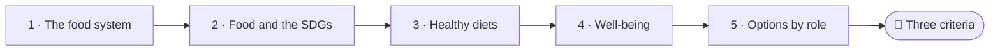
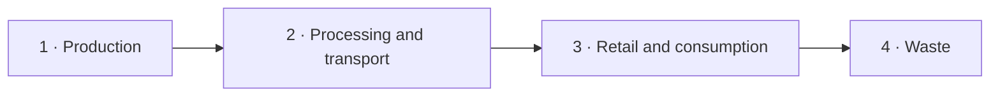

<!--
author:   Juliana Hilf; Hannes Tegelbeckers
email:    juliana.hilf@ovgu.de
version:  2.0.0
language: en
narrator: UK English Female
mode:     Presentation
comment:  GIZ Sustainability Onboarding, session 4_2, Food, health, and well-being. Self-paced and unmoderated. Licence CC BY-SA 4.0 [CHECK confirm with GIZ]

import:   https://raw.githubusercontent.com/LiaTemplates/mermaid_template/0.1.4/README.md
-->

# GIZ Sustainability Onboarding 4_2 – Food, health, and well-being

    --{{0}}--
Welcome to session four two. At Milica's school, the canteen contract is up for renewal. What looks like a small administrative task turns out to connect health, climate and fairness. If you can, turn the sound on.

**Subtopic of Session 4 · about 30 minutes · self-paced · no tutor**

> [!TIP] How this works
> Turn the sound on if you can; everything important is also on the page. Every quiz explains its answer, hints appear after a wrong try, and you can try again as often as you like. Your written notes are your personal learning journal – nobody grades them.

> [!IMPORTANT] Completing this session in Moodle
> You pass with at least 70 % of the quizzes correct **and** every survey and text box submitted. A few words are enough. Finish in one sitting if you can, because answers may be lost when you reload the page.

> [!NOTE] The case in this course
> Milica Stojanović, Ravnica Technical School and its canteen are fictional. The facts around them are real, and the sources are on the last page.

## The Canteen Contract

    --{{0}}--
The school canteen contract is up for renewal. The contract is on Milica's desk, and she is on the way to the market. Think about your last meal. Where did the food come from? Who grew it, processed it, transported it and sold it? And where did the leftovers go?

<!-- style="max-width:100%;width:60%;display:block;margin:0 auto;" -->

The canteen contract at Ravnica Technical School is up for renewal (fictional). Milica thinks of markets like Belgrade's **Kalenić market**, a familiar form of local food supply. Think about your last meal: where did it come from? Who grew it, processed it, transported it and sold it, and where did the leftovers go?

    --{{1}}--
Milica has one question before signing.

      {{1}}
> [!IMPORTANT] Guiding question
> How does one food decision connect health, climate and fairness?

    --{{2}}--
What do you think? How many global goals does food touch?

      {{2}}
****************************************

**Predict:** How many of the Sustainable Development Goals does food connect to, according to the Stockholm Resilience Centre's short video?

<!-- data-hint-button="1" data-solution-button="2" -->
- [(X)] All of them
- [( )] Only SDG 2, zero hunger
- [( )] None: food is separate from the SDGs
[[?]] Food touches hunger, health, consumption, water, climate, oceans and land.
***
Food connects all the SDGs: it touches hunger, health, consumption, water, climate, oceans and land.
***

****************************************

    --{{3}}--
So the contract is not only about price. In this session, you will help Milica choose her criteria.

      {{3}}
> [!NOTE] What really happened
> This is why food is a social issue, not only an ecological one. By the end of this session, you can help Milica choose three criteria for the contract.

## Today's Path

    --{{0}}--
Here is today's path, from the food system to Milica's contract.

    --{{1}}--
After this session, you can do three things.

      {{1}}

<!-- data-type="none" -->
| Know | Can do | Value |
|------|--------|-------|
| The stages of a food system and the main impact of each | Describe them, and explain how food connects to the SDGs, planetary boundaries and health | Connecting health and sustainability |
| Options for more sustainable and healthy consumption | Reflect on these options in your role | Acting within your real responsibilities |

    --{{2}}--
A quick look at the path.

      {{2}}
****************************************

**Decide:** What comes directly after healthy diets on today's path?

<!-- data-hint-button="1" data-solution-button="2" -->
- [(X)] Well-being
- [( )] The food system
- [( )] Options by role
[[?]] Follow the arrows from left to right.
***
Food is only one part of well-being. Air and heat also matter.
***

****************************************

## What Is a Food System?

    --{{0}}--
A food system covers everything from production, meaning farming, to consumption and waste. Each stage has a different main impact. Milica follows the chain.

    --{{1}}--
It begins on the farm.

      {{1}}
1. **Production:** Farming uses **fertilisers and water**: nitrogen and phosphorus from fertilisers, plus freshwater use.

    --{{2}}--
Then processing needs energy and transport creates emissions.

      {{2}}
2. **Processing and transport:** Processing needs **energy**. Transport and trade create **emissions**.

    --{{3}}--
Next comes retail, and our plate, where food meets our health.

      {{3}}
3. **Retail and consumption:** Retail and markets lead to consumption, where food meets our **health**.

    --{{4}}--
And finally, waste.

      {{4}}
4. **Waste:** Waste ends up in **landfill**. This is why one decision, for example in a school canteen, touches several stages at once.

## Put the Chain in Order

    --{{0}}--
Now you put the chain in order. Drag each card into the right gap.

**Order:** Drag each card into the right gap.

<!-- data-randomize data-show-partial-solution data-solution-button="2" -->
Step 1: [->[ Production ]] → Step 2: [->[ Processing and transport ]] → Step 3: [->[ Retail and consumption ]] → Step 4: [->[ Waste ]]

## Food and the Goals

    --{{0}}--
Food is not only an ecological topic. It is also a social one. Several Sustainable Development Goals are directly linked to food systems. Here is a very short video by the Stockholm Resilience Centre.

> [!TIP] Watch for
> 1. how one topic, food, touches many different goals at the same time
> 2. which goals you recognise from Session 2_3

!?[How food connects all the SDGs](https://www.youtube.com/watch?v=kvmoue_EsPo "Stockholm Resilience Centre – How food connects all the SDGs (0:31)")

Text summary of the video

**Directly linked to food systems:** SDG 2 (zero hunger), SDG 3 (good health and well-being), SDG 12 (responsible consumption and production), plus the ecological SDGs 6, 13, 14 and 15. Health (SDG 3) is also essential for education (SDG 4) and for reducing inequalities (SDG 10). If people are hungry or sick, learning and fairness become much harder.

    --{{1}}--
Which goal is not on the list?

      {{1}}
****************************************

**Decide:** Which of these SDGs is **not** listed here as directly linked to food systems?

<!-- data-hint-button="1" data-solution-button="2" -->
- [( )] SDG 2, zero hunger
- [(X)] SDG 7
- [( )] SDG 12, responsible consumption and production
[[?]] Open the text summary of the video if you need it.
***
The list has SDGs 2, 3 and 12, plus the ecological SDGs 6, 13, 14 and 15. SDG 7 is not part of that list.
***

****************************************

    --{{2}}--
And one number.

      {{2}}
****************************************

**Type:** Which SDG is "zero hunger"? (number)

<!-- data-hint-button="1" data-solution-button="2" -->
[[2]]
[[?]] It is the second goal.

****************************************

## Healthy for People and Planet

    --{{0}}--
Can a diet be healthy for people and gentle on the planet at the same time? The EAT-Lancet Commission of 2019 says yes. It proposed a planetary health diet. Watch this two-minute video.

> [!TIP] Watch for
> 1. the central idea: what we eat and how it is produced affects both people and the planet
> 2. what a "planetary health diet" is meant to achieve

!?[Can healthy food save the planet?](https://www.youtube.com/watch?v=PIc42oIU0Ik "EAT – Can healthy food save the planet? (2:11)")

Text summary of the video

The EAT-Lancet Commission (2019) proposed a "planetary health diet": a diet that is healthy for people and stays within planetary boundaries. [CHECK: Juliana – decide whether to name food groups/amounts; not in the source]

    --{{1}}--
What is the idea behind it?

      {{1}}
****************************************

**Decide:** What is the idea behind the "planetary health diet"?

<!-- data-hint-button="1" data-solution-button="2" -->
- [( )] A diet that maximises food production at any cost.
- [(X)] A diet that is healthy for people and stays within planetary boundaries.
- [( )] A diet that only wealthy countries can afford.
[[?]] Think of the double benefit in its name.
***
The core idea is the double benefit: healthy for people and within planetary boundaries. It is not about producing as much as possible, and it is not about cost.
***

****************************************

    --{{2}}--
One word.

      {{2}}
****************************************

**Type:** A planetary health diet is healthy for people and stays within which boundaries? (one word)

<!-- data-hint-button="1" data-solution-button="2" -->
[[planetary]]
[[?]] You met them in Session 3_2.

****************************************

## From Field to Policy

    --{{0}}--
On the production side, Milica meets two ideas: agroecology and local food systems, where farming works with natural systems, and the EU's Farm to Fork strategy. Complete the sentence.

**Complete:**

<!-- data-hint-button="1" data-solution-button="2" data-show-partial-solution -->
The EU Green Deal strategy for sustainable farming is called [[ (Farm to Fork) | Field to Table | Plate to Farm ]] . It covers the whole chain. The number of the SDG on responsible consumption and production is [[12]]. Agroecology is an example of [->[ (strong sustainability) | weak sustainability ]].
[[?]] Strong sustainability means nature sets limits that cannot be compensated by money or technology.

    --{{1}}--
Now a few statements on agriculture and the planet.

      {{1}}
****************************************

**Decide:** True or false?

<!-- data-hint-button="1" data-solution-button="2" data-show-partial-solution -->
[(true) (false)]
[  (X)    ( )  ] In agroecology, farming works with natural systems and preserves soil and biodiversity.
[  ( )    (X)  ] Agroecology replaces natural systems with machines.
[  (X)    ( )  ] Agriculture is linked to biogeochemical flows, freshwater use, land-system change and biosphere integrity.
[  ( )    (X)  ] Agriculture is mainly linked to the ozone layer.
[[?]] Remember the table of VET sectors in Session 3_2.
***
Agroecology works with natural systems, and is an example of strong sustainability. Agriculture is linked to biogeochemical flows (nitrogen and phosphorus from fertilisers), freshwater use, land-system change and biosphere integrity. The ozone layer is not mentioned.
***

****************************************

## Our Food, Our Health

    --{{0}}--
The World Health Organization points out a broader truth. What we eat, and how it is produced, affects our health and the environment. This video takes about a minute.

> [!TIP] Watch for
> 1. the link between food systems and health
> 2. the link between food systems and the environment

!?[Food systems: our food, our health, our future](https://www.youtube.com/watch?v=6Y499vq7tDg "World Health Organization – Food Systems: Our food, our health, our future (1:05)")

Text summary of the video

The WHO message is that food systems connect health and environment: what we eat matters for our health, and how food is produced matters for the environment.

    --{{1}}--
Which statement fits?

      {{1}}
****************************************

**Decide:** Which statement fits the WHO message?

<!-- data-hint-button="1" data-solution-button="2" -->
- [( )] Food choice is only a private matter with no wider effect.
- [(X)] What we eat affects our health, and how food is produced affects the environment.
- [( )] Food systems have no link with health.
[[?]] The video links food systems, health and the environment.
***
Because production, trade and consumption affect everyone, food is not only a private matter.
***

****************************************

    --{{2}}--
One more word.

      {{2}}
****************************************

**Type:** Production, trade and consumption affect everyone. So is food only a private matter? (yes or no)

<!-- data-hint-button="1" data-solution-button="2" -->
[[no]]
[[?]] Read the question again.

****************************************

## Well-being Beyond the Plate

    --{{0}}--
Food is only one part of well-being. Well-being also depends on the air we breathe and the heat we endure. One helpful way to hold all of this together is the doughnut model. Its social foundation includes food and health, while the ecological ceiling must not be overshot.

 – Kate Raworth / Doughnut Economics Action Lab – CC BY-SA 4.0 – via Wikimedia Commons")

**The air we breathe:**

- More than **22,000 premature deaths** in the Western Balkans in 2023 were caused by air pollution (EEA 2025).
- In Serbia, premature mortality due to PM2.5 (very fine particles in the air) was **188.3 per 100,000 inhabitants over 30** (EEA data via RERI).

**The heat we endure:** climate change brings more **heatwaves**, which are a health risk for workers and learners (IPCC 2023).

**The doughnut** holds this together: its social foundation includes **food and health**, while the ecological ceiling must not be overshot.

    --{{1}}--
Here is the main point.

      {{1}}
> [!NOTE] Key message
> Well-being in Serbia is not only about food, but about air and heat as well.

    --{{2}}--
Check the unit.

      {{2}}
****************************************

**Type:** The Western Balkans figure of 22,000 premature deaths is a total for one year. In which year? (4 digits)

<!-- data-hint-button="1" data-solution-button="2" -->
[[2023]]
[[?]] It is the year in the text.

***
2023. The 22,000 is a total count for the Western Balkans. The Serbian figure of 188.3 is a rate per 100,000 inhabitants over 30, which is a different measure.
***

****************************************

## Back to the Contract

    --{{0}}--
You do not have to solve the food system alone. The same goal, more sustainable and healthy food, is steered at three different levels. One school, one curriculum, one system. Now help Milica.

The canteen contract is on Milica's desk (fictional). The options by role:

<!-- data-type="none" -->
| Figure | Value |
|--------|-------|
| Principal | canteen and buffet (seasonal, local, less waste), school garden, drinking water, healthy workshop climate (heat, air) |
| School developer | food, waste and health topics in the curricula of cooks, food technicians, farmers and retail |
| Ministry | occupational standards for food and agriculture occupations; public procurement criteria for school meals [CHECK: Serbian rules on school meals] |

## Your Learning Journal

    --{{0}}--
First, Milica's contract.

**1 · Answer:** Which three criteria do you add to the school canteen contract, and why?

[[___ ___]]

✅ Model answer

**Seasonal and local food, less food waste in preparation and serving, and drinking water available to all learners.** "Cheapest price, whatever the source" ignores the sustainability and health goals, and "only imported products" goes against the local-food option. A good contract combines price with these quality criteria.

    --{{1}}--
Next, your own choices.

      {{1}}
****************************************

**2 · Answer:** Name two sustainable choices you could make in your daily or professional life, for example around food, waste or health.

[[___ ___]]

✅ Model answer

A **principal** might choose seasonal and local food for the canteen and add a school garden. A **school developer** could weave food, waste and health topics into the curricula of cooks, food technicians, farmers or retail occupations. A **ministry officer** might act through public procurement criteria for school meals or occupational standards. What matters is that the choice is concrete, fits your real responsibilities, and connects health with sustainability.

****************************************

    --{{2}}--
And finally, what comes first?

      {{2}}
****************************************

**3 · Answer:** Which one health topic – heat, air or food – could your institution address first? Why this one?

[[___ ___]]

✅ Model answer

A **principal** often starts with **food and heat**, because the canteen and the workshop climate are under the school's direct control. A **school developer** often starts with **food**, because integrating it into curricula can change many schools at once. A **ministry officer** may start with what sets the frame for everyone, through procurement criteria and occupational standards. There is no single right answer: the best first step fits your real decision power and your institution's conditions.

****************************************

## Exit Ticket

    --{{0}}--
Three short questions, one per objective. You can repeat them as often as you like.

**🎟️ 1 · Diets** – What does the "planetary health diet" of the EAT-Lancet Commission (2019) combine?

<!-- data-hint-button="1" data-solution-button="2" -->
- [(X)] Health for people and staying within planetary boundaries
- [( )] Maximum production at any cost
- [( )] A diet only wealthy countries can afford
[[?]] Think of the double benefit in its name.

    --{{1}}--
Next, the principal's options.

      {{1}}
****************************************

**🎟️ 2 · Options** – Which options does this session name for a school principal?

<!-- data-hint-button="1" data-solution-button="2" -->
- [[X]] A canteen with seasonal and local food and less waste
- [[ ]] Public procurement rules for the whole VET system
- [[X]] A school garden and drinking water
[[?]] Procurement rules and occupational standards are options at ministry level.

****************************************

    --{{2}}--
And one number.

      {{2}}
****************************************

**🎟️ 3 · Air** – What was the premature mortality due to PM2.5 in Serbia, per 100,000 inhabitants over 30? (number with a decimal point)

<!-- data-hint-button="1" data-solution-button="2" -->
[[188.3]]
[[?]] It is on the page about well-being beyond the plate.

****************************************

## What Milica Signs

    --{{0}}--
Milica signs the new contract. Here is what she has learned.

    --{{1}}--
First, it is one system.

      {{1}}
- A food system runs from production to consumption and waste, and each stage has its own main impact.

    --{{2}}--
Second, food connects the goals.

      {{2}}
- Food connects **all the SDGs**, and health is essential for education and reducing inequalities.

    --{{3}}--
Third, a healthy diet can stay within limits.

      {{3}}
- A **planetary health diet** is healthy for people and stays within planetary boundaries.

    --{{4}}--
Fourth, well-being goes beyond the plate.

      {{4}}
****************************************

- Well-being goes beyond the plate: **air and heat** matter too.

> [!NOTE] Remember
> One goal, three levels: one school, one curriculum, one system.

****************************************

    --{{5}}--
One last question.

      {{5}}
****************************************

**Recap:** Why does the canteen contract matter beyond the school?

<!-- data-hint-button="1" data-solution-button="2" -->
- [( )] Because the cheapest price is always the most sustainable
- [( )] Because food is only a private matter
- [(X)] Because one food decision touches several stages of the food system at once
[[?]] Remember the chain.
***
One decision in a school canteen touches production, transport, consumption and waste at once.
***

****************************************

    --{{6}}--
Milica's plan now has people in it. But her company partners have a harder question: can we go on growing? Topic five is about economic issues.

      {{6}}
**➡️ Next:** Session 5, *Economic Issues*. Company partners ask Milica a hard question: can a green plan and economic growth go together?

## Sources and licences

    --{{0}}--
Here you find all sources and licences of this session. The case of Milica and Ravnica Technical School is fictional.

- Hilf, J. (2024): *Introduction to the Sustainability Approach*. GIZ training, Day 1 – adapted
- Hilf, J. (2024): *SDGs and Sustainable Economies*. GIZ training, Day 2 – adapted
- Hilf, J. (2025): *Models of Sustainability …*. GIZ workshop – adapted
- Hilf, J. (2026): *Green TVET – Concepts and practical approaches*. Expert input – adapted
- Stockholm Resilience Centre – https://www.stockholmresilience.org/research/planetary-boundaries.html – linked
- Stockholm Resilience Centre / PIK (2025): *Seven of nine planetary boundaries now breached* – https://www.stockholmresilience.org/news--events/general-news/2025-09-24-seven-of-nine-planetary-boundaries-now-breached – summarised
- EAT-Lancet Commission (2019): *Food in the Anthropocene* – https://eatforum.org/eat-lancet-commission/ – linked
- World Health Organization – video "Food Systems: Our food, our health, our future" – https://www.youtube.com/watch?v=6Y499vq7tDg – embedded
- Balkan Green Energy News (2026): RERI analysis of Serbia's air quality – https://balkangreenenergynews.com/reri-serbia-facing-at-least-7373-early-deaths-in-2030-from-air-pollution/ – summarised
- IPCC (2023): *Climate Change 2023: Synthesis Report* – summarised
- EAT – video "Can healthy food save the planet?" – https://www.youtube.com/watch?v=PIc42oIU0Ik – embedded
- Stockholm Resilience Centre – video "How food connects all the SDGs" – https://www.youtube.com/watch?v=kvmoue_EsPo – embedded
- Bebauautu – *Kalenić market in Belgrade 1* – CC BY-SA 3.0 – https://commons.wikimedia.org/wiki/File:Kaleni%C4%87_market_in_Belgrade_1.JPG – unchanged
- Kate Raworth / Doughnut Economics Action Lab – *Doughnut (economic model)* – CC BY-SA 4.0 – https://commons.wikimedia.org/wiki/File:Doughnut_(economic_model).jpg – unchanged
- Case: Milica Stojanović, Ravnica Technical School and the canteen contract are fictional – created for this course
- [CHECK: Juliana / GIZ – one source on local food / green markets or school meals in Serbia]
