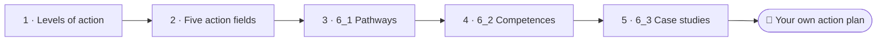

<!--
author:   Juliana Hilf; Hannes Tegelbeckers
email:    juliana.hilf@ovgu.de
version:  2.0.0
language: en
narrator: UK English Female
mode:     Presentation
comment:  GIZ Sustainability Onboarding, session 6, Responding to Sustainability Challenges. Self-paced and unmoderated. Licence CC BY-SA 4.0 [CHECK confirm with GIZ]

import:   https://raw.githubusercontent.com/LiaTemplates/mermaid_template/0.1.4/README.md
-->

# GIZ Sustainability Onboarding 6 – Responding to Sustainability Challenges

    --{{0}}--
Welcome to the last topic of this course. Milica's green plan is full of problems and goals. Now one of her students asks: so what do we actually do? If you can, turn the sound on.

**Main topic · about 30 minutes, including a 13-minute video you can watch in two breaks · self-paced · no tutor**

> [!TIP] How this works
> Turn the sound on if you can; everything important is also on the page. Every quiz explains its answer, hints appear after a wrong try, and you can try again as often as you like. Your written notes are your personal learning journal – nobody grades them.

> [!IMPORTANT] Completing this session in Moodle
> You pass with at least 70 % of the quizzes correct **and** every survey and text box submitted. A few words are enough. Finish in one sitting if you can, because answers may be lost when you reload the page.

> [!NOTE] The case in this course
> Milica Stojanović, principal of Ravnica Technical School, and the people around her are fictional. The facts around them are real, and the sources are on the last page. Your journal entry here feeds the action plan in Session 6_3, so keep a copy.

## So What Do We Do?

    --{{0}}--
Milica presents the plan to a class of electricians. It covers ecological limits, social inequality and economic pressure. A student raises a hand. So what can we actually do about it?

<!-- style="max-width:100%;width:60%;display:block;margin:0 auto;" -->
 – CC BY-SA 2.0 – via Wikimedia Commons")

Sessions 1 to 5 showed the challenges: ecological limits, social inequality, economic pressure. Milica presents her green plan to a class of electricians (fictional). A student asks: *"So what can we actually do about it?"* A solar technician on a rooftop is one concrete answer: a real skill, a real job, a real contribution to the energy transition. But who decides on the bigger questions?

    --{{1}}--
This is the last topic of the course, so it asks a different question.

      {{1}}
> [!IMPORTANT] Guiding question
> What can we actually do about it – and at which level?

    --{{2}}--
Make a first guess.

      {{2}}
****************************************

**Predict:** Which level of action is best suited to set a national climate target?

<!-- data-hint-button="1" data-solution-button="2" -->
- [(X)] Society: policy makers
- [( )] Individual: personal choices
- [( )] Organisation: a school or company
[[?]] Who can decide for the whole country?
***
Setting a national climate target is a policy decision, so it belongs to the society level. Individuals and organisations can support, pressure or follow such a target, but they cannot set it.
***

****************************************

    --{{3}}--
So there are several levels of action. Serbia's system is already moving, and your role is one of the places where these levels meet.

      {{3}}
> [!NOTE] What really happened
> Some problems can only be solved by systems, and others begin with one person. Serbia's *Low Carbon Development Strategy* names **green jobs** in its 2050 vision, and the GIZ project *Teaching skills for green transformation* (2024–2026) is revising VET programmes. The system is already moving.

## Your Way Through Topic 6

    --{{0}}--
This main topic has three subtopics. Six one is about pathways towards a great transformation. Six two is about competences and change agency. Six three contains case studies and your own action plan.

    --{{1}}--
After this session, you can do these things.

      {{1}}

<!-- data-type="none" -->
| Know | Can do | Value |
|------|--------|-------|
| The three levels of action: individuals, organisations, societies | Distinguish them, and place typical actions on the right level | Taking responsibility at your own level |
| Footprint and handprint, and the five action fields in TVET | Explain the difference, name the fields, see where your institution fits, and choose a subtopic | Being a change maker in a team |

    --{{2}}--
Which subtopic ends with an action plan?

      {{2}}
****************************************

**Decide:** Each subtopic takes 20 to 30 minutes. Which one ends with your own action plan?

<!-- data-hint-button="1" data-solution-button="2" -->
- [(X)] 6_3
- [( )] 6_1
- [( )] 6_2
[[?]] Follow the road to its end.
***
6_3 is the most practical subtopic: concrete case studies and your own action plan, built on your journal entries. 6_1 gives the big picture, and 6_2 asks what you personally need to act.
***

****************************************

## Three Levels of Action

    --{{0}}--
Milica draws three levels on the board. The answer to the student's question starts here.

**Where can action happen?**

    --{{1}}--
Individuals act through everyday decisions.

      {{1}}
- **Individuals:** everyday decisions on food, transport, energy use and travel; participation and social engagement

    --{{2}}--
Organisations act through work decisions, for example by appointing a sustainability officer on a campus.

      {{2}}
- **Organisations:** work decisions that change how a school, campus or company runs, for example a **sustainability officer** for strategy, networking, climate protection management and an ESD action plan

    --{{3}}--
Societies act through democracy and politics.

      {{3}}
- **Societies:** democracy and politics, such as the Paris Agreement, the EU Green Deal, the Green Agenda for the Western Balkans and Serbia's climate law

    --{{4}}--
One idea frames all of this: the great transformation. In 2011, the German Advisory Council on Global Change called for a social contract for sustainability.

      {{4}}
- **The great transformation:** the German Advisory Council on Global Change (WBGU) called for a "social contract for sustainability" in 2011. It is not only a technical task, but a shared, political decision

    --{{5}}--
And responsibility is shared.

      {{5}}
> [!TIP] Why this matters
> Responsibility for the transformation lies with society, science, policy makers and industries. In practice, a single initiative often touches all three levels at once.

    --{{6}}--
Which of these were you already aware of?

      {{6}}
****************************************

**Mark:** Which of these do you already know? (several possible)

[[a1]] **Individuals:** everyday decisions on food, transport, energy use and travel; participation and social engagement
[[a2]] **Organisations:** work decisions that change how a school, campus or company runs, for example a **sustainability officer** for strategy, networking, climate protection management and an ESD action plan
[[a3]] **Societies:** democracy and politics, such as the Paris Agreement, the EU Green Deal, the Green Agenda for the Western Balkans and Serbia's climate law
[[a4]] **The great transformation:** the German Advisory Council on Global Change (WBGU) called for a "social contract for sustainability" in 2011. It is not only a technical task, but a shared, political decision

****************************************

## Can You Fix Climate Change?

    --{{0}}--
This video makes the point in a very direct way. It takes about thirteen minutes, so you can watch it at your own pace, for example in two breaks.

> [!TIP] Watch for
> 1. what individuals can do
> 2. what only systems (politics, companies) can change

!?[Can YOU Fix Climate Change? Kurzgesagt, about 13 minutes](https://www.youtube.com/watch?v=yiw6_JakZFc "Kurzgesagt – In a Nutshell – Can YOU Fix Climate Change? (about 13 min)")

Text summary of the video

The video (Kurzgesagt, about 13 minutes) stresses that some problems can only be solved by systems: politics, companies, regulation. Individuals can support, pressure or follow these decisions.

    --{{1}}--
Where does this action belong?

      {{1}}
****************************************

**Decide:** Where does choosing public transport instead of a private car belong?

<!-- data-hint-button="1" data-solution-button="2" -->
- [( )] Organisation
- [(X)] Individual
- [( )] Society
[[?]] It is an everyday personal choice.
***
Everyday personal choices belong to the individual level. Running an ESD action plan belongs to the organisation level, and supporting a national climate policy framework to the society level.
***

****************************************

    --{{2}}--
And a year.

      {{2}}
****************************************

**Type:** In which year did the WBGU call for a "social contract for sustainability"? (4 digits)

<!-- data-hint-button="1" data-solution-button="2" -->
[[2011]]
[[?]] It is on the previous page.

****************************************

## Footprint, Handprint, Brainprint

    --{{0}}--
Two more terms will help you think about action. Milica asks the students to look at their hands.

<!-- data-type="none" -->
| Criterion | Footprint | Handprint |
|-----------|---------------|---------------|
| Side of our impact | negative | positive |
| Character | passive | active |
| In a school | what the school uses and emits | what the school starts: the action fields are where a school can build a handprint |
| Next step | reduce it | grow it, through education and empowerment |

    --{{1}}--
Here are two examples.

      {{1}}
- **Footprint:** The energy use of the workshop halls
- **Handprint:** A monthly energy-use check, started with the facilities team

    --{{2}}--
And a third word.

      {{2}}
> [!WARNING] Common misconception
> "Handprint and footprint are the same thing, only used in different contexts." They are opposites. Education and empowerment together create a **brainprint**.

    --{{3}}--
Now you sort them.

      {{3}}
****************************************

**Decide:** Which concept does each statement describe?

<!-- data-hint-button="1" data-solution-button="2" data-show-partial-solution -->
[(Footprint) (Handprint)]
[       (X)             ( )      ] The negative, passive side of our impact
[       ( )             (X)      ] The positive, active side of our impact
[       (X)             ( )      ] The waste a campus produces
[       ( )             (X)      ] A half-day workshop on green campus
[[?]] Negative and passive, or positive and active?
***
A footprint is the negative, passive side of our impact, and a handprint is the positive, active side. They are opposites, not synonyms.
***

****************************************

## Five Action Fields in TVET

    --{{0}}--
How does a great transformation look in practice? In a VET school, it is not one project. It is a set of action fields. Juliana Hilf names five.

 – CC BY-SA 2.0")

- **Green campus:** the buildings, energy and everyday life of the school
- **Green curriculum:** what students learn
- **Green community:** the school's role in its neighbourhood and region
- **Green culture:** how sustainability is lived, not just taught
- **Green research:** the school's own learning and innovation

A solar technician is a small, concrete example of what "green campus" and "green curriculum" can look like together.

    --{{1}}--
Here is the key point.

      {{1}}
> [!NOTE] Key message
> The action fields are where a school can actually build a handprint.

    --{{2}}--
Check one of the fields.

      {{2}}
****************************************

**Type:** Which field covers the school's role in its neighbourhood and region? Complete: "green …" (one word)

<!-- data-hint-button="1" data-solution-button="2" -->
[[community]]
[[?]] It is the third item in the list.

***
Green community. The five fields are green campus, curriculum, community, culture and research.
***

****************************************

## Where Do You Start?

    --{{0}}--
Before you choose a starting point, rate yourself honestly. There is no wrong answer.

**How familiar are these three subtopics?**

    --{{1}}--
Six one, pathways towards a great transformation. How can a society move towards sustainability?

      {{1}}
- **6_1 Pathways towards a great transformation:** pathways, strategies and current debates

    --{{2}}--
Six two, competences for sustainable development and change agency. What do you need to act?

      {{2}}
- **6_2 Competences and change agency:** which competences you need to act, and how to become a change agent

    --{{3}}--
Six three, think global, act local. Case studies and your own plan.

      {{3}}
- **6_3 Think global, act local:** concrete case studies and your own action plan

    --{{4}}--
And your own journal entry on the next pages carries over into six three.

      {{4}}
- **Your journal entry** in this session feeds the action plan in 6_3

    --{{5}}--
Here is the recommendation. If all are new, start with six one. If you know six one, go on to six two. If you know both, start with six three. If you know all three, six three is still worthwhile, because only it ends with an action plan.

      {{5}}
> [!TIP] Why this matters
> **All new?** Start with 6_1: it is the natural entry point. **Know 6_1?** Go to 6_2, the most personal subtopic. **Know 6_1 and 6_2?** Go to 6_3, the most practical. **Know all three?** Do 6_3 anyway: only it ends with an action plan.

    --{{6}}--
Now mark what you already know, and use your answer to choose your next session.

      {{6}}
****************************************

**Mark:** Which of these do you already know? (several possible)

[[a1]] **6_1 Pathways towards a great transformation:** pathways, strategies and current debates
[[a2]] **6_2 Competences and change agency:** which competences you need to act, and how to become a change agent
[[a3]] **6_3 Think global, act local:** concrete case studies and your own action plan
[[a4]] **Your journal entry** in this session feeds the action plan in 6_3

****************************************

## Warm-up Check

    --{{0}}--
Three short checks to make sure the core terms are clear before you move on.

**1 · Choose one:** Which of Juliana Hilf's take-home messages says that a team is stronger than an individual?

<!-- data-hint-button="1" data-solution-button="2" -->
- [( )] Be a change maker and let your colleagues, friends and students become change makers.
- [(X)] Network with others: a team is stronger than an individual.
- [( )] Schools and TVET institutions play the role of a catalyst.
[[?]] Look for the message that is about working with other people.
***
The fifth take-home message is about networking. The change-maker message is about inspiring people around you, and the catalyst message is about the role of schools.
***

    --{{1}}--
Now the action fields.

      {{1}}
****************************************

**2 · Choose all that apply:** Which of the following are action fields in TVET?

<!-- data-hint-button="1" data-solution-button="2" -->
- [[X]] Green campus
- [[ ]] Green footprint
- [[X]] Green culture
- [[ ]] Green budget
[[?]] The five fields are campus, curriculum, community, culture and research.
***
"Green footprint" is a useful trap: a footprint is the negative, passive side of our impact, not a field where a school can act.
***

****************************************

    --{{2}}--
And one number.

      {{2}}
****************************************

**3 · Type:** How many action fields in TVET does Juliana Hilf name? (number)

<!-- data-hint-button="1" data-solution-button="2" -->
[[5]]
[[?]] Count the fields in the list.

***
Five: green campus, curriculum, community, culture and research.
***

****************************************

## One Thing You Could Start

    --{{0}}--
The student's question now goes to you. It does not have to be big, and it does not have to be funded. It only has to be something you could start. Keep your answer, as it is the seed of your action plan in session six three.

 – CC BY-SA 2.0")

Milica passes the student's question on to you. Your answer does not have to be big, and it does not have to be funded. It only has to be something you could start. **Keep a copy: it is the seed of your action plan in Session 6_3.**

<!-- data-type="none" -->
| Figure | Value |
|--------|-------|
| Individual | everyday decisions, participation, social engagement |
| Organisation | work decisions in a school, campus or company |
| Society | democracy and politics |

## Your Learning Journal

    --{{0}}--
First, your idea.

**1 · Answer:** Write down one concrete **handprint** idea for your own institution: a ministry, a school or a campus.

[[___ ___]]

✅ Model answer

A good handprint idea is small enough to start and specific enough to name. A **ministry officer**: "We can add one green-skills indicator to the next curriculum review." A **school developer**: "I can offer one half-day workshop on green campus to the schools I support." A **principal**: "We can start a monthly energy-use check with our facilities team." They are not about changing the whole system. They add one concrete, visible step.

    --{{1}}--
Next, your level.

      {{1}}
****************************************

**2 · Answer:** Which of the three levels do you have the most direct influence on in your current role? Name one concrete step you could take there.

[[___ ___]]

✅ Model answer

Most **ministry officers** will say society, because they shape policy, standards and funding. Most **school developers** will say organisation, because they work directly with schools and teachers. Most **principals** will say organisation too, but at a different scale. What matters is naming one step you can actually take. The three levels are not a hierarchy of importance; they are three places where the same transformation happens.

****************************************

    --{{2}}--
And finally, the student.

      {{2}}
****************************************

**3 · Answer:** What would you answer the student who asks: "So what can we actually do?"

[[___ ___]]

✅ Model answer

For example: "Some things you can do yourself, such as your everyday choices. Some we can do as a school, such as running our campus differently. And some only politics can decide, but you can take part in that too. And the skills you are learning here are themselves part of the answer."

****************************************

## Juliana's Take-Home Messages

    --{{0}}--
Before you go on, keep Juliana Hilf's five take-home messages in mind. They are the thread that runs through the rest of this course.

    --{{1}}--
The first message.

      {{1}}
- Keep reminding yourself of the necessity and power of (Education for) Sustainable Development.

    --{{2}}--
The second message.

      {{2}}
- Green empowerment and competences matter more than just content.

    --{{3}}--
The third message.

      {{3}}
- Be a change maker, and let your colleagues, friends and students become change makers.

    --{{4}}--
The fourth message.

      {{4}}
****************************************

- Schools and TVET institutions play the role of a catalyst for a sustainable economy, ecology and social equality.

> [!NOTE] Remember
> Network with others: a team is stronger than an individual.

****************************************

    --{{5}}--
One last question.

      {{5}}
****************************************

**Recap:** Which statement about the handprint is correct?

<!-- data-hint-button="1" data-solution-button="2" -->
- [( )] It is the negative, passive side of our impact.
- [( )] It is the same as the footprint.
- [(X)] It is the positive, active side of our impact.
[[?]] Negative and passive, or positive and active?
***
The footprint is the negative, passive side, and the handprint the positive, active side. Education and empowerment together create a brainprint.
***

****************************************

    --{{6}}--
Choose your subtopic. If you follow the road, Milica needs a route for her whole plan in session six one.

      {{6}}
**➡️ Next:** Choose your subtopic as recommended. In Session 6_1, Milica wants to see the route from a national target to her workshop.

## Sources and licences

    --{{0}}--
Here you find all sources and licences of this session. The case of Milica and Ravnica Technical School is fictional.

- Hilf, J. (2024): *Introduction to the Sustainability Approach*. GIZ training, Day 1 – adapted
- Hilf, J. (2025): *Models of Sustainability …*. GIZ workshop – adapted
- Hilf, J. (2026): *Green TVET – Concepts and practical approaches*. Expert input – adapted
- WBGU (2011): *World in Transition – A Social Contract for Sustainability* – summarised
- Leal Filho, W. et al. (2021): Handling climate change education at universities. *Environmental Sciences Europe* 33, 109 – via Hilf
- *Low Carbon Development Strategy Serbia 2023–2030* – https://unfccc.int/sites/default/files/resource/Low_Carbon_Development_Strategy_Serbia_2023-2030_with_2050_Projections.pdf – summarised
- GIZ: *Teaching skills for green transformation* – https://www.giz.de/en/worldwide/123790.html – linked
- Video: Kurzgesagt – "Can YOU Fix Climate Change?" – https://www.youtube.com/watch?v=yiw6_JakZFc – embedded
- Image: CoCreatr – *Solar installation technician on rooftop* – CC BY-SA 2.0 – https://commons.wikimedia.org/wiki/File:Solar_installation_technician_on_rooftop_(5392894792).jpg – unchanged
- Case: Milica Stojanović, Ravnica Technical School and the class of electricians are fictional – created for this course
