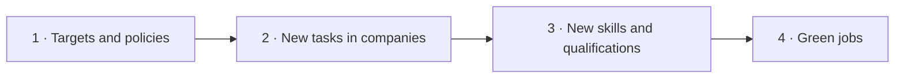

<!--
author:   Juliana Hilf; Hannes Tegelbeckers
email:    juliana.hilf@ovgu.de
version:  2.0.0
language: en
narrator: UK English Female
mode:     Presentation
comment:  GIZ Sustainability Onboarding, session 6_1, Pathways towards a great transformation. Self-paced and unmoderated. Licence CC BY-SA 4.0 [CHECK confirm with GIZ]

import:   https://raw.githubusercontent.com/LiaTemplates/mermaid_template/0.1.4/README.md
-->

# GIZ Sustainability Onboarding 6_1 – Pathways towards a great transformation

    --{{0}}--
Welcome to session six one. Milica wants to see the whole route, from a national target to her own workshop. If you can, turn the sound on.

**Subtopic of Session 6 · about 35 minutes · self-paced · no tutor**

> [!TIP] How this works
> Turn the sound on if you can; everything important is also on the page. Every quiz explains its answer, hints appear after a wrong try, and you can try again as often as you like. Your written notes are your personal learning journal – nobody grades them.

> [!IMPORTANT] Completing this session in Moodle
> You pass with at least 70 % of the quizzes correct **and** every survey and text box submitted. A few words are enough. Finish in one sitting if you can, because answers may be lost when you reload the page.

> [!NOTE] The case in this course
> Milica Stojanović, Jelena Marković and Ravnica Technical School are fictional. The facts around them are real, and the sources are on the last page.

## From a Wind Farm to a Workshop

    --{{0}}--
Milica visits a wind farm with her electricians. Such capacity is already visible in Serbia, but the country's starting point is still fossil-based. On the bus home she asks Jelena: how do societies actually change?

<!-- style="max-width:100%;width:60%;display:block;margin:0 auto;" -->
 – Ivan25 – CC BY-SA 4.0 – via Wikimedia Commons")

Milica visits a wind farm with her electricians (the visit is fictional). New renewable capacity is already visible in Serbia, but the starting point is still fossil-based: about **60 %** of electricity comes from lignite (2024), while wind provides about **3 %**. On the bus home she asks Jelena: *"How do societies actually change?"*

    --{{1}}--
This session turns from the problems to the other side.

      {{1}}
> [!IMPORTANT] Guiding question
> What is a pathway from today's situation to the 2050 vision – and who has to do what along the way?

    --{{2}}--
What do you think such a change mainly needs?

      {{2}}
****************************************

**Predict:** According to the WBGU (2011), what does the transformation towards sustainability mainly need?

<!-- data-hint-button="1" data-solution-button="2" -->
- [(X)] A new "social contract" between citizens, science, business and the state
- [( )] A single international law that all countries must follow
- [( )] Only technical innovation: society can stay the same
[[?]] Think about who has to agree to change, not just what has to be built.
***
The transformation needs a new social contract. A single law cannot do it, because the goal is normative and contested. Technology alone is not enough, because the change also concerns how we consume, organise work and make decisions.
***

****************************************

    --{{3}}--
So a pathway is not a straight line. It is a route that is negotiated again and again.

      {{3}}
> [!NOTE] What really happened
> A pathway is not a straight line. It is a route that is negotiated again and again by governments, companies, schools and citizens.

## Today's Path

    --{{0}}--
Here is today's path. Yes, it is a path about pathways.

    --{{1}}--
After this session, you can do three things.

      {{1}}

<!-- data-type="none" -->
| Know | Can do | Value |
|------|--------|-------|
| Possible **pathways and strategies** for societal transformation | Outline them, and name the main **actors** at each level | Negotiation as part of the route |
| Current debates and examples | Relate pathways to the European Green Deal, Serbia and TVET | Seeing education as a load-bearing step |

    --{{2}}--
A quick look at the path.

      {{2}}
****************************************

**Decide:** Which step comes directly before TVET on today's path?

<!-- data-hint-button="1" data-solution-button="2" -->
- [(X)] Green Deal
- [( )] Five strategies
- [( )] Great transformation
[[?]] Follow the arrows from left to right.
***
First the European example, then the role of TVET in it.
***

****************************************

## What Is a Great Transformation?

    --{{0}}--
The German Advisory Council on Global Change used the expression great transformation in 2011. Jelena sums it up for Milica.

 – Ivan25 – CC BY-SA 4.0")

The WBGU's report *World in Transition – A Social Contract for Sustainability* (2011) argues that the transformation towards sustainability is as deep as the great transformations of earlier centuries. It cannot be achieved by technology alone. It needs a new **"social contract"** between citizens, science, business and the state. [CHECK: Juliana – confirm wording against the WBGU summary for policy-makers]

Two consequences follow:

- The transformation is **normative**: it is a goal society chooses, not a technical problem with one solution.
- It is **contested**: different actors weigh goals differently, so it relies on **constant negotiation and societal learning** (UNESCO 2022).

    --{{1}}--
Here is the idea to keep.

      {{1}}
> [!NOTE] Key message
> A pathway is a route that is negotiated again and again: by governments, companies, schools and citizens.

    --{{2}}--
Complete the sentence.

      {{2}}
****************************************

**Type:** The transformation relies on constant … and societal learning. (one word)

<!-- data-hint-button="1" data-solution-button="2" -->
[[negotiation]]
[[?]] Different actors weigh goals differently, so they have to talk.

***
Constant negotiation and societal learning (UNESCO 2022).
***

****************************************

## Five Strategies

    --{{0}}--
Debates about transformation usually revolve around five strategies. You will recognise them in policy documents from the EU and from Serbia. They are not alternatives that exclude each other.

<!-- data-type="none" -->
| Strategy | In plain words |
|---|---|
| **Efficiency** | Doing more with fewer resources (weak sustainability) |
| **Sufficiency** | Using less, consuming differently (strong sustainability, degrowth) |
| **Consistency / circularity** | Closing loops so materials stay in use (circular economy) [CHECK: Juliana – "consistency" is a common third strategy in German debates; keep or drop] |
| **Decarbonisation / net zero** | Reduce emissions, balance the rest (Paris Agreement, European Green Deal) |
| **Just transition** | Make the change fair for workers and regions (EU Just Transition Mechanism; ILO) |

    --{{1}}--
A real pathway usually combines several.

      {{1}}
> [!NOTE] Key message
> A real pathway combines several strategies. For example, a school installs heat pumps (efficiency), buys them as a shared service (sufficiency) and keeps them repairable (circularity).

    --{{2}}--
Check one of them.

      {{2}}
****************************************

**Type:** Which strategy means "doing more with fewer resources"? (one word)

<!-- data-hint-button="1" data-solution-button="2" -->
[[efficiency]]
[[?]] It is the first row of the table.

***
Efficiency. Sufficiency, by contrast, means using less and consuming differently.
***

****************************************

## Which Strategy Is It?

    --{{0}}--
Milica looks at her green plan and asks which strategy each measure stands for.

**Complete:**

<!-- data-hint-button="1" data-solution-button="2" data-show-partial-solution -->
LED lighting in a school building uses less energy for the same light. This is [[ (efficiency) | sufficiency | just transition ]] . The number of strategies on the previous page is [[5]]. A repair workshop for machines and tools keeps materials in use. This is [->[ (circularity) | decarbonisation ]].
[[?]] Does the example use less of a resource, keep materials in use, reduce emissions, or protect workers?

    --{{1}}--
Now some true or false statements.

      {{1}}
****************************************

**Decide:** True or false?

<!-- data-hint-button="1" data-solution-button="2" data-show-partial-solution -->
[(true) (false)]
[  (X)    ( )  ] Car-sharing instead of private cars is an example of sufficiency.
[  ( )    (X)  ] A new solar park is an example of a just transition.
[  (X)    ( )  ] Retraining coal miners for green jobs is an example of a just transition.
[  ( )    (X)  ] Each real project uses exactly one strategy.
[[?]] A solar park replaces fossil electricity. Real projects often combine strategies.
***
Car-sharing means fewer cars in total, which is sufficiency. A solar park replaces fossil electricity, which is decarbonisation. Retraining miners makes the change fair for workers. Real projects often combine several strategies at once.
***

****************************************

## A Pathway from Policy to Jobs

    --{{0}}--
How do these strategies become reality? One simple pathway connects today, which is fossil-based and linear, to the vision for 2050. Every arrow is a job for a different group of actors.

    --{{1}}--
First, targets and policies. Jelena's ministry works here.

      {{1}}
1. **Targets and policies:** Paris Agreement, European Green Deal, Green Agenda for the Western Balkans, Serbian climate law. They set the direction, starting from today's fossil-based, linear situation.

    --{{2}}--
Second, companies get new tasks.

      {{2}}
2. **New tasks in companies:** Renewables, efficiency, circularity.

    --{{3}}--
Third, VET turns tasks into skills. This is your step.

      {{3}}
3. **New skills and qualifications:** VET standards, curricula, teacher training. Policy creates new tasks, and VET must turn them into skills and qualifications.

    --{{4}}--
Fourth, green jobs and a just transition. This is the vision for 2050.

      {{4}}
4. **Green jobs:** Green jobs and a just transition: the 2050 vision. Responsibility lies with **society, science, policy makers and industries** (Leal Filho et al. 2021). Change can start through democracy and politics, participation and social engagement, work decisions and everyday decisions.

## Put the Pathway in Order

    --{{0}}--
Now you put the pathway in order. Drag each card into the right gap.

**Order:** Drag each card into the right gap.

<!-- data-randomize data-show-partial-solution data-solution-button="2" -->
Step 1: [->[ Targets and policies ]] → Step 2: [->[ New tasks in companies ]] → Step 3: [->[ New skills and qualifications ]] → Step 4: [->[ Green jobs ]]

## Climate Goals and Jobs

    --{{0}}--
This video shows how a GIZ project makes the link between climate goals and jobs. Read what to watch for.

> [!TIP] Watch for
> 1. how the video connects climate goals with jobs
> 2. which groups it names as partners in the transition

!?[TVET4GreenJobs: Skills for a Just Transition to a Green Future](https://www.youtube.com/watch?v=P-L2YULZHVI "GIZ – TVET4GreenJobs: Skills for a Just Transition to a Green Future (3:45)")

Text summary of the video

The GIZ project *TVET4GreenJobs* links climate goals and jobs: VET prepares people for the new tasks that a greener economy creates. That is step 3 of the pathway: new skills and qualifications.

    --{{1}}--
What does the project connect?

      {{1}}
****************************************

**Decide:** What does the GIZ project *TVET4GreenJobs* connect?

<!-- data-hint-button="1" data-solution-button="2" -->
- [( )] Only school curricula and examination formats
- [(X)] Climate goals and jobs: skills for a just transition to a green future
- [( )] Household energy use and private consumption
[[?]] Look at the project's title.
***
The title says it: Skills for a Just Transition to a Green Future. VET prepares people for the new tasks that a greener economy creates.
***

****************************************

    --{{2}}--
One word.

      {{2}}
****************************************

**Type:** The pathway's step 3 is new … and qualifications. (one word)

<!-- data-hint-button="1" data-solution-button="2" -->
[[skills]]
[[?]] It is the step where VET comes in.

****************************************

## An Example: the European Green Deal

    --{{0}}--
The clearest recent example of a societal pathway is the European Green Deal. This short introductory video is optional. Notice what is missing from the list: a ban on all fossil fuels by a fixed date.

> [!TIP] Watch for
> 1. the targets and the package of policies
> 2. what a "steering framework" does

!?[European Green Deal: Achieving Climate Neutrality and Economic Growth](https://www.youtube.com/watch?v=e-OiG6p2dHQ "European Commission – European Green Deal: Achieving Climate Neutrality and Economic Growth (3:13, optional)")

Text summary of the video

**Central commitments:** net zero greenhouse gas emissions by 2050; at least −55 % emissions by 2030 (compared with 1990); a package of policies: clean energy, circular economy, sustainable mobility, Farm to Fork, zero pollution; a Just Transition Mechanism to support regions and workers affected; at least EUR 1 trillion in investments.

**Not on the list:** a ban on all fossil fuels by a fixed date. The Green Deal is a **steering framework**: it sets targets, funds investment and protects the most vulnerable. That is what a pathway means in practice: a direction, a budget, and rules for fairness.

    --{{1}}--
Which statement fits?

      {{1}}
****************************************

**Decide:** Which statement describes the European Green Deal?

<!-- data-hint-button="1" data-solution-button="2" -->
- [( )] It plans to phase out all fossil fuels completely by 2025.
- [(X)] It aims at net zero by 2050, and sets up a Just Transition Mechanism for affected regions and workers.
- [( )] It is financed only by voluntary donations from companies.
[[?]] Open the text summary of the video if you need it.
***
The Green Deal is a framework of targets, policies and investments (at least EUR 1 trillion), not a single ban.
***

****************************************

    --{{2}}--
And its year.

      {{2}}
****************************************

**Type:** Net zero under the European Green Deal is planned by which year? (4 digits)

<!-- data-hint-button="1" data-solution-button="2" -->
[[2050]]
[[?]] It is the year of the vision on the pathway too.

****************************************

## TVET as a Load-Bearing Step

    --{{0}}--
Education is not a side track on the pathway. It is a load-bearing step. Without new skills and qualifications, new tasks in companies cannot be filled. The ILO explains the idea of a just transition in this short video.

> [!TIP] Watch for
> 1. who is affected by the transition
> 2. what "fair" means in practice

!?[A just transition to a new, greener life](https://www.youtube.com/watch?v=xu-PyeicH64 "ILO – A just transition to a new, greener life (2:40)")

Text summary of the video

**Two international documents frame the role of TVET:**

- **UNESCO TVET strategy 2022–2029**, *Transforming TVET for successful and just transitions*: TVET should build skills for work and life, for inclusive and sustainable economies, and for inclusive and peaceful societies.
- **Cedefop & UNESCO-UNEVOC (2025)**, [*Meeting skill needs for the green transition*](https://www.cedefop.europa.eu/en/publications/4220) (Practical guide 4): how to anticipate green skill needs and turn them into VET.

    --{{1}}--
What does the term mean?

      {{1}}
****************************************

**Decide:** In this course, what does the term "just transition" mean?

<!-- data-hint-button="1" data-solution-button="2" -->
- [( )] A transition that is finished as quickly as possible
- [(X)] A transition that is fair for workers and regions affected by the change
- [( )] A transition that is financed only by the EU
[[?]] The word "just" means "fair". Ask who must be protected.
***
Workers and regions that lose jobs or industries during the change must not be left behind. That is why UNESCO names "successful and just transitions" in its TVET strategy.
***

****************************************

    --{{2}}--
One word.

      {{2}}
****************************************

**Type:** The word "just" in "just transition" means … (one word)

<!-- data-hint-button="1" data-solution-button="2" -->
[[fair]]
[[?]] Read the question above.

****************************************

## Serbia's Route

    --{{0}}--
Serbia has its own set of targets that feed into the pathway. At the regional level, the Green Agenda for the Western Balkans sets a common direction. Milica and Jelena put the numbers side by side.

 – Ivan25 – CC BY-SA 4.0 [CHECK: Juliana – add capacity/year from an official source if wanted]")

The **Low Carbon Development Strategy 2023–2030 with projections until 2050** (Official Gazette 46/2023) covers energy, industry, transport, agriculture, forestry and waste, and its 2050 vision explicitly includes **green jobs**. Regionally, the **Green Agenda for the Western Balkans** (Sofia Declaration, 10 November 2020) sets a common direction.

<!-- data-type="none" -->
| Figure | Value |
|--------|-------|
| NDC 2022 | −33.3 % greenhouse gases by 2030 compared with 1990 (without land use) |
| NDC 3.0 (September 2025) | −40.1 % by 2035 compared with 1990 (conditional). CAN Europe: ambition raised, but the 2030 target was not updated |
| Starting point (2024) | about 60 % of electricity from lignite; about 3 % from wind |

## Your Learning Journal

    --{{0}}--
First, one sector.

**1 · Answer:** Pick one sector. Describe one pathway from a policy target to a VET offering in that sector, in three or four sentences.

[[___ ___]]

✅ Model answer

Follow the steps of the pathway. Example (energy): a policy sets a target for renewable energy → companies and municipalities build solar parks and heat-pump systems and need installers → VET updates standards, curricula and teacher training → graduates fill green jobs, including in regions affected by the shift away from coal. A ministry officer might emphasise the first steps, a school developer the middle ones, and a principal the last one.

    --{{1}}--
Now the obstacles.

      {{1}}
****************************************

**2 · Answer:** Which obstacle do you see on this pathway in your role?

[[___ ___]]

✅ Model answer

A **ministry officer** may see slow updates of occupational standards or a gap between climate targets and education policy. A **school developer** may see that curricula and teacher training lag behind new company tasks, or that few companies offer training places in green occupations. A **principal** may see budget limits, a shortage of qualified teachers, or partners who are themselves in transition. None of these stops the pathway, but each needs a concrete answer at its level.

****************************************

    --{{2}}--
Finally, a question for Jelena. And for you.

      {{2}}
****************************************

**3 · Answer:** As a ministry officer, which step of the pathway is the most direct lever? And which of the five strategies is the most realistic for Serbia by 2030?

[[___ ___]]

✅ Model answer

A ministry works mainly at the **targets and policies** step: it sets the framework (strategy, standards, funding rules) that companies, schools and citizens then follow. It does not run companies, and it cannot decide everyday behaviour directly. That is why the quality of the policy step decides how fast the later steps move. On the most realistic strategy there is no right answer: it is your own opinion, and a good answer gives a reason.

****************************************

## Exit Ticket

    --{{0}}--
Three short questions, one per objective. You can repeat them as often as you like.

**🎟️ 1 · Serbia's targets** – What does Serbia's NDC 3.0 (September 2025) commit to?

<!-- data-hint-button="1" data-solution-button="2" -->
- [(X)] −40.1 % greenhouse gas emissions by 2035 compared with 1990 (conditional)
- [( )] −33.3 % greenhouse gas emissions by 2030
- [( )] Net zero greenhouse gas emissions by 2045
[[?]] NDC 3.0 is the newer document. Check both the percentage and the year.

    --{{1}}--
Next, the Green Deal.

      {{1}}
****************************************

**🎟️ 2 · European Green Deal** – Which statements apply to the European Green Deal?

<!-- data-hint-button="1" data-solution-button="2" -->
- [[X]] At least −55 % emissions by 2030 compared with 1990
- [[ ]] A complete phase-out of fossil fuels by 2025
- [[X]] A Just Transition Mechanism for affected regions and workers
[[?]] It is a steering framework, not a single ban.

****************************************

    --{{2}}--
And one number.

      {{2}}
****************************************

**🎟️ 3 · Strategies** – How many strategies for transformation did this session name? (number)

<!-- data-hint-button="1" data-solution-button="2" -->
[[5]]
[[?]] Efficiency, sufficiency, circularity, decarbonisation, and …

****************************************

## What Milica Adds to the Plan

    --{{0}}--
Back at school, Milica draws the pathway into her plan.

    --{{1}}--
First, a social contract.

      {{1}}
- The transformation needs a new **social contract**, and it is normative and contested.

    --{{2}}--
Second, five strategies.

      {{2}}
- Five strategies: efficiency, sufficiency, circularity, decarbonisation and just transition. Real pathways combine them.

    --{{3}}--
Third, one chain.

      {{3}}
- One pathway: targets and policies → new tasks → new skills → green jobs.

    --{{4}}--
Fourth, VET is load-bearing.

      {{4}}
****************************************

- **TVET is a load-bearing step**, not a side track.

> [!NOTE] Remember
> A pathway means a direction, a budget, and rules for fairness.

****************************************

    --{{5}}--
One last question.

      {{5}}
****************************************

**Recap:** Match the example to its actor level: which one is a policy framework?

<!-- data-hint-button="1" data-solution-button="2" -->
- [( )] A company energy audit
- [( )] A school strike for the climate
- [(X)] The European Green Deal
[[?]] Ask who decides, who operates, and who mobilises.
***
The European Green Deal is a policy framework. A company energy audit is a business decision, and a school strike is civil society. All three can initiate change.
***

****************************************

    --{{6}}--
The route is clear. But who walks it? Which competences do people need? Stefan and Milica look at that in session six two.

      {{6}}
**➡️ Next:** Session 6_2, *Competences for sustainable development and change agency*. The route is clear. But what do Milica's teachers need in order to walk it?

## Sources and licences

    --{{0}}--
Here you find all sources and licences of this session. The case of Milica and Ravnica Technical School is fictional.

- *World in Transition – A Social Contract for Sustainability* – WBGU, 2011 – https://www.wbgu.de/en/publications/publication/world-in-transition-a-social-contract-for-sustainability – summarised
- *Introduction to the Sustainability Approach* – Hilf, J., 2024, GIZ training, Day 1 – adapted
- *SDGs and Sustainable Economies* – Hilf, J., 2024, GIZ training, Day 2 – adapted
- *Models of Sustainability …* – Hilf, J., 2025, GIZ workshop – adapted
- *Green TVET – Concepts and practical approaches* – Hilf, J., 2026, expert input – adapted
- *Transforming TVET for successful and just transitions. UNESCO strategy 2022–2029* – UNESCO, 2022 – summarised
- *Meeting skill needs for the green transition – Skills anticipation and VET for a greener future* (Practical guide 4) – Cedefop & UNESCO-UNEVOC, 2025 – https://www.cedefop.europa.eu/en/publications/4220 – linked only
- Leal Filho, W. et al. (2021) – via Hilf
- *Sofia Declaration on the Green Agenda for the Western Balkans* – Regional Cooperation Council, 2020 – https://www.rcc.int/docs/546/sofia-declaration-on-the-green-agenda-for-the-western-balkans – linked
- *Low Carbon Development Strategy Serbia 2023–2030 with 2050 Projections* – Republic of Serbia, 2023 – https://unfccc.int/sites/default/files/resource/Low_Carbon_Development_Strategy_Serbia_2023-2030_with_2050_Projections.pdf – summarised
- Serbia NDCs – NDC Partnership – https://ndcpartnership.org/country/srb ; CAN Europe – https://caneurope.org/western-balkans-ndcs-3-0-serbia-joins-montenegro-in-updating-climate-commitments – summarised
- *The energy sector in Serbia* – CEE Bankwatch Network – https://bankwatch.org/beyond-coal/the-energy-sector-in-serbia – summarised
- Video: *TVET4GreenJobs: Skills for a Just Transition to a Green Future* – GIZ – https://www.youtube.com/watch?v=P-L2YULZHVI – embedded
- Video: *A just transition to a new, greener life* – ILO – https://www.youtube.com/watch?v=xu-PyeicH64 – embedded
- Video: *European Green Deal: Achieving Climate Neutrality and Economic Growth* – European Commission – https://www.youtube.com/watch?v=e-OiG6p2dHQ – embedded
- Image: *Wind farm Čibuk 1 (2018) 2* – Ivan25, CC BY-SA 4.0 – https://commons.wikimedia.org/wiki/File:Wind_farm_%C4%8Cibuk_1_(2018)_2.jpg – unchanged
- Image: *Heat pump installation* – Jim Barton, CC BY-SA 2.0 – https://commons.wikimedia.org/wiki/File:Heat_pump_installation_-_geograph.org.uk_-_7495844.jpg – unchanged
- Case: Milica Stojanović, Jelena Marković, Ravnica Technical School and the wind farm visit are fictional – created for this course
