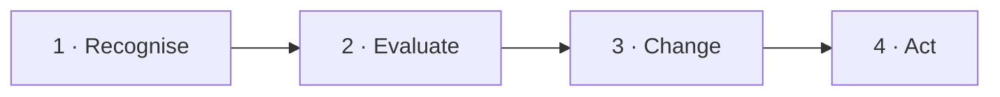

<!--
author:   Juliana Hilf; Hannes Tegelbeckers
email:    juliana.hilf@ovgu.de
version:  2.0.0
language: en
narrator: UK English Female
mode:     Presentation
comment:  GIZ Sustainability Onboarding, session 6_2, Competences for sustainable development and change agency. Self-paced and unmoderated. Licence CC BY-SA 4.0 [CHECK confirm with GIZ]

import:   https://raw.githubusercontent.com/LiaTemplates/mermaid_template/0.1.4/README.md
-->

# GIZ Sustainability Onboarding 6_2 – Competences for sustainable development and change agency

    --{{0}}--
Welcome to session six two. The route is clear, but Milica's teachers have an objection: green topics are not in our curriculum. If you can, turn the sound on.

**Subtopic of Session 6 · about 30 minutes · self-paced · no tutor**

> [!TIP] How this works
> Turn the sound on if you can; everything important is also on the page. Every quiz explains its answer, hints appear after a wrong try, and you can try again as often as you like. Your written notes are your personal learning journal – nobody grades them.

> [!IMPORTANT] Completing this session in Moodle
> You pass with at least 70 % of the quizzes correct **and** every survey and text box submitted. A few words are enough. Finish in one sitting if you can, because answers may be lost when you reload the page.

> [!NOTE] The case in this course
> Milica Stojanović, Stefan Ilić, Ravnica Technical School and its teachers are fictional. The facts around them are real, and the sources are on the last page.

## "Not in Our Curriculum"

    --{{0}}--
Milica shares the plan with her teachers. Their answer is not hostile, just tired. Green topics are not in our curriculum. And outside the school, young people are already taking action, like these students in Tartu.

<!-- style="max-width:100%;width:60%;display:block;margin:0 auto;" -->

Milica shares the green plan with her teachers (fictional). Their answer: *"Green topics are not in our curriculum."* Meanwhile, young people elsewhere are already acting, like these students in Tartu, Estonia. Sustainability is changing what schools and VET institutions are expected to do.

    --{{1}}--
Milica wonders whether more content is really the answer.

      {{1}}
> [!IMPORTANT] Guiding question
> Which competences do people need to act – and how can you become a change agent in your own role?

    --{{2}}--
What do you think?

      {{2}}
****************************************

**Predict:** Which statement about Education for Sustainable Development (ESD) is correct?

<!-- data-hint-button="1" data-solution-button="2" -->
- [(X)] ESD enables people to understand the impact of their own actions and to make responsible, sustainable choices.
- [( )] ESD is the same as environmental education.
- [( )] ESD transfers fixed knowledge that every learner must reproduce exactly.
[[?]] Think of what a learner should be able to do afterwards.
***
ESD grew out of environmental education in the 1990s, but it is broader. It is about understanding the impact of your own actions and making responsible choices. It is not rigid knowledge transfer.
***

****************************************

    --{{3}}--
So it is not enough to know about sustainability. You must be able to do something with that knowledge.

      {{3}}
> [!NOTE] What really happened
> It is not enough to *know* about sustainability. You must be able to *do* something with that knowledge: in a ministry, in a school development team, or in a school.

## Today's Path

    --{{0}}--
Here is today's path.

    --{{1}}--
After this session, you can do three things.

      {{1}}

<!-- data-type="none" -->
| Know | Can do | Value |
|------|--------|-------|
| The four ESD competence steps and the GreenComp areas and competences | Describe these key competences for sustainable development | Competence matters more than content alone |
| Occupation-specific green skills and cross-cutting competences | Explain the difference, and reflect on acting as a small-scale change agent in your role | You do not need a special title to act |

    --{{2}}--
A quick look at the path.

      {{2}}
****************************************

**Decide:** Which step comes directly before change agents?

<!-- data-hint-button="1" data-solution-button="2" -->
- [(X)] Green skills in VET
- [( )] Four steps
- [( )] GreenComp
[[?]] Follow the arrows from left to right.
***
First the skills, then the people who use them to change something.
***

****************************************

## Why Competences, Not Just Content?

    --{{0}}--
Stefan offers Milica an idea. ESD stands for Education for Sustainable Development. Modern education aims at competences instead of rigid knowledge transfer. Watch this video of about three minutes.

> [!TIP] Watch for
> 1. what ESD means, and how it differs from "just teaching about the environment"
> 2. what it asks of learners

!?[What is Education for Sustainable Development?](https://www.youtube.com/watch?v=YUFqamr78Xk "Deutsche UNESCO-Kommission – Learning to change the world! What is Education for Sustainable Development? (3:06)")

Text summary of the video

*"ESD enables all people to understand the impact of their own actions on the world and to make responsible, sustainable choices."* (UNESCO 2022)

**ESD** evolved from environmental education in the 1990s, after the Rio Conference. Its key idea: education has a central role for future developments.

A **competence** is the ability to act in variable situations. Four kinds are often named: professional, methodological, self- and social competence, plus cognitive and problem-solving skills.

    --{{1}}--
What does UNESCO say?

      {{1}}
****************************************

**Decide:** According to UNESCO (2022), ESD enables people to …

<!-- data-hint-button="1" data-solution-button="2" -->
- [( )] reproduce a fixed set of environmental facts
- [(X)] understand the impact of their own actions and make responsible, sustainable choices
- [( )] vote for sustainability policies in the European Parliament
[[?]] It is about understanding and choice.
***
UNESCO's definition is about understanding and choice, not about memorising facts or a specific political act.
***

****************************************

    --{{2}}--
One word.

      {{2}}
****************************************

**Type:** A … is the ability to act in variable situations. (one word)

<!-- data-hint-button="1" data-solution-button="2" -->
[[competence]]
[[?]] It is the title of this session.

****************************************

## Four Steps: From Recognising to Acting

    --{{0}}--
Research describes ESD competence development in four steps. They build on each other. Milica recognises herself in them.

    --{{1}}--
First, notice the problem.

      {{1}}
1. **Recognise:** Apply knowledge; recognise problems of unsustainable development. A ministry officer recognises that VET programmes are missing green skills.

    --{{2}}--
Second, draw conclusions.

      {{2}}
2. **Evaluate:** Draw conclusions from analyses of the present and studies of the future.

    --{{3}}--
Third, develop solutions.

      {{3}}
3. **Change:** Rethink human–nature relations; develop ways to solve problems. The officer changes the programmes.

    --{{4}}--
Fourth, implement decisions.

      {{4}}
4. **Act:** Make and implement decisions that realise sustainable development, for example by funding new training places (de Haan 2008; Brundiers et al. 2021).

## Put the Steps in Order

    --{{0}}--
Now you put the four steps in order. Drag each card into the right gap.

**Order:** Drag each card into the right gap.

<!-- data-randomize data-show-partial-solution data-solution-button="2" -->
Step 1: [->[ Recognise ]] → Step 2: [->[ Evaluate ]] → Step 3: [->[ Change ]] → Step 4: [->[ Act ]]

## GreenComp: Four Areas, Twelve Competences

    --{{0}}--
In 2022, the European Commission's Joint Research Centre published GreenComp, the European sustainability competence framework. It is a reference framework for all learners, of any age. It is licensed CC BY 4.0, so you may adapt it with credit.

**GreenComp** (European Commission JRC, 2022; CC BY 4.0) is a reference framework for all learners, of any age.

<!-- data-type="none" -->
| Area | Competences |
|---|---|
| **1. Embodying sustainability values** | valuing sustainability · supporting fairness · promoting nature |
| **2. Embracing complexity in sustainability** | systems thinking · critical thinking · problem framing |
| **3. Envisioning sustainable futures** | futures literacy · adaptability · exploratory thinking |
| **4. Acting for sustainability** | political agency · collective action · individual initiative |

Area 2 in one line: **systems thinking** is seeing how parts of a system are connected; **critical thinking** is questioning assumptions and evidence; **problem framing** is defining a problem clearly before solving it.

    --{{1}}--
Here is the key point.

      {{1}}
> [!NOTE] Key message
> The competences are **interrelated and non-hierarchical**: none is "higher" than another, and they work together.

    --{{2}}--
Check the number.

      {{2}}
****************************************

**Type:** How many competences does GreenComp describe in total? (number)

<!-- data-hint-button="1" data-solution-button="2" -->
[[12]]
[[?]] Four areas with three competences each.

***
12 competences in 4 areas. The framework was published in 2022 (Bianchi, Pisiotis & Cabrera Giraldez).
***

****************************************

## Introducing GreenComp

    --{{0}}--
In this video of about seven minutes, the JRC author introduces GreenComp. Watch for the four areas, and for why the competences are described as not hierarchical.

> [!TIP] Watch for
> 1. the four competence areas
> 2. why the competences are described as **not hierarchical**

!?[Introducing GreenComp: the European sustainability competence framework](https://www.youtube.com/watch?v=F6DGQXE8fD0 "Guia Bianchi (JRC) – Introducing GreenComp – the European sustainability competence framework (7:15)")

Text summary of the video

The video (Guia Bianchi, JRC, 7:15) introduces GreenComp: 4 competence areas with 12 interrelated, non-hierarchical competences, as a reference framework for all learners, of any age.

    --{{1}}--
How is it structured?

      {{1}}
****************************************

**Decide:** How is GreenComp structured?

<!-- data-hint-button="1" data-solution-button="2" -->
- [( )] 12 independent, hierarchical competences
- [(X)] 4 competence areas with 12 interrelated, non-hierarchical competences
- [( )] 4 competences, one for each pillar of sustainability
[[?]] Remember the table on the previous page.
***
GreenComp (JRC, 2022) has 4 competence areas with 12 interrelated, non-hierarchical competences. Because they are non-hierarchical, you group them; you do not rank them.
***

****************************************

    --{{2}}--
One more word.

      {{2}}
****************************************

**Type:** Read the area names as verbs: embody values, embrace complexity, envision futures, and … (one word)

<!-- data-hint-button="1" data-solution-button="2" -->
[[act]]
[[?]] It is the fourth area: "… for sustainability". The base form of the verb is enough.

****************************************

## Green Skills: Two Kinds

    --{{0}}--
In VET, green competences combine two kinds. Stefan points at the heat pump in the school's new workshop.

<!-- data-type="none" -->
| Criterion | Occupation-specific skills | Cross-cutting competences |
|-----------|---------------|---------------|
| What | what you do in a concrete job | what you can do in many jobs |
| Examples | installing heat pumps, handling refrigerants, working with high-voltage systems in electric vehicles | systems thinking, adaptability and the other GreenComp competences |
| Who needs them | people in that occupation | all learners, of any age |
| When you review a VET course, use | three lenses: **resource efficiency** (material, energy, water; reuse versus replacement; waste), **climate relevance** (emissions of the technology and work process), **occupational safety** (new hazards and protective measures) | the GreenComp competences as a reference |

    --{{1}}--
Here are two examples.

      {{1}}
- **Occupation-specific skills:** Handling refrigerants safely
- **Cross-cutting competences:** Seeing how a building's heating, electricity and insulation connect (systems thinking)

    --{{2}}--
There is a common error here.

      {{2}}
> [!WARNING] Common misconception
> "Systems thinking and adaptability are occupation-specific skills." They are cross-cutting. That is why they appear in GreenComp for all learners.

    --{{3}}--
Now you sort them.

      {{3}}
****************************************

**Decide:** Which concept does each statement describe?

<!-- data-hint-button="1" data-solution-button="2" data-show-partial-solution -->
[(Occupation-specific skills) (Cross-cutting competences)]
[       (X)             ( )      ] Installing heat pumps
[       ( )             (X)      ] Systems thinking
[       (X)             ( )      ] Handling refrigerants
[       ( )             (X)      ] Adaptability
[[?]] Does it belong to a concrete job, or does it work in many jobs?
***
Heat pumps and refrigerants are occupation-specific. Systems thinking and adaptability work in many occupations. Green competences combine both kinds.
***

****************************************

## You Can Be a Change Agent

    --{{0}}--
You do not need a special title to be a change agent. Milica thinks of one of her teachers, who has started a small project all on his own.

**What is a change agent, and where do change agents act?**

    --{{1}}--
First, the definition.

      {{1}}
- **Change agent (change maker):** a person who consciously or unconsciously exerts influence on sustainability-relevant changes in the world (Bellina et al. 2021; Brandt 2016)

    --{{2}}--
Second, three words for influence.

      {{2}}
- **Footprint:** the negative, passive effect. **Handprint:** the positive, active effect. **Brainprint:** education plus empowerment, the ability to think through problems and act on them

    --{{3}}--
Third, their fields.

      {{3}}
- **Fields:** leadership and management, education, culture and arts, activism, everyday decisions, political decision-making, economic and consumer decisions, universities, and **schools and TVET institutions**

    --{{4}}--
And fourth, a practical role: the sustainability officer.

      {{4}}
- **Sustainability officer for a TVET campus:** implements the strategy (measures, support, funding), networks stakeholders (initiatives, events, advice on applications and green-skills jobs), manages climate protection (energy and GHG balance) and develops an integrated ESD action plan

    --{{5}}--
And here are the take-home messages.

      {{5}}
> [!TIP] Why this matters
> Green empowerment and competences matter more than content alone. Be a change maker, and let colleagues and students become change makers. Network: a team is stronger than an individual.

    --{{6}}--
Which of these ideas did you already know?

      {{6}}
****************************************

**Mark:** Which of these do you already know? (several possible)

[[a1]] **Change agent (change maker):** a person who consciously or unconsciously exerts influence on sustainability-relevant changes in the world (Bellina et al. 2021; Brandt 2016)
[[a2]] **Footprint:** the negative, passive effect. **Handprint:** the positive, active effect. **Brainprint:** education plus empowerment, the ability to think through problems and act on them
[[a3]] **Fields:** leadership and management, education, culture and arts, activism, everyday decisions, political decision-making, economic and consumer decisions, universities, and **schools and TVET institutions**
[[a4]] **Sustainability officer for a TVET campus:** implements the strategy (measures, support, funding), networks stakeholders (initiatives, events, advice on applications and green-skills jobs), manages climate protection (energy and GHG balance) and develops an integrated ESD action plan

****************************************

## Example: The Green Art Incubator

    --{{0}}--
The GIZ project Teaching skills for green transformation works with the Ministry of Education to revise VET programmes to include green skills. And here is one example of what is already happening in Serbia.

> [!TIP] Watch for
> 1. what the project does
> 2. how young people turn green skills into action

!?[Green Skills Award 2023 Finalist: Serbia, The Green Art Incubator](https://www.youtube.com/watch?v=ZvukstUO9a0 "European Training Foundation – Green Skills Award 2023 Finalist: Serbia – The Green Art Incubator (1:26)")

Text summary of the video

"The Green Art Incubator" was a finalist of the ETF Green Skills Award 2023 from Serbia. [CHECK: Juliana – one sentence on what the project does, from the ETF page]

    --{{1}}--
Which statement is correct?

      {{1}}
****************************************

**Decide:** Which statement about "The Green Art Incubator" is correct?

<!-- data-hint-button="1" data-solution-button="2" -->
- [( )] It is a national ministry programme started in 2024.
- [(X)] It was a finalist of the ETF Green Skills Award 2023 from Serbia.
- [( )] It is one of the 12 GreenComp competences.
[[?]] Look at the caption of the video.
***
It was a finalist of the ETF Green Skills Award 2023 from Serbia. It is neither a ministry programme nor a GreenComp competence.
***

****************************************

    --{{2}}--
And the year.

      {{2}}
****************************************

**Type:** In which year was the project a finalist? (4 digits)

<!-- data-hint-button="1" data-solution-button="2" -->
[[2023]]
[[?]] It is in the caption.

****************************************

## First Step at Milica's School

    --{{0}}--
Now you help Milica. The same GreenComp competences fit all three roles in the VET system. Only the field of action changes.

Milica's teachers say: *"Green topics are not in our curriculum."* The same GreenComp competences fit all three roles. Only the field of action changes:

<!-- data-type="none" -->
| Figure | Value |
|--------|-------|
| Ministry officer | political agency: standards and funding |
| School developer | collective action: networks of schools, teacher training |
| Principal | individual initiative and collective action: school vision, sustainability officer |

## Your Learning Journal

    --{{0}}--
First, Milica's situation.

**1 · Answer:** You are the principal. Which GreenComp competence would you start with, and how would you make a first change in the school?

[[___ ___]]

✅ Model answer

A common first step is **problem framing** (area 2): instead of arguing about the curriculum, work with teachers to define what "green" should mean in your school: one concrete goal, one small pilot. A ministry perspective: check which standards already allow green content, and fund a teacher exchange. A school developer would connect you to a partner school that has already done it. Your answer is valid if it names one competence, one concrete first step, and one person or group you would involve.

    --{{1}}--
Now your own mix.

      {{1}}
****************************************

**2 · Answer:** Which two GreenComp competences are your strongest, and which one is your weakest? What role could you play as a change agent, based on that mix?

[[___ ___]]

✅ Model answer

Many **ministry officers** name **political agency** as a strength and **futures literacy** as a growth area. **School developers** often score high on **collective action** and may find **adaptability** challenging. **Principals** frequently name **individual initiative**, while **problem framing** can be hard when every request feels urgent. A useful role often pairs one strength with one growth area. There is no "correct" combination.

****************************************

    --{{2}}--
And finally, your network.

      {{2}}
****************************************

**3 · Answer:** Name one person in your network who already acts as a change agent for sustainability. What do they do, and what could you learn from them?

[[___ ___]]

✅ Model answer

A change agent in a school network is often a teacher who started a small project, for example an energy audit, and now advises other schools. A ministry officer's network may include a colleague who shares application templates. What you can learn is usually the practice of starting small, networking and making the work visible. If you cannot name a person yet, that is a useful signal: the next step is to find one, because a team is stronger than an individual.

****************************************

## Exit Ticket

    --{{0}}--
Three short questions, one per objective. You can repeat them as often as you like.

**🎟️ 1 · Change agents in VET** – A ministry officer is drafting a new occupational standard for "solar installer". Which GreenComp competence best fits this kind of work?

<!-- data-hint-button="1" data-solution-button="2" -->
- [(X)] Political agency
- [( )] Futures literacy
- [( )] Valuing sustainability
[[?]] Think about which field of action a ministry officer works in: standards and funding.

    --{{1}}--
Next, the sustainability officer.

      {{1}}
****************************************

**🎟️ 2 · Sustainability officer** – Which are tasks of a sustainability officer for a TVET campus?

<!-- data-hint-button="1" data-solution-button="2" -->
- [[X]] Network internal and external stakeholders
- [[ ]] Set the national education budget
- [[X]] Develop an integrated ESD action plan
[[?]] Setting the national education budget is a state-level task.

****************************************

    --{{2}}--
And one number.

      {{2}}
****************************************

**🎟️ 3 · GreenComp** – How many competence areas does GreenComp have? (number)

<!-- data-hint-button="1" data-solution-button="2" -->
[[4]]
[[?]] Values, complexity, futures, and acting.

****************************************

## What Milica Tells Her Teachers

    --{{0}}--
At the next staff meeting, Milica does not hand out a new curriculum. She asks one question instead. Here is what she knows now.

    --{{1}}--
First, competences.

      {{1}}
- ESD aims at **competences**, not rigid knowledge transfer: recognise, evaluate, change, act.

    --{{2}}--
Second, GreenComp.

      {{2}}
- **GreenComp**: 4 areas, 12 interrelated, non-hierarchical competences.

    --{{3}}--
Third, two kinds of skills.

      {{3}}
- Green skills combine occupation-specific skills and cross-cutting competences.

    --{{4}}--
Fourth, change agents.

      {{4}}
****************************************

- Anyone can be a **change agent**, and you do not need a special title.

> [!NOTE] Remember
> Start with one competence, one small step and one partner.

****************************************

    --{{5}}--
One last question.

      {{5}}
****************************************

**Recap:** Complete the term: education plus empowerment creates a …

<!-- data-hint-button="1" data-solution-button="2" -->
- [( )] footprint
- [( )] handprint
- [(X)] brainprint
[[?]] It is about thinking through problems and acting on them.
***
Education plus empowerment is called the brainprint: the dimension that can turn a negative footprint into a positive handprint.
***

****************************************

    --{{6}}--
Now it is time for the last step: think global, act local. In session six three, you write your own plan, with Milica's as your example.

      {{6}}
**➡️ Next:** Session 6_3, *Think global, act local*. Milica looks at her school's roof, and you start planning your own small green initiative.

## Sources and licences

    --{{0}}--
Here you find all sources and licences of this session. The case of Milica and Ravnica Technical School is fictional.

- Bianchi, G., Pisiotis, U. & Cabrera Giraldez, M. (2022): *GreenComp – The European sustainability competence framework*. JRC, Publications Office of the EU – CC BY 4.0 – https://publications.jrc.ec.europa.eu/repository/handle/JRC128040 – adapted
- Hilf, J. (2024): *Introduction to the Sustainability Approach*. GIZ training, Day 1 – adapted
- Hilf, J. (2025): *Models of Sustainability …*. GIZ workshop – adapted
- Hilf, J. (2026): *Green TVET – Concepts and practical approaches*. Expert input – adapted (three lenses)
- de Haan, G. (2008); Brundiers, K. et al. (2021): *Key competencies in sustainability in higher education*. Sustainability Science 16(1), 13–29; Bellina, L. et al. (2020/2021); Brandt (2016) – via Hilf – adapted
- UNESCO (2022): *Transforming TVET for successful and just transitions* – quoted
- Cedefop & UNESCO-UNEVOC (2025): *Meeting skill needs for the green transition* – https://www.cedefop.europa.eu/en/publications/4220 – linked only
- GIZ: *Teaching skills for green transformation* – https://www.giz.de/en/worldwide/123790.html – linked
- European Training Foundation: Green Skills Award 2023 – https://www.youtube.com/watch?v=ZvukstUO9a0 – embedded
- Video: Guia Bianchi (JRC): *Introducing GreenComp – the European sustainability competence framework* – https://www.youtube.com/watch?v=F6DGQXE8fD0 – embedded
- Video: Deutsche UNESCO-Kommission: *Learning to change the world! What is Education for Sustainable Development?* – https://www.youtube.com/watch?v=YUFqamr78Xk – embedded
- Image: Jim Barton – *Heat pump installation* – CC BY-SA 2.0 – https://commons.wikimedia.org/wiki/File:Heat_pump_installation_-_geograph.org.uk_-_7495844.jpg – unchanged
- Image: Ehitaja – *School strike for climate in Tartu* – CC BY-SA 4.0 – https://commons.wikimedia.org/wiki/File:School_strike_for_climate_in_Tartu,_Estonia,_on_March_15,_2019_04.jpg – unchanged
- Case: Milica Stojanović, Stefan Ilić, Ravnica Technical School and its teachers are fictional – created for this course
- This session: GIZ Sustainability Onboarding, GIZ / OVGU, 2026 – CC BY-SA 4.0 [CHECK: confirm with GIZ]
