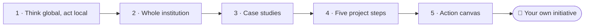
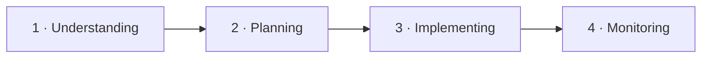

<!--
author:   Juliana Hilf; Hannes Tegelbeckers
email:    juliana.hilf@ovgu.de
version:  2.0.0
language: en
narrator: UK English Female
mode:     Presentation
comment:  GIZ Sustainability Onboarding, session 6_3, Think global, act local, case studies. Self-paced and unmoderated. Licence CC BY-SA 4.0 [CHECK confirm with GIZ]

import:   https://raw.githubusercontent.com/LiaTemplates/mermaid_template/0.1.4/README.md
-->

# GIZ Sustainability Onboarding 6_3 – Think global, act local – case studies

    --{{0}}--
Welcome to the last session of this course. Milica looks up at the roof of her school. Today, you stop reading about her plan and start writing your own. If you can, turn the sound on.

**Subtopic of Session 6 · about 40 minutes · self-paced · no tutor**

> [!TIP] How this works
> Turn the sound on if you can; everything important is also on the page. Every quiz explains its answer, hints appear after a wrong try, and you can try again as often as you like. Your written notes are your personal learning journal – nobody grades them.

> [!IMPORTANT] Completing this session in Moodle
> You pass with at least 70 % of the quizzes correct **and** every survey and text box submitted. A few words are enough. Finish in one sitting if you can, because answers may be lost when you reload the page. Write your action canvas in a separate document as well, so that you can keep it.

> [!NOTE] The case in this course
> Milica Stojanović, Stefan Ilić, Ravnica Technical School and its PV project are fictional. The facts around them are real, and the sources are on the last page.

## A Map and a Roof

    --{{0}}--
Stefan shows Milica this map, from the Global Solar Atlas. It shows the photovoltaic power potential across Serbia. Milica looks at the map, and then out of the window at the school's roof. Her electrical programme, she thinks. And a local company.

<!-- style="max-width:100%;width:60%;display:block;margin:0 auto;" -->
 – CC BY 4.0 – via Wikimedia Commons")

The Global Solar Atlas shows the **photovoltaic power potential across Serbia**. Stefan Ilić shows this map to Milica (both fictional). She looks at it, then out of the window at the roof of her school. *"Our electrical programme. A local company. A training system on our own roof?"*

    --{{1}}--
Some challenges are simply too big for one school. But Milica sees a way in.

      {{1}}
> [!IMPORTANT] Guiding question
> How can a global challenge become a small action, in your school, ministry or office?

    --{{2}}--
What do you think? You are explaining the idea to a group of principals.

      {{2}}
****************************************

**Predict:** Which statement about "think global, act local" is correct?

<!-- data-hint-button="1" data-solution-button="2" -->
- [(X)] Global frameworks give the direction, and action happens where people live and work.
- [( )] Global problems must be solved by global policies only; local actors should wait.
- [( )] Local solutions are copied into every country without any change.
[[?]] Look for the option that keeps both levels and says what each one does.
***
Global frameworks set the direction, and the action takes place locally: in a school, a company, a municipality. Waiting does nothing, and blindly copying ignores local conditions.
***

****************************************

    --{{3}}--
And that is where this course ends: with one small action of your own.

      {{3}}
> [!NOTE] What really happened
> The question is never "global *or* local". By the end of this session, you will have an **action canvas** for one small green initiative of your own.

## Today's Path

    --{{0}}--
Here is today's path, the last one of the course.

    --{{1}}--
After this session, you can do these things.

      {{1}}

<!-- data-type="none" -->
| Know | Can do | Value |
|------|--------|-------|
| The idea of "think global, act local", and how the SDGs link local action to global goals | Explain the idea, and analyse case studies: what is global, what is local, who acts, which SDGs | Starting small, and starting now |
| The **whole-institution approach** and its four steps | Describe it, and plan a small green initiative with the five micro-project steps | Working together with others |

    --{{2}}--
A quick look at the path.

      {{2}}
****************************************

**Decide:** What comes directly before your action canvas?

<!-- data-hint-button="1" data-solution-button="2" -->
- [(X)] Five project steps
- [( )] Case studies
- [( )] Whole institution
[[?]] Follow the arrows from left to right.
***
The five project steps give the structure, and the canvas is where you use them.
***

****************************************

## Think Global, Act Local

    --{{0}}--
Climate change, planetary boundaries and the SDGs are global problems. But the actions that solve them happen locally: in a school building, a workshop, a municipality, a company. The two levels need each other.

 – CC BY-SA 2.0 – via Wikimedia Commons")

Global challenges need action where people live and work. The two levels need each other:

- **Global frameworks give direction.** The SDGs and the Paris Agreement show *where* the world is heading. The SDGs are a good framework to link any greening strategy, project or syllabus with global goals.
- **Local action makes it real.** A green campus, a greened curriculum, a partnership with a local company: this is where change becomes visible and measurable.

    --{{1}}--
Here is the question to ask.

      {{1}}
> [!NOTE] Key message
> Which global goal does my local action serve – and which local action serves that goal?

    --{{2}}--
Now check it.

      {{2}}
****************************************

**Type:** Global frameworks give the direction. Where does the action happen: at global or local level? (one word)

<!-- data-hint-button="1" data-solution-button="2" -->
[[local]]
[[?]] It is in the name: think global, act …

***
Local: in a school, a company, a municipality. The SDGs then show why the local action matters globally.
***

****************************************

## The Whole-Institution Approach

    --{{0}}--
Milica knows that a solar system on the roof is not enough. Greening a VET institution is more than changing the curriculum. UNESCO-UNEVOC describes a whole-institution approach. Besides the curriculum, it includes four more things.

**What belongs to greening a whole institution, besides the curriculum?**

    --{{1}}--
First, how it is run.

      {{1}}
- **Integrated management and governance**

    --{{2}}--
Second, what it stands for.

      {{2}}
- **A sustainability ethos:** the shared values of the institution

    --{{3}}--
Third, who it works with.

      {{3}}
- **Community and stakeholder engagement**

    --{{4}}--
Fourth, how far it looks ahead, and how it checks progress.

      {{4}}
- **Long-term planning, with sustainability monitoring and evaluation**

    --{{5}}--
And who decides? Everyone, together.

      {{5}}
> [!TIP] Why this matters
> All stakeholders – **leadership, teachers, learners, administration** – jointly develop a vision and a plan. Networks of institutions enable peer-to-peer learning. Greening works *within* existing programmes: it does not demand replacing the entire curriculum.

    --{{6}}--
Which of these does your own institution already do?

      {{6}}
****************************************

**Mark:** Which of these do you already know? (several possible)

[[a1]] **Integrated management and governance**
[[a2]] **A sustainability ethos:** the shared values of the institution
[[a3]] **Community and stakeholder engagement**
[[a4]] **Long-term planning, with sustainability monitoring and evaluation**

****************************************

## Four Steps of Greening

    --{{0}}--
UNEVOC describes four steps. Milica applies them to her school. They form a cycle, not a one-off project.

    --{{1}}--
First, everyone understands the process.

      {{1}}
1. **Understanding:** Leadership, teachers, learners and administration understand the greening process. Only then can they jointly develop the plan.

    --{{2}}--
Second, there is a plan.

      {{2}}
2. **Planning:** An institutional greening plan with short-, medium- and long-term goals.

    --{{3}}--
Third, measures are put into practice.

      {{3}}
3. **Implementing:** In five action fields: **green campus** (energy, water, waste, buildings), **green curriculum**, **green community** (partnerships with companies and the municipality), **green culture** and **green research**.

    --{{4}}--
Fourth, progress is checked, and the plan is adjusted. After that, the cycle usually starts again.

      {{4}}
4. **Monitoring:** Monitoring and assessment: check progress and adjust the plan. After that, the cycle usually starts again. That is what makes it a long-term approach.

## Put the Steps in Order

    --{{0}}--
Now you put the four steps in order. Drag each card into the right gap.

**Order:** Drag each card into the right gap.

<!-- data-randomize data-show-partial-solution data-solution-button="2" -->
Step 1: [->[ Understanding ]] → Step 2: [->[ Planning ]] → Step 3: [->[ Implementing ]] → Step 4: [->[ Monitoring ]]

## Case A: The Green Art Incubator

    --{{0}}--
Now to real examples. For each case, keep the same four questions in mind. What is global? What is local? Who acts? And which SDGs are touched?

> [!TIP] Watch for
> 1. **what is local** about the project
> 2. **what is global** about the project

!?[Green Skills Award 2023 Finalist: Serbia, The Green Art Incubator](https://www.youtube.com/watch?v=ZvukstUO9a0 "European Training Foundation – Green Skills Award 2023 Finalist: Serbia – The Green Art Incubator (1:26)")

Text summary of the video

**Four questions for every case: what is global? What is local? Who acts? Which SDGs are touched?** This project from Serbia was a finalist of the ETF Green Skills Award 2023. [CHECK: Juliana – 2 sentences on the project from the ETF page]

    --{{1}}--
What does the framework do for a local project?

      {{1}}
****************************************

**Decide:** Why do the SDGs help in "think global, act local"?

<!-- data-hint-button="1" data-solution-button="2" -->
- [( )] They replace local planning entirely.
- [(X)] They are a framework to link any greening strategy, project or syllabus with global goals.
- [( )] They are only relevant for ministries, not for schools.
[[?]] Think about what the SDGs do for a *local* project.
***
The SDGs work as a linking framework, which shows why the local action matters globally. They do not replace local planning, and they apply at every level, including schools.
***

****************************************

    --{{2}}--
And one number.

      {{2}}
****************************************

**Type:** In which year was the project a finalist of the ETF Green Skills Award? (4 digits)

<!-- data-hint-button="1" data-solution-button="2" -->
[[2023]]
[[?]] It is in the caption of the video.

****************************************

## Cases B and C: A Person and a Roof

    --{{0}}--
Here are two more cases. One is about a person. The other one is Milica's roof.

 – CC BY 4.0")

**Case B – Sustainability officer for a TVET campus.** From training practice: this person works on a greening **strategy**, **networking** with other institutions, **climate-protection management** (energy and GHG balance) and an **ESD action plan**. One person, several action fields: the whole-institution approach in practice.

**Case C – Solar potential as a local opportunity (example idea).** From the local data on this map follows an idea: a VET school with an electrical programme installs a **training PV system on its roof together with a local company**. Green curriculum, green campus and green community in one project.

    --{{1}}--
Note the pattern.

      {{1}}
> [!NOTE] Key message
> One real project can touch several action fields at once.

    --{{2}}--
Check this.

      {{2}}
****************************************

**Type:** Which action field is defined by a partnership with a local company? Complete: "green …" (one word)

<!-- data-hint-button="1" data-solution-button="2" -->
[[community]]
[[?]] It is about partners, not about buildings or teaching content.

***
Green community. Measuring energy and water is green campus, and adding a learning outcome to a standard is green curriculum.
***

****************************************

## Case D: Learning from Each Other

    --{{0}}--
UNEVOC's Greening TVET initiative shows institutions learning from each other in networks. Watch what the video says about exchange between institutions.

> [!TIP] Watch for
> 1. **exchange between institutions**
> 2. what peer-to-peer learning can look like

!?[BILT: Greening TVET](https://www.youtube.com/watch?v=PXlDLAI3g20 "UNESCO-UNEVOC – BILT | Greening TVET (1:41)")

Text summary of the video

The video (UNESCO-UNEVOC, 1:41) shows the "Greening TVET" initiative: institutions learning from each other in networks. That is the peer-to-peer learning of the whole-institution approach.

    --{{1}}--
Who develops the vision?

      {{1}}
****************************************

**Decide:** In the whole-institution approach, who develops the vision and the plan?

<!-- data-hint-button="1" data-solution-button="2" -->
- [( )] The leadership alone
- [(X)] All stakeholders jointly: leadership, teachers, learners and administration
- [( )] An external consultant only
[[?]] It is a "whole-institution" approach, not a top-down one.
***
UNEVOC is explicit about this: all stakeholders jointly develop the vision and plan. A top-down plan usually fails, because the people who run the school daily are not part of it.
***

****************************************

    --{{2}}--
And the first step?

      {{2}}
****************************************

**Type:** According to UNEVOC, which step comes first? (one word)

<!-- data-hint-button="1" data-solution-button="2" -->
[[understanding]]
[[?]] Understanding, planning, implementing, monitoring.

****************************************

## From Idea to Action: Five Steps

    --{{0}}--
How do you turn an idea like Milica's roof into a real project? The micro-project method gives you five steps. Skipping an early step is the most common reason small green projects stall.

 – CC BY-SA 2.0")

1. **Profile:** name of your institution or department; field of work; core tasks.
2. **Assessment of the institution:** environmental and social practices; strengths, weaknesses, opportunities. Three **lenses** help: resource efficiency; climate relevance; occupational safety and health.
3. **Defining project outcomes:** aligned with the SDGs and sustainability.
4. **Assessing resources:** which are relevant, which do you have, which do you need?
5. **Project plan:** a small-scale green initiative based on the outcomes.

    --{{1}}--
Here is the pattern to notice.

      {{1}}
> [!NOTE] Key message
> Steps 1 and 2 look at yourself, step 3 at the goals, step 4 at what you have, and step 5 is doing.

    --{{2}}--
Check step three.

      {{2}}
****************************************

**Type:** Step 3 of the micro-project is defining project … that are aligned with the SDGs. (one word)

<!-- data-hint-button="1" data-solution-button="2" -->
[[outcomes]]
[[?]] It is the third item in the list.

***
Outcomes: the results the project should deliver. Step 5 is then built from these outcomes, not the other way round.
***

****************************************

## Action Canvas, Part 1

    --{{0}}--
Now you do it yourself. Milica's plan is on the left of your desk, and your own page is on the right. Three to five sentences are enough for each answer. Write them in a separate document too, so that you can keep them.

 – CC BY 4.0")

**Now you do it yourself.** First analyse one case, then begin your own canvas. 3–5 sentences per answer are enough, and you can use your journal entry from Session 6 as a seed. Keep a copy of your answers in a separate document.

The real anchors in Serbia:

<!-- data-type="none" -->
| Figure | Value |
|--------|-------|
| GIZ project *Teaching skills for green transformation* | January 2024 – December 2026, with the Ministry of Education: revises VET programmes to include green skills |
| Low Carbon Development Strategy | names green jobs in its 2050 vision |
| Roadmap for Circular Economy (2020) | invites industry, academia and civil society to act |

## Case Analysis and Your First Steps

    --{{0}}--
First, analyse one case with the four questions.

**1 · Answer:** Pick Case A or Case C. What is global? What is local? Who acts? Which SDGs are touched?

[[___ ___]]

✅ Model answer

**Case A (The Green Art Incubator):** *global*: the shared idea of green skills and the international award framework; *local*: the project works with people and institutions in Serbia; *actors*: the project team and its local partners; *SDGs*: quality education, decent work, local partnerships. **Case C (the PV idea):** *global*: the SDGs and the climate agenda; *local*: the school, its roof, its electrical programme, its company partner; *actors*: the school, the students, the company; *SDGs*: energy, education, work, local communities. A strong answer names one concrete local actor and one global goal, and connects them in one sentence.

    --{{1}}--
Now your own canvas, step one: your profile.

      {{1}}
****************************************

**2 · Answer:** **Step 1, Profile:** which institution or department would your small initiative belong to? What is its field of work, and what are its core tasks?

[[___ ___]]

✅ Model answer

Short and concrete: the name, what it does, and who it serves. **Ministry officer:** "the department for VET policy; core task is revising occupational standards". **School developer:** "curriculum support for about 20 VET schools". **Principal:** "a VET school with mechanical and electrical programmes". One or two sentences are enough.

****************************************

    --{{2}}--
Step two: take a look at your institution.

      {{2}}
****************************************

**3 · Answer:** **Step 2, Assessment:** what are the environmental and social practices of that institution today? Name one strength, one weakness and one opportunity.

[[___ ___]]

✅ Model answer

Use the three lenses: a *strength* could be "the workshop already reuses material" (resource efficiency); a *weakness* "energy use is not measured at all"; an *opportunity* "the electrical programme could teach PV systems" (climate relevance). One honest weakness is more useful than three vague strengths.

****************************************

## Action Canvas, Part 2

    --{{0}}--
Now the last three steps. Milica has written hers: a training PV system, a local company and one electrical class. Now it is your turn.

 – CC BY-SA 2.0")

**Milica's canvas so far (fictional):**

<!-- data-type="none" -->
| Figure | Value |
|--------|-------|
| Outcome | students can plan and maintain a PV system |
| Resources | has: a roof, an electrical teacher. Needs: equipment, a company partner |
| First step | one electrical class, one local company |

## Finish Your Canvas

    --{{0}}--
Step three: your outcomes.

**1 · Answer:** **Step 3, Outcomes:** what outcomes should your initiative deliver, and which SDGs do they align with?

[[___ ___]]

✅ Model answer

Formulate outcomes as results, not activities: not "install solar panels", but "students can plan and maintain a PV system" or "the school measures its energy use and reduces it". Then name the SDGs. For energy and climate topics, these are usually the goals about clean energy and climate action. If you cannot name an SDG, the outcome is probably too vague.

    --{{1}}--
Step four: your resources.

      {{1}}
****************************************

**2 · Answer:** **Step 4, Resources:** which resources are relevant for your outcomes? Which does your institution already have, and which does it need?

[[___ ___]]

✅ Model answer

Resources are more than money: people (a teacher, a caretaker, a company partner), knowledge, equipment, space and time. A useful pattern: "We **have** X and Y, we **need** Z, and Z can come from a local company partner or from a network with another school." Naming the gap now prevents the project from stalling in step 5.

****************************************

    --{{2}}--
Step five: your plan. This is the most important one.

      {{2}}
****************************************

**3 · Answer:** **Step 5, Project plan:** write your small-scale green initiative in 5–8 sentences: what, who, when, and how you will check it.

[[___ ___]]

✅ Model answer

Three worked examples (constructed):

- **Ministry officer:** "Within the revision of occupational standards for electricians, add one learning outcome on PV systems and energy efficiency (SDG 7, 13); test with two pilot schools; monitor with the school developers."
- **School developer:** "Set up a network of five VET schools that review one curriculum each with the three lenses; share results in a peer meeting each term."
- **Principal:** "Name a sustainability team (teacher, student, caretaker, company partner); measure electricity and water use for three months; choose one green-campus measure and one curriculum project."

All three have a concrete first step, named actors, and a way to check progress. As an entry point, the **GIZ project** suits daily work on programmes, the **Low Carbon Development Strategy** is the strongest argument upwards, and the **Roadmap for Circular Economy** is best for partnerships. Download the action canvas in Moodle, and mark it as done.

****************************************

## Exit Ticket

    --{{0}}--
Three short questions, the last ones in this course. You can repeat them as often as you like.

**🎟️ 1 · First step** – You are a principal and want to start the whole-institution approach. What comes **first**, according to UNEVOC?

<!-- data-hint-button="1" data-solution-button="2" -->
- [(X)] Getting all stakeholders to understand the greening process
- [( )] Writing the institutional greening plan
- [( )] Starting with the green-campus measures
[[?]] The steps are: understanding, planning, implementing, monitoring.

    --{{1}}--
Next, what belongs to the approach?

      {{1}}
****************************************

**🎟️ 2 · Whole institution** – Which statements belong to the whole-institution approach?

<!-- data-hint-button="1" data-solution-button="2" -->
- [[X]] Integrated management and governance
- [[ ]] Replacing the entire curriculum with a new one
- [[X]] Community and stakeholder engagement
[[?]] The approach includes the curriculum, but it does not demand a full replacement.

****************************************

    --{{2}}--
And one number.

      {{2}}
****************************************

**🎟️ 3 · Micro-project** – How many steps does the micro-project method have? (number)

<!-- data-hint-button="1" data-solution-button="2" -->
[[5]]
[[?]] Profile, assessment, outcomes, resources, plan.

****************************************

## Milica's Plan, and Yours

    --{{0}}--
This is the end of the course. A year ago, the word sustainable appeared nine times in a letter on Milica's desk. Today, she has a plan, a roof, a company partner and one class that begins in September.

    --{{1}}--
Here is the idea.

      {{1}}
- **Think global, act local:** global frameworks give the direction, and action happens where people live and work.

    --{{2}}--
Here is the frame.

      {{2}}
- **Whole institution:** all stakeholders jointly; understand, plan, implement, monitor.

    --{{3}}--
Here is the method.

      {{3}}
- **Five steps:** profile, assessment, outcomes, resources, project plan.

    --{{4}}--
And here is what remains.

      {{4}}
****************************************

- **Your action canvas:** a concrete first step, named actors, and a way to check progress.

> [!NOTE] Remember
> Network with others: a team is stronger than an individual.

****************************************

    --{{5}}--
One last question, the last one in the course.

      {{5}}
****************************************

**Recap:** Which of these is step 4 of the micro-project?

<!-- data-hint-button="1" data-solution-button="2" -->
- [( )] Defining project outcomes
- [( )] Writing the project plan
- [(X)] Assessing resources: which are relevant, which you have and which you need
[[?]] Outcomes come in step 3, and the plan in step 5.
***
Step 4 is assessing resources: people, knowledge, equipment, space, time and money.
***

****************************************

    --{{6}}--
Thank you for following Milica's story. Now it is your turn. Start small, start with someone, and start this week.

      {{6}}
**➡️ Next:** There is no next session. Your next step is the first line of your own action canvas. Start small, start with someone, and start this week.

## Sources and licences

    --{{0}}--
Here you find all sources and licences of this session. The case of Milica and Ravnica Technical School is fictional.

- UNESCO-UNEVOC (2017): *Greening Technical and Vocational Education and Training: A practical guide for institutions* – CC BY-SA 3.0 IGO – adapted
- Hilf, J. (2024): *Introduction to the Sustainability Approach*. GIZ training, Day 1 – adapted
- Hilf, J. (2024): *SDGs and Sustainable Economies*. GIZ training, Day 2 – adapted
- Hilf, J. (2024): *Micro Project*. GIZ training, Day 3 – adapted (action-planning steps)
- Hilf, J. (2026): *Green TVET – Concepts and practical approaches*. Expert input – adapted (three lenses)
- European Training Foundation: Green Skills Award 2023 – https://www.youtube.com/watch?v=ZvukstUO9a0 – embedded
- GIZ: *Teaching skills for green transformation* – https://www.giz.de/en/worldwide/123790.html – linked
- *Low Carbon Development Strategy Serbia 2023–2030* – https://unfccc.int/sites/default/files/resource/Low_Carbon_Development_Strategy_Serbia_2023-2030_with_2050_Projections.pdf – summarised
- UNDP Serbia: *Roadmap for Circular Economy in Serbia* – https://www.undp.org/serbia/publications/roadmap-circular-economy-serbia – linked
- Global Solar Atlas 2.0 (World Bank / ESMAP / Solargis) – https://globalsolaratlas.info – CC BY 4.0
- UNESCO-UNEVOC: BILT | Greening TVET – https://www.youtube.com/watch?v=PXlDLAI3g20 – embedded
- Solargis: *Serbia PVOUT photovoltaic power potential map* – CC BY 4.0 – https://commons.wikimedia.org/wiki/File:Serbia_PVOUT_Photovoltaic-power-potential-map_GlobalSolarAtlas_World-Bank-Esmap-Solargis.png – unchanged
- CoCreatr: *Solar installation technician on rooftop* – CC BY-SA 2.0 – https://commons.wikimedia.org/wiki/File:Solar_installation_technician_on_rooftop_(5392894792).jpg – unchanged
- Case: Milica Stojanović, Stefan Ilić, Ravnica Technical School and its PV project are fictional – created for this course
- [CHECK: Juliana – origin of the phrase "think global, act local", if wanted]
- This session: GIZ Sustainability Onboarding, GIZ / OVGU, 2026 – CC BY-SA 4.0 [CHECK: confirm with GIZ]
